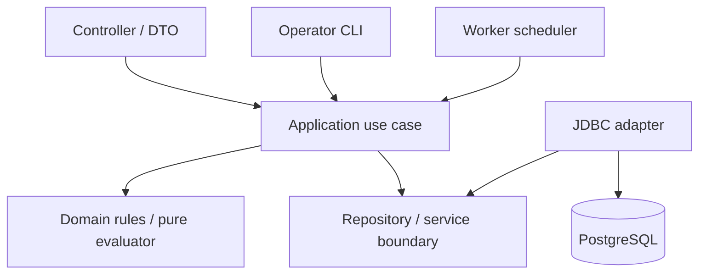

> HISTORICAL BASELINE: superseded by [microservices review](microservices-review.md) for service topology and source layout. Do not implement this as the current architecture.

# Architecture source code — Backend

30/09/2026 · [Mục lục architecture](README.md). **Toàn bộ cây Java bên dưới là dự kiến.** `backend/` hiện chỉ có README; chưa có API, DB hay Maven build. Baseline stack/version nằm ở [D08](../delivery/history/implementation-v2.md), tránh giữ hai danh sách dependency độc lập.

## 1. Một ứng dụng, package theo nghiệp vụ

```text
backend/
  pom.xml / mvnw / mvnw.cmd / .mvn/wrapper/
  src/main/java/lab/backend/
    BackendLabApplication.java
    configuration/           composition, Security/DB/worker wiring
    shared/                  lỗi chuẩn, clock/ID abstraction khi cần
    identity/
    catalog/
    work/
    assessment/
    progress/
    transfer/
    maintenance/
  src/main/resources/
    application.yml          config không secret
    db/migration/            Flyway, gồm schema Spring Session quản lý version
  src/test/java/lab/backend/ unit/DB/API theo package nghiệp vụ
  src/test/resources/        fixtures và cấu hình test cô lập
```

Một Maven app, một process với worker DB. Không có module Maven/service/network riêng cho mỗi package. Tên class là hướng dẫn trách nhiệm, task có thể chọn tên rõ hơn khi triển khai; không scaffold mọi tầng nếu chỉ là wrapper không có ý nghĩa.

## 2. Bên trong một module

```text
work/
  api/                       controller và DTO public input/output
  application/               OpenAttempt, SaveDraft, SubmitAttempt; transaction owner
  domain/                    draft/submission rules, value types, invariant
  infrastructure/            JDBC repositories và adapter DB
```

`api → application → domain`; infrastructure hiện thực repository/port cần thiết của application. Configuration lắp implementation. Domain không phụ thuộc controller, servlet/session hay SQL. Application không biết React. Không trả row/entity JDBC trực tiếp làm API DTO.



Mũi tên JDBC→Port thể hiện thực hiện contract, không là luồng query. Transaction của use case bao toàn bộ thay đổi cần atomic; repository không tự commit từng insert. Chỉ thêm abstraction khi có contract/test boundary thật, không tạo generic base repository cho mọi table.

## 3. Trách nhiệm module

| Package | Sở hữu | API/boundary cung cấp |
|---|---|---|
| identity | user/credential/session guards/token/throttle | Principal, kiểm quyền/guard, login/logout/credential flows |
| catalog | TOP/CAP/version/placement/prerequisite/publication | Public catalog, pinned case contract, publication impact |
| work | attempt/draft/support/submission/receipt | Mở/lưu/hint/nộp; T1 và snapshot immutable |
| assessment | evaluator/job/result | Chấm pure, job lease/fencing; điều phối T2 |
| progress | evidence/viewed/projection/history/guidance | Áp kết quả trong transaction T2, read/rebuild |
| transfer | staging/imported records/export | Validate/preview/merge và snapshot theo owner |
| maintenance | publish CLI, tài khoản operator, suppression/cleanup/restore tooling | Gọi application service đúng quyền, không public admin API |

Không truy cập repository nội bộ của module khác từ controller. Dùng application boundary; orchestration T2 gọi progress để ghi evidence/projection trong **cùng transaction**, không dùng eventual event để báo pass trước. Circular runtime workflow không yêu cầu circular Java imports: DTO/port hẹp do consumer sở hữu hoặc contract dùng chung có mục đích, composition root lắp adapter.

Identity không nhập learner-work để revoke; account guard cung cấp cơ chế đồng bộ. Catalog publish khóa publication, không quét khóa account. Shared chỉ giữ primitive kỹ thuật thật sự chung, không gom nghiệp vụ thành “CommonService”.

## 4. Transaction và quyền phải nhìn thấy trong code

Use case mutation: validate shape/quota → authenticate → transaction READ COMMITTED → lock account_guard → kiểm session/context/owner/epoch → publication khi cần → revision/receipt/resource → ghi → commit. Query cá nhân cũng enforce active identity/owner và current epoch; không tin userId từ body.

- T1 `SubmitAttempt`: save/freeze snapshot + submission + job + receipt atomic. Unique attempt chặn nộp trùng.
- Job claim lease ở transaction ngắn rồi thả lock. Evaluator tính ngoài transaction từ snapshot immutable.
- T2 `FinalizeGrade`: lock account→publication→job, kiểm epoch/fencing rồi ghi result/evidence/projection/job complete atomic. Logout/disable không hủy bài đã nhận; reset/deletion chặn hồi sinh.
- JDBC query có owner predicate; learner FK composite owner+epoch; catalogue version FK RESTRICT. Exposure/receipts xuyên epoch.
- Hash password và gọi storage ngoài không nằm trong lock dài. Login tính hash rồi kiểm credential version/status dưới guard trước cấp session.
- Reset journal qua outbox hai bước, final commit sau verify durable; chi tiết LLD-06/S03. Không dùng annotation transaction để giả atomic DB và object storage.

## 5. Contract, configuration và dependency

OpenAPI/JSON schema/fixtures ở root `contracts/`; mỗi task chịu endpoint/DTO/test của mình. Public answer input khác private rubric/case expected. Content publisher nhận bundle repo đã validate, DB là nguồn published. Không đọc file authoring tùy đường dẫn do learner gửi.

Boot parent/BOM kiểm version starter/JDBC; Flyway forward migrations, app role không DDL. Spring Security/Spring Session JDBC cùng guards app; JDBC thay JPA theo ADR-01. Không Redis/broker/runner/AI grader. Provider deployment, image digest/corpus password được pin trong task sở hữu, không giả đã chọn từ source tree.

## 6. Test và từng bước tạo source

| Lớp | Evidence cần có |
|---|---|
| Domain/evaluator | Fixture đúng/sai/biên độc lập từ D06, không snapshot implementation |
| JDBC/integration | PostgreSQL thật, constraints/owner/CAS/rollback; barrier/latch cho race |
| Application/API | Auth/CSRF/quotas/error/receipt và contract public/private |
| Worker/recovery | Crash/lease/fencing, T2/publish/reset race, restore journal/dedupe |
| Full stack | Browser gọi API/DB, login→draft→submit→result và A/B |

R01 tạo bootstrap/wrapper/test, R02 DB harness/schema nền, R03/04 identity, R05–07 catalog, R08–13 work/assessment/progress; R25–29 transfer/maintenance. R31/32 vận hành và restore. Các task chỉ thêm source trong scope; README backend cập nhật lệnh chạy thật khi có build. R00 không cài Java/DB hay tạo service rỗng.

Nguồn: [S02](../features/f10-identity-access/business.md), [S03](../features/f11-learner-work/data-contract.md), [D08](../delivery/history/implementation-v2.md), [quality](../quality-process.md), [backlog](../delivery-backlog.md).
