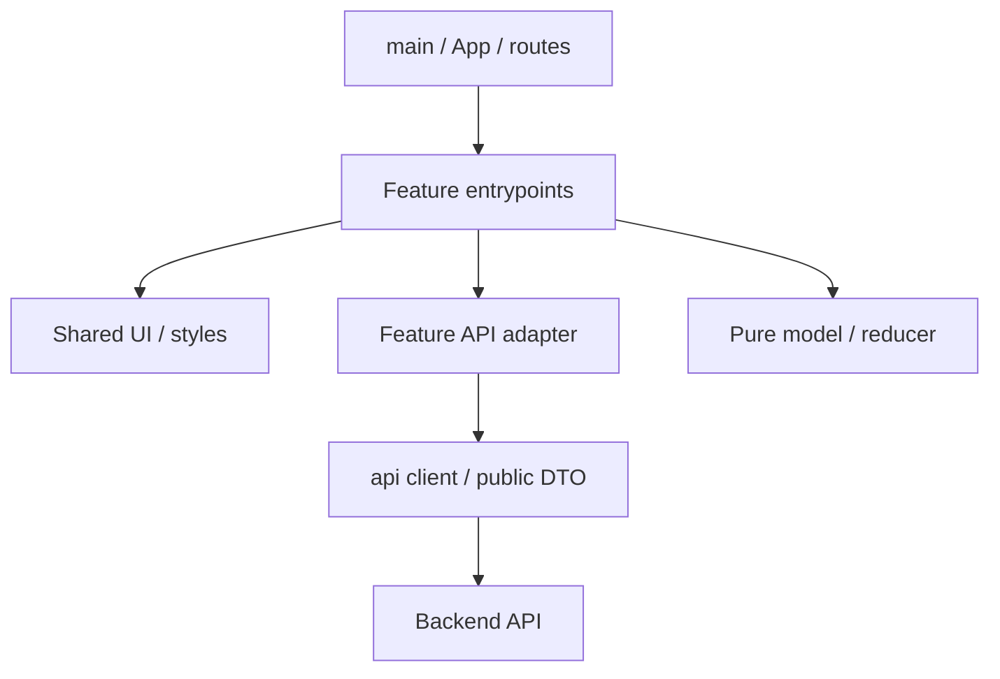

# Architecture source code — Frontend

30/09/2026 · R00 cấu trúc repo. [Mục lục architecture](README.md) · [LLD trải nghiệm](../features/f02-learning-experience/lld.md).

## 1. Source thực tế sau di chuyển

```text
frontend/
  package.json / package-lock.json
  .npmrc / .nvmrc / .node-version
  index.html / public/
  vite.config.ts / tsconfig.json / eslint.config.js / playwright.config.ts
  scripts/check-runtime.mjs / validate-content.ts
  src/
    main.tsx / App.tsx / routes.ts
    components/              AppShell, PageHeading, PreparationPanel
    i18n/                    LocaleProvider, store, Pair và validator locale
    pages/                   Home, Journey, Learning, NotFound
    data/journey.ts          outline hiện có
    content/                 schema1/validator/catalog/API500 draft
    styles/
  tests/                     content-schema và Playwright specs
```

R00 giữ cách tổ chức nội bộ và hành vi hiện có; các mục bên dưới là cấu trúc đích áp dụng dần theo task, không phải một đợt viết lại UI. Config/import tương đối vẫn trong package; helper root chuyển cwd sang frontend. Artifact build là `frontend/dist`, không còn root `dist`.

## 2. Cấu trúc đích khi thực hiện R14–24

```text
frontend/src/
  main.tsx                   mount React
  App.tsx / routes.ts        composition và route tree duy nhất
  components/                shell/UI dùng chung, không logic chấm
  styles/                    tokens, layout, responsive
  api/
    client.ts                fetch cùng origin, CSRF/context, lỗi chuẩn
    types.ts                 public DTO theo contract, không table/private rubric
  features/
    identity/                session provider, credential screens, authGeneration
    journey/                 catalog adapter, branch/placement, URL state
    topic/                   mục học, refresh cards, CAP overview
    learning/                unit renderer, vị trí học và viewed event
    collections/             reducer/state/view của mô hình, bounded inputs
    practice/                bài luyện, hints và phản hồi có nhãn
    assessment/              draft editor/CAS/autosave, submit/result
    progress/                history, ba chiều, guidance/readiness display
    projects/                CL-U-01 form/result trong phạm vi R1
    learning-data/           export/import-preview/reset workflows
  content/                   legacy v1 còn giữ đến khi có task retire
```

Mỗi feature chỉ thêm `components/`, `hooks/`, `model/`, `api.ts`, `index.ts` khi có nhu cầu thật; không bắt mọi feature đủ thư mục rỗng. `pages/` hiện có được thích nghi hoặc chuyển dần vào feature ở task sở hữu, không duy trì hai route tree/engine song song.

## 3. Dependency và ownership



| Thành phần | Được làm | Không được làm |
|---|---|---|
| App/routes | Lắp provider và entrypoint | Chấm bài, ghi evidence |
| Shared UI | Render props, phát callback | Import feature, gọi API nghiệp vụ |
| Locale provider | Whitelist `vi|en`, persist display preference, chọn Pair và cập nhật document language | Lưu answer/progress, tạo content ID theo language |
| Feature adapter | Map public DTO→view model, xử lý error code | Import private authoring hoặc đoán owner |
| Session provider | Identity/context, cache lifecycle | Giả server đã revoke khi offline |
| Model reducer | Chuyển state xác định từ input/action | Network/storage, tự ghi mastery |
| Progress view | Hiển thị server result/provenance | Tự cộng điểm từ Next hoặc hint |

Feature không deep-import private implementation feature khác; dùng public entrypoint hoặc phối hợp qua App/callback. Không thêm query/state library mặc định. Shared module không import ngược feature; logic chuyên Collections ở feature Collections, không đẩy vào thư mục utils chung.

## 4. Dòng dữ liệu và trạng thái

Catalog/outline public cache theo publicationRevision; body cần login không dùng public cache key. Dữ liệu cá nhân RAM theo owner/context. Unit và case ghim version. `api/client` gửi cookie/CSRF/context và map lỗi chuẩn; session đổi làm abort/discard response cũ. API không tự replay POST sau401/403.

Draft form giữ answer mới nhất tách lastSavedSnapshot/revision. Autosave debounce500ms, một request in-flight; ACK chỉ xác nhận snapshot tương ứng. Conflict hiển thị lựa chọn, không ghi đè RAM. Submit chờ save, dùng idempotency key; timeout tra receipt trước gửi lại. Response của owner cũ không được render vào user mới.

Form assessment không có private expected hay “chấm chính thức” trong browser. Public practice model có feedback xem trước được; kết quả chính thức lấy từ backend. HashSet/Map ordering của mô hình tuân theo D06, không giả JVM/performance.

## 5. Routes, assets và bảo mật nội dung

Routes canonical theo D08; deep links/Back lấy ID từ URL, state cá nhân từ API. Alias stage-index cũ được resolve explicit; `api-debug-500` vẫn legacy draft, không suy TOP/CAP. Shared package Collections chỉ điều hướng, không mastery riêng.

`frontend/public` chỉ asset public. `content-v2` authoring ngoài frontend, private rubric không import trực tiếp/gián tiếp vào bundle/sourcemap. Việc tách thư mục không tự chứng minh đáp án không lộ; R07/R30 phải kiểm payload/artifact. FE không giữ secret deployment hoặc session credential trong localStorage.

## 6. Kiểm tra và thứ tự thích nghi

Hiện có test trong `frontend/tests`; giữ các case sau di chuyển. Khi thêm feature, pure reducer/grader-preview được kiểm bằng expected độc lập, adapter kiểm DTO/error, Playwright kiểm hành trình đã tích hợp với backend. Không dùng mock để chứng minh quyền server.

| Task | Thay đổi source dự kiến |
|---|---|
| R00 | Chỉ chuyển package, config/helper/path và tài liệu |
| R14/15 | Journey/topic lấy public catalog, stable IDs |
| R24 | Session/client/credential UI trước flow cá nhân |
| R16–20 | Player/model/practice/draft/submit/result |
| R21–23/25–29 | History/progress/apply/data workflows |

Kiểm tra runtime, content, TypeScript/lint, production build, keyboard/mobile/Back/error theo quality-process. Không tạo lint rule/test import graph trong R00 khi chưa có feature tree; khi thêm boundary thực phải review dependency theo bảng trên. Evidence thực thi nằm ở checkpoint task, không coi cây dự kiến là code đã có.

## 7. Adapter theo service — BL-MS01

[Service catalog/API boundaries](service-boundaries.md) là nguồn owner/contract: identity → Identity API-I01–09; journey/topic → Content API-C01–03 + Learning progress/readiness; work/practice/assessment/projects/progress/learning-data → Learning API-L01–16. `api/client` gọi cùng origin qua edge; không biết DB/service credential hay gọi `/internal`/maintenance. Owner/graderVersion/pass không lấy từ input client.

Outline anonymous; unit body cần login. Hint/case/solution đi qua assigned attempt/support API Learning để ghi exposure trước disclose; Content không có public endpoint trả private rubric/expected. FE adapter chỉ consume public schemas ở `contracts/http/{identity,content,learning}/` khi các task triển khai tạo chúng, không import Java class hay private authoring.

FE ghép stable TOP/CAP/placement với server progress; [publication MS03](../features/f08-content/publication/protocol.md) trả canonical/applied revisions, sync pending và response as-of. Không render stale progress như current mastery; response cũ incompatible bị bỏ/refetch. Attempt/case/support có `preparing` chờ exposure journal, không prompt/hint giả trước ACK; readonly history khác current progress bị fence. Reset dùng receipt pending→completed; restore có system maintenance và account RECOVERY_REQUIRED. [Lifecycle/recovery](lifecycle-recovery-protocol.md) giữ các state này, không thêm admin UI R1.

Một TOP/CAP shared có một progress. [Session MS02](../features/f10-identity-access/sessions/protocol.md) giữ context/CSRF/reauth/status/no-store: unavailable không anonymous, logout pending khóa UI, proof RAM/password Identity. authGeneration không ngăn Set-Cookie trễ nên logout/status không clear cookie; test đa tab/preauth/login/context. MS04 [backlog v3](../delivery-backlog.md) thay dependency bảng §6: R24a client/R24b forms/R24c revoke; R16a/b player/viewed, R21/22/23 API+UI child; R24c trước private flows. [Test-release](../delivery/test-release-plan.md) giữ backend-linked E2E/UX/privacy/REL gates, không FE smoke thay quyền server. Chưa CODE.

[D14 review](readiness-review.md): R31a edge/TLS/base CMD-07 là dependency của R14 và R24a, không đợi pilot mới tạo môi trường. `api/client` theo catalog §4.1: counter bigint string exact, error/pending/state/version xử lý explicit, no implicit mutation replay sau đổi owner/401; cursor không là quyền. R15/R20 có slice demo review sớm và finding owner; không thay R34 learner acceptance hoặc tự claim full Collections/feedback người dùng.
