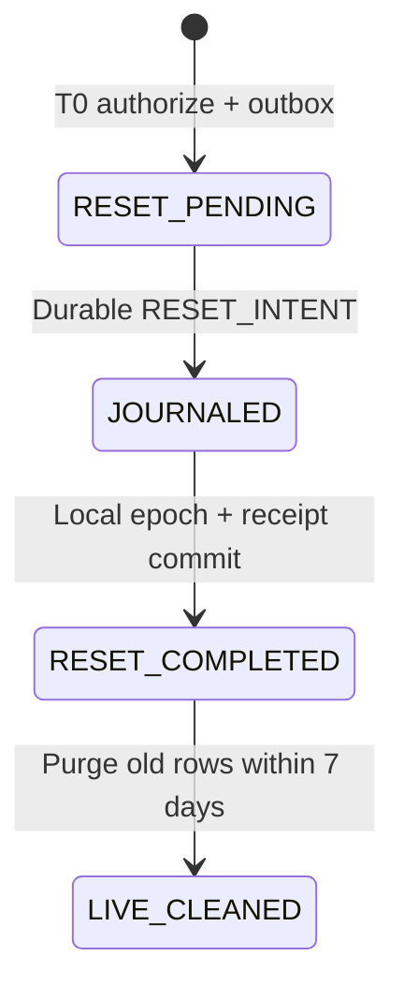

# Lifecycle và recovery — ba DB + journal

BL-MS03 · 30/09/2026 · LLD thiết kế, chưa runtime/storage provider. [Data protocols](data-protocols.md) giữ invariant/wire/failure cases; [session](../features/f10-identity-access/sessions/protocol.md) giữ auth barriers, [publication](../features/f08-content/publication/protocol.md) giữ content gates. Thay reset/delete/restore một-DB ở D08 và S03; không biến learner export thành server backup.

MS04 [implementation plan](../delivery/implementation-plan.md) chọn S3 API adapter/record-index-head CAS+qualification cho off-host, lab filesystem riêng; [test-release](../delivery/test-release-plan.md) gắn R28a/b/R29a–c/R32a/b và DATA cases. Provider endpoint/key/retention actual evidence chưa có, chưa tạo bucket/SDK/backend/schedule; protocol dưới vẫn giữ invariant trước disclosure/reset/deletion/recovery.

## 1. Journal ngoài snapshot

Journal là infrastructure storage port của Identity/Learning, không thêm service nghiệp vụ. Record immutable/create-if-absent theo ID, exact stored bytes + SHA-256 digest, durable write/read-back receipt trước final effect hoặc disclosure. Business pending + outbox ghi DB trước; gọi journal ngoài transaction/locks rồi local final commit. Duplicate cùng ID/bytes trả receipt; khác bytes conflict. Timeout không là durable ACK. Không ghi password/cookie/proof/answer/submission body vào journal.

| Record | Producer / nội dung tối thiểu | Recovery dominance |
|---|---|---|
| JRN-01 EXPOSURE_FLOOR | Learning: user UUID, family/exposureGroup/version, encounter/support level/solution flag, operation/attempt ref | Merge max/union monotonic; case đã biết không clean lại |
| JRN-02 RESET_INTENT | Learning: UUID, operation/key fingerprint, old/next learningEpoch, frozen dataRevision, intent digest | Hoàn tất intent; floor chặn old work/jobs, giữ exposure |
| JRN-03 DELETE_INTENT | Identity: UUID, lifecycleVersion, terminal suppression/credentialEpoch floor, operation/digest | Terminal delete thắng reset/exposure/enable và stale replay |
| JRN-04 ACCOUNT_STATE | Identity: UUID, ordered lifecycleVersion, disabled/enabled trạng thái và credential floor, operation/digest | Latest version thắng; enable không vượt terminal deletion |

Mỗi producer journal namespace có append/index sequence và inventory digest; storage port phải cung cấp durable acknowledged record + index và consistent inventory checkpoint, CAS/serialization cho concurrent writers. Partial record/index write không là ACK, retry phải hội tụ; provider không chứng minh được contract này thì không dùng cho official assessment/reset. Recovery manifest chứng minh prefix/watermark đầy đủ, kể cả record sau snapshot. Không lấy “list rỗng” hoặc timestamp mới nhất làm bằng chứng không có reset/delete/exposure. Counter mỗi loại có domain riêng; không so reset sequence với lifecycleVersion. Operator phải có inventory/checksum/key và quyền đọc journal hiện hành; missing/corrupt prefix fail closed.

Production journal phải ngoài vùng rollback snapshot DB, storage riêng và quyền tối thiểu: runtime append/read-back namespace của nó, không global delete; recovery operator đọc/verify; retention/purge quyền riêng có audit. Local dev có thể dùng adapter thư mục biệt lập để test, không chứng minh off-host production durability. Provider, encryption/key handling, atomic durable write semantics và commands phải chốt/test MS04 trước pilot; app không tự giả filesystem flush = disaster safety.

Backup encrypted giữ 30 ngày; cleanup live work tối đa 7 ngày sau logical reset/delete. Journal/receipt/cursor retention ít nhất toàn backup inventory + replay window + 7 ngày grace; backup ngoại lệ còn thì kéo dài tương ứng. UUID terminal tombstone tối thiểu không tái sử dụng để chặn old replay. Exposure riêng của account đã xóa được purge theo window khi suppression đủ; không coi metadata tối thiểu/tồn tại backup là “đã xóa mọi byte ngay”.

Active account exposure floors không được GC chỉ vì record đã quá 30 ngày. Có thể compact event records thành immutable durable floor checkpoint ngoài DB snapshots với covered-prefix inventory/digest, giữ max/union và pending allocations; verify checkpoint trước xóa prefix đã covered. Reset không xóa floor checkpoint. Deleted account chỉ purge exposure theo terminal suppression + toàn backup/replay inventory, tombstone tối thiểu vẫn chặn UUID hồi sinh.

## 2. Exposure phải durable trước tiết lộ

Chỉ DB exposure không đủ: restore snapshot trước lúc người học xem case/lời giải sẽ làm case quen trở lại clean. R1 thêm durable external exposure floor **trước mọi disclosure ảnh hưởng assessment**: prompt case mới, hint/solution và feedback chứa đáp án/family mới. Content chỉ trả public lesson/examples tách khỏi assessment families; case/expected/hints/solutions riêng phải qua Learning. Ví dụ public trùng assessment phải được phân loại known/practice, không âm thầm clean.

1. Admission/reauth nếu cần thực hiện ngoài local transaction. Learning dưới auth_account_gate → learner_guard → publication gate kiểm owner/context/epoch/policy, chọn case và reserve allocation; ghi pending exposure + outbox. Case clean tại assignment áp cho đúng attempt đầu đó; encounter làm family known cho attempt tương lai, không tự hủy tính độc lập của attempt vừa được cấp. Một guard ngăn hai clean assignments đồng thời.
2. API-L01 có thể nhận attempt ID ở `preparing`; chưa trả private prompt cho tới journal ACK. API-L02/status chỉ trả state cho đúng owner/context. T1 không accept submission của attempt preparing/thiếu allocation exposure receipt; browser đoán attempt/case không bypass journal. Support request tương tự ghi monotonic marker trước, chưa disclose. Giá trị prompt/answer không nằm trong status/journal/log.
3. Append JRN-01 ngoài locks, verify durable receipt. Journal lỗi: pending/unavailable, không tiết lộ; marker có thể conservative dirty dù chưa gửi bytes. Crash sau journal trước disclosure vẫn dirty, an toàn hơn tái dùng case đã có thể thấy.
4. Trước response chứa disclosure, admission phải còn valid; nếu đã hết hạn thì lấy admission mới ngoài transaction. Local final transaction kiểm lại caller/context/session gate, learningEpoch/reset/deleted status, publication policy và journal receipt; commit disclosure-ready state/support marker. Response mang context/epoch/revision. Revoke/reset/fence sau snapshot tuân linearization các gate; không cam kết thu hồi bytes đã gửi trước đó.

Không dùng async worker để tự gửi prompt vào browser; worker chỉ chuẩn bị durable state. Browser poll/read luôn được auth lại và kiểm gate. Solution exposure làm open attempt supported trước khi trả; closed submission/result support snapshot bất biến, disclosure sau kết quả chỉ tăng knowledge floor cho lần sau. Clean pool exhaustion không sinh lại family vì reset/reload/restore. Import ghi known exposure theo D05, không official evidence; nếu import introduces knowledge floor thì journal ACK trước import final commit, pending lỗi không overwrite dữ liệu tốt.

Recovery merge JRN-01 max/union kể cả attempt local chưa tồn tại trong snapshot. Deleted user bị suppress trước, không dựng lại exposure/profile của user đó. Reset giữ toàn exposure. Không đủ journal để xác định clean thì giữ assessment denied; không cấp independent pass từ dữ liệu mơ hồ. DATA-18/22/23/25/28 chứng minh các boundary này khi code.

## 3. Reset dữ liệu học — Learning coordinator

Reset toàn dữ liệu học của account, không reset theo roadmap; giữ account, canonical content/private bundle và exposure. Reset mô phỏng chỉ đổi simulation input/state, không đi protocol này. Browser reauth proof scope operation/intent theo MS02, dùng receipt key để timeout/retry không reset phần học mới.

| Phase | Transaction / kết quả |
|---|---|
| T0 authorize | Reserve proof/admission ngoài lock. Auth gate + learner_guard kiểm owner/key fingerprint/current epoch/frozen revision; ghi RESET_PENDING, old/next epoch, intent/outbox. Mutation/job finalize dừng, dữ liệu tốt chưa bị xóa |
| Journal | Worker append/verify JRN-02 ngoài DB locks. Mất ACK retry cùng intent; lỗi giữ pending. Không complete từ riêng outbox existence |
| Final local commit | learner_guard kiểm đúng operation/old epoch/pending; tăng learningEpoch, hide old work/submission/progress/viewed/import previews, supersede old jobs; dataRevision tăng, receipt COMPLETED và clear pending cùng commit |
| Cleanup | Purge old epoch rows có giới hạn, idempotent; progress/current reads chỉ new epoch ngay sau final, không chờ physical purge |

Receipt final là điểm thành công reset. Worker được tiếp tục intent đã authorize dù browser logout; không đòi session còn sống để hoàn tất, như accepted grading job. Reset/deletion pending được worker T2 kiểm dưới learner_guard; stale autosave/import/T2/leases không resurrect old rows. Key cũ tra receipt của intent cũ, không áp lên epoch mới sau người dùng học lại. Reauth/key conflict trả đúng conflict, không tạo reset khác.

Journal intent durable nhưng DB final chưa commit rồi restore: hoàn tất intent theo old/next floor, tạo minimal recovered receipt cùng operation/key digest; không trả old state như chưa reset. Nếu snapshot có pending chưa journaled, recovery verify intent rồi append/resume, hoặc quarantine khi thiếu proof/state; không bỏ pending để mở traffic. Delete terminal thắng reset đang pending. Giữ exposure floor riêng khi cleanup reset.

## 4. Account deletion — Identity coordinator, operator sau R1 UI

Thiết kế maintenance operation, không admin/learner delete API mới. Identity giữ state/status; cả Content và Learning phải nhận suppression dù user chưa có dữ liệu ở service đó. Chỉ `LOGICALLY_DELETED` sau tất cả durable suppression ACK đúng generation; `LIVE_PURGED` là scope live stores, backup expiry được báo riêng.

| State | Điều kiện/commit và failure |
|---|---|
| LIFE-01 REQUESTED | Operator authorized, unique operation/user/lifecycleVersion; durable coordinator intent |
| LIFE-02 AUTH_FENCING | Identity disable + bump credentialEpoch, authTransitionPending; MS02 mandatory Content/Learning fences. New login/admission deny, participant down thì pending |
| LIFE-03 JOURNALED | JRN-03 terminal DELETE_INTENT durable trước suppression final; journal lỗi không báo deleted |
| LIFE-04 SUPPRESSING | INT-05 SUPPRESS từng participant với journal ref/lifecycle/epoch floor; inbox+effect+receipt atomic, retry same bytes |
| LIFE-05 LOGICALLY_DELETED | Đủ auth/suppression ACK: Identity canonical deleted, loại credential/contact payload, chỉ giữ minimal UUID/tombstone/receipt/audit theo retention |
| LIFE-06 PURGING / LIVE_PURGED | Participant cleanup idempotent ≤7 ngày, coordinator GET status; toàn live stores purged mới LIVE_PURGED, encrypted backups còn tới expiry |

Learning SUPPRESS khóa learner_guard, ghi terminal deleted/epoch floor, hide work/results/evidence/exposure/jobs và schedule purge cùng inbox receipt. Content SUPPRESS ghi terminal auth/lifecycle metadata rồi cleanup private auth metadata; không xóa canonical curriculum vì account này. Absence local vẫn ghi tombstone/ACK, không auto-create learner. Terminal UUID không tái dùng, import/old events không tạo lại account.

INT-05 status phản ánh logical/purging/live-purged, không personal payload. Lost ACK/status retry được; không reverse delete để compensate participant failure. Journal record exposure tới sau delete không thể khôi phục user hoặc cấp quyền; race disclosure kiểm learner_guard/auth gate trước snapshot như MS02.

Disable/re-enable không xóa learner work và không là delete. JRN-04 ordered account state durable trước báo lifecycle operation complete, cùng auth barrier/credential floors MS02; latest state dùng khi restore. Auth sub-operation có thể đã ACK, lifecycle vẫn pending tới journal receipt; enable giữ authTransitionPending/deny admission tới cả journal + barrier đạt. Enable tăng credential epoch, không xóa terminal tombstone, không cho stale enable record thắng delete. Password change/reset không cần journal password: mọi restored account RECOVERY_REQUIRED nên credential cũ không hoạt động lại.

## 5. Backup checkpoint

R1 chọn controlled checkpoint backup: maintenance/quiesce mọi auth/domain mutation và protected requests, publication coordinator/worker/dispatch/journal writer; drain in-flight HTTP/storage work và local transactions rồi dừng app/writer như §5.1. Capture consistent dump riêng từng DB + journal/index watermarks + manifest rồi resume. Trong cửa sổ dừng app, edge phục vụ static maintenance, API503/no-store; không hứa anonymous outline live hoặc gia hạn idle. Quiesce tạo application logical cut, không biến ba dump thành global DB transaction. MS04 đo pause/dump duration; chưa đổi sang online backup nếu chưa có evidence reconcile tương ứng.

Manifest gồm backupSetId/env/build/schema, checksum/encryption key ref của từng DB, participant generations, canonical/applied publication heads + operation states/bundle digests, user UUID/lifecycle/learning epoch floors, inbox cursor/outbox ranges, job generation và journal watermarks/inventory. Không passwords/key material trong manifest. Capture đang lỗi hoặc thiếu thành phần là incomplete set, không thay backup tốt. Ngoài checkpoint, restore vẫn phải dùng journal records mới hơn dump và verify prefix; scheduled interval/job/provider cụ thể thuộc MS04, không tuyên bố backup thực đã chạy.

Ba DB khác thời điểm từ incident/partial backup không tự ready vì dumps mỗi DB restore được. Recovery có thể đối soát bằng verified operation/bundle/journal prefix; không đủ thì quarantine hoặc chọn backup set đầy đủ khác, không guess source. [PostgreSQL dump](https://www.postgresql.org/docs/18/backup-dump.html) xác nhận snapshot consistent trong một DB, `pg_dumpall` không đồng bộ snapshots nhiều DB.

### 5.1. Maintenance interlock và cut — bổ sung D14

R32a hiện thực controlled stop cho baseline Compose R1, không hứa online/HA backup. Durable maintenance state ngoài DB snapshots do operator/coordinator riêng ghi, bind env/backupSetId/operation/generation/actor và approved writer inventory. State CAS `RUN→QUIESCING→CAPTURING→RESUMING→RUN`; coordinator lease chỉ điều phối, lease hết hạn **không tự mở RUN**. Stale generation không stop/resume một operation mới. State missing/corrupt sau incident giữ protected startup/writer blocked tới recovery; operator initialization lab có fixture riêng, không default prod allow.

1. Persist QUIESCING trước edge503. Chặn new protected requests/mutations/schedules, disable app restart/auto-start qua deployment control; startup gate trên mọi replica/writer kiểm maintenance state. Inventory gồm cả ba apps, grading/sweeper/relay/journal/cleanup/publication/maintenance CLI/migration jobs; không chỉ browser ingress. Các command bảo trì ghi khác bị khóa trong operation này.
2. Drain admitted work tới bounded cutoff, ghi completed/rolled-back hoặc durable pending; không giữ DB lock chờ HTTP/storage. Sau đó stop toàn app/writer instances có quyền vào môi trường, verify process/container inventory và không còn writer DB connections/transactions. App/migration DB roles temporarily NOLOGIN dưới operator control riêng, terminate surviving sessions có audit và bounded wait tới confirmed disconnect; một signal-sent true không là drained. Backup dùng read-only roles riêng, operator role control không mount vào apps. Writer không dừng/unknown replica/late connection/storage request chưa drain → incomplete, không capture success hoặc drop pending intent.
3. Khi các writer đã dừng, capture fixed verified journal heads/prefix và per-DB dumps/manifest/checksums dưới CAPTURING. Giữ gate/roles locked suốt capture; kiểm head không đổi và writer inventory trước/sau, không reset live head về snapshot. Unexpected write/head change/partial dump/encryption failure hoặc coordinator crash → incomplete set, giữ backup tốt và maintenance đóng. Không tự gọi ba snapshots atomic.
4. Resume chỉ qua operator được cấp quyền, current operation/generation và verified report. Complete set hoặc audited abort không đổi dữ liệu: phục hồi **đúng preflight role attributes**, không blanket LOGIN cho role vốn disabled; start từng app theo dependency trong RESUMING, protected requests và ordinary writer schedules vẫn blocked. Cho maintenance recovery pump được action allowlist/audit xử lý auth fences/publication đã nhận khi cần; không đòi mọi pending job complete để resume hoặc chờ scheduler bị chính gate khóa. Verify schema/clock/cert/auth/publication/journal và pending state đúng protocol rồi persist RUN và mở edge/schedules. Mất resume ACK thì đọc state/status, không chạy stale unlock. Recovery chưa đối soát dùng §6, không fast-resume từ liveness.

Report giữ writer/role inventory, stopped/drain evidence, phase/generation, heads/checksums/time interval và resume decision; không DB passwords/key/answer. Crash ở từng phase, replica/host restart, missing interlock, unexpected migration writer, journal request trễ, stop/dump timeout và stale resume là fixtures FX-08/DATA-24/30, CMD-09/10. Storage provider qualification phải kiểm head/prefix read semantics; không suy filesystem controlfile hoặc Docker stop tự bảo đảm off-host durability. Thay multi-host/orchestrator/online backup cần task vận hành riêng trước thay procedure.

Đối chiếu primary01/10: [PostgreSQL role attributes](https://www.postgresql.org/docs/18/role-attributes.html) quy định LOGIN cho kết nối khởi tạo; [server signaling](https://www.postgresql.org/docs/18/functions-admin.html#FUNCTIONS-ADMIN-SIGNAL) phân biệt signal sent với termination đã chờ. Maintenance gate/inventory/role restoration vẫn là protocol app, không guarantee chỉ từ ALTER ROLE hoặc một return boolean.

## 6. Restore readiness — luôn cô lập trước

1. Tạo môi trường/DB names riêng, no external protected traffic/dispatcher/worker; preserve originals. Verify backup set/checksums/key/schema/tool version và journal **hiện hành** inventory/prefix; missing/corrupt source giữ offline, không overwrite nguồn tốt.
2. Apply terminal delete trước; latest ACCOUNT_STATE/lifecycle floors; reset intent/learningEpoch floors; exposure max/union. Pending durable intents phải hội tụ/recovered receipt trước mở dữ liệu. Không clear tombstone để sửa reference.
3. Rotate `authRealmId`, mọi `participantDbGeneration`, admission/fence topology generation và job lease generation. Old cookie/session/invite/reset token/reauth proof/admission/ACK/lease không hợp lệ. Tất cả restored accounts **RECOVERY_REQUIRED**, old password hash không được login; operator verified recovery tạo credential/reset authorization mới sau khi disable/delete state đã đối soát. Không tự gửi email/nhắn tin trong task thiết kế này.
4. Identity UUID thiếu nhưng Learning owner data còn: quarantine orphan, không map theo loginName. Content canonical versions/bundles thiếu: chỉ recover từ nguồn có manifest/provenance verified và operator audit; không auto-publish Learning replica/guess grader. Giữ history references trước GC.
5. Đối soát publication canonical operation/head với Learning staged/fenced/applied head. Replay verified operation prefix dưới recovery mode tới release/abort hợp lệ trước serving; nhận durable receipts generation mới. Old messages/receipts giữ làm provenance, không edit bytes/claim ACK cũ còn live. Recovery coordinator cấp delivery records mới bound recovery realm/stream, cùng business operation/digest; thay cursor cần verified covered-prefix manifest + audit, không arbitrary skip poison/gap. Các coordinator ở maintenance cũng cần quyền mTLS/action đúng.
6. Rebuild current projections từ surviving owner evidence/current epoch/publication policy; requeue surviving pinned submissions theo job dedupe/fencing generation mới. Không nhận exported/imported pass như official result; lost work sau snapshot là RPO loss được báo, không tự tái tạo đáp án/evidence.
7. Verify owner/reference/version/cursor/journal/terminal floors, certificate/clock/auth barrier và publication release readiness; drill failure DATA-24–30. Chỉ mở protected traffic khi gates đạt và verified recovery record có RPO/RTO đo thực, backup age/lost interval/credential recovery/known limitations.

Readiness tách system restore ready và user credential ready: hệ thống có thể mở login recovery sau reconciliation, mỗi account vẫn RECOVERY_REQUIRED tới khi cấp credential mới hợp lệ. Chưa đối soát exposure thì independent assessment deny. Không tự bật practice fallback giả independent, không biến thiếu dữ liệu thành fail của learner. Availability, RPO/RTO và storage provider là ops evidence sau MS04, không có bảo đảm zero loss từ thiết kế.

## 7. Export/import và review

Export là owner Learning snapshot consistent một DB, có dataRevision/epoch/publication as-of, không cross-service global dump, secret/private expected/user khác. Import preview/apply theo validation/CAS/quota/receipt: drafts/unverified evidence, không official pass; known exposure từ import phải qua journal trước final như mục 2. Server restore là operator workflow khác, không nhận learner JSON làm trusted DB source.

Review cases: DATA-16–30; reset/deletion/disclosure DB races, journal durable fault và actual restore drill phải test trên storage/DB thực sau MS04. Design trace: REQ-05/06/09/10/15/16, MS-F04/06, [S03](../features/f11-learner-work/data-contract.md), [D05](../features/f04-assessment/evidence-contract.md), [LLD data](../features/f07-data-lifecycle/lld.md). Không claim runtime, physical purge, backup hoặc learner test đã chạy.
