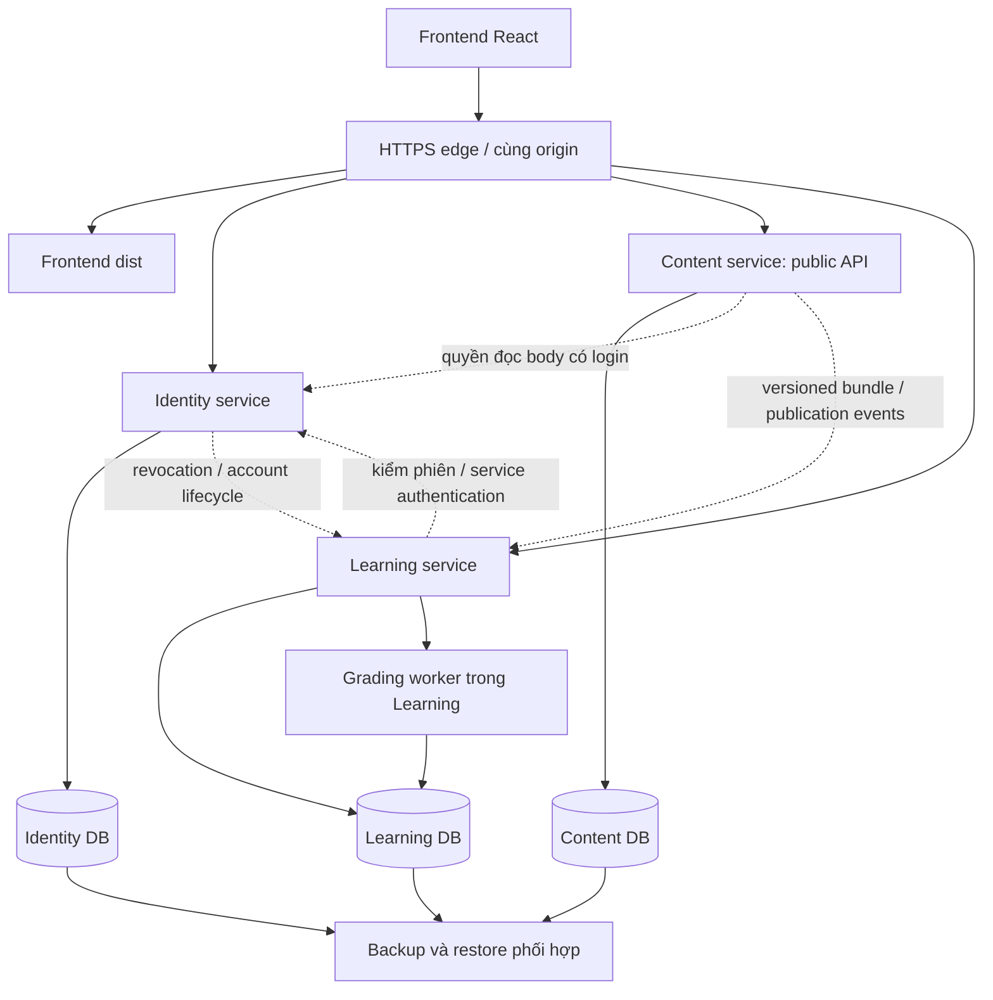

# Review chuyển backend sang microservices

BL-D13 · 30/09/2026 · ADR-03, trạng thái **hướng microservice đã được người dùng yêu cầu; ranh giới và giao thức dưới đây là đề xuất review**. Chưa triển khai service. [Backlog](../delivery-backlog.md) điều phối bước đặc tả tiếp theo; bản review không phải LLD phân tán đã sẵn sàng code.

**Bổ sung BL-MS01, 30/09/2026:** [service catalog/API boundaries](service-boundaries.md) đã chốt ba service, data/module owner, browser/internal contract và source boundary. MS-F01 xử lý ở ranh giới T1/T2 local Learning; MS-F08 thống nhất outline anonymous/body login và support qua Learning. Các giao thức auth/publication/lifecycle và runtime tests vẫn còn MS02–04; bảng đề xuất D13 bên dưới giữ lịch sử phân tích, không đóng toàn bộ findings.

**Bổ sung BL-MS02:** [security design](security-design.md) và [session LLD v3](../features/f10-identity-access/sessions/protocol.md) xử lý MS-F02/05/08 ở contract: online admission, local monotonic fences, static CNT/LRN ACK barrier, mTLS/caller/resource controls, CSRF/no-store/private bundle và SEC-01–30 dự kiến. Cookie cleanup được sửa để response logout A trễ không clear phiên B. Chưa có runtime security test; MS03/04 còn data/restore/ops. Các phương án D13 ở dưới là lịch sử, đọc MS02 để lấy auth contract hiện hành.

## 1. Kết luận và phạm vi thay đổi

**Bổ sung BL-MS03:** [data protocols](data-protocols.md), [publication](../features/f08-content/publication/protocol.md) và [lifecycle/recovery](lifecycle-recovery-protocol.md) xử lý MS-F01/03/04/06 ở thiết kế: T1/T2 local gates, HTTP outbox/inbox, FENCE→canonical COMMIT→RELEASE, external intent/exposure journal, epoch/tombstone và restore mới realm/generations/credential recovery. Các phương án D13 bên dưới giữ lịch sử; MS04 còn task/test/ops/rebaseline, chưa runtime evidence.

**Bổ sung BL-MS04:** [implementation plan](../delivery/implementation-plan.md)/[test-release plan](../delivery/test-release-plan.md) xử lý MS-F07/09 ở kế hoạch:35 ID cũ/38 child,14 parent/58 executable leaves, DAG; SEC30/DATA30 leaf owners/10fixtures/11commands/REL8; baseline primary check, S3 adapter qualification, per-service artifacts/roles/listeners, N/N-1/CI/metrics/backup/restore-before-pilot. Không source/runtime/test mới; R01a chờ CODE.

Chuyển kiến trúc đích từ một backend modular sang microservices trong cùng repo. FE đã ở frontend, backend mới có README nên chưa phải di chuyển dữ liệu/runtime đã vận hành. Giữ business R1: nhiều user, Collections trọn luồng, hai roadmap outline, dữ liệu theo owner, admin sau R1.

Đề xuất R1 có **ba service nghiệp vụ**: Identity, Content, Learning; edge reverse proxy đứng trước. Mỗi service có executable/artifact, config, migration, database credentials và test riêng, có thể triển khai độc lập khi contract tương thích. Chung repository/parent build không đồng nghĩa chung runtime hoặc giao dịch.

Learning giữ learner-work + assessment + progress như các module nội bộ vì chúng cùng bảo vệ một hành vi học nhất quán. Không tách thành service theo từng bảng hoặc tên module. Mốc tách Grading sau này chỉ khi cần scale/cô lập compute độc lập; runner thực thi code tương lai phải có boundary riêng, không chạy trong Learning.

Lợi ích là ownership/deployment rõ, học được API giữa service và xử lý lỗi phân tán. Chi phí tăng: service identity, contract compatibility, đồng bộ dữ liệu, theo dõi request, backup nhiều DB, kiểm timeout/retry/partial failure. Chưa có số đo tải để nói microservices nhanh hơn hoặc cần thiết để scale; quyết định ở đây đáp ứng hướng kiến trúc người dùng muốn.

## 2. Kiến trúc đề xuất



Mũi tên event không khẳng định giao thức đã hoàn chỉnh. Gateway/edge không giữ credential DB hoặc tự chấm/quyết owner. Reverse proxy đã đủ vai trò định tuyến ở baseline đề xuất; chỉ thêm application gateway/BFF khi có use case cụ thể, không thêm Spring Cloud/Kubernetes vì tên microservice.

## 3. Service, dữ liệu và code ownership

| Service | Sở hữu | Không sở hữu | API/contract cần đặc tả |
|---|---|---|---|
| Identity | User/password, invite/reset, session, credentialEpoch, throttle/audit auth, account lifecycle operation | Answer/submission/progress | Auth public; introspection và revocation/account-change protocol nội bộ |
| Content | TOP/CAP, placement/prerequisite, unit/exercise/case/rubric version, publication/impact/review metadata | Owner draft/result, learner exposure | Public outline; authenticated body; private version bundle và publication feed cho Learning |
| Learning | Learner guard/epoch, exposure, attempt/draft/submission/jobs/results/evidence/projection/history, import/export/reset, readiness/CL-U-01 | Password/session authority, authoring canonical | API learner; applied content revision; event inbox/receipt; reset/delete participant |

UserId là reference opaque trong Learning, không FK sang Identity DB. TOP/CAP/version reference từ Content được kiểm qua contract hoặc bản sao bất biến đã tiếp nhận; không cross-DB join. Learning giữ bản version/rubric cần chấm và đọc lịch sử dưới quyền private, với checksum/provenance; đây là bản sao phục vụ bounded context, không nguồn biên soạn thứ hai.

Mỗi service có database/role riêng. Local có thể một PostgreSQL instance chứa ba logical databases; runtime role không truy cập database service khác. Backup/restore không tự atomic trên ba DB. Không giữ account_guard hoặc publication singleton dùng chung cả hệ thống như D08 cũ.

```text
backend/
  pom.xml                       dự kiến: parent/aggregator build, không executable chung
  mvnw / mvnw.cmd / .mvn/
  services/
    identity-service/
      pom.xml
      src/main/java/lab/backend/identity/{api,application,domain,infrastructure}
      src/main/resources/db/migration/
      src/test/
    content-service/            cùng skeleton, domain content riêng
    learning-service/
      pom.xml
      src/main/java/lab/backend/learning/
        work/ assessment/ progress/ transfer/ lifecycle/
      src/main/resources/db/migration/
      src/test/
contracts/
  http/{identity,content,learning}/
  events/                        schema, version và consumer fixtures
ops/
  compose/ edge/ observability/ backup/
```

Đây là cây đề xuất, không tạo code rỗng trong review. Không có shared entity/repository/domain JAR cho ba service; shared build conventions và DTO schema có thể dùng chung với version/compatibility test. Không import source Java service khác. Version library/framework exact phải kiểm lại ở task dựng nền; BOM một app cũ chưa chứng minh tương thích dependency mới.

## 4. Review findings theo mức ảnh hưởng

| ID / mức | Vấn đề khi dùng nguyên thiết kế cũ | Quyết định review / owner |
|---|---|---|
| MS-F01 / P1 | T2 ghi result/evidence/progress một transaction; tách ba service mất atomicity | MS01/03 chốt local Learning commit/gates/epoch/fencing; DATA-01–09 expected, DB race còn sau MS04 |
| MS-F02 / P1 | Logout và save dùng account/session guard cùng DB; introspection trước request vẫn có race commit sau revoke | MS02 đã chốt online admission, local monotonic gate/static participant ACK barrier tại contract; race/partial failure tests còn sau rebaseline. Không tự đổi sang JWT có hiệu lực tới expiry |
| MS-F03 / P1 | Publish impact yêu cầu có hiệu lực ngay, nhưng event tới Learning trễ | MS03 FENCE trước canonical COMMIT, RELEASE policy/current overlay; DATA-01–07 expected, lag giữ pending |
| MS-F04 / P1 | Reset/delete/restore dùng DB chung; event cũ có thể dựng lại user/data đã xóa | MS03 intent/exposure journal, terminal suppression, epochs, three-DB restore/realm/credential readiness; DATA-16–30 expected |
| MS-F05 / P1 | Chỉ gateway kiểm auth không đủ bảo vệ API nội bộ/private rubric | MS02 đã chốt mTLS/action allowlist + owner enforcement tại receiver; negative tests/runtime config còn sau rebaseline; internal network không tự là quyền |
| MS-F06 / P2 | POST/event timeout/retry dễ tạo lặp hoặc đảo version | MS03 HTTP relay/outbox/inbox, stream sequence/exact digest/receipt/recovery; DATA-10–15 expected |
| MS-F07 / P2 | Single-app tests/deploy/backup chưa bao phủ service partial failure | MS04 FX/CMD/SEC/DATA/REL plan + actual provider/recovery/compatibility owners; reports phải thu trong leaves |
| MS-F08 / P2 | S02 chỉ public outline, D08 có chỗ mô tả body public thiếu login | Giữ S02: outline anonymous; body học authenticated/no-store; MS01/02 đã thống nhất endpoint matrix và FE adapter, artifact/negative tests còn sau rebaseline |
| MS-F09 / P2 | Backlog R01–34 và D09 readiness dựa trên một app | MS04 v3 parent/leaf/owner/REQ/DAG/brief/DoD đã thay backlog; lịch sử R00/nội dung giữ, CODE chưa có |

MS-F01–09 có giải pháp thiết kế/kế hoạch MS01–04, **runtime chưa kiểm chứng**. D13 mục 6–7 proposals bị MS02/03 thay; current stack/tasks/test/ops ở MS04. Không cosmetic eventual publication/Learning-only deletion ACK/shared guard. No P0/P1 design solution missing trong phạm vi; code tests/gates còn leaves, CODE chưa có.

## 5. Luồng nộp/chấm được giữ nhất quán

Trước mở attempt, Learning phải có version bundle bất biến được xác minh từ Content và biết eligibility/publication revision theo giao thức MS03. Không gọi Content trong transaction DB đang khóa của T1/T2. Catalog chưa đồng bộ thì trả dependency unavailable/pending phù hợp, không tự chọn bản cũ để chấm.

1. Edge định tuyến request; Learning xác thực caller/user/context và kiểm ownership theo hợp đồng MS02.
2. Learning T1 khóa guard/epoch local, kiểm draft revision/exposure/version đã tiếp nhận, ghi snapshot/submission/job/receipt trong Learning DB.
3. Worker cùng Learning tính pure từ snapshot/rubric pinned ngoài lock.
4. T2 cùng Learning DB ghi result/evidence/progress/job complete, kiểm epoch và version eligibility.
5. Frontend đọc result/progress từ Learning. Không cần event giữa grader và progress cho R1.

Nếu tương lai tách grader: response chấm từ service chỉ là kết quả đề xuất có provenance, Learning vẫn finalize evidence/progress. Không tin message chỉ vì field passed=true.

## 6. Những cam kết phân tán cần chốt trước code

### Phiên và logout

Giữ cookie HttpOnly/Secure/SameSite + CSRF cho browser; Identity sở hữu phiên. Cookie chỉ ở boundary cần thiết; không broadcast credentials qua event. Cần xác thực service-to-service, kiểm audience/scope và owner tại dịch vụ nhận; không tin X-User-Id browser gửi. TTL assertion/introspection cache chỉ chốt sau khi chứng minh revoke semantics.

S02 yêu cầu revoke hoàn tất thì mutation chưa commit không được ghi. **MS02 chốt LLD** ở [session protocol](../features/f10-identity-access/sessions/protocol.md): Identity chuyển operation sang revoking, từ chối admission mới, fence hai participant static dưới local gate rồi ACK; chỉ báo complete sau đủ durable ACK. Participant chưa tồn tại session vẫn ACK fence; participant down thì operation pending. Chi tiết admission binding, late request, epoch, expiry, reauth, duplicate/partial failure và logout-all/password reset nằm trong LLD. Đây vẫn chưa là thuật toán đã chứng minh bằng runtime.

### Publication

Content giữ canonical version; Learning giữ applied revision và bundle/checksum. Các thay đổi cosmetic có thể chuyển bất đồng bộ, nhưng withdrawal/invalid-rubric không được âm thầm eventual nếu vẫn hứa hiệu lực ngay. MS03 cần prepare→apply/ACK→activate hoặc block affected content trong cửa sổ chưa đồng bộ; giao thức phải có linearization point và đường xử lý participant lỗi. Kết quả lịch sử vẫn giữ, current mastery tuân manifest hiệu lực. Không giải quyết bằng mỗi lần read join database Content.

### Reset, xóa account và restore

Reset học chủ yếu local Learning, giữ exposure và tăng learningEpoch sau suppression journal durable như S03. Delete account là operation liên service do Identity điều phối: disable/revoke → Learning suppression/purge ACK → final account deletion theo retention. Crash/retry tiếp tục cùng operationId; tombstone chặn message cũ tạo lại state, không bù trừ bằng hồi sinh dữ liệu đã yêu cầu xóa.

Export dữ liệu học là snapshot Learning DB với content refs đã pin; không hứa snapshot atomically bao mọi service. Restore cần manifest backup mỗi service, applied event watermarks, replay/dedupe, đối soát user/content references và journal ngoài snapshot. Chỉ mở traffic khi dữ liệu đủ nhất quán; vô hiệu session/token cũ. Runbook D08 một DB phải thay, không chỉ nhân lệnh pg_dump ba lần.

## 7. Giao tiếp và khả dụng

HTTP đồng bộ cho thao tác cần trả lời tức thời, có deadline và giới hạn retry; chỉ retry mutation có idempotency contract. Không retry mù lỗi nghiệp vụ. Backend dependency lỗi không fallback sang quyền/đáp án/progress do browser tự khai.

Đề xuất khởi đầu truyền cập nhật liên service bằng **transactional outbox + authenticated HTTP receiver/inbox**: ghi business change/outbox local atomic, relay gửi, receiver ghi inbox và effect atomic, ACK rồi mark delivered. Không cần broker cho job chấm nội bộ. MS03 quyết định transport cuối sau liệt kê event/fan-out; RabbitMQ có thể thêm nếu nhu cầu rõ, Kafka/Kubernetes/service mesh chưa phải dependency mặc định.

Envelope tối thiểu: eventId, producer, aggregateId, aggregateVersion, schemaVersion, occurredAt, correlationId, payload tối thiểu; lifecycle thêm epoch/operationId phù hợp. Có dedupe, xử lý gap/out-of-order, poison message, retry/backoff có trần, cách replay và retention. Không hứa exactly-once delivery; duplicate delivery phải không tạo duplicate business effect. Không đưa password/cookie/answer không cần thiết vào event/log.

Local Compose đề xuất gồm edge +3 app +PostgreSQL databases; hostname cấu hình tĩnh đủ pilot. Mỗi app có health/readiness, log correlation/trace, timeout/retry metrics. Cần kiểm một service down không làm sai dữ liệu service còn lại; fail closed riêng endpoint phụ thuộc, không nhất thiết khóa outline công khai khi Identity down.

## 8. Security và kiểm thử bổ sung

MS02 phải cung cấp threat model tài sản/actor/trust boundary; endpoint/caller matrix gồm browser, edge, service, operator. Bao phủ XSS/SQL parameterization/CSRF/CORS/security headers, chống giả mạo user/service, secret/key rotation, truy cập private content, resource quotas/rate limits, dependency/secret scanning và incident actions. Các phần này từng thiếu security design tổng hợp, việc tách service làm chúng bắt buộc rõ hơn.

DoD kỹ thuật mới phải có: service DB role không đọc được DB khác; consumer-driven contract/compatibility; không cross-source import; build/deploy từng service độc lập; duplicate/out-of-order/lost response/partition tests; revoke vs commit với barrier; publish lag/withdrawal; delete/restore/replay; lỗi Identity không cấp quyền cũ. FE E2E hiện có vẫn là nền UI, không chứng minh các ca này.

## 9. Kế hoạch sau review

| Task thiết kế | Đầu ra | Điều kiện hoàn thành |
|---|---|---|
| BL-MS01 | Service catalog, ownership/API matrix và architecture source v3 | Mỗi use case/service/DB rõ; chọn3service hay điều chỉnh có lý do; chốt public outline/auth body; không shared DB |
| BL-MS02 | Security design và session/revocation LLD | Threat model/control/test; lifecycle và ACK/failure semantics giữ S02 hoặc đề xuất đổi business minh bạch |
| BL-MS03 | Data/event/publication/lifecycle/recovery LLD | T1/T2 local, version sync/activation, event delivery, reset/delete/restore; failure/sequence tests có expected |
| BL-MS04 | Rebaseline task triển khai và DoD/release | Xử lý findings chặn, chọn transport/ops stack với lý do, cập nhật R01–34 hoặc tách task con và dependencies; tất cả consumer có contract |

Chưa dựng R01 theo một app cũ trong khi review hướng mới. User đã chọn microservices, không cần hỏi lại hướng đó. Những lựa chọn kỹ thuật còn mở có owner MS01–04; điểm thật sự đổi hành vi người học như logout complete/withdrawal mới cần nêu riêng cho người dùng.

## 10. Nguồn đối chiếu và giới hạn

Đọc ngày30/09/2026: [Microsoft — microservice boundaries](https://learn.microsoft.com/en-us/azure/architecture/microservices/model/microservice-boundaries) khuyến nghị ranh giới theo domain/consistency và kiểm deploy độc lập, tránh gọi qua lại quá nhiều; đây là cơ sở chọn Learning đủ rộng. [Database per service](https://microservices.io/patterns/data/database-per-service.html) mô tả dữ liệu private, chỉ qua API; một server DB vật lý không đồng nghĩa dùng chung quyền/bảng. [Transactional outbox](https://microservices.io/patterns/data/transactional-outbox.html) giải thích local commit/outbox và khả năng gửi lặp cần consumer idempotent. [OWASP microservices security](https://cheatsheetseries.owasp.org/cheatsheets/Microservices_Security_Cheat_Sheet.html) là nguồn cho service authentication/authorization và boundary nội bộ.

Ba service, HTTP outbox và giao thức ACK là đề xuất áp dụng cho dự án này, không phải yêu cầu bắt buộc của các nguồn. Không benchmark, chạy service, audit/pentest hay chứng nhận an toàn trong task review này.
