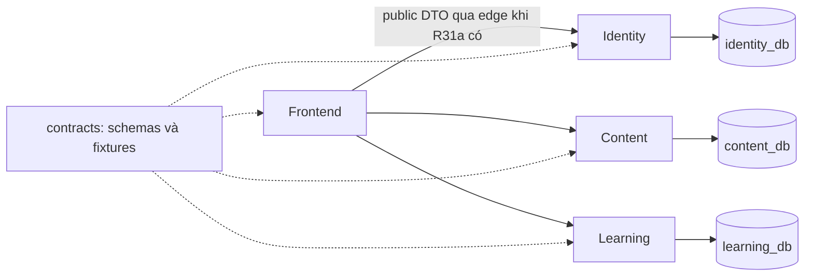

# Review cấu trúc dự án — BL-D16

04/10/2026. [Task/acceptance/checkpoint](../delivery/tasks/BL-D16.md) · [Mục lục doc](../README.md) · [Source FE](frontend.md) · [Source BE](backend.md).

Cấu trúc cấp repo phù hợp với hướng đã chốt: FE/BE cùng repository; Identity, Content và Learning có artifact/database riêng; tài liệu theo feature; contracts và vận hành nằm ngoài source UI. Nên giữ cấu trúc này. Các điểm cần xử lý nằm ở quản lý Git, hygiene đầu ra, hướng dẫn test và quy ước package bên trong service.

Đây là review tĩnh theo source tại thời điểm đọc. R04a đang được triển khai/qualification ở phiên riêng; code runtime và kết quả thử có thể tiếp tục thay đổi. [Registry](../delivery-backlog.md) và [checkpoint R04a](../features/f10-identity-access/sessions/tasks/BL-R04a.md) giữ trạng thái hiện hành. Báo cáo này không nghiệm thu hoặc sửa trạng thái R04a.

Snapshot phía trên và §1–5 giữ kết quả review ngày04/10. [Cập nhật xử lý ngày05/10](#6-xử-lý-findings--d17-ngày05102026) bên dưới có ưu tiên về disposition; convention hiện hành nằm ở source architecture BE, không ở cây đề xuất lịch sử §4.

## 1. Cấu trúc hiện có

```text
Learning Java/
  frontend/                    package, lockfile, React source, tests, Vite config
  backend/
    pom.xml / mvnw / .mvn/     build conventions và wrapper
    services/
      identity-service/        credential, session, transport; own migrations/tests
      content-service/         bootstrap, transport; own migrations/tests
      learning-service/        bootstrap, transport; own migrations/tests
  contracts/http/              common và Identity schemas/examples
  ops/                         db-lab, trust-lab, identity, release manifests
  scripts/                     command entrypoints, lab harness, qualification checks
  docs/                        business/architecture/features/curriculum/platform/delivery
  .tools/                      portable runtimes, caches và công cụ cục bộ; ignored
  artifacts/quality/           kết quả chạy và fixture sinh ra; ignored
```

FE hiện có `pages/components/content/data/styles`, chưa có cây `src/features` mới. Content/Learning hiện chủ yếu là nền bootstrap/transport; Identity có credential/session đang triển khai. Contracts catalog/events, authoring `content-v2`, Compose/edge/observability/backup/CI còn thuộc task sau. Không coi các thư mục chưa được task tạo là thiếu sót hiện tại; không scaffold thư mục trống để làm đầy cây.

## 2. Ranh giới nên giữ



Sơ đồ thể hiện ranh giới đích; edge và full public APIs chưa được nghiệm thu từ review này.

| Phần | Trách nhiệm và quy ước |
|---|---|
| Frontend | Feature UI, mô hình tương tác và public API adapters; kết quả/progress chính thức thuộc server. |
| Identity | Tài khoản/credentials/canonical session và lifecycle danh tính; không lưu bài làm của Learning. |
| Content | Nội dung canonical, version, publication; không là nguồn tiến độ cá nhân. |
| Learning | Nháp/submission/result/evidence/progress và replica nội dung; giữ T1/T2 local atomic. |
| contracts | Schema và fixture giao tiếp; không entity/repository Java dùng chung hoặc private đáp án trong FE. |
| ops | Layout/config/runbook/manifests và deployment khi task tạo; dữ liệu bí mật lab sinh ở vùng ignored. |
| scripts | Entry command và harness xuyên package; unit/DB tests của service vẫn ở `src/test`. |
| docs | Feature là giá trị người dùng; service là boundary runtime. Hai cây không cần trùng một-một. |

Parent Maven hiện là `packaging=pom`, có đúng ba child POM và mỗi child trỏ về parent của repo. Không thấy direct runtime dependency hoặc main Java import sang service khác trong phạm vi kiểm. DB layout có ba database với owner/migrator/app roles riêng. Đây là bằng chứng cấu trúc tĩnh; quyền DB/HTTP thực phải dùng evidence của task sở hữu.

## 3. Findings và mức ưu tiên

| ID / ưu tiên | Bằng chứng, tác động | Hướng xử lý và owner |
|---|---|---|
| STR-01 · P2 | Audit 29/10/2026: `git ls-files` trả 0 file; `git rev-parse --verify HEAD` thất bại; symbolic branch là `master`, 561 file không bị ignore và không có remote. Repo chưa có commit nền, nên chưa có baseline để review diff/rollback qua Git hoặc tái tạo checkout đã bàn giao. | [BL-R00a](../platform/repository/tasks/BL-R00a.md) sở hữu initial reviewed baseline trước R31c/CI/release. Task phải được cấp quyền stage/commit và chốt integration-branch name; review này không tự commit hoặc đóng finding. |
| STR-02 · P2 | [.gitignore](../../.gitignore) chưa có Python cache patterns; `git ls-files --others --exclude-standard -- scripts/__pycache__` liệt kê hai `.pyc`. Khi add repo, bytecode phụ thuộc máy có thể lẫn vào source. | Repo hygiene: bổ sung `__pycache__/`, `*.py[cod]`; kiểm `git check-ignore` và giữ helper source. Không cần xóa cache đang dùng hoặc thay runtime. Có thể xử lý bằng sửa cấu hình nhỏ khi được giao sửa. |
| STR-03 · P2 | [session_browser.mjs](../../scripts/tests/session_browser.mjs) resolve Playwright và Ajv từ `frontend/package.json`; [backend README](../../backend/README.md) và [Identity README](../../backend/services/identity-service/README.md) chưa liệt kê bước chuẩn bị Node/npm dependencies cho browser qualification. Một người đi theo hướng dẫn backend trên checkout mới có thể chỉ chuẩn bị JDK/PG rồi thiếu module browser. | R04a khi bàn giao qualification: ghi rõ Node, npm ci theo FE lockfile, browser đã có và suite cần chúng. Phân biệt build/unit/DB service với browser qualification xuyên package. Giữ dependency đang khóa; chưa cần thêm package tooling riêng. Đây là thiếu hướng dẫn ở snapshot IN_PROGRESS, không kết luận R04a DONE sai. |
| STR-04 · P3 | [Cây BE đích](backend.md#2-source-tree-đích) đặt Identity/Content theo layer ở cấp đầu, Learning theo feature; source Identity đã chia `credential/session/transport`. Cùng loại tính năng có thể bị đặt ở các vị trí khác nhau khi code tăng. | Khi mở rộng source, thống nhất feature ở cấp đầu trong mỗi service; lớp `api/application/domain/infrastructure` chỉ thêm bên trong feature khi cần. Owner: tài liệu architecture và leaf thêm feature, không một đợt refactor toàn backend. Quy ước ở §4 là đề xuất tổ chức, chưa thay source architecture đã chốt. |
| STR-05 · P3 | [IdentitySessionAuthorityIT](../../backend/services/identity-service/src/test/java/lab/backend/identity/credential/IdentitySessionAuthorityIT.java) nằm trong package credential, dùng fixture từ `CredentialPolicyTests` và `PasswordHasher` package-private. Session tests có liên kết white-box với credential test implementation; [strict review script](../../scripts/tests/session_checkpoint_review.py) cũng nhận diện tên suite này. | Giữ trong lúc R04a qualification. Nếu dọn sau, tách fixture test dùng chung có owner rõ rồi mới cân nhắc đặt suite theo feature; cập nhật POM/required-suite checks/evidence cùng lúc. Không public API production chỉ để đổi folder test, không làm rơi negative/race cases. Owner: task cleanup/test-support riêng hoặc leaf thay đổi tests liên quan. |

P2 cần xử lý trước luồng bị ảnh hưởng; P3 là cải thiện tổ chức. Không phát hiện lỗi boundary cấp repo cần đổi topology trong các kiểm tra tĩnh đã thực hiện. Findings này không là chứng nhận an toàn hoặc độ đúng nghiệp vụ toàn hệ thống.

## 4. Mức chia feature đề xuất

Giữ `frontend/src/features/<feature>` theo [kiến trúc FE](frontend.md#2-cấu-trúc-đích-khi-thực-hiện-r1424). Chỉ tạo `components/hooks/model/api.ts` khi feature cần. `App/routes` lắp ghép entrypoints; shared UI nhận props/callback, không nắm nội dung riêng của feature. Hiện [AppShell](../../frontend/src/components/AppShell.tsx) vẫn đọc catalog v1; việc tách adapter/route metadata thuộc R14/R15, không sửa prototype trong review này.

Với BE, đề xuất dùng cùng một quy ước trong ba service:

```text
<service>/src/main/java/lab/backend/<service>/
  <feature>/                 ví dụ credential, session, publication, work, progress
    <classes>                feature nhỏ được giữ phẳng
    api/                     thêm khi có HTTP adapter riêng
    application/             use case và transaction boundary
    domain/                  policy/model độc lập khi có nhu cầu
    infrastructure/          DB/client/journal adapters khi cần tách
  transport/                 receiver/client trust nền của service
  configuration/             composition và cấu hình service
```

Không tạo đủ bốn layer cho mỗi feature nhỏ. Không chuyển mọi class hiện có ngay để khớp cây. Cross-feature use case trong cùng service gọi qua entrypoint/port rõ; giao dịch Learning vẫn cùng database. Transport thuộc từng service có chủ đích; duplication hiện tại không tự là lý do tạo shared runtime/domain JAR.

Các test bám phần sở hữu: logic/HTTP adapter unit và DB/service IT ở service; browser/contract/harness xuyên package ở scripts hoặc tầng test chung có prerequisite rõ. Khi harness nhiều hơn, có thể phân scripts theo backend/identity/testing và giữ wrapper entrypoints hiện hành; không đổi các đường dẫn đang được qualifier/hash checks sử dụng chỉ vì muốn cây đẹp hơn.

## 5. Thứ tự xử lý và giới hạn

1. Hoàn thành leaf R04a theo AC hiện hành; bổ sung hướng dẫn prerequisite browser trong bàn giao của chính leaf. Review này không mở R04b/c/d hoặc đổi dependency.
2. Thực hiện [BL-R00a](../platform/repository/tasks/BL-R00a.md) theo [Git workflow](../platform/repository/git-workflow.md) trước khi dùng branch/worktree/CI/release checkout. Không đưa output `.tools/artifacts/target/dist/node_modules` vào source; giữ evidence cần bàn giao theo contract của release.
3. Chốt convention BE trong source architecture trước khi feature Content/Learning tăng; áp dụng dần ở leaf sở hữu, không mở một đợt viết lại bootstrap.
4. FE chuyển sang feature tree theo R14–24 và dependency thực ở registry. R31a edge/fixture vẫn có trước FE tích hợp; chưa có Compose/CI không phải lý do tự code R31 trong review.
5. Khi R31c đưa quality checks vào checkout/CI, static doc checks phải dùng input trong repo; baseline một lần di chuyển ở ignored `.tools/doc-reorganization` chỉ là bằng chứng D15 cục bộ.

Đã kiểm file/config/module/import/layout/link/ID/dependency trong phạm vi task. Không chạy app build, database, browser hay security suites: review không thay code và R04a có qualification riêng đang chạy. Linux/container/provider/deployment và hành trình người học hoàn chỉnh giữ owners và gates cũ.

## 6. Xử lý findings — D17 ngày05/10/2026

[Task D17 và checkpoint](../delivery/tasks/BL-D17.md) giữ evidence của lượt xử lý. R04a đã DONE theo task/evidence của chính nó; R04b có checkpoint riêng trong registry. D17 không thực thi leaf sản phẩm hoặc thay qualification.

| Finding | Disposition hiện hành | Source và bước còn lại |
|---|---|---|
| STR-01 | OPEN | Git baseline vẫn chưa tạo. BL-R00a đã có brief/owner nhưng còn chờ explicit stage/commit authorization và quyết định integration branch; chỉ đóng sau khi initial commit/evidence được Control Center review. |
| STR-02 | CLOSED | `.gitignore` có `__pycache__/` và `*.py[cod]`; bytecode ở scripts/nested package được ignore, helper `.py/.mjs` vẫn được phát hiện. Không xóa cache. |
| STR-03 | CLOSED trong phạm vi hướng dẫn | [Browser prerequisite](../platform/environment/identity-browser-qualification.md) là source duy nhất; backend/service/feature entrypoints link tới nó. Ghi đúng launcher Node path, FE lockfile modules và installed Edge. Launcher vẫn có giới hạn Windows/current user cache; portability còn task riêng nếu được giao. |
| STR-04 | CLOSED cho convention | [Architecture BE §2/2.1](backend.md#21-cấp-feature-và-layer) thống nhất feature ở cấp đầu, layer khi cần. AGENTS dẫn source này. Áp dụng dần theo leaf, source qualified hiện tại không bị chuyển package. |
| STR-05 | DEFERRED có owner | Không chuyển suite/fixture trong D17. Task cleanup riêng sau khi phạm vi được giao phải giữ package-private seams hoặc test-support phù hợp, cập nhật POM/required-suite checks và chạy lại qualification liên quan. Không giảm độ phủ/race cases hoặc public production APIs chỉ để đổi folder. |

D17 không tạo Git baseline hoặc coi cleanup test đã xong. Khi thực thi feature kế tiếp, đọc convention hiện hành và task dependency/AC trước; quyết định bố trí folder không mở thêm service/module/runtime nghiệp vụ.

## 7. Checkpoint planning Git baseline — 29/10/2026

- Read-only audit xác nhận repository root tại workspace hiện hành, `.git` là directory,
  `HEAD` chưa tồn tại, symbolic branch `master`, tracked count 0, 561 untracked
  entries và không có remote. `git diff` rỗng trong trạng thái này không là scope
  hoặc PASS evidence.
- `.gitignore` hiện đã chặn `node_modules`, `dist`, npm/Vite cache, test output,
  `.env`, `.tools`, quality artifacts, Maven `target` và Python cache. Bốn JVM
  crash/replay `.log` cùng `.codex/config.toml` vẫn nằm trong candidate inventory;
  baseline task phải classify, không tự xóa hoặc stage.
- `.gitattributes` hiện chỉ pin EOL cho `backend/mvnw` và `backend/mvnw.cmd`;
  BL-R00a phải review policy text/binary/line endings trước stage.
- STR-01 giữ `OPEN`. Planning này không chạy `git add`, commit, branch, worktree,
  remote, push, PR, merge hoặc thao tác phá huỷ.

Gate 1 của BL-R00a đã hoàn tất audit/hygiene read-only trong session executor cùng ngày:

- Proposed tracked inventory còn 559 file, 5906989 bytes sau checkpoint edits, không file nào từ 1 MiB;
  13 binary đều là PNG QA evidence đã được source docs link. `.codex/config.toml`
  được classify là shared project policy và đề xuất track.
- Bốn JVM fatal-error/replay log được classify là sensitive machine/runtime diagnostics
  và bị ignore bằng rule hẹp; file vẫn còn trên disk, không bị xóa.
- `.gitattributes` nay dùng `text=auto`, giữ EOL riêng cho Maven wrappers và đánh dấu
  PNG binary. EOL scan thấy 46 text file mixed; không rewrite source trong Gate 1 và
  phải review normalized bytes/file mode ở staged index.
- Secret scan không thấy strong credential pattern; các assignment-like hit là runtime
  random/config handling hoặc test fixture. Validation tĩnh/content/FE check/backend
  parent validate và JSON/XML/link/state checks đều đạt trong lớp bằng chứng tương ứng.
- STR-01 vẫn `OPEN`: tracked count vẫn 0, `HEAD` chưa tồn tại và không có Git mutation.
  Gate 2 chờ explicit stage authorization; user vẫn phải chốt integration branch name,
  rồi cấp commit authorization riêng sau staged review.

Gate 2 sau đó được cấp quyền riêng và đã stage/review đúng 559 file. Index không có
file ≥1 MiB, secret mạnh, generated/vendor output hoặc JVM diagnostics; 13 binary vẫn
chỉ là linked QA PNG. `backend/mvnw` được sửa mode index-only thành `100755`; text
index đã normalize LF và wrapper/PNG attributes đúng policy. `git diff --cached --check`
còn 3 trailing-whitespace và 45 blank-at-EOF finding có sẵn, được classify là hygiene
nợ không P0/P1 ngoài write scope baseline. STR-01 vẫn `OPEN`, `HEAD` chưa tồn tại;
không commit hoặc đổi branch trước quyết định/authorization riêng của user.
