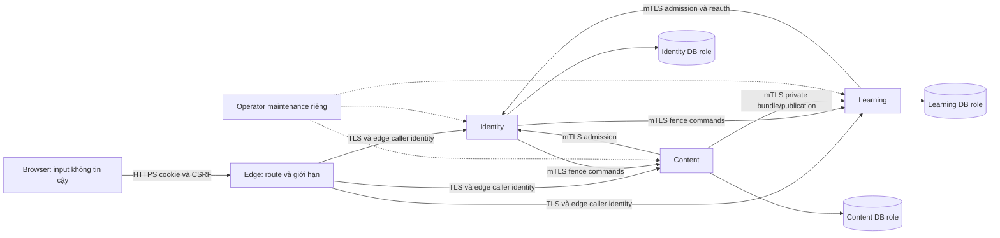

# Security design — R1 microservices

BL-MS02 · 30/09/2026 · Thiết kế/threat model, **chưa có security controls hoặc test backend chạy thật**. [Session LLD v3](../features/f10-identity-access/sessions/protocol.md) là nguồn thuật toán admission/fence/revoke; [service catalog](service-boundaries.md) giữ ownership/API; tài liệu này giữ tài sản, caller/resource matrix, controls và acceptance tests.

Bổ sung MS03: [data protocols](data-protocols.md), [publication](../features/f08-content/publication/protocol.md) và [lifecycle/recovery](lifecycle-recovery-protocol.md) chốt CTL-14/16, SEC-13/16/17/27 ở protocol: private disclosure có external exposure journal, reset/delete/restore fences/realm/credential recovery. DATA-01–30 bổ sung expected; các test/config/runbook thực còn MS04/code, không đóng runtime findings.

Bổ sung MS04: [test-release](../delivery/test-release-plan.md) gắn SEC/DATA từng ID với leaf/FX/CMD/evidence/REL gates; [implementation plan](../delivery/implementation-plan.md) chọn stack/budgets/listeners/secrets/S3 adapter qualification và dependency v3. Cookie revoked remaining hard expiry/reorder thuộc R04a/R24c, actual TLS browser bắt buộc; không đổi trade-off MS02 hoặc ghi runtime PASS.

Bổ sung [D14 review](readiness-review.md): public API8080 HTTPS/mTLS chỉ edge, internal8443 chỉ service/operator đúng action; CA/SAN/SNI/header verification và proxy request/response temp/cache/log sentinel thuộc R02b receiver + R31a actual edge. No-store không thay spill tests; common wire catalog §4.1/WIRE fixtures, maintenance interlock lifecycle §5.1 giữ protected traffic/writers đóng khi backup bị gián đoạn. Chưa runtime controls PASS.

## 1. Brief và quyết định chính

- Goal: ba service xác minh đúng caller/user/owner; thu hồi phiên có biên hoàn tất rõ; mỗi control có owner và test dự kiến. REQ-09/13–15, MD10 và các receiver/FE/ops. Dependency MS01 DONE.
- Inputs: S02/IA-01–24, S03/LD-01–26, MS-F02/05/08, API-I/C/L và INT-01/02/06. Scope R1 pilot invite nhiều user, admin sau R1.
- Output: threat model/control matrix và session LLD v3, cập nhật review/index/backlog. Ngoài phạm vi: code, admin, MFA/SSO/signup công khai, runner, chọn hosting hoặc mua security service.
- Plan: assets/trust boundaries → caller/action → session protocol/races → controls/threat/tests → review và checkpoint. Rules/DoD: [AGENTS](../../AGENTS.md), [delivery contract](../delivery/contract.md), [quality](../quality-process.md).
- Quyết định MS02: opaque server session Identity; online admission; durable local fences/hai participant static; mTLS/action allowlist; owner tại receiver; browser cùng origin/CSRF/no-store. Chi tiết publication/lifecycle/journal/restore hiện ở MS03, task build/test/ops còn MS04.

| AC | Nghiệm thu thiết kế | Evidence dự kiến của MS02 |
|---|---|---|
| MS02-AC1 | Assets/actor/trust boundary và caller/resource rõ | Mục 2–4, TH-01–11 |
| MS02-AC2 | Registration/install/revoke/commit/expiry/partial failure có protocol và expected | Session LLD, AUTH-INV01–08; SEC-01–13 |
| MS02-AC3 | Service identity/private bundle/owner/CSRF được kiểm tại receiver | SEC-14–21, CTL-01/03/04/05/06 |
| MS02-AC4 | App/infra/security controls có owner, task/test; không bỏ XSS/SQL/secrets/scanning | CTL-01–16, SEC-22–30 |
| MS02-AC5 | MS-F02/05/08 có giải pháp ở thiết kế, đồng bộ nguồn; không giả runtime READY | Mục 8, backlog/checkpoint |

## 2. Tài sản, actor và trust boundary

| Asset | Owner / điều cần bảo vệ |
|---|---|
| Credentials/session/invite/reset/reauth proof | Identity; chống lộ/replay/rotate sai/thu hồi giả |
| Nháp, submission, result, evidence, progress, import/export | Learning; riêng theo owner, đúng revision/epoch/provenance |
| Private case/rubric/expected, bundle manifest | Content canonical/Learning replica; browser chỉ thấy phần được cấp sau exposure |
| Publication/eligibility/epoch/fences/tombstones | Owner tương ứng; không rollback/replay làm hồi sinh quyền hoặc pass |
| DB roles, cert/private keys, backup/journal | Operator và từng service; quyền tối thiểu, khác env, không public |
| Audit/security logs, deployment artifacts | Owner sự kiện/ops; đủ đối soát nhưng không chứa secret/answer |

Actor: anonymous, learner A, learner B có chủ ý đổi ID/payload, browser bị XSS hoặc cookie bị đánh cắp, edge, ba service, worker Learning, operator và attacker ngoài mạng. Service/edge không tự là quyền learner; operator không là admin role trong browser. Host/DB superuser hoặc private CA bị chiếm có thể vượt trust boundary: phải có containment/rotation/recovery, không tuyên bố app-level authorization chống được operator root độc hại.

Boundary cần test: browser→edge; edge→public app listener; service→internal listener; mỗi app→DB riêng; worker→Learning application; authoring→published/private bundle; backup/journal→restore readiness; operator→maintenance. Nội bộ không mặc định tin cậy. Listener/filter/route allowlist phải phân biệt public/internal/maintenance, kể cả dùng cùng process; `/internal`, `/actuator`, debug/metrics/maintenance không được edge publish tùy ý.

## 3. Caller/resource authorization matrix

`Login` = phiên/context hợp lệ qua Identity và receiver guard; `Owner` = Login + kiểm ownership tài nguyên. Identity không trả quyết định owner draft thay Learning. Service TLS certificate chỉ cho biết caller; receiver tiếp tục kiểm action/scope/audience/resource. Mọi action không có allowlist là deny.

| Surface / action | Caller/quyền | Enforcement và giới hạn |
|---|---|---|
| API-C01/02 catalog/topic outline | Anonymous hoặc learner | Content chỉ metadata, planned rõ; không unit body/private bundle |
| API-C03 unit body | Browser Login | Content admission + context/fence; published learner DTO, không answer/rubric; no-store |
| API-I01 bootstrap | Browser anonymous/Login | Identity; không gia hạn idle từ poll, CSRF/context đúng flow |
| API-I02/05/06 login/activate/reset | Browser credential flow | Preauth context/CSRF, throttle/token purpose/consume; không owner/role client |
| API-I03/04/07 logout/all/password change | Browser context đúng + reauth khi cần | Identity + barrier; mismatch không thu hồi phiên/account khác |
| API-I08 reauth / API-I09 status | Login cho proof; initiating binding cho status | Proof purpose/intent; status-only không khôi phục learner auth sau revoke |
| API-L01–16 work/progress/data | Browser Owner | Learning admission/fence + query/write lọc owner ở gốc và con; reset reauth/xác nhận |
| INT-01 admission | Content/Learning → Identity | CNT chỉ published-body read; LRN chỉ learner actions; không yêu cầu audience/service khác |
| INT-02 revoke fence | Identity → Content/Learning | Command scope/realm/epoch/digest; ACK durable; service khác không được revoke |
| INT-03 private bundle | Learning → Content | Version/checksum/schema exact, private scope; Identity/edge/browser bị deny |
| INT-04 publication phases | Content ↔ Learning theo bước | Caller/action/revision đúng; verb/envelope/state ở MS03; không cấp actor learner |
| INT-05 account lifecycle | Identity → participant liên quan | Disable/purge state tách; auth barrier MS02, purge/suppression MS03 |
| INT-06 reauth reservation | Learning → Identity | Proof + caller/purpose/user/context/intent; không general token exchange |
| Worker T2 / projection rebuild | Learning worker application / operator maintenance được phép | Không browser endpoint nhận passed=true; pinned input và local epoch/job checks |
| OPS-01/02/03 | Operator được cấp credential riêng | Scope/service/process/DB role, actor/audit; không dùng cookie learner |
| Health/readiness/metrics | Liveness tối thiểu riêng; ops trên mạng quản trị | Không secrets/config dumps/DB detail public; protected readiness gồm cert/clock/realm/fences |

## 4. Threat model

Các mức là impact nếu chưa có control, không phải phát hiện lỗ hổng đã khai thác trong code hiện tại. Mỗi threat có expected/test để MS04 gắn task triển khai.

| Threat | Kịch bản / tác hại | Controls | Tests |
|---|---|---|---|
| TH-01 / P1 | Spoof user/caller/audience hoặc gọi internal/private bundle từ edge | CTL-01/03/04 | SEC-14/15/16 |
| TH-02 / P1 | B đổi ID/list/query/export/receipt đọc/sửa dữ liệu A | CTL-04 | SEC-17/18 |
| TH-03 / P1 | Revoke bỏ lọt session chưa đăng ký; admission/flush tới trễ ghi sau logout | CTL-02 | SEC-01/02/03/04/05 |
| TH-04 / P1 | Partition/crash/ACK giả/clock skew làm báo thu hồi thành công hoặc hồi sinh phiên | CTL-02/03/14 | SEC-06/07/08/09/10/13 |
| TH-05 / P1 | CSRF/login CSRF/fixation/old cookie response, nháp A dưới B | CTL-02/05/09 | SEC-11/19/20/21 |
| TH-06 / P1 | Credential stuffing/reset token/proof replay/enumeration | CTL-06/07 | SEC-12/22/23/24 |
| TH-07 / P1 | Content/answer/import chứa XSS hoặc SQL, URL/lệnh tùy ý | CTL-08/10/11 | SEC-25/26/27 |
| TH-08 / P1 | Leak expected/private rubric/secret qua FE payload, logs, cache, backup | CTL-01/09/12/13/14 | SEC-16/18/28/29 |
| TH-09 / P2 | Body/import/trace/throttle-key/job/poll làm cạn tài nguyên | CTL-07/11 | SEC-24/27 |
| TH-10 / P1 | Dependency/image/secret artifact hoặc role/maintenance cấu hình sai | CTL-01/12/13/15 | SEC-14/28/29/30 |
| TH-11 / P1 | Replay/restore/reset-delete/version làm hiện lại dữ liệu hoặc mastery sai | CTL-02/14/16 | SEC-13; failure matrix MS03, restore drill MS04 |

## 5. Control matrix và task owner

Rxx dưới đây là **task baseline cần MS04 rebaseline/tách theo service**, không task READY hoặc chỉ dẫn chạy code. Control có owner hiện hành ở design và nơi cần evidence runtime; không thay dependency của backlog.

| Control | Quyết định tối thiểu R1 | Owner / task sau rebaseline | Tests |
|---|---|---|---|
| CTL-01 Network/edge/TLS | Browser HTTPS; public8080 HTTPS/mTLS edge-only, private8443 service/operator-only; upstream CA/SAN/SNI verify và edge cert riêng không INT/OPS; không public `/internal`/maintenance; strip identity/audience/internal headers, chỉ trust forwarded IP từ edge xác minh | Receiver R02b + actual edge R31a | SEC-14/15/28 |
| CTL-02 Session/revoke | Opaque cookie, online admission, local monotonic gate/fence, static CNT/LRN ACK, context/clock/deadline checks, pending rõ; [LLD v3](../features/f10-identity-access/sessions/protocol.md) | Identity/CNT/LRN / MS04→R03/04; FE R24 | SEC-01–13 |
| CTL-03 Service identity | Private CA theo env; cert/SAN map tới đúng service/receiver, chain/expiry/EKU/hostname kiểm; deny mặc định theo action; không một client cert chung cho mọi app | Receiver + ops / MS04→R04/31 | SEC-14/15/16 |
| CTL-04 Resource/field auth | Principal từ Identity; receiver query/filter owner cả list/count/search/export/receipt/con ID; unknown owner/role/pass/grader fields reject; cross-owner như absent | Learning/CNT / MS04→R04/08–11/13/25–29 | SEC-17/18 |
| CTL-05 CSRF/CORS | Synchronizer token Identity, preauth cả credential flows, verify qua admission cho LRN mutations; exact origin/method/content-type; same-origin browser, CORS không mở wildcard credentials; SameSite là lớp hỗ trợ | Identity/receivers/FE / MS04→R04/24/31 | SEC-19/20 |
| CTL-06 Credential/token | S02 loginName/password policy, Argon2id baseline D08, token/proof random256bit + digest/purpose/expiry, consume atomic; reauth theo action; không tự login sau reset | Identity / MS04→R03/04/24 | SEC-12/22/23 |
| CTL-07 Abuse/throttle | Trước KDF; S02 account-key5 sai/15m, IP30 sai/15m, block15m, key HMAC/TTL/cap100k theo D08; activation/reset/reauth có bucket riêng/cap; generic errors, không lock vĩnh viễn | Identity + edge ops / MS04→R03/31 | SEC-22/24 |
| CTL-08 XSS/render | Render text/code escaped; Markdown subset không raw HTML; URL schemes allowlist; không eval/dynamic script/dangerous HTML từ authoring/input/import; sanitize khi thật sự cần rich content và test artifact | FE + Content/LRN validation / MS04→R07/16/20/27/30 | SEC-25/28 |
| CTL-09 Browser/cache | Private/authenticated body no-store, cache/key theo context+version, no sensitive localStorage/service worker, authGeneration/focus/Back/đa tab; không late logout cookie clear; proxy request/response temp/cache/store/log không persist private payload, sentinel kiểm chunked/slow/near-limit/export/error | FE + providers + edge R24/R31a/R33 | SEC-11/18/21/28 |
| CTL-10 SQL/data access | Prepared/parameterized queries, sort/filter identifier allowlist; mỗi runtime/migration DB role chỉ DB owner; không trust imported SQL/resource IDs | Từng service + ops / MS04→R02/04/27/31 | SEC-17/26/29 |
| CTL-11 Input/compute/SSRF | Schema allowlist/UTF-8/size/depth/trace/quota/pagination theo D08; endpoint budgets và bounded queue; no arbitrary runner/upload; internal URL từ config allowlist, không URL client/source auto-fetch | Receiver/worker/edge / MS04→R08–12/27/30/31 | SEC-24/27 |
| CTL-12 Secrets/rotation | DB/cert keys riêng service/env, không FE/repo/image/log; runtime mount ngoài source với quyền chỉ process cần; migration credential không trong runtime; inventory/rotation/rollback; CA private key ngoài app host | Ops + service owner / MS04→R01/30/31 | SEC-28/29/30 |
| CTL-13 Audit/errors/observability | Event type/actor ref/time/action/result/correlation/fence operation, không password/raw token/cookie/CSRF/answer; generic external auth/error, no stack trace; giới hạn cardinality/log retention/quyền query | Identity/receivers/ops / MS04→R03/04/30/31 | SEC-22/28/29 |
| CTL-14 Backup/readiness/incident | Backup mã hóa+quyền riêng; snapshot khác export user; durable maintenance interlock/stop toàn writer/current-generation verified resume; realm/fences/journal/clock/cert đối soát trước protected readiness; secret/cert lộ →deny identity/rotate/revoke/recover có audit | Ops/Identity/participants R31/R32a/b | SEC-06/13/29; DATA-24/30 |
| CTL-15 Supply chain/release | Pin lock/resolved versions, SCA/secret/image scan + SBOM artifact per service/FE, no credentials in fixtures; exploitable critical/high chưa xử lý chặn release, exception có lý do/owner/expiry; tool chọn ở MS04 | Ops + reviewer / MS04→R01/30–34 | SEC-30 |
| CTL-16 Domain integrity | Server chọn mode/case/version, ghi exposure trước disclose, T1/T2 local; import không official pass, reset/withdrawal/replay/restore theo epoch/policy | LRN/CNT / MS03 + MS04→R08–13/25–30/32 | SEC-16/17/27; LD/publication/lifecycle MS03 |

Argon2id tái dùng D08: memory19456KiB, iterations2, parallelism1; salt16byte/output32byte, hash format versioned. Implementation benchmark CPU/concurrency, pin encoder/dependency/corpus blocklist offline và licence, không giảm baseline để test nhanh, không gửi raw password ra dịch vụ ngoài. 15–128 Unicode code point, không trim/truncate; không claim compliance/FIPS. Đây là baseline cần hiện thực và đo, không là proof chống mọi brute-force.

Rate-limit Identity có bucket bounded cho failed login/reset/activate/reauth, cap key giả và IP trusted; edge coarse limit không thay account limiter. Các numeric body/trace/import limits tái dùng D08: answer/code64KiB, import5MiB/500record, trace1000action, depth20, draft20/user; default/max page20/100. Chọn HTTP/queue/time/concurrency budgets qua số đo MS04, không báo latency/SLA từ thiết kế. Client retry/backoff có trần, không retry mù POST hoặc consume token.

## 6. Transport, headers, secret và incident details

mTLS theo cặp caller→receiver: app kiểm hostname và expected service identity từ certificate SAN mapping riêng env, không chỉ CA chain hợp lệ. Internal endpoints kiểm allowlist từng action. Edge certificate chỉ vào public listener, không INT/OPS; operator certificate/OS access riêng cho maintenance. Root CA key không mount vào app; issuer/leaf rotation có giai đoạn overlap kiểm soát, fixture wrong issuer/expired/wrong audience bắt buộc. Credential bị lộ: chặn serial/service identity cả kết nối hiện hữu trước cho traffic lại, rotate cert/DB secret, revoke sessions khi liên quan, ghi incident và recovery. Không cho existing keep-alive bỏ qua identity deny mới.

Prod header baseline: CSP `default-src 'self'; script-src 'self'; style-src 'self'; img-src 'self' data:; connect-src 'self'; object-src 'none'; base-uri 'none'; frame-ancestors 'none'; form-action 'self'`; `X-Content-Type-Options: nosniff`, `Referrer-Policy: no-referrer`, hạn chế Permissions-Policy phù hợp. HSTS chỉ bật trên HTTPS/domain đã kiểm, không tự preload/includeSubDomains. CSP phải được test với build FE/thành phần trực quan ở R30/31; sửa render/assets phù hợp trước enforce, không thêm unsafe-inline/eval chỉ để suite pass. CSP là lớp hỗ trợ, không thay output encoding. Dev ngoại lệ loopback explicit, startup prod reject.

Secret runtime dùng mount/config ngoài Git/image; không bắt cài Vault/cloud provider trong MS02. Script bootstrap chỉ tạo/giao secret qua kênh có quyền, output/log redact; `.env` mẫu dùng placeholder. Cert/DB migration secret có owner/expiry/rotation inventory; fixture chỉ key test/environment riêng. Backup/journal storage khác quyền runtime, giải mã chỉ recovery operator, không download qua learner API. MS03 chốt retention/suppression, MS04 hiện thực runbook và drill.

Security incident tối thiểu: xác định scope từ audit an toàn → khóa traffic/action bị ảnh hưởng, giữ operation pending → revoke/fence hoặc deny service identity → rotate/đối soát credential và dữ liệu → review readiness trước mở lại → ghi bằng chứng và task follow-up. Không xóa audit/tombstone để “reset lỗi”; không bật fail-open khi Identity/cert/DB down. Alert trên revoke/publication/reset pending kéo dài, journal unavailable/inventory mismatch, admission deny spike, owner violation, cert/clock/readiness failure; ngưỡng đo MS04, không tạo automation từ doc.

## 7. Acceptance/test matrix

Các tests là contract dự kiến, **chưa chạy**. Unit không đủ cho commit/ACK race: dùng hai transaction DB thật và deterministic barriers; service/cert failure ở integration/fault harness; browser cho cookie/cache/multitab. MS04 gắn fixture/command/CI/task owner từ cột control và service bên dưới; mock allow không chứng minh quyền server.

| Test | Trigger | Expected | Runtime evidence owner |
|---|---|---|---|
| SEC-01 | Admission được cấp, revoke fence commit rồi request T1 tới | Deny/rollback, không submission/evidence | Identity/LRN DB race |
| SEC-02 | Revoke session chưa có local row; install tới sau | Tombstone vẫn deny, không auto-provision learner | CNT/LRN DB |
| SEC-03 | T1 giữ auth gate, logout tới | ACK chờ T1 commit/rollback; không COMPLETED trước fence | Identity/LRN race |
| SEC-04 | Hai replica cùng user: save và fence | Chung DB lock quyết thứ tự, không process cache bypass | Receiver integration |
| SEC-05 | Framework flush/admission cũ sau revoke | Canonical/fence không ACTIVE lại | Identity/receivers |
| SEC-06 | CNT hoặc LRN down/partition/cert lỗi lúc logout | Pending202, deny admission mới, UI locked; không204 giả | Identity + FE/fault |
| SEC-07 | Receiver commit fence mất ACK; retry/Id crash | Resume same operation, ACK durable/dedupe, không hạ floor | Identity/receivers fault |
| SEC-08 | ACK sai caller/operation/digest/generation | Reject/audit, không COMPLETED | Identity contract |
| SEC-09 | Cùng commandId khác payload hoặc old epoch command | Conflict hoặc monotonic covered receipt; không resurrect | Receiver DB |
| SEC-10 | Deadline/idle/absolute hết, admission bị giữ trễ, clock drift | Reject trước ghi, poll không extend idle; readiness clock lỗi | Identity/receiver time harness |
| SEC-11 | Logout A response/status retry về khi cookie đã là B | Không revoke/clear B; context mismatch, response A bỏ | Browser + Identity |
| SEC-12 | Reset/change/disable khi KDF/login cũ đang chạy; reset token dùng hai lần | Không cấp session cũ; consume/update một lần, fence pending rõ | Identity DB/fault |
| SEC-13 | Restore/restart replica với fence/realm cũ | Protected readiness chặn đến đối soát; không grant từ snapshot | MS03/04 recovery |
| SEC-14 | Browser/edge gọi INT/OPS; cert sai CA/SAN/EKU/expired | Reject trước domain action; internal không public | Ops/mTLS harness |
| SEC-15 | CNT cert yêu cầu LRN action, forged X-User-Id/Audience hoặc request binding | Deny action/audience/nonce/binding, không tin header | Identity/receiver contract |
| SEC-16 | Edge/IDN/browser xin private bundle, learner bypass support solution | Deny; LRN private scope đúng mới nhận, exposure trước disclose | Content/LRN integration |
| SEC-17 | B đổi root/con ID hoặc gửi owner/role/pass/graderVersion | Detail/list/count/mutation không leak/đổi A; field reject | LRN API+DB |
| SEC-18 | B GET/export/receipt A hoặc cache key chỉ topic | Không metadata/answer của A; personal/body no-store | LRN/CNT + browser |
| SEC-19 | CSRF thiếu/sai/token cũ, login CSRF, wrong Origin/content-type | Deny trước mutation, rebootstrap không replay POST | Identity/receiver/browser |
| SEC-20 | SameSite/CORS allow nhưng không CSRF, browser cookie gọi internal | Không bypass synchronizer/service auth | Security filter integration |
| SEC-21 | Hai login dùng cùng preauth; late cookie/Back/focus/tab A sau B | Một preauth consume; sai context lock, không render/ghi A dưới B | Identity DB + browser |
| SEC-22 | Unknown/disabled/loginName thật, KDF error và throttle keys giả | Generic error, throttle trước KDF/bounded storage, no secret log | Identity API/abuse |
| SEC-23 | Reauth proof/token expired/wrong purpose/user/context/intent/replay | Deny; reserve same intent idempotent, không reset hai lần | Identity/LRN fault |
| SEC-24 | Flood failed auth/activation/reauth, body/queue/poll/capkeys | Bounded/quota/throttle/retry rõ; không permanent account lock | Identity/ops/load harness |
| SEC-25 | Script/HTML/javascript URL trong content, answer/import/result | Escaped/reject/safe rendering; không script, không private answer leak | FE/artifact + providers |
| SEC-26 | SQL strings/unknown sort column, DB role đọc database service khác | Parameterization/allowlist; cross-DB permission denied | Service DB integration |
| SEC-27 | Huge/deep JSON/trace, arbitrary URL/command/upload/import official pass | Reject trước mutation/fetch/exec; data tốt giữ; no fake evidence | Receivers/LRN+ops |
| SEC-28 | Kiểm FE payload/bundle/sourcemap/cache/log/error/headers | Không secret/private rubric/expected; CSP/render hợp lệ, no-store đúng | Content/FE/ops artifact |
| SEC-29 | Rotation cert/DB key, existing connection và backup role truy cập sai | New+existing traffic enforce deny; wrong role reject, recovery có audit | Ops/service fault |
| SEC-30 | SCA/secret/image scans, SBOM và config fixture cố tình unsafe | Policy gate phát hiện; artifacts pin/no secrets; exception có owner/expiry | CI/release reviewer |

Nối IA/LD/DATA cases và Collections vào R1 E2E sau integration. SEC-13/CTL-16 protocol chi tiết ở MS03; security doc không thay publication/lifecycle LLD hoặc runtime evidence.

## 8. Findings, scope và nguồn primary

- MS-F02: đã có admission/local gate/static participant/ACK barrier, xử lý lazy install và crash/late request/expiry. Không claim đã chứng minh bằng DB runtime.
- MS-F05: mTLS/caller allowlist tại receiver, private bundle scope và không trust edge/browser headers, tests SEC-14–17.
- MS-F08: public outline, body Login/no-store, support/solution qua Learning exposure; anonymous/body/private fixture SEC-16/18/28.
- MS02-AC1–5 có evidence thiết kế ở checkpoint; MS03 bổ sung data/publication/lifecycle/recovery. MS04 build/test/ops/rebaseline còn dependency trước code R1, không dùng design PASS làm security/runtime PASS.

Nguồn đọc 30/09/2026; quyết định trực tiếp cho dự án được phân biệt với khuyến nghị. Không dùng các link làm bằng chứng runtime, benchmark hoặc chứng nhận ASVS.

| Source | Nội dung dùng và giới hạn |
|---|---|
| [OWASP Microservices Security](https://cheatsheetseries.owasp.org/cheatsheets/Microservices_Security_Cheat_Sheet.html) | Service authorization, mTLS và identity propagation; barrier/static participants/direct admission là thiết kế riêng |
| [OWASP Session Management](https://cheatsheetseries.owasp.org/cheatsheets/Session_Management_Cheat_Sheet.html) | Session/rotation/idle/absolute server và khuyến nghị invalidate cookie phía client lẫn server; MS02 ghi rõ tradeoff không clear cookie từ response có thể đến trễ, giới hạn bằng hard absolute expiry + revoke server |
| [OWASP CSRF Prevention](https://cheatsheetseries.owasp.org/cheatsheets/Cross-Site_Request_Forgery_Prevention_Cheat_Sheet.html) | Synchronizer token và defense in depth; không lấy SameSite thay CSRF |
| [OWASP Password Storage](https://cheatsheetseries.owasp.org/cheatsheets/Password_Storage_Cheat_Sheet.html) | Argon2id minimum; encoder/version/concurrency vẫn cần implementation benchmark |
| [Spring Security logout](https://docs.spring.io/spring-security/reference/servlet/authentication/logout.html) | Cleanup SecurityContext/session/CSRF cho custom flow; distributed barrier và không late-clear cookie là phần app phải cấu hình/test |
| [Spring Security SPA CSRF](https://docs.spring.io/spring-security/reference/servlet/exploits/csrf.html) | Token handling/refresh khi auth thay đổi; không copy sample API trước pin runtime version |
| [OWASP XSS Prevention](https://cheatsheetseries.owasp.org/cheatsheets/Cross_Site_Scripting_Prevention_Cheat_Sheet.html) | Output encoding/safe contexts; policy Markdown/CSP/artifact test của app |
| [OWASP SQL Injection Prevention](https://cheatsheetseries.owasp.org/cheatsheets/SQL_Injection_Prevention_Cheat_Sheet.html) | Parameterized queries/allowlist; DB owner roles thuộc architecture app |
| [OWASP Secrets Management](https://cheatsheetseries.owasp.org/cheatsheets/Secrets_Management_Cheat_Sheet.html) | Secret lifecycle/least privilege/rotation/audit; mount/PKI/runbook cụ thể thuộc MS04 |

Business/source: [S02](../features/f10-identity-access/business.md), [S03](../features/f11-learner-work/data-contract.md), [requirements](../product-requirements.md), [D08 baseline](../delivery/history/implementation-v2.md), [backlog](../delivery-backlog.md). Không mở signup/admin/runner hoặc tự cài security dependency trong MS02.
