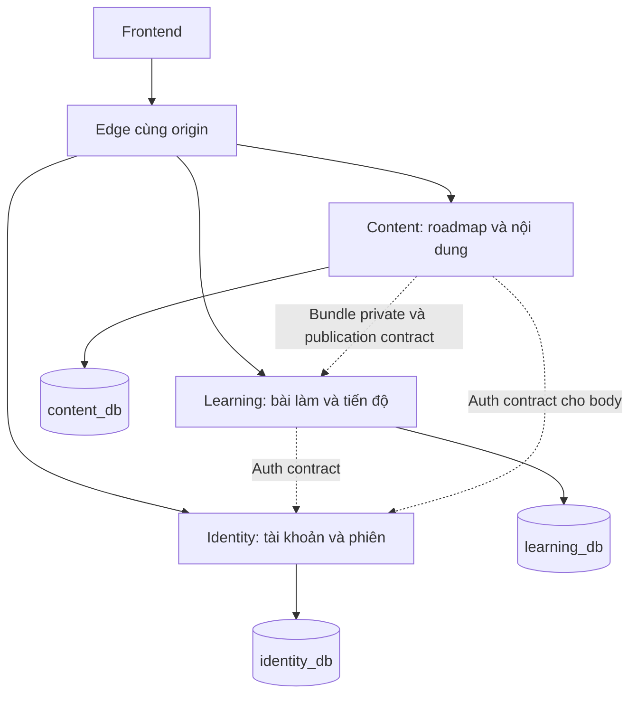

# Service catalog và API boundaries — R1

BL-MS01 · 30/09/2026 · Bổ sung ADR-03. **Chốt ba service Identity, Content, Learning ở mức thiết kế.** Mỗi service sở hữu dữ liệu, API và artifact riêng; edge chỉ định tuyến. Source/runtime chưa được triển khai. Giao thức security, đồng bộ và vận hành còn thuộc MS02–04.

**Bổ sung MS02/03:** [security/threat model](security-design.md) và [session LLD v3](../features/f10-identity-access/sessions/protocol.md) chốt INT-01/02/06, thêm API-I08 reauth/API-I09 operation status. [Data protocols](data-protocols.md), [publication](../features/f08-content/publication/protocol.md) và [lifecycle/recovery](lifecycle-recovery-protocol.md) chốt INT-03/04/05, HTTP outbox/inbox, gates và journals. Catalog có 28 browser routes; evidence MS01 vẫn là snapshot 26. Các protocol là thiết kế, build/test/ops/rebaseline còn MS04.

Đây là nguồn hiện hành cho ownership. [ADR-03](microservices-review.md) giữ review và lý do tách; [source BE](backend.md) giữ cây package; [source FE](frontend.md) giữ adapter/UI. [Backlog](../delivery-backlog.md) giữ trạng thái task.

## 1. Brief, phạm vi và tiêu chí

- Goal: mỗi use case R1 có service và DB chịu trách nhiệm; browser và service biết gọi contract nào, không đọc dữ liệu chéo DB.
- Context: REQ-01/09/14–16/18; S02 quyền content/session, S03 dữ liệu học, D05 năng lực, D13 findings MS-F01/08. Module nghiệp vụ không mặc định bằng service.
- Scope: service/data/module catalog, API public/nội bộ, bản sao content, source/build boundary và walk-through. Admin sau R1, runner R3. Transport, credential/token algorithm và SQL/OpenAPI thực thi nằm ngoài MS01.
- Plan: đối chiếu use case → chốt owner → chốt caller/contract → kiểm luồng và failure boundary → đồng bộ tài liệu/checkpoint.
- Rules/DoD: [AGENTS](../../AGENTS.md), [delivery contract](../delivery/contract.md), [quality process](../quality-process.md). Review thiết kế và kiểm link/ID, không dùng sơ đồ làm bằng chứng runtime.

| AC | Tiêu chí nghiệm thu MS01 | Vị trí review |
|---|---|---|
| MS01-AC1 | Ba service và mọi nhóm dữ liệu R1 có owner; không shared DB/entity | Mục 2–3 |
| MS01-AC2 | Public/internal API có owner, caller, nơi giữ contract; outline anonymous, body login | Mục 4–5 |
| MS01-AC3 | T1/T2 cùng Learning, content replica có provenance và quyền private | Mục 3/6 |
| MS01-AC4 | FE adapter, package, build/artifact/migration độc lập có ranh giới | Mục 7 |
| MS01-AC5 | Walk-through và findings phân biệt quyết định đã chốt với protocol còn thiếu | Mục 8–9 |

## 2. Ba service, use case và module

Các mũi tên nội bộ biểu diễn dependency nghiệp vụ, không có nghĩa mỗi request phải gọi network. MS02/03 chốt cơ chế cấp context/fence và tiếp nhận version. Edge không xác thực thay mọi service và không truy cập ba DB.

| Service | Use case và module bên trong | Không sở hữu |
|---|---|---|
| Identity — IDN | Cấp lời mời/activate, login/logout/logout-all, mật khẩu/reset, phiên và auth audit; MD10 phần thẩm quyền danh tính; điều phối disable/xóa account qua operator | Bài làm/progress, authoring, quyết định rubric, quyền owner tài nguyên Learning |
| Content — CNT | Hai roadmap, TOP/CAP/placement/prerequisite, unit/refresh card, bài luyện/case/rubric/mốc project, version và xuất bản; MD01, phần định nghĩa của MD02/07 | Trạng thái người học, lựa chọn case theo exposure, lưu hint đã xem, cấp evidence |
| Learning — LRN | Tạo/lưu/đóng attempt, support/exposure, nộp/chấm/lịch sử, ba chiều progress, guidance/readiness, CL-U-01, import/export/reset; MD04/05/11 và phần cá nhân của MD02/07 | Credential/session canonical, biên soạn/publish canonical, thực thi Java/Docker tùy ý |

MD06 là persistence **bên trong từng owner**, không phải DB service dùng chung: Identity lưu identity; Content lưu content; Learning lưu work/progress/transfer. MD10 gồm Identity authority và control tại từng receiver. MD03/09 ở FE; backend kiểm trace/evidence theo contract, không tin kết quả client. MD08/12 ngoài R1. Các module này đầy đủ trách nhiệm nhưng không đòi đủ ba backend đã có source.

Content lưu điều kiện prerequisite/readiness; Learning áp dụng điều kiện lên evidence/progress của user. FE ghép roadmap/placement với progress theo ID ổn định, render và giữ trạng thái UI. TOP/CAP dùng chung giữa Java Backend/DevOps có một ID canonical và một progress của user, không tách theo roadmap.

## 3. Ownership dữ liệu và giao dịch

Tên dưới đây là nhóm domain, không phải DDL đã tạo. Mỗi DB có runtime role và migration role riêng theo phạm vi service. Local có thể chung một PostgreSQL instance chứa ba database; credentials không cho đọc/ghi DB khác. Không FK/join/transaction xuyên DB, không truy vấn DB Identity để lấy owner ở repository Learning.

| ID | Dữ liệu/thẩm quyền | Owner / DB | Reference hoặc bản sao được phép |
|---|---|---|---|
| OWN-01 | User ID, loginName, password hash/version, trạng thái account | IDN / identity_db | LRN chỉ giữ userId opaque; thông tin hiển thị lấy DTO Identity |
| OWN-02 | Invite/reset token, session, credentialEpoch, revoke và auth throttle/audit | IDN / identity_db | CNT/LRN giữ context/fence cục bộ được xác minh theo MS02; không sao chép password/cookie/session table |
| OWN-03 | Roadmap/stage, TOP/CAP, placement, prerequisite và định nghĩa project/readiness | CNT / content_db | Public outline DTO cho FE; versioned definitions cho LRN |
| OWN-04 | Unit/refresh card/model schema, exercise/case/rubric, sources/review/impact manifest | CNT / content_db | Body DTO được phân quyền; private bundle sang LRN |
| OWN-05 | Publication revision/status/withdrawal và operation xuất bản | CNT / content_db | LRN stage/fence trước canonical commit rồi release policy; MS03 publication protocol |
| OWN-06 | Bundle content bất biến đã tiếp nhận, checksum/provenance, eligibility cục bộ | LRN / learning_db | Dẫn về canonical CNT; không cho edit/publish từ LRN |
| OWN-07 | Learner guard, learningEpoch/dataRevision, mutation fence và trạng thái reset | LRN / learning_db | userId/identity context là external reference; learningEpoch khác credentialEpoch |
| OWN-08 | Attempt/case assignment, draft/revision, hỗ trợ/exposure, viewed event, mutation receipt | LRN / learning_db | Body đề cho FE theo attempt; không phát private expected/rubric |
| OWN-09 | Submission/snapshot bất biến, job/lease/fencing, result, evidence và history | LRN / learning_db | Reference bundle/version được giữ đủ để giải thích kết quả |
| OWN-10 | Progress projection/review-needed, resume, recommendation/readiness, applied evidence | LRN / learning_db | Dùng definition CNT đã tiếp nhận; FE chỉ hiển thị DTO |
| OWN-11 | Import preview/staging/dedupe, export snapshot và unverified archive | LRN / learning_db | Import không tạo credential/account hoặc official evidence |
| OWN-12 | Reset receipt/tombstone/exposure tối thiểu và suppression metadata của dữ liệu học | LRN / learning_db + journal phục hồi | Intent/exposure journal durable ngoài snapshot trước reset final/disclosure; retention ở MS03 |
| OWN-13 | Account lifecycle operation và trạng thái các participant | IDN / identity_db + journal phục hồi | IDN điều phối terminal deletion; LRN/CNT đều suppression ACK, CNT không xóa curriculum; MS03 |
| OWN-14 | Outbox/inbox/delivery receipt, audit mutation/publish | Từng producer/consumer trong DB riêng | HTTP relay; producer state+outbox/receiver inbox+effect local atomic; MS03 envelope/sequence |

Log/trace tập trung không thay nguồn result/evidence/session. Export user chỉ snapshot Learning. MS03 chọn controlled checkpoint ba DB + manifest/journal, restore isolated/reference/realm/generation/credential recovery; provider/commands/drill MS04. Chung PostgreSQL instance không bảo đảm global snapshot.

**T1 và T2 là giao dịch local Learning.** T1 kiểm owner/context/fence/epoch/revision/exposure/version, ghi save+freeze+submission+job+receipt cùng transaction. Worker chấm pinned input ngoài transaction; T2 kiểm epoch/eligibility/job/fencing và ghi result+evidence+progress+job complete cùng transaction. Không HTTP/journal trong T1/T2. MS02 auth gates và MS03 publication/learner gates sắp thứ tự mutation/finalization; logout không tự hủy accepted job. Boundary/protocol chưa là bằng chứng DB runtime.

## 4. API browser và ownership contract

Tất cả path dưới có prefix `/api/v1`. Đây là danh mục contract **dự kiến**, chưa là router/OpenAPI chạy được. Path giữ baseline D08 nơi phù hợp; quyết định quyền ở bảng này thay điểm body public mơ hồ trong D08. Schema/error/CSRF và reauth proof chi tiết thuộc MS02 và task implementation sau rebaseline.

`Anon` cho phép chưa login; `Login` là phiên learner active hợp lệ; `Owner` gồm Login và kiểm quan hệ owner tại Learning. Browser không gửi owner/role/passed/graderVersion do mình chọn. Các trường context/revision/epoch hỗ trợ chống stale, không thay xác thực. API list/count/pagination/export cũng phải lọc owner.

| API ID | Method / path | Owner | Caller/quyền | Kết quả / hành vi |
|---|---|---|---|---|
| API-I01 | GET /session | IDN | Browser / Anon hoặc Login | Bootstrap identity/context/CSRF; anonymous response không lộ account |
| API-I02 | POST /auth/login | IDN | Browser / credential flow | Cấp phiên sau kiểm credential/account; chống login CSRF/throttle MS02 |
| API-I03 | POST /auth/logout | IDN | Browser / Login | Thu hồi phiên hiện tại; biên hoàn tất/retry thuộc MS02 |
| API-I04 | POST /auth/logout-all | IDN | Browser / Login + reauth | Thu hồi mọi phiên của mình theo MS02 |
| API-I05 | POST /auth/activate | IDN | Browser / invite flow | Consume token và đặt credential; không nhận role client |
| API-I06 | POST /auth/password-reset | IDN | Browser / reset-token flow | Consume reset token; revoke theo S02/MS02, không tự login |
| API-I07 | POST /auth/password-change | IDN | Browser / Login + reauth | Đổi credential/revoke; không viết DB Learning |
| API-I08 | POST /auth/reauth | IDN | Browser / Login + CSRF/context | Proof reset học gắn purpose/intent; password chỉ Identity |
| API-I09 | GET /auth/operations/{operationId} | IDN | Browser / initiating cookie/context binding | Status-only của operation này kể cả phiên đang revoke; không learner auth hoặc list |
| API-C01 | GET /catalog | CNT | Browser / Anon | Metadata hai roadmap/placement/publication; planned rõ |
| API-C02 | GET /topics/{topicId} | CNT | Browser / Anon | TOP/CAP/prerequisite/outline/status; không body activity/đáp án |
| API-C03 | GET /topics/{topicId}/units/{unitId} | CNT | Browser / Login | Published learner body, đúng version/policy; không private case/rubric |
| API-L01 | POST /attempts | LRN | Browser / Owner | Server chọn exercise version/case sạch; attempt+draft revision0 |
| API-L02 | GET /attempts/{attemptId} | LRN | Browser / Owner | Đề được gán + draft/revision/support/status; ghim bundle |
| API-L03 | PUT /drafts/{draftId} | LRN | Browser / Owner | CAS expectedRevision; conflict giữ bản tốt |
| API-L04 | POST /attempts/{attemptId}/support | LRN | Browser / Owner | Ghi exposure trước trả hint/lời giải được phép |
| API-L05 | POST /attempts/{attemptId}/abandon | LRN | Browser / Owner | Đóng attempt theo revision; không ghi CAP fail giả |
| API-L06 | POST /attempts/{attemptId}/submissions | LRN | Browser / Owner | T1 atomic, tối đa một submission/attempt; nhận bài khác chấm xong |
| API-L07 | GET /submissions/{submissionId} | LRN | Browser / Owner | Pending/error/result/history DTO; không private grader input |
| API-L08 | GET /receipts/{operation}/{key} | LRN | Browser / Owner | Lookup receipt **mutation Learning** sau timeout; không receipt auth |
| API-L09 | POST /viewed-events | LRN | Browser / Owner | Viewed theo unit/version published; không proven/applied |
| API-L10 | GET /progress | LRN | Browser / Owner | Ba chiều, version/review-needed; một progress cho shared TOP/CAP |
| API-L11 | GET /history | LRN | Browser / Owner | History có source/version và pagination ổn định |
| API-L12 | GET /recommendations | LRN | Browser / Owner | Next/ôn/readiness có lý do, chỉ đường vào khả dụng |
| API-L13 | GET /learning-data/export | LRN | Browser / Owner | Snapshot học; không password/token/private đáp án chưa được phép |
| API-L14 | POST /learning-data/import-preview | LRN | Browser / Owner | Validate/checksum/preview; chưa merge |
| API-L15 | POST /learning-data/import-apply | LRN | Browser / Owner | Preview+revision/epoch hợp lệ; merge+receipt local atomic |
| API-L16 | POST /learning-data/reset | LRN | Browser / Owner + reauth/xác nhận | Reset toàn dữ liệu học theo operation; không xóa account |

Practice, assessment và CL-U-01 dùng attempt contract/mode do server kiểm; chưa thêm một service/project submit API. Không có API user-list, role-edit, publish, account-delete công khai trong R1. Operator maintenance đi contract riêng ở mục 5. Abandon là đóng bài, không endpoint xóa lịch sử tùy ý.

OpenAPI/schema đích ở `contracts/http/{identity,content,learning}/`, phân vùng `public/` và `internal/`; service provider sở hữu định nghĩa và examples/error fixtures. FE chỉ consume public DTO. Các thư mục chưa tồn tại; MS04 gắn task tạo file/test thực. Common error envelope là schema có version, không là domain JAR dùng chung. Mã lỗi domain giữ S03/D08; lỗi dependency/fence chưa rõ phải fail/processing minh bạch, không trả thành công giả.

Catalog/outline public có thể cache theo publication revision. Unit body cần auth nên không dùng public cache key. Personal và authenticated body response dùng private/no-store policy theo MS02; không đưa rubric/answer vào bundle FE, sourcemap, log hoặc public CDN. Content không cung cấp đường bypass `/support`: case/solution chỉ được Learning tiết lộ sau exposure policy, kể cả cùng phiên hợp lệ.

R04a adapter decision04/10: API-I01 GET remains read-only/no cookie/idle touch. Explicit preauth mint uses POST `/api/v1/session` + `X-Auth-Flow: credential`, exact Origin and schemaVersion1 JSON, because same-origin GET cannot rely on browser Origin. [Identity public contract](../../contracts/http/identity/README.md) records allowlists/cookies/capabilities. Adapter is registered only by the explicit owned-lab `session` profile after startup qualification/public mTLS edge checks, not by `bootstrap`/`transport`. [Actual candidate evidence](../features/f10-identity-access/sessions/verification.md) defines runtime limits; I04/I07 reauth stays fail-closed until R04d, no signup/password-only proof or production edge claim.

### 4.1. Wire conventions chung — bổ sung D14

R02b tạo schema/examples/negative fixtures ở `contracts/http/common/`, không Java domain JAR. Provider và FE áp dụng khi endpoint được tạo; R31c compatibility registry/R33 audit. Chưa OpenAPI hoặc runtime parser. Giữ domain codes S03/D08 nhưng convention hiện hành ở đây; không tự migrate JSON v1/local FE.

- Public prefix **`/api/v1` giữ nguyên qua edge**; route/resources được receiver parse/allowlist và dùng canonical binding MS02. Encoding/path/query mơ hồ, duplicate privileged parameters hoặc content type sai bị reject trước admission/domain effect; không normalize password/answer tùy ý.
- JSON UTF-8, object keys không duplicate kể cả escaped equivalent, reject invalid encoding/unpaired surrogate. Counter bigint như expectedRevision/dataRevision/learningEpoch/credentialEpoch/publicationRevision/deliverySequence/lifecycleVersion là **decimal string** `0` hoặc chữ số không leading zero, range0..9223372036854775807; không exponent/float/negative. FE giữ string hoặc BigInt để so exact, không Number/parseInt; writer overflow fail không wrap. UUID/content IDs là string theo schema; bounded counts/limits và schemaVersion enum có thể number. Timestamp output UTC RFC3339 uppercase T/Z với millisecond precision, không dùng time thay sequence hoặc làm deadline rộng hơn.
- Command input reject unknown/privileged fields theo allowlist. Response cùng supported schema có thể thêm field optional; consumer bỏ field chưa biết, nhưng enum/state/action/major version chưa hiểu phải unavailable/unsupported, không tự gán completed/pass. N consumer với N-1 provider chỉ dùng request subset được hỗ trợ; field mới phải có transition/capability policy, không bật silent mutation fallback.
- Error envelope version1 có `schemaVersion`, `code`, `traceId`, `messageKey`; optional `operationId`, `retryAfterSeconds` và fieldErrors bằng tên field/code, không echo secret/answer/private expected/SQL/stack/owner khác. Status:400 malformed/schema;401 phiên/credential không hợp lệ với generic credential errors;403 CSRF/action deny;404 không tồn tại hoặc không thuộc owner;409 revision/key/epoch conflict;413 quá byte limit;429 throttled;503 dependency/maintenance/unavailable. Accepted async operation trả202 và state/status link thuộc đúng owner/binding; read job pending có thể200 nhưng không completed. Không đổi completed/pending theo HTTP2xx đơn thuần hoặc convert edge error thành HTML thành công.
- Learning mutations có receipt dùng `Idempotency-Key` opaque UUID; scope `(verified user,operation,key)` và canonical business fingerprint theo S03. Cookie/CSRF/context không thuộc fingerprint nhưng vẫn được authorize mỗi lần. Cùng key khác intent409, lost ACK tra receipt rồi retry **same intent** dưới context hợp lệ do người học xác nhận; client/edge không tự replay mutation sau401/403/đổi owner. Identity keys/preauth consume/initiating binding theo MS02, không blanket retry login để phát cookie mới.
- History pagination R21a: default20/max100, stable `(acceptedAt,resourceId)` order và initial asOf cutoff; `nextCursor` opaque authenticated, bound owner/learningEpoch/filter/sort/asOf/expiry. Mỗi request vẫn authorize/owner-filter; cursor không là token quyền. Invalid/tampered cursor400, stale epoch/filter409 buộc đọc trang đầu, không trộn old/new epoch. New records sau asOf xuất hiện khi refresh; reset/delete hide dù cursor cũ, không cross-owner list/count. Cursor signing key chỉ Learning, rotate/expiry fixtures theo service config; không trả raw query/answer hoặc dùng offset làm snapshot promise.

Negative fixtures WIRE-01–06 và owner/commands ở [test-release](../delivery/test-release-plan.md). [RFC7493](https://www.rfc-editor.org/rfc/rfc7493.html) hỗ trợ lựa chọn encoding/number interoperability; các status/key/cursor/version policy là quyết định app, không suy guideline thành implementation PASS.

## 5. Contract nội bộ và operator

Prefix `/internal/v1` không route browser qua edge. INT-01/02/06 có wire contract ở [session LLD](../features/f10-identity-access/sessions/protocol.md); INT-03/04/05 ở [data protocols](data-protocols.md). Chưa có API runtime. Mỗi receiver xác thực service/caller/audience/action; header userId không tự có thẩm quyền.

| Contract ID | Receiver/provider | Caller được phép | Namespace / surface | Nội dung / giới hạn | Owner đặc tả tiếp |
|---|---|---|---|---|---|
| INT-01 Auth context và admission | IDN | CNT/LRN | POST /internal/v1/auth-context/admissions | Online admission/direct mTLS response, bound action/context/request; local fence vẫn bắt buộc | MS02 contract, runtime sau MS04 |
| INT-02 Revoke/fence participant | CNT/LRN | IDN | PUT /internal/v1/session-fences/{operationId} | Static hai participant, local monotonic gate/receipt rồi ACK; absent session cũng fence | MS02 contract, runtime sau MS04 |
| INT-03 Immutable content bundle | CNT | LRN | GET /internal/v1/content-bundles/{bundleId} | Immutable private bytes/manifest/checksum; FE/IDN không có quyền | MS03 contract |
| INT-04 Publication phase/status | LRN | CNT coordinator | PUT /internal/v1/publication-operations/{operationId}/phases/{phase}; GET /internal/v1/publication-operations/{operationId} | STAGE/FENCE/RELEASE/ABORT receipt/status; canonical commit ở CNT sau FENCE ACK; không callback ACK | MS03 contract |
| INT-05 Account suppression/status | LRN/CNT mandatory | IDN coordinator | PUT /internal/v1/account-lifecycle/{operationId}/phases/{phase}; GET /internal/v1/account-lifecycle/{operationId} | SUPPRESS terminal UUID/lifecycle floor + purge status; absence vẫn tombstone/ACK; disable auth qua INT-02 | MS03 contract |
| INT-06 Reauth authorization cho mutation nhạy cảm | IDN | LRN | POST /internal/v1/reauth-authorizations/reservations | Proof purpose/intent/context/expiry, reserve idempotent; không bearer login hoặc reset đã commit | MS02 contract, runtime sau MS04 |
| OPS-01 Invite/reset/disable/delete account | IDN maintenance | Operator được cấp quyền riêng | Identity maintenance CLI | CLI/maintenance ngoài learner API; audit actor/operation; gọi INT-02/05 khi cần | MS02/03/04 |
| OPS-02 Validate/prepare/publish/withdraw | CNT maintenance | Operator/release process | Content maintenance CLI | Authoring → canonical content + operation; không write thẳng Learning | MS03/04 |
| OPS-03 Backup/restore/replay/rebuild | Từng service maintenance | Operator recovery | Service recovery CLI/runbook | Kiểm reference/journal/watermark; LRN rebuild projection từ evidence; không biến import thành trusted restore | MS03/04 |

CNT không giữ bài làm/progress; auth/lifecycle participant mandatory kể cả user absent, không xóa canonical curriculum vì learner deleted. IDN không đọc Learning history, LRN không được publish/disable account. HTTP relay/outbox+inbox được MS03 chọn cho ít consumer R1, không broker; gọi ngoài local commit. Journal là infrastructure port, không service thứ tư.

## 6. Replica content và nguồn sự thật

Content canonical sở hữu ID/version, immutable payload và publication operation. Learning tiếp nhận bundle vào kho private: ít nhất version refs, producer/schema, manifest/checksum, rubric/grader compatibility và trạng thái applied. Bản cùng ID/version nhưng checksum khác bị từ chối; không ghi đè bản đã dùng. Bundle không truy cập qua FE/public authoring path.

Attempt/submission ghim exercise/case/rubric/content version và support snapshot. T2 kiểm current policy của pinned bundle; history giữ, current mastery theo eligibility/impact hiện hành. STAGE bundle không là active; MS03 FENCE → canonical COMMIT → RELEASE giữ hiệu lực withdrawal. Case/hint disclosure chờ external exposure journal ACK.

Catalog public có revision canonical; Learning có applied revision. Response phải mang revision/provenance cần thiết để FE không hiển thị hai phần chưa tương thích như trạng thái hợp lệ. Khi release chưa đủ bundle/eligibility, activity liên quan unavailable/processing theo protocol; không lấy private rubric on-demand vào T2 hay dùng version mới nhất thay bản ghim. Content downtime có thể cho history đã lưu tiếp tục đọc khi auth hợp lệ; tạo attempt version mới phải có bundle active đã xác minh. Không hứa mọi flow đều khả dụng khi một service down.

## 7. Source, FE adapter và release boundary

Mỗi app ở `backend/services/{identity,content,learning}-service/` có entrypoint, package root, config, pom, migration và test riêng theo [backend source](backend.md). Maven parent chỉ quản conventions/version; có thể build chọn service cùng dependency build cần thiết mà không bắt đóng gói/chạy ba app. Artifact và image tag của mỗi app riêng; deploy service tương thích không buộc deploy đồng thời toàn repo. Câu lệnh/version/tag/CI matrix thực thuộc MS04.

`api → application → domain`; infrastructure thực hiện port. Không import Java source/domain/entity/repository của service khác. Adapter gọi schema HTTP/event có version; nếu sinh DTO thì chỉ từ contract được phân quyền, không sinh private rubric vào FE. Shared test fixture public khác fixture private; fixtures phải có owner và consumer được phép. Migration DB do service owner phát hành, role vận hành khác role migration.

| FE feature/adapter | Provider | Vai trò |
|---|---|---|
| identity | IDN / API-I01–09 | Session/context, credential/reauth/status screens; authGeneration/cache lifecycle |
| journey/topic | CNT / API-C01–03 + LRN / API-L10/12 | Outline/body theo quyền, ghép progress/readiness qua stable ID/revision |
| learning/collections | CNT body + LRN / API-L09 | Renderer/model local, viewed event; không cấp mastery |
| practice/assessment/projects | LRN / API-L01–08 | Assigned đề, draft/CAS/support/submit/result; CL-U-01 dùng cùng work flow |
| progress | LRN / API-L10–12 | History/ba chiều/guidance; không tự tổng hợp official evidence |
| learning-data | LRN / API-L13–16, IDN reauth | Export/import/reset và processing/conflict |

FE gọi cùng origin qua `api/client`; edge route `/session` và `/auth/*` → IDN, `/catalog` và `/topics/*` → CNT, các public learner path còn lại trong bảng → LRN. Không dựng BFF nghiệp vụ trong R1 chỉ để ghép hai DTO. Route prefix nội bộ/maintenance không public. Cấu hình route/header stripping/TLS được kiểm security ở MS02 và ops ở MS04.

Chính sách compatibility: thay đổi additive có schema version và provider/consumer tests; breaking change có contract/version mới và giai đoạn hỗ trợ consumer cũ trước retire. Build/deploy độc lập không cho phép đổi field/meaning tùy ý. API compatibility khác content/rubric compatibility: một DTO tương thích không tự làm pass bản cũ còn hiệu lực. MS04 chốt gate/release matrix; chưa có runtime đo khả năng triển khai độc lập.

## 8. Walk-through thiết kế và failure boundary

| Review ID | Luồng/tình huống | Owner và expected ở boundary |
|---|---|---|
| MS01-W01 | Anonymous xem Java Backend/DevOps | Edge → CNT outline; không cần đọc IDN/LRN DB; shared TOP/CAP không nhân bản; mở body yêu cầu login |
| MS01-W02 | Login → mở bài → tạo attempt | IDN cấp context; CNT body cần quyền; LRN kiểm context + bundle active rồi tạo learner state theo user đã xác minh; không auto-provision từ userId client |
| MS01-W03 | Autosave → hint → submit | LRN xử lý revision/exposure, support trước disclose; T1 save/freeze/submission/job/receipt local atomic; intake không gọi DB service khác |
| MS01-W04 | Worker → T2 → progress/history | LRN chấm bundle đã ghim, T2 local atomic; FE nhận official DTO, mô phỏng không được gắn nhãn Java chạy thật |
| MS01-W05 | Content đang down trong lúc T2/history | Dùng private pinned bundle/applied state hợp lệ; missing/ineligible state không chấm đoán; publication recovery được MS03 đặc tả |
| MS01-W06 | Identity down hoặc revoke tranh save/T1 | Public outline vẫn có boundary độc lập; protected action không tin context chưa xác minh; biên revoke/commit cần MS02, không chứng minh bằng introspection một lần |
| MS01-W07 | Publish/withdraw tranh T2 | CNT canonical và LRN applied có protocol activation; không giả eventual delivery bảo đảm mastery ngay; phần timing thuộc MS03 |
| MS01-W08 | Reset/import/export hoặc operator xóa user | Reset/import/export ở LRN, không đổi credential; xóa account do IDN điều phối LRN; reset/delete/restore chống replay thuộc MS03 |
| MS01-W09 | User B đổi ID của A, FE còn response A | LRN query/filter owner ở gốc và resource con; CNT body vẫn kiểm quyền; FE bỏ generation cũ; edge không cấp ownership |
| MS01-W10 | Một app đổi contract/migration và release | Service owner phát hành artifact/migration riêng; compatibility gate trước deploy; không shared entity hoặc all-service transaction |

Đây là review luồng trên giấy, **không phải login/API/DB/fault test đã chạy**. Runtime tests sau rebaseline cần chứng minh từng expected, nhất là MS01-W06/07/08 đang thiếu protocol chi tiết.

## 9. Findings, quyết định và phần chuyển tiếp

| Finding / quyết định | Kết quả MS01 | Còn lại |
|---|---|---|
| MS-F01 — T2 bị tách transaction | T1/T2 local Learning + publication/learner gates MS03 | DB race/fault sau MS04 |
| MS-F08 — quyền content body mơ hồ | Boundary đã xử lý: outline Anon; body Login; hint/solution chỉ qua LRN exposure; không có body public bypass | MS02 chốt enforcement/cache/service caller và negative tests |
| Source/API/data owner chưa chốt | OWN/API/INT/OPS, MS02 auth và MS03 delivery/publication/lifecycle đã có | MS04 executable schemas/build/CI/runtime tasks |

MS01–03 chốt boundary/auth/data protocol ở mức thiết kế; runtime chưa kiểm chứng. MS04 rebaseline R01–34, executable contract/test/release/ops trước code. Giữ owner, logout barrier, withdrawal, viewed/proven/applied và admin sau R1; credential recovery/pending disclosure là refinement phục hồi an toàn được ghi ở MS03.

Nguồn áp dụng: [requirements](../product-requirements.md), [feature/module](../feature-module-map.md), [S02 identity/access](../features/f10-identity-access/business.md), [S03 learning data](../features/f11-learner-work/data-contract.md), [D05 evidence](../features/f04-assessment/evidence-contract.md), [D08 baseline](../delivery/history/implementation-v2.md). Các cơ chế một-app/shared-DB ở nguồn cũ đã bị supersede về topology; tham chiếu chỉ giữ invariant/hành vi, không hướng dẫn code cũ. Lý do kiến trúc và nguồn primary nằm ở ADR-03; MS01 chốt quyết định riêng cho dự án, không claim benchmark hay audit bảo mật.
