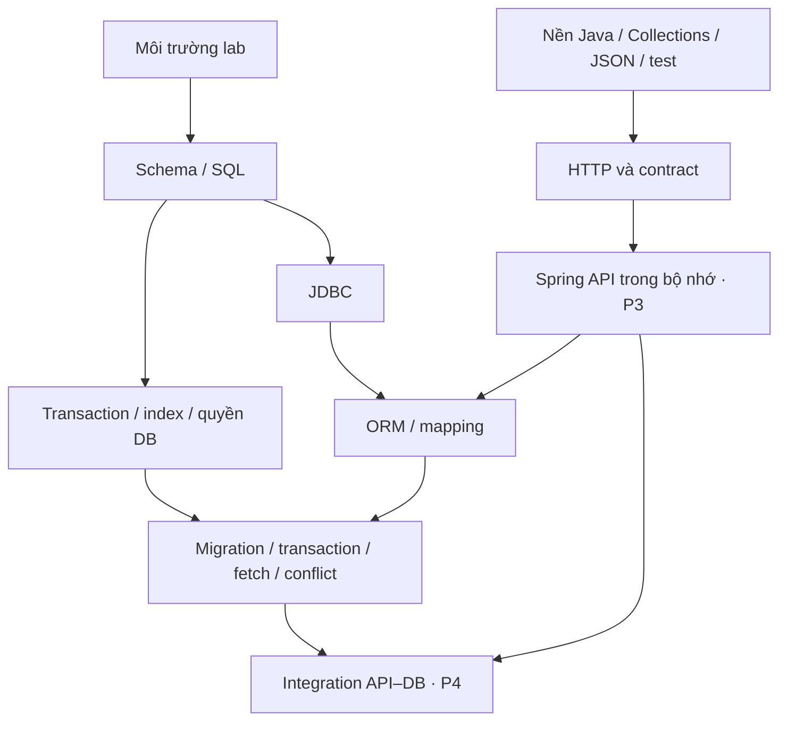

# Catalog HTTP, SQL, Spring và persistence — S04–S07

BL-D02 · bản thiết kế 1 · 23/09/2026. Tiếp nối [catalog nền tảng](core-foundations.md), dùng cùng TOP/CAP, A/B, selector `.A`/`.B`, prerequisite all-of/bắc cầu và quy tắc ID/version. Domain mới: HTTP, SQL, SPR, DATA. Tất cả 26 topic dưới đây là C (cốt lõi), `contentStatus=planned`, `catalogVersion=1`; không là nội dung đã xuất bản.

Nguồn phạm vi: [đường học](java-backend-learning-path.md), [business](../business-design.md), REQ-01/02/08/10. Task chỉ thiết kế mục/năng lực/readiness, chưa biên soạn bài, kiểm chứng ví dụ code hay chọn phiên bản công cụ. Đi qua S04–S07 không cấp mastery toàn K02/K08/K09/K10/K11.

## 1. Các quyết định về thứ tự

- HTTP và SQL là hai nhánh độc lập. SQL bắt đầu từ môi trường/file path và tư duy dữ liệu, không cần Java, HTTP hoặc Spring; người mới vẫn có thể theo thứ tự chặng mặc định.
- Spring API đầu tiên dùng dữ liệu trong bộ nhớ, chưa cần SQL/JDBC/JPA. Prerequisite là Java/Collections/JSON/test và HTTP tương ứng, không là trạng thái đã hoàn thành project P2.
- S07 hợp nhất SQL và API. JDBC được học trước ORM; transaction SQL trước transaction ứng dụng; phát hiện vấn đề truy vấn trước việc tối ưu.
- DB test dùng database/schema riêng có cơ chế reset cô lập. Docker/Testcontainers không là prerequisite bất kỳ topic nào ở đây. Sau S09 có thể thay cách cấp môi trường test bằng Testcontainers mà không tạo topic/progress nghiệp vụ trùng.
- Core tập trung một RDBMS và một stack Spring. Nhận biết các loại database không đồng nghĩa phải cài/học cả PostgreSQL/MySQL/NoSQL. Chọn sản phẩm/phiên bản lúc viết lab.
- CORS/cookie được hiểu ở S04, authorization triển khai ở S08. P3/P4 chưa có tài khoản, chỉ là lab local, không tự coi đủ để mở dịch vụ công khai.

## 2. Danh mục và prerequisite

### S04 — HTTP và API: 5 mục

| Topic ID | Mục học | K | Mức | Prerequisite topic | Mốc liên quan |
|---|---|---|---|---|---|
| TOP-HTTP-001 | Client/server và đường đi của request | K02 | C | TOP-ENV-002.B | P3 |
| TOP-HTTP-002 | HTTP request/response và semantics | K02,K08 | C | TOP-HTTP-001 | P3 |
| TOP-HTTP-003 | Resource, JSON và contract API | K08 | C | TOP-HTTP-002,TOP-FILE-002 | P3 |
| TOP-HTTP-004 | Browser, cookie, origin và trust boundary | K02,K16 | C | TOP-HTTP-002 | P3,P5 |
| TOP-HTTP-005 | Validation/error, phân trang và API docs | K08 | C | TOP-HTTP-003,TOP-COL-002 | P3 |

HTTP-004 có thể học song song contract; không buộc viết frontend hoàn chỉnh. Phần JSON tái sử dụng FILE-002, không kéo theo đọc/ghi file adapter. DNS/IP/TCP/TLS học đủ để theo request; quản trị mạng sâu là nhánh sau.

### S05 — Database và SQL: 7 mục

| Topic ID | Mục học | K | Mức | Prerequisite topic | Mốc liên quan |
|---|---|---|---|---|---|
| TOP-SQL-001 | Phân loại database và làm quen một RDBMS | K10 | C | TOP-ENV-002.A | P4 |
| TOP-SQL-002 | Schema, kiểu dữ liệu và ràng buộc | K10 | C | TOP-SQL-001 | P4 |
| TOP-SQL-003 | SQL CRUD, điều kiện và NULL | K10 | C | TOP-SQL-002 | P4 |
| TOP-SQL-004 | JOIN, tổng hợp và subquery | K10 | C | TOP-SQL-003 | P4 |
| TOP-SQL-005 | Transaction, isolation và cập nhật đồng thời | K10 | C | TOP-SQL-003 | P4 |
| TOP-SQL-006 | Index, execution plan và chi phí truy vấn | K10 | C | TOP-SQL-004 | P4 |
| TOP-SQL-007 | Quyền DB và backup/restore trong lab | K10,K16 | C | TOP-SQL-003,TOP-ENV-002.A | P4 |

Sau CRUD, JOIN/index và transaction có thể tiến song song. SQL-007 không đòi cloud/Docker; phạm vi DB test cá nhân. CTE/window/function nâng cao/replication/sharding không chặn CRUD hoặc API; D03 đặt chúng vào extension index.

### S06 — Spring API: 7 mục

| Topic ID | Mục học | K | Mức | Prerequisite topic | Mốc liên quan |
|---|---|---|---|---|---|
| TOP-SPR-001 | Dependency injection và cấu hình thành phần | K07,K09 | C | TOP-JAVA-006,TOP-ENV-004 | P3 |
| TOP-SPR-002 | Boot, cấu hình và request lifecycle | K03,K09 | C | TOP-SPR-001,TOP-HTTP-002,TOP-ENV-002.B | P3 |
| TOP-SPR-003 | MVC, DTO và lớp nghiệp vụ | K07,K08,K09 | C | TOP-SPR-002,TOP-HTTP-003,TOP-COL-007 | P3 |
| TOP-SPR-004 | Validation, lỗi và contract có thể gọi lại | K08,K09 | C | TOP-SPR-003,TOP-HTTP-005 | P3 |
| TOP-SPR-005 | Shared state và repository trong bộ nhớ | K06,K09 | C | TOP-SPR-003,TOP-JAVA-004,TOP-COL-004 | P3 |
| TOP-SPR-006 | Kiểm thử API và nghiệp vụ | K17 | C | TOP-SPR-004,TOP-SPR-005,TOP-JAVA-009 | P3 |
| TOP-SPR-007 | Cấu hình an toàn và log request | K03,K09,K16,K20 | C | TOP-SPR-002,TOP-FILE-005,TOP-HTTP-004 | P3 |

SPR-004/005/007 có thể tiến song song sau nền tương ứng. Shared state là phần bắt buộc cho API trong bộ nhớ, không để người mới đưa mutable state của request vào singleton rồi coi happy path là đủ. Không yêu cầu toàn bộ JMM, reactive hoặc microservices.

### S07 — Persistence: 7 mục

| Topic ID | Mục học | K | Mức | Prerequisite topic | Mốc liên quan |
|---|---|---|---|---|---|
| TOP-DATA-001 | JDBC, prepared statement và connection | K11,K16 | C | TOP-SQL-003,TOP-ENV-004,TOP-JAVA-007 | P4 |
| TOP-DATA-002 | Migration và môi trường dữ liệu riêng | K10,K11 | C | TOP-SQL-002,TOP-SQL-007,TOP-SPR-002 | P4 |
| TOP-DATA-003 | JPA/Hibernate/Spring Data và mapping | K09,K11 | C | TOP-DATA-001,TOP-SPR-003,TOP-SQL-004 | P4 |
| TOP-DATA-004 | Fetch, N+1 và phân trang dữ liệu | K11 | C | TOP-DATA-003,TOP-SQL-006 | P4 |
| TOP-DATA-005 | Transaction boundary và rollback ứng dụng | K09,K10,K11 | C | TOP-DATA-003,TOP-SQL-005 | P4 |
| TOP-DATA-006 | Xung đột cập nhật và optimistic locking | K06,K11 | C | TOP-DATA-005,TOP-SPR-005 | P4 |
| TOP-DATA-007 | Integration test API–DB và khôi phục trạng thái | K11,K17 | C | TOP-DATA-002,TOP-DATA-004,TOP-DATA-006,TOP-SPR-006 | P4 |

JDBC có thể học cùng nhánh SQL trước khi Spring sẵn sàng; cả chặng tích hợp vẫn cần API. Migration và nhánh JDBC/ORM có thể học song song. DB test/schema cô lập, constraint thật và transaction thật là phần cần xác minh; mock repository không đủ chứng minh hành vi DB.

## 3. Năng lực A/B

Mỗi dòng khai báo CAP tương ứng theo quy ước D01, ví dụ TOP-DATA-005 → CAP-DATA-005-A/B. Có 52 competency mới. Bảng là mục tiêu quan sát được, không phải đề bài/đáp án hoặc công thức tính điểm.

| Topic ID | A — năng lực/bằng chứng | B — năng lực/bằng chứng |
|---|---|---|
| TOP-HTTP-001 | Lần theo tên miền, IP, kết nối và server xử lý trong một request; phân biệt vai trò DNS/TCP/TLS | Phân biệt lỗi phân giải tên, kết nối/port và lỗi HTTP bằng dấu hiệu; không coi mọi lỗi là server 500 |
| TOP-HTTP-002 | Đọc/tạo request và giải thích method, path/query, header/body, status/response | Chọn semantics phù hợp cho thao tác đọc/ghi và giải thích safe/idempotent trong tình huống lặp request |
| TOP-HTTP-003 | Mô tả resource task và contract JSON cho thao tác, tách dữ liệu client với model nội bộ | Xác định field cần/được phép, cách biểu diễn tài nguyên thiếu và thay đổi contract có thể làm hỏng client |
| TOP-HTTP-004 | Theo dõi cookie và origin qua request/browser, phân biệt CORS với việc server kiểm tra quyền | Vẽ trust boundary đơn giản; phân biệt xác thực, phân quyền và mã hóa đường truyền; nhận ra cần kiểm tra input phía server |
| TOP-HTTP-005 | Thiết kế validation/error payload và status nhất quán cho input sai, tài nguyên thiếu và lỗi nội bộ | Mô tả filter/sort/pagination có giới hạn và thứ tự ổn định; tạo contract/API docs và bộ request ví dụ |
| TOP-SQL-001 | Phân biệt mô hình quan hệ/document/key-value và lựa chọn theo yêu cầu task, không xếp product thành các loại loại trừ tuyệt đối | Kết nối một RDBMS lab, xác định database/schema/table và tách dữ liệu lab khỏi dữ liệu cá nhân |
| TOP-SQL-002 | Thiết kế task/user có PK/FK/unique/not-null và kiểu phù hợp; giải thích quan hệ và normalization đủ dùng | Chứng minh constraint từ chối dữ liệu sai; phân biệt ràng buộc DB với validation giao diện |
| TOP-SQL-003 | Viết CRUD/WHERE/ORDER/LIMIT với tập dữ liệu cho trước và chỉ đúng phạm vi sửa/xóa | Xử lý NULL và điều kiện kết hợp bằng expected rows; phát hiện thao tác UPDATE/DELETE thiếu điều kiện trong lab |
| TOP-SQL-004 | Viết JOIN/GROUP/HAVING/subquery cho câu hỏi dữ liệu; giải thích khác biệt JOIN với nối tập kết quả | Phát hiện dòng bị nhân/thiếu do quan hệ hoặc NULL; đối chiếu kết quả với dataset có edge case |
| TOP-SQL-005 | Nhóm thay đổi trong transaction và xác minh commit/rollback bằng trạng thái dữ liệu | Quan sát hai phiên cập nhật và giải thích isolation/lock ở tình huống cụ thể, không hứa mọi mức isolation ngăn mọi anomaly |
| TOP-SQL-006 | Đọc execution plan cơ bản, chọn index cho một truy vấn và kiểm tra trước/sau trên dữ liệu xác định | Giải thích chi phí ghi/dung lượng và giới hạn kết luận từ số đo; không thêm index mọi cột theo thói quen |
| TOP-SQL-007 | Dùng tài khoản lab với quyền cần thiết và phân biệt quyền ứng dụng với quyền quản trị | Backup rồi restore vào nơi riêng, kiểm tra dữ liệu phục hồi thay vì chỉ thấy có file backup |
| TOP-SPR-001 | Tách dependency qua constructor/interface và lắp các thành phần bằng DI | Giải thích thành phần nào do container quản lý, cách chọn implementation/config và lỗi thiếu dependency |
| TOP-SPR-002 | Build/start ứng dụng Boot, theo request từ web server tới handler và xác định port/config | Phân biệt cấu hình theo môi trường, vai trò auto-configuration và cấu hình ghi đè; chẩn đoán lỗi startup có hướng |
| TOP-SPR-003 | Map route/DTO và gọi service giữ quy tắc task; repository là ranh giới lưu trữ | Tái sử dụng logic đã test và tách lỗi HTTP khỏi nghiệp vụ; không để controller sở hữu toàn bộ dữ liệu/logic |
| TOP-SPR-004 | Hiện thực validation và error handler theo contract, tránh trả stack trace/dữ liệu nội bộ cho client | Chứng minh CRUD/filter/pagination đúng status/body ở ca đúng/sai/không tồn tại bằng bộ request chạy lại được |
| TOP-SPR-005 | Nhận ra shared mutable state và tái hiện race ở thao tác tạo/cập nhật task trong bộ nhớ | Chọn cơ chế bảo vệ toàn thao tác nghiệp vụ; giải thích concurrent map không tự làm chuỗi check-then-act thành atomic |
| TOP-SPR-006 | Viết test API cho contract và lỗi, tách với unit test service theo mục tiêu | Kiểm tra request đồng thời có kiểm soát, reset dữ liệu test và phân biệt mock với server/API được chạy thật |
| TOP-SPR-007 | Đưa config/secret ra đúng chỗ, giới hạn lab local và giải thích cấu hình CORS theo client | Gắn ngữ cảnh/correlation cho log request và lỗi mà không ghi secret/body nhạy cảm; truy lần một request lỗi |
| TOP-DATA-001 | Thực hiện truy vấn bằng JDBC/prepared statement với parameter và đọc result/resource lifecycle | Phân biệt connection/pool/transaction scope; không nối input vào SQL và không để rò connection khi lỗi |
| TOP-DATA-002 | Dựng schema bằng migration có version trên DB trống và nâng một phiên bản lab có dữ liệu | Tách database/config test, phát hiện migration lỗi và mô tả phục hồi phù hợp; không sửa lịch sử migration đã áp dụng tùy tiện |
| TOP-DATA-003 | Phân biệt JPA/Hibernate/Spring Data và map entity/relationship theo schema đã học | Theo dõi entity lifecycle và truy vấn phát sinh, giữ DTO/API contract riêng; không coi repository method là không có SQL |
| TOP-DATA-004 | Nhận diện N+1/fetch thừa qua query count/log và thay kế hoạch fetch phù hợp | Giữ đúng số phần tử/thứ tự khi paging/filter; kiểm tra truy vấn và hành vi lazy theo transaction/context |
| TOP-DATA-005 | Đặt transaction quanh thay đổi nghiệp vụ và kiểm tra lỗi giữa chừng rollback đúng | Giải thích exception/boundary ảnh hưởng rollback trong cấu hình chọn cho bài; không cấp thành công khi chỉ một phần thay đổi được ghi |
| TOP-DATA-006 | Tái hiện lost update và phát hiện xung đột bằng version/optimistic locking | Trả kết quả xung đột theo contract, kiểm tra dữ liệu cuối và tránh retry mù làm lặp tác dụng phụ |
| TOP-DATA-007 | Chạy integration test với DB thật riêng cho migration/constraint/rollback và cập nhật xung đột | Kiểm tra restart giữ dữ liệu, cô lập/reset fixture và giữ API contract cũ khi thay repository; ghi rõ môi trường và phần chỉ mock |

## 4. Readiness project P3/P4

Readiness dùng competency A/B của các topic gốc bên dưới và prerequisite bắc cầu (tôn trọng selector). Các topic dạy qua ví dụ nhỏ; project ghép thành hệ thống. Không topic nào lấy trạng thái hoàn thành chính P3/P4 làm prerequisite.

| Mốc | Tập topic readiness gốc | Bằng chứng hoàn thành milestone | Ngoài phạm vi mốc |
|---|---|---|---|
| P3 bắt đầu | TOP-SPR-006,TOP-SPR-007 | Task API trong bộ nhớ: CRUD/filter/paging, validation/error contract, service/API test và thao tác đồng thời theo invariant, config/log không lộ bí mật | DB, tài khoản, triển khai công khai, queue/cache |
| P4 bắt đầu | TOP-DATA-007,TOP-SPR-007 | Thay adapter bằng DB; migration, restart giữ dữ liệu, rollback khi lỗi, xung đột cập nhật, kiểm tra query/fetch và regression contract trên DB test riêng | Auth S08, Docker/Testcontainers bắt buộc, SQL/ORM nâng cao toàn bộ |

P3/P4 có thể bắt đầu tích hợp từng phần trước khi đạt toàn bộ readiness, nhưng UI chỉ ghi “đủ nền tảng theo lộ trình” khi tập đã đạt. Bằng chứng milestone được đánh giá riêng, không tự cấp vì hoàn thành các topic. Hoàn thành P4 không nghĩa đã đạt mọi competency SQL-007 nếu mới backup mẫu mà chưa có evidence restore; topic prerequisites đề xuất học không tự sinh mastery.

P3 có contract version/reference và bộ request/test giữ lại để đối chiếu khi đổi storage tại P4. Authentication/ownership chưa có trong mốc này; P5 sẽ nối thêm contract/test, không giả đã hỗ trợ quyền ở P3.

## 5. Các nhánh cần giữ độc lập

Sơ đồ là nhánh khái niệm rút gọn; bảng mục 2 là nguồn dependency cụ thể. Không có Docker node trong graph; Docker được nối sau bằng năng lực môi trường, không qua trạng thái learner “đã xong P4”.

## 6. Walk-through và review

| Ca | Kết quả thiết kế cần giữ |
|---|---|
| Người chưa học SQL muốn xây API | Closure P3 chỉ kéo Java/HTTP/Spring/config/test, không kéo SQL/DATA |
| Người biết lập trình, muốn học SQL trước Spring | SQL closure chỉ kéo ENV file/path và các mục SQL; không Java/Spring/HTTP |
| Người chưa làm CLI lưu file | Có thể học API khi đạt JSON/Collections/test cần thiết; không phải hoàn thành FILE-003/004 hoặc P2 |
| Người bắt đầu ORM | DATA-003 kéo JDBC/SQL/mapping nền; không được bỏ ranh giới giữa SQL và repository abstraction |
| Người test persistence chưa học Docker | DB test riêng có thể dựng bằng công cụ RDBMS; không cần Testcontainers, không giả mock là DB integration |
| Người đã có API nhưng transaction còn yếu | P4 chỉ ra SQL-005/DATA-005 và case rollback; không báo đủ vì CRUD happy path pass |
| Người chạy hai request cập nhật cùng task | P3 có shared-state invariant; P4 thêm optimistic conflict, không đồng nhất hai cơ chế |
| Người thử ORM trước khi đủ prerequisite | Được xem trước; thiếu năng lực được dẫn về topic tương ứng, không khóa cứng và không tự cấp evidence |

REQ-01: có K/S/mức/P và trạng thái; REQ-02: prerequisite đủ và nhánh độc lập; REQ-08: readiness/đầu ra P3/P4; REQ-10: ID/CAP/version dùng chung D01. Rubric/điểm/hint theo D05, đề bài/đáp án/nguồn theo quy trình biên soạn. Review ở đây chỉ đánh giá curriculum, chưa xác minh Spring/SQL code hoặc hiệu quả học thật.

Ngoài phạm vi để D03 mở nhánh: gRPC/GraphQL/realtime/HATEOAS; SQL CTE/window/query nâng cao, NoSQL và distributed DB; executor/JMM/profiling; batch/reactive/Spring Cloud; propagation/cascade/batching nâng cao theo bài toán. Không thêm chúng thành prerequisite ẩn của P4.

Kiểm tra 23/09/2026: script đọc cả hai catalog xác nhận 54 topic và 108 competency không trùng, đủ A/B, K mapping/reference/selector hợp lệ, link tồn tại, dependency không vòng. S04/S05/S06/S07 lần lượt 5/7/7/7 mục. Kiểm tra closure xác nhận P3 không cần SQL/DATA hoặc file adapter; nhánh SQL không kéo Java/HTTP/Spring; ORM có JDBC trước; P4 bao gồm P3, SQL transaction, rollback, conflict và DB integration, không Docker prerequisite. Đã review tám ca walk-through ở trên; chưa learner test hoặc technical test các ví dụ Java/SQL/Spring, không chạy app test vì chỉ thay tài liệu.
