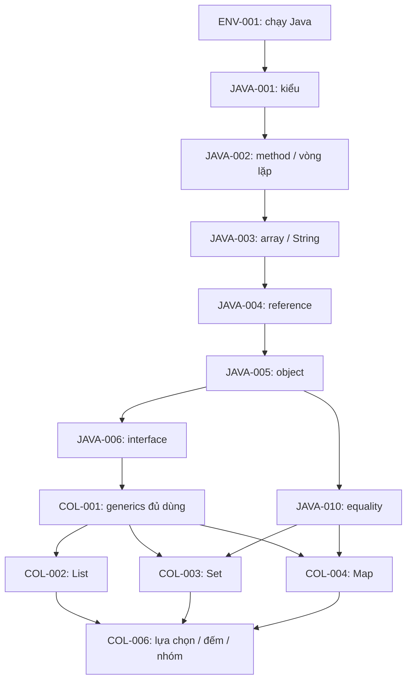

# Catalog nền tảng S00–S03

BL-D01 · bản thiết kế 1 · 23/09/2026. Đầu vào: [đường học](java-backend-learning-path.md), [business](../business-design.md), REQ-01/02/10 trong [requirements](../product-requirements.md). Phạm vi: mục học và năng lực từ môi trường đến Collections, CLI và file; chưa viết lesson, đề thi, đáp án hoặc code app.

Điều chỉnh BL-S04 ngày 28/09/2026: prerequisite ENV-004 dùng file/path để build app mẫu theo hướng dẫn, không bắt Java trước. JDK là setup của biến thể Java; CAP giữ nguyên. ENV-005–007 và catalogVersion=2 của quan hệ mới ở [catalog DevOps](devops-catalog.md); số lượng/kiểm tra D01 bên dưới là bằng chứng lịch sử.

## 1. Hợp đồng ID để dùng tiếp D02/D03

- Topic ID: `TOP-<DOMAIN>-<NNN>`, ví dụ TOP-JAVA-001. DOMAIN ở bản này là ENV, JAVA, COL, FILE. D02/D03 thêm domain có nghĩa riêng, kiểm tra không trùng; không đánh số lại topic cũ để khớp thứ tự học.
- Competency ID: `CAP-<DOMAIN>-<NNN>-<SUFFIX>`. Hai cột **A/B** trong bảng năng lực khai báo hai ID A và B tương ứng của mỗi topic. Ví dụ TOP-COL-004 khai báo CAP-COL-004-A và CAP-COL-004-B. Đây là 56 ID năng lực trong bản v1, không quy định mọi topic tương lai phải có đúng hai năng lực.
- K là phân loại; S là vị trí học mặc định; P là mốc áp dụng. ID topic/năng lực không phụ thuộc ba loại này. Dùng chung topic ở nhiều lộ trình vẫn giữ cùng ID/progress.
- Đổi tên hoặc chuyển chặng không đổi ID. Khi đổi nghĩa năng lực: tăng version và rà evidence; nếu tách/gộp topic, tạo ID mới, lưu quan hệ thay thế và lịch sử cũ. Không tái sử dụng ID đã bỏ cho khái niệm khác.
- Tất cả topic dưới đây có `contentStatus=planned`, `catalogVersion=1`. Hoàn thành thiết kế catalog không đồng nghĩa có bài published hoặc learner đã đạt năng lực.
- Mức **C**: cốt lõi trong chặng; **M**: mở rộng. Mốc bắt đầu project chỉ cần tập năng lực xác định ở mục 5, không mặc định phải xong toàn chặng.
- Prerequisite bảng là **all-of** các mục được liệt kê và prerequisite bắc cầu. Topic không có hậu tố cần cả A/B; hậu tố `.A` hoặc `.B` chỉ yêu cầu competency tương ứng, ví dụ TOP-ENV-002.A là CAP-ENV-002-A. Nhờ vậy Git/build không bắt người học xong process/port trước. Dấu `—` là không có prerequisite topic nội bộ, vẫn dùng đầu vào persona biết lập trình cơ bản. Không ngầm thêm dependency từ số thứ tự dòng/chặng hoặc nhóm K.
- Đây là điều kiện để đề xuất đường học, không khóa truy cập. Năng lực đã biết có thể xác nhận qua kiểm tra đầu vào; tự khai chỉ dùng để đề xuất, không tạo evidence đạt. Rubric/điểm chấm cụ thể do BL-D05 định nghĩa.

## 2. Danh mục và quan hệ

### S00 — Môi trường: 4 mục cốt lõi

| Topic ID | Mục học | K | Mức | Prerequisite topic | Mốc liên quan |
|---|---|---|---|---|---|
| TOP-ENV-001 | JDK/JVM, IDE và chạy Java | K01,K06 | C | — | P0 |
| TOP-ENV-002 | File/path, terminal, process/port/env | K01 | C | — | P0,P2 |
| TOP-ENV-003 | Git và thay đổi có thể xem lại | K03 | C | TOP-ENV-002.A | P0–P2 |
| TOP-ENV-004 | Project, build và dependency đủ dùng | K03 | C | TOP-ENV-002.A | P0–P2 |

Git học song song Java, không là điều kiện để hiểu object hay Collections. Build dùng project mẫu để học chạy lệnh; chưa yêu cầu người học hiểu cấu trúc OOP bên trong. Shell scripting/network diagnostic sâu để sau.

### S01 — Java và kiểm thử đầu tiên: 10 mục cốt lõi

| Topic ID | Mục học | K | Mức | Prerequisite topic | Mốc liên quan |
|---|---|---|---|---|---|
| TOP-JAVA-001 | Kiểu, biến, toán tử và chuyển kiểu | K04 | C | TOP-ENV-001.A | P0 |
| TOP-JAVA-002 | Điều khiển luồng, method và scope | K04 | C | TOP-JAVA-001 | P0–P2 |
| TOP-JAVA-003 | Array và String | K04 | C | TOP-JAVA-002 | P0–P2 |
| TOP-JAVA-004 | Reference, null và truyền tham số | K04,K06 | C | TOP-JAVA-003 | P0–P2 |
| TOP-JAVA-005 | Class/object và đóng gói trạng thái | K04,K07 | C | TOP-JAVA-004 | P0–P2 |
| TOP-JAVA-006 | Interface, composition và đa hình cơ bản | K04,K07 | C | TOP-JAVA-005 | P0–P2 |
| TOP-JAVA-007 | Input validation và exception | K04 | C | TOP-JAVA-003 | P0–P2 |
| TOP-JAVA-008 | Debugger và tái hiện lỗi | K03,K04 | C | TOP-JAVA-002 | P0–P2 |
| TOP-JAVA-009 | Unit test một method | K17 | C | TOP-JAVA-002,TOP-ENV-004.A | P0–P2 |
| TOP-JAVA-010 | Equality, hashCode và mutability | K04 | C | TOP-JAVA-005 | P0–P2 |

S01 dùng ví dụ input/exception theo mẫu trước khi học thiết kế hierarchy exception. Unit test có khung test class có sẵn để tập trung input/expected/actual, không đợi học hết OOP. Debugger, exception và testing có thể học xen kẽ nhánh object. Class loading/JMM/GC sâu không nằm ở đây.

### S02 — Collections và nghiệp vụ: 7 mục cốt lõi

| Topic ID | Mục học | K | Mức | Prerequisite topic | Mốc liên quan |
|---|---|---|---|---|---|
| TOP-COL-001 | Generics và đọc collection API | K04 | C | TOP-JAVA-006 | P1 |
| TOP-COL-002 | List: phần tử, vị trí và thứ tự | K04 | C | TOP-COL-001,TOP-JAVA-003 | P1 |
| TOP-COL-003 | Set: duy nhất và equality | K04 | C | TOP-COL-001,TOP-JAVA-010 | P1 |
| TOP-COL-004 | Map: khóa, giá trị và tra cứu | K04 | C | TOP-COL-001,TOP-JAVA-010 | P1 |
| TOP-COL-005 | Duyệt, sửa, sắp xếp và tính bất biến | K04 | C | TOP-COL-002,TOP-COL-003,TOP-COL-004 | P1 |
| TOP-COL-006 | Chọn cấu trúc, tìm/nhóm/đếm và Big O | K04,K05 | C | TOP-COL-002,TOP-COL-003,TOP-COL-004 | P1 |
| TOP-COL-007 | Quy tắc task và tách giao diện CLI | K04,K07,K17 | C | TOP-COL-002,TOP-COL-004,TOP-JAVA-007,TOP-JAVA-009 | P1 |

COL-005 và COL-006 có thể học song song; không buộc học sorting trước frequency/grouping. COL-007 chuẩn bị logic/enum và test từ bài nhỏ; không đòi đã hoàn thành project P1 để bắt đầu chính mục này. Học đủ S02 gồm 7 mục C, nhưng P1 có thể bắt đầu sớm theo mục 5.

### S03 — File và độ tin cậy: 6 mục cốt lõi, 1 mở rộng

| Topic ID | Mục học | K | Mức | Prerequisite topic | Mốc liên quan |
|---|---|---|---|---|---|
| TOP-FILE-001 | Đọc/ghi file và quản lý resource | K04 | C | TOP-ENV-002.A,TOP-JAVA-007 | P2 |
| TOP-FILE-002 | JSON và chuyển đổi dữ liệu có kiểm soát | K04,K08 | C | TOP-COL-002,TOP-COL-004,TOP-JAVA-007,TOP-ENV-004.A | P2 |
| TOP-FILE-003 | Storage interface và adapter file | K04,K07 | C | TOP-FILE-001,TOP-FILE-002,TOP-COL-007 | P2 |
| TOP-FILE-004 | Kiểm thử hồi quy và cô lập dữ liệu test | K17 | C | TOP-JAVA-009,TOP-FILE-003 | P2 |
| TOP-FILE-005 | Logging có ngữ cảnh, không lộ dữ liệu | K04,K20 | C | TOP-JAVA-007,TOP-ENV-004.A | P2 |
| TOP-FILE-006 | Date/time và biểu diễn thời gian | K04,K07 | C | TOP-JAVA-005,TOP-JAVA-007 | P2 |
| TOP-FILE-007 | Lambda, Stream và Optional đủ dùng | K04 | M | TOP-COL-005,TOP-COL-006,TOP-JAVA-006 | P2 mở rộng |

JSON ở S03 chỉ là dữ liệu, không yêu cầu HTTP/Spring. Logging và thời gian học song song persistence. Functional style là cách giải khác để so sánh với vòng lặp; không chặn P2 hay S04. FILE-006 cốt lõi vì backend cần xử lý thời gian, nhưng CLI P2 tối thiểu chưa buộc có deadline/timestamp. API thư viện, phiên bản Java và công cụ build cụ thể được chốt khi biên soạn, không giả có lab đã chạy.

## 3. Năng lực và bằng chứng quan sát được

Mỗi ô A/B dưới đây khai báo một competency ID theo mục 1. Đây là mục tiêu assessment, chưa là câu hỏi/đáp án hay ngưỡng điểm. Ví dụ tên thao tác không được dùng làm kết quả thực thi giả; bằng chứng mô phỏng và chạy thật phải được ghi đúng loại.

| Topic ID | A — năng lực/bằng chứng | B — năng lực/bằng chứng |
|---|---|---|
| TOP-ENV-001 | Chạy một chương trình mẫu từ IDE và terminal, xác định source/bytecode/runtime ở mức luồng | Phân biệt lỗi compile và runtime qua output; xác định phiên bản Java đang dùng |
| TOP-ENV-002 | Xác định đúng file bằng path tương đối/tuyệt đối và encoding; thao tác trong thư mục lab | Tìm process/port và đọc env của ví dụ; giải thích cấu hình đang tác động ở đâu mà không in secret |
| TOP-ENV-003 | Xem diff, tạo commit có nội dung rõ và đọc lịch sử thay đổi | Phân biệt untracked/staged/committed; loại file build/secret khỏi phần định lưu |
| TOP-ENV-004 | Build/run/test project mẫu bằng một build tool và giải thích vai trò dependency | Đọc lỗi dependency/config và làm lại thao tác từ hướng dẫn trên checkout/thư mục mẫu |
| TOP-JAVA-001 | Chọn kiểu và tính kết quả biểu thức với input thông thường | Nhận ra chuyển kiểu mất thông tin, phép chia nguyên và giá trị ngoài miền qua ca biên |
| TOP-JAVA-002 | Viết method với tham số/kết quả và nhánh/vòng lặp đáp ứng yêu cầu nhỏ | Lần theo scope/control flow và sửa lỗi điều kiện dừng/off-by-one bằng ví dụ phản chứng |
| TOP-JAVA-003 | Duyệt/tìm phần tử array và xử lý String trong yêu cầu nhỏ | Xử lý rỗng/index biên và phân biệt thao tác tạo String mới với thay đổi phần tử array |
| TOP-JAVA-004 | Lần theo biến/reference khi gán và gọi method, giải thích truyền giá trị | Phân biệt đổi reference với đổi object dùng chung; nhận biết null và tình huống dereference lỗi |
| TOP-JAVA-005 | Tạo class/constructor, field/method, access modifier và invariant nhỏ | Phân biệt instance/static, final và tính bất biến; giải thích trạng thái thay đổi ở object nào |
| TOP-JAVA-006 | Thay implementation qua interface và gọi đúng hành vi trong bài nhỏ | Chọn composition cho việc kết hợp trách nhiệm; giải thích override so với overload ở ví dụ có sẵn |
| TOP-JAVA-007 | Phân biệt input không hợp lệ với lỗi xử lý, trả/báo lỗi theo contract nhỏ | Bắt hoặc truyền tiếp exception có chủ đích; không nuốt lỗi và không coi input rỗng/sai là thành công |
| TOP-JAVA-008 | Tạo ca tái hiện ổn định và đặt breakpoint/step/watch để tìm vị trí sai | Đối chiếu expected/actual và chứng minh cách sửa bằng chạy lại ca đã lỗi |
| TOP-JAVA-009 | Viết test input/expected/actual cho một method, gồm ca đúng và biên | Tạo một thay đổi sai khiến test fail rồi sửa; phân biệt lỗi test với lỗi logic |
| TOP-JAVA-010 | Phân biệt identity và equality, giải thích hợp đồng equals/hashCode qua object nhỏ | Nhận biết rủi ro thay đổi field dùng cho equality/hash và chọn biểu diễn khóa ổn định |
| TOP-COL-001 | Đọc và dùng collection có type parameter, tránh raw type/cast không cần thiết | Phân biệt kiểu interface và implementation trong khai báo/khởi tạo và đọc chữ ký thao tác đơn giản |
| TOP-COL-002 | Thêm/đọc/sửa/xóa List, phân biệt vị trí và giá trị, giữ đúng phần tử trùng | Chọn List cho yêu cầu thứ tự/vị trí và xử lý danh sách rỗng hoặc index không hợp lệ |
| TOP-COL-003 | Loại phần tử trùng theo equality và giải thích vì sao chúng được coi là cùng phần tử | Chọn Set có đặc tính thứ tự phù hợp; không suy mọi Set giữ thứ tự chèn |
| TOP-COL-004 | Tra cứu/cập nhật theo khóa, phân biệt khóa không có và giá trị theo contract đã chọn | Giải thích thay thế giá trị khi trùng khóa và giữ khóa ổn định, dùng String ID cho ví dụ đầu |
| TOP-COL-005 | Duyệt/lọc/xóa an toàn theo cách hỗ trợ của collection; không dựa vào hành vi sửa khi đang duyệt không hợp lệ | Sắp xếp bằng tiêu chí rõ và phân biệt collection sửa được, view chỉ đọc và bản sao độc lập |
| TOP-COL-006 | Chọn List/Set/Map cho tra cứu/loại trùng/đếm/nhóm và giải thích trade-off | So sánh chi phí khi input lớn lên; phân biệt Big O với thời gian đo thực tế và nêu giả định lookup |
| TOP-COL-007 | Tách đọc lệnh/in kết quả khỏi thao tác task, mô hình ID/tiêu đề/trạng thái bằng class/enum | Bảo vệ tiêu đề hợp lệ, ID duy nhất, chuyển trạng thái hợp lệ và task không tồn tại bằng unit test nhỏ |
| TOP-FILE-001 | Đọc/ghi text đúng path/encoding và đóng resource kể cả khi lỗi | Phân biệt file thiếu, lỗi đọc/ghi và dữ liệu hỏng; chọn phản hồi rõ thay vì coi tất cả là danh sách rỗng |
| TOP-FILE-002 | Chuyển task sang JSON và ngược lại, kiểm tra trường/kiểu/giá trị cần thiết | Từ chối hoặc xử lý có chủ đích dữ liệu thiếu/sai/không tương thích; không deserialize object tùy ý |
| TOP-FILE-003 | Thay lưu trong bộ nhớ bằng adapter file qua interface, giữ contract logic task | Lưu rồi nạp lại giữ ID/trạng thái; lỗi load/save không âm thầm ghi đè bản dữ liệu đang tốt |
| TOP-FILE-004 | Tạo test roundtrip, file thiếu/hỏng và regression nghiệp vụ với dữ liệu test riêng | Chạy test độc lập thứ tự, dọn file tạm trong vùng test và phân biệt unit với integration file |
| TOP-FILE-005 | Ghi log có operation/context/error đủ để lần theo lỗi trong CLI | Loại secret/dữ liệu không cần thiết khỏi log; phân biệt log chẩn đoán với phản hồi người dùng |
| TOP-FILE-006 | Chọn cách biểu diễn ngày/giờ hoặc thời điểm theo yêu cầu và giải thích vai trò zone | Parse/format theo format rõ, xử lý input thời gian sai và kiểm tra chuyển đổi zone ở ví dụ nhỏ |
| TOP-FILE-007 | Viết lại một thao tác lọc/nhóm bằng lambda/Stream và so với vòng lặp | Dùng Optional để biểu diễn có/không theo contract; nhận ra side effect và lạm dụng chuỗi thao tác |

## 4. Đường vào mẫu Collections

Mẫu Collections của BL-D06 là một gói trải nghiệm ghép TOP-COL-002/003/004 và phần chọn cấu trúc của TOP-COL-006; TOP-COL-001 là ôn dẫn vào. Không tạo thêm topic “Collections” trùng nội dung và cấp progress lần hai. BL-D06 quyết định tập competency chính xác được assessment bao phủ; chưa cấp toàn bộ CAP-COL-006-B chỉ vì biết chọn cấu trúc cơ bản.

### Nhánh đầu vào tối thiểu

Sơ đồ rút gọn bỏ cạnh bắc cầu, bảng mục 2 là nguồn prerequisite đầy đủ. List không phải điều kiện của Set/Map; có thể học ba mục xen kẽ sau nền tương ứng. Git, I/O, SQL, Spring, Docker, thuật toán nâng cao và toàn bộ JVM không là điều kiện để vào mẫu.

### Ôn ngắn và kiểm tra đầu vào cần thiết kế ở BL-D06

| Nhóm nền cần kiểm tra | Hành vi quan sát | Khi còn thiếu |
|---|---|---|
| JAVA-001/002/003 | Đọc khai báo, gọi method, duyệt dữ liệu, xử lý String/array rỗng | Ôn type/method/loop/array; nếu chưa làm được quay đúng topic thay vì dồn vào bài Collections |
| JAVA-004/005/006 | Phân biệt biến/object, gọi qua interface, nhận ra null | Ôn mô hình object/reference và interface đủ dùng, không buộc học inheritance sâu |
| JAVA-010 | Phân biệt cùng reference và cùng giá trị; nhận biết equality/hash | Ví dụ String ID trước; ôn equality trước khi dùng object riêng trong Set/Map |
| COL-001 | Đọc List/Set/Map có type parameter và khởi tạo implementation | Phần dẫn nhập generic/API; chưa cần wildcard/type erasure |
| ENV-001 | Chạy được chương trình nếu chọn nhánh thực hành Java thật | Có thể dùng mô phỏng để khám phá; không đánh dấu năng lực chạy Java đã đạt từ mô phỏng |

Ôn ngắn chỉ là đường hỗ trợ. Bấm qua phần ôn không tạo bằng chứng đã đạt mọi prerequisite. Unit test không phải điều kiện để hiểu mẫu trực quan, nhưng là điều kiện để chứng minh logic khi bước sang P1.

## 5. Project mở theo năng lực, không theo số bài đã xem

Tập readiness dưới đây dùng toàn bộ A/B của các topic được nêu và prerequisite bắc cầu. UI phải chỉ ra năng lực còn thiếu, cho đọc trước hướng dẫn, không khóa cứng phần học. Không yêu cầu hoàn thành project làm prerequisite cho chính topic dạy project đó.

| Mốc | Tập topic readiness gốc | Đầu ra áp dụng / bằng chứng | Chưa bắt buộc |
|---|---|---|---|
| P0 | Không có | Bài tập nhỏ theo từng topic, chưa project chính | Toàn bộ Collections/OOP |
| P1 bắt đầu | TOP-COL-007 | CLI task CRUD/lọc bằng dữ liệu trong bộ nhớ; ca input sai, ID trùng/không tồn tại và trạng thái không hợp lệ có test | Set, sorting/Big O sâu, file, DB, Spring |
| P2 bắt đầu | TOP-FILE-003,TOP-FILE-004 | Giữ dữ liệu sau tắt/mở; file thiếu/hỏng/lỗi ghi có hành vi rõ; test riêng không phá dữ liệu tốt | Stream, timestamp/deadline, SQL, Docker |

Readiness khác hoàn thành. COL-007 dùng thao tác nghiệp vụ nhỏ trước; P1 tích hợp thành chương trình. FILE-003/004 dùng adapter và test mẫu trước; P2 gắn vào CLI và xác minh quy trình tắt/mở cùng recovery. Người có năng lực tương đương không phải làm lại P1 chỉ để được học file, nhưng vẫn cần bằng chứng riêng nếu muốn ghi “đã hoàn thành P1”.

Không gắn cứng P2 → mọi bài S04/S05: BL-D02 dùng competency thực sự cần (JSON, xử lý lỗi, tư duy dữ liệu...) để tạo prerequisite cấp mục. Thứ tự S00–S10 vẫn là tuyến khuyến nghị tổng quát.

## 6. Walk-through thiết kế và điều kiện bàn giao

### Người mới theo tuyến mặc định

1. ENV-001/002 → ENV-004; ENV-003 học xen kẽ, không chặn Java.
2. JAVA-001 → 002 → 003 → 004 → 005. Sau 002 có thể học 008/009 (009 cần build); sau 003 học 007; sau 005 học 006/010 độc lập.
3. COL-001 → 002/003/004 theo prerequisite. COL-005/006 học song song; khi có exception/test và List/Map, COL-007 chuẩn bị P1.
4. Làm P1. Học FILE-001/002 → 003 → 004 để tích hợp P2. FILE-005/006 xen kẽ; FILE-007 tùy chọn.
5. Hoàn thiện các mục C còn thiếu để hoàn tất phạm vi chặng, không nhầm đạt P1/P2 với hoàn thành toàn S02/S03.

### Các ca chống prerequisite quá nặng

- Người đã biết Java: kiểm tra đầu vào competency tương ứng, không bắt học lại theo số thứ tự S.
- Chưa biết Git: vẫn xem/học Collections được, nhưng Git còn thiếu trong coverage S00.
- Chưa biết exception/unit test: vào phần hiểu Collections được; P1 readiness chỉ ra phần còn thiếu.
- Chưa học Set/Comparator/Stream: có thể bắt đầu P1 nếu đã đạt tập readiness; không báo đã hoàn tất mọi Collections.
- Chưa có Java local: khám phá mô phỏng được; không cấp CAP-ENV-001-A hoặc bằng chứng project chạy thật.
- Chưa làm P1 nhưng đã biết các năng lực: có đường vào persistence; không dependency vòng qua trạng thái project.

### Traceability và giới hạn

| Requirement | Được cụ thể hóa ở đây |
|---|---|
| REQ-01 | 28 topic gắn K/S/mức/P; trạng thái planned; phạm vi nền tảng, chưa thay toàn cây 23 nhóm |
| REQ-02 | Prerequisite all-of cấp topic; năng lực A/B; đường vào và phần ôn Collections; không khóa cứng |
| REQ-10 | Quy ước ID/version/status dùng chung cho D02/03; không coi thiết kế là published |

Đây là review thiết kế curriculum, chưa phải learner test, technical review các lesson hoặc xác minh code Java. Công thức chấm/rubric/hỗ trợ do D05, đề bài/đáp án/nguồn phiên bản do D06. Nội dung JAVA/FILE được giới hạn theo năng lực bảng; các chủ đề như nested class/reflection/module, BigDecimal nâng cao, NIO nâng cao vẫn trong cây kiến thức và sẽ có điểm vào ở extension index của D03, không bị xóa khỏi chương trình.

Kiểm tra 23/09/2026 bằng script đọc trực tiếp các bảng: 28 ID topic không trùng, 56 competency được khai báo, đủ đầu ra A/B; S00/S01/S02/S03 lần lượt 4/10/7/7 mục. Reference và hậu tố competency hợp lệ, prerequisite không có vòng, mọi mục có đường vào; link tài liệu tồn tại. Đã kiểm tra closure Collections không kéo theo file/Git/test, P1 có List/Map/validation/test nhưng không buộc Set/sort/Stream, P2 không cần mục mở rộng. Closure được kiểm tra ở cấp topic để phát hiện chặn thừa; hậu tố `.A` vẫn chỉ cấp readiness cho năng lực A, không cấp mastery toàn topic.

Review thiết kế qua sáu ca ở trên đạt phạm vi BL-D01. 27 mục C và 1 mục M; chưa chạy thử với người học hoặc code Java, không chạy test app vì đầu ra chỉ là tài liệu. D02 có thể dùng các ID này để tiếp tục; không cần đổi tên/đánh số theo chặng mới.
