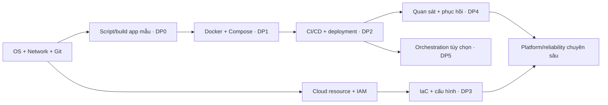

# Catalog DevOps — đường vào độc lập, nội dung dùng chung

BL-S04 · 28/09/2026 · catalogVersion=2 cho quan hệ được điều chỉnh; mọi nội dung vẫn `planned`. Đây là thiết kế, chưa là lesson/assessment/lab hoặc UI đã triển khai. Đầu vào: [khung DS00–DS11](devops-learning-path.md), [requirements](../product-requirements.md) REQ-01/02/10/18, [business](../business-design.md), [policy evidence](../features/f04-assessment/evidence-contract.md).

## 1. Quy tắc học và nguồn sự thật

- Giữ 78 TOP/156 CAP cũ trong [nền tảng](core-foundations.md), [API/data](core-api-data.md), [security/operations](core-security-operations.md); thêm 17 TOP/34 CAP dưới đây. TOP dùng chung chỉ có một định nghĩa, một progress theo owner; DS/S chỉ là vị trí trên roadmap.
- Bảng dưới khai báo CAP A/B theo quy ước: TOP-NET-001 có CAP-NET-001-A/B. Prerequisite all-of và bắc cầu; `.A`/`.B` chỉ lấy năng lực đó. `—` không yêu cầu topic nội bộ. Số thứ tự chặng không tạo cạnh prerequisite.
- C là lõi DevOps, M là nhánh mở rộng, S là chuyên sâu chưa phân rã. Lõi không đồng nghĩa bắt học xong trước project; DP có tập readiness riêng. Kubernetes/DS09 là M, DS11 là M/S; DS10 học xuyên suốt.
- Chỉ đổi quan hệ đầu vào của các topic shared ở mục 4, không đổi nghĩa CAP hay cấp lại evidence. Một app mẫu được cung cấp cùng source/build/test/config/migration/health/ownership fixtures giúp học vận hành mà không phải tự viết backend. Không bắt biết JDK, Collections, Spring, ORM hay hoàn thành P5/P7 để vào DevOps.
- Điều kiện phục vụ gợi ý học; luôn cho khám phá. Tự khai kinh nghiệm chỉ điều chỉnh gợi ý, chưa tạo mastery. D05/S03 vẫn phân biệt đã xem, chứng minh và áp dụng; thao tác ngoài app/log tự nộp chưa là verifiedExecution.

## 2. Bao phủ 12 chặng

Các dải ID dưới đây gồm tất cả số trong dải. Mỗi chặng dùng A/B của topic được nối; điều kiện chi tiết lấy bảng canonical, không lấy cả chặng trước.

| Chặng | TOP dùng chung hoặc mới | Đường vào và giới hạn | Gap có owner |
|---|---|---|---|
| DS00 OS/Linux | TOP-ENV-002,TOP-ENV-005 | File/process trước user/permission/service/package/SSH; lab Linux độc lập Java | DG-01 |
| DS01 Network/web | TOP-HTTP-001,TOP-HTTP-002,TOP-NET-001,TOP-NET-002 | Request cơ bản → routing/transport → proxy/firewall/TLS diagnostics | DG-01 |
| DS02 Git/automation | TOP-ENV-003,TOP-ENV-004,TOP-ENV-006,TOP-ENV-007 | Git/build app mẫu và shell; không học ngôn ngữ thứ hai bắt buộc | DG-01 |
| DS03 Container/Docker | TOP-CTR-001–008 | Image → build/lifecycle → network/volume → Compose/health/runtime | DG-02 |
| DS04 CI/CD/artifact | TOP-OPS-001,TOP-OPS-003,TOP-OPS-004,TOP-SEC-010 | Pipeline/gate và promotion cùng artifact; rollback khác restore | DG-02 |
| DS05 Cloud/deploy | TOP-CLD-001,TOP-CLD-002,TOP-SEC-009,TOP-OPS-002 | Resource/IAM → deploy/cost; một provider khi biên soạn, local để học cơ chế | DG-03 |
| DS06 IaC/configuration | TOP-IAC-001,TOP-IAC-002,TOP-IAC-003 | State/plan → drift/module → cấu hình host; không bắt Kubernetes | DG-03 |
| DS07 Observability | TOP-OPS-005,TOP-OPS-006,TOP-OPS-008,TOP-OPS-010 | Log/metric/trace → alert/SLO; tải lab không là SLA | DG-04 |
| DS08 Recovery/DB operations | TOP-SQL-001–003,TOP-SQL-005,TOP-SQL-007,TOP-OPS-004,TOP-OPS-007,TOP-OPS-009 | Quyền/connection/schema/migration/backup/restore; không bắt JOIN/index hay ORM để restore cơ bản | DG-04 |
| DS09 Orchestration · M | TOP-KUB-001–003 | Sau container/network/deploy; workload, discovery/storage, rollout; Helm/GitOps sâu còn gap | DG-05 |
| DS10 Security xuyên suốt | TOP-ENV-005,TOP-SEC-006,TOP-SEC-009,TOP-SEC-010,TOP-CTR-008,TOP-NET-002 | Quyền/secret từ đầu, IAM trước cloud; supply chain trước promotion; policy cluster sâu mở rộng | DG-02,DG-05 |
| DS11 Platform/chuyên sâu · M/S | TOP-CLD-002,TOP-OPS-010 là điểm vào; nhánh ở mục 7 | Reliability/capacity, multi-region, platform, FinOps nâng cao có nhu cầu riêng | DG-06 |

Sơ đồ chỉ nhịp gợi ý, không thêm dependency DP trước → DP sau. Security nằm trong prerequisite thật; monitoring cơ bản bắt đầu ngay từ app mẫu. Không khóa DP4 bằng DP3 hoặc Kubernetes.

## 3. Topic mới: khai báo và năng lực

### Danh mục canonical cho 17 topic mới

| Topic ID | Mục học | K | Mức | Prerequisite topic | Mốc liên quan |
|---|---|---|---|---|---|
| TOP-ENV-005 | Linux user, permission, package và service | K01,K16 | C | TOP-ENV-002 | DP0–DP5 |
| TOP-ENV-006 | Shell script có xử lý lỗi | K01,K03 | C | TOP-ENV-005,TOP-ENV-003 | DP0 |
| TOP-ENV-007 | Git cộng tác và review thay đổi | K03 | C | TOP-ENV-003 | DP2 |
| TOP-NET-001 | IP, subnet, routing và transport | K02 | C | TOP-HTTP-001 | DP1–DP5 |
| TOP-NET-002 | Proxy, firewall và chẩn đoán DNS/TLS | K02,K16 | C | TOP-NET-001,TOP-HTTP-002 | DP2 |
| TOP-SEC-009 | IAM và danh tính workload | K16,K22 | C | TOP-ENV-005,TOP-HTTP-001 | DP3 |
| TOP-SEC-010 | Supply chain và kiểm soát artifact | K16,K19 | C | TOP-OPS-001,TOP-SEC-006 | DP2 |
| TOP-CLD-001 | Cloud resource và mô hình triển khai | K19,K22 | C | TOP-NET-001,TOP-SEC-009 | DP3 |
| TOP-CLD-002 | Chi phí, inventory và vòng đời resource | K20,K22 | C | TOP-CLD-001 | DP3 |
| TOP-IAC-001 | Resource, state và plan/apply | K22 | C | TOP-CLD-001,TOP-ENV-007 | DP3 |
| TOP-IAC-002 | Module, drift và thay đổi hạ tầng | K22 | C | TOP-IAC-001 | DP3 |
| TOP-IAC-003 | Configuration management cho host | K01,K22 | C | TOP-ENV-006,TOP-CLD-001 | DP3 |
| TOP-OPS-009 | Hợp đồng vận hành app và dữ liệu mẫu | K10,K17,K19 | C | TOP-ENV-004,TOP-HTTP-002,TOP-SQL-003 | DP1–DP4 |
| TOP-OPS-010 | SLI/SLO và capacity có số đo | K20,K21 | C | TOP-OPS-005,TOP-OPS-008 | DP4 |
| TOP-KUB-001 | Cluster, workload và scheduling | K22 | M | TOP-CTR-007,TOP-CTR-008,TOP-NET-001 | DP5 |
| TOP-KUB-002 | Service, ingress, config và storage | K18,K22 | M | TOP-KUB-001,TOP-NET-002 | DP5 |
| TOP-KUB-003 | Rollout, scale và chẩn đoán cluster | K20,K22 | M | TOP-KUB-002,TOP-OPS-003,TOP-OPS-005 | DP5 |

### Năng lực A/B (34 CAP mới)

| Topic ID | A — năng lực/bằng chứng | B — năng lực/bằng chứng |
|---|---|---|
| TOP-ENV-005 | Xác định owner/group/mode, quản lý user/quyền trên vùng lab và giải thích quyền truy cập SSH | Cài package, quản lý service/process/log và chẩn đoán quyền sai hoặc disk/memory thiếu trong Linux lab; không mở quyền toàn hệ thống để né lỗi |
| TOP-ENV-006 | Viết script nhận tham số/env, dùng quoting/pipe/redirection và trả exit code theo kết quả | Thử input có khoảng trắng, thiếu biến, command fail và chạy lặp; dừng đúng lỗi, cleanup trong vùng lab, không in secret |
| TOP-ENV-007 | Tạo branch, xem diff và xử lý conflict nhỏ qua workflow review | Giải thích merge/rebase và khôi phục thay đổi lab có chủ đích; không ghi đè lịch sử dùng chung tùy tiện |
| TOP-NET-001 | Vẽ IP/subnet/default route/DNS, phân biệt TCP/UDP, port và NAT trong một đường kết nối | Dựa bảng route/connection test xác định lỗi địa chỉ, đường đi hoặc port, không kết luận lỗi ứng dụng chỉ từ timeout |
| TOP-NET-002 | Cấu hình lab reverse proxy, đường TLS và firewall theo luồng vào/ra xác định | Chẩn đoán DNS sai, cert/hostname sai, upstream lỗi hoặc rule chặn; phân biệt proxy/load balancer, không mở mọi port để sửa |
| TOP-SEC-009 | Phân biệt user/service identity, authentication và policy resource; thiết kế quyền tối thiểu cho workload mẫu | Kiểm tra allow/deny đúng resource, luân chuyển credential và quan sát audit không lộ secret; không dùng account quản trị cho runtime |
| TOP-SEC-010 | Theo dấu source/dependency/image tới artifact, đọc kết quả scan và phân loại việc cần xử lý | Thiết lập gate thử nghiệm cho artifact lỗi/không rõ nguồn; đối chiếu digest/provenance trước promotion, không coi scan sạch là hết rủi ro |
| TOP-CLD-001 | So sánh VM/PaaS/managed container, compute/block/object storage và network theo workload mẫu | Dựng môi trường thử theo sơ đồ, kiểm network/quyền và nêu phần trách nhiệm provider/người vận hành; mô phỏng local không chứng minh đã vận hành cloud thật |
| TOP-CLD-002 | Lập inventory/tag/owner và ước lượng các thành phần chi phí theo bảng giá của lab được chọn | Phát hiện resource bỏ quên, kiểm cảnh báo và teardown đúng phạm vi; phân biệt ước tính với hóa đơn, không giả budget alert tự ngắt mọi chi phí |
| TOP-IAC-001 | Diễn giải resource/dependency/state và đọc plan trước apply vào vùng lab | Thử cạnh tranh ghi state bằng backend hỗ trợ locking, bảo vệ state/secret và xử lý apply lỗi; không dùng force unlock khi chưa biết chủ lock |
| TOP-IAC-002 | Tách input/output/module và môi trường/state đúng phạm vi | Phát hiện drift, review replacement/destruction và thử phục hồi thay đổi lỗi; không coi chạy apply luôn an toàn hoặc luôn đảo ngược được |
| TOP-IAC-003 | Biểu diễn package/config/service ở desired state, phân biệt provision hạ tầng với cấu hình host | Chạy cấu hình lại không gây thay đổi ngoài dự kiến, thử host lỗi từng phần và xác định retry/rollback; không dùng script chạy lặp làm bằng chứng idempotence nếu chưa kiểm |
| TOP-OPS-009 | Chạy app mẫu từ hướng dẫn, xác định config/secret/port/health/dependency và hợp đồng schema/migration | Chạy bộ test có sẵn gồm smoke/ownership/migration trong DB lab riêng, tạo ca fail và đọc kết quả; không cần tự viết Spring hay ORM |
| TOP-OPS-010 | Chọn SLI theo hành vi người dùng, xác định cửa sổ/SLO/error budget từ dataset có nguồn | Đối chiếu latency/error/saturation dưới tải có giới hạn, đề xuất hành động/alert và ghi giới hạn đo; không lấy uptime process làm trải nghiệm người dùng |
| TOP-KUB-001 | Giải thích control plane/node, desired state, Pod/workload và yêu cầu scheduling/resource | Chạy workload trên cluster lab, quan sát restart/reschedule và chẩn đoán Pending/CrashLoop theo dấu hiệu |
| TOP-KUB-002 | Nối Service/ingress tới workload, cấu hình config/secret và storage với phạm vi quyền rõ | Thử lỗi discovery/readiness hoặc volume, phân biệt dữ liệu còn/mất; không coi có Secret resource là đủ toàn bộ bảo vệ dữ liệu |
| TOP-KUB-003 | Thực hiện rollout/scale và quan sát readiness/traffic trên cluster thử | Tạo rollout lỗi, dừng/khôi phục theo runbook và kiểm dịch vụ/dữ liệu; scale nhiều replica không tự chứng minh HA |

Không tạo TOP riêng cho từng hãng. SEC-009 tập trung IAM resource/workload, không cấp CAP-SEC-003/004 về session/ownership API. SEC-010 tập trung chuỗi artifact, không thay CTR-002 build image. OPS-009 là đọc/vận hành hợp đồng app mẫu, không thay CAP-DATA về tự triển khai persistence.

## 4. Tháo prerequisite Java khỏi phần vận hành dùng chung

Bảng này ghi lý do thay đổi; prerequisite thực thi canonical đã sửa trực tiếp trong hai catalog gốc. Không tạo profile có CAP thấp hơn cho DevOps. Năng lực đầu ra cũ giữ nguyên; bài tập Java chuyên biệt bổ sung điều kiện lab, không biến chúng thành điều kiện học toàn topic.

| Topic shared | Prerequisite canonical mới | Lý do |
|---|---|---|
| TOP-ENV-004 | TOP-ENV-002.A | Build/run/test app mẫu theo hướng dẫn; JDK chỉ cần cho biến thể Java |
| TOP-CTR-001 | TOP-ENV-002.B | Process đủ để vào image/container, không cần chạy Java trước |
| TOP-CTR-006 | TOP-CTR-002,TOP-CTR-004,TOP-CTR-005,TOP-OPS-009 | App/DB mẫu có contract/test thay điều kiện tự viết persistence |
| TOP-CTR-007 | TOP-CTR-006 | Health/shutdown quan sát từ app mẫu, không cần tự cài Spring lifecycle |
| TOP-SEC-006 | TOP-ENV-002,TOP-HTTP-001,TOP-SQL-007.A | Secret/quyền/TLS không cần password account implementation; topic vẫn dạy phân biệt hash/encryption |
| TOP-OPS-001 | TOP-ENV-003,TOP-ENV-004,TOP-CTR-002,TOP-ENV-006 | Pipeline dùng test suite mẫu; tác giả Java viết unit test riêng ở JAVA-009 |
| TOP-OPS-002 | TOP-SEC-006,TOP-CTR-008,TOP-NET-002 | Domain/TLS có nền mạng độc lập ngôn ngữ |
| TOP-OPS-003 | TOP-OPS-001,TOP-OPS-002,TOP-CTR-007,TOP-OPS-009 | Deployment chạy migration/test được cung cấp, không đòi ORM |
| TOP-OPS-004 | TOP-OPS-003,TOP-SQL-005,TOP-OPS-009 | Compatibility và rollback có fixture SQL, không cần transaction JPA |
| TOP-OPS-005 | TOP-OPS-009,TOP-CTR-007 | Có app mẫu/log/metric trước release; không cần chờ toàn deployment |
| TOP-OPS-007 | TOP-SQL-007,TOP-OPS-004 | Restore và migration compatibility độc lập integration test Java |
| TOP-OPS-008 | TOP-OPS-003,TOP-OPS-005,TOP-OPS-009 | Bộ smoke/ownership mẫu vẫn đủ đầu ra cũ, không ép tự viết Spring Security |

CTR-008 tiếp tục cần SEC-006; OPS-006 tiếp tục cần OPS-005. Backend P6 vẫn cần SEC-008, P7 nhận đủ readiness P6 như catalog gốc; không suy học DP1/DP2 là hoàn thành project Java. Đổi prerequisite không thay version rubric/evidence khi ý nghĩa CAP không đổi; D08 validator/publish ghi catalog change và kiểm closure lại.

## 5. Readiness và đầu ra project song song

Readiness dùng all-of A/B và bắc cầu như topic. Đây là tập để bắt đầu, không là điểm thưởng hoặc bằng chứng hoàn thành. Mỗi DP còn phải chứng minh tích hợp trong bối cảnh cụ thể; không yêu cầu hoàn thành DP trước nếu đã có năng lực tương đương.

| Mốc | Readiness gốc | Đầu ra để đánh giá áp dụng | Không bắt buộc |
|---|---|---|---|
| DP0 · Tự động chạy app mẫu | TOP-ENV-006,TOP-ENV-004 | Script build/test/run/check từ checkout sạch, exit code đúng; có ca command fail và chạy lặp | Java core, database, Docker |
| DP1 · App/DB container | TOP-CTR-007,TOP-CTR-008 | Compose/network/config/health hoạt động; giữ dữ liệu sau recreate, thử DB down và runtime không quyền thừa | Tự viết API, P4/P5, Kubernetes |
| DP2 · Release có kiểm soát | TOP-OPS-004,TOP-OPS-008,TOP-SEC-010,TOP-ENV-007 | Commit → test gate → artifact → staging/deploy; smoke/ownership, promotion cùng artifact, rollback app và đối chiếu DB | Cloud trả phí, IaC, hoàn thành DP1 hoặc P7 |
| DP3 · Môi trường tái lập | TOP-IAC-002,TOP-IAC-003,TOP-CLD-002 | Plan/review/state isolation, apply và drift; cấu hình host chạy lại, teardown và inventory chi phí | Kubernetes, CI/CD toàn khóa, hoàn thành DP2 |
| DP4 · Diễn tập sự cố | TOP-OPS-007,TOP-OPS-006,TOP-OPS-010 | Alert có hành động; incident timeline/runbook/postmortem; restore DB riêng, đo dữ liệu mất/thời gian và đối chiếu RPO/RTO mục tiêu | IaC, multi-region, hoàn thành DP3 |
| DP5 · Orchestration mở rộng | TOP-KUB-003 | Rollout/scale/định tuyến/storage, fail và recovery có log/metric và kiểm dữ liệu | Mesh, GitOps/Helm nâng cao, tự xây control plane production |

Có thể phát triển một app mẫu xuyên DP0–DP4 hoặc dùng fixture khác đáp ứng contract; không cần project ngay bài đầu. Với DP3/cloud, bản local chứng minh cơ chế đã thử, không cấp năng lực cloud-specific còn thiếu. R2 phải cung cấp sandbox hoặc phương án không trả phí để học; chưa chọn provider/giá hay yêu cầu tạo tài khoản cloud.

P/DP có rubric milestone riêng. Một submission có thể được tham chiếu làm bằng chứng cho nhiều tiêu chí tương thích, nhưng mỗi milestone phải được đánh giá rõ; mở roadmap khác không nhân đôi pass. Khi chưa có xác minh thực thi, ghi selfReport/unverified theo S03, không làm giả runner trong R1.

## 6. Walk-through nghiệm thu thiết kế

| ID | Persona/tình huống | Expected |
|---|---|---|
| DV-01 | Mới lập trình, chọn DevOps | ENV-002 → Git/build/Linux/script, tới DP0 không có JAVA/SPR/DATA prerequisite |
| DV-02 | Chỉ muốn học Docker | CTR-001 từ process, đi build/lifecycle/network/volume; chưa kéo P5/auth implementation |
| DV-03 | Tới Compose/DP1 chưa biết Spring | OPS-009 và SQL cơ bản giúp vận hành app mẫu; giữ nguyên CAP-CTR, không chứng nhận viết backend |
| DV-04 | Java learner đã đạt Docker | Chuyển roadmap giữ evidence/progress; chỉ bổ sung Linux/network/IaC nếu còn thiếu |
| DV-05 | Muốn CI/CD và rollback | Có test fixture/gate/migration compatibility; DP2 không cần cloud hoặc Kubernetes |
| DV-06 | Muốn IaC trước pipeline | DS05 → IAC, DP3 không có dependency DP2/OPS-003 |
| DV-07 | Muốn quan sát và restore | Log/metric từ app mẫu; DP4 có SQL/rollback, không buộc IaC/Kubernetes |
| DV-08 | Chưa muốn orchestration | DP0–DP4 không kéo KUB; DS09/11 vẫn thấy được nhưng không vào mẫu số bài published |
| DV-09 | Chọn Kubernetes | Có container/readiness/network/deploy trước DP5; không tạo cycle vào Docker |
| DV-10 | Đưa log tự khai hoặc chỉ replay mô phỏng | Không ghi verifiedExecution/applied; gắn nhãn đúng nguồn |
| DV-11 | Đã làm Task API, mở DP2 | Reuse evidence phù hợp, không tự cấp DP2 chỉ từ P7 hoặc cùng artifact |
| DV-12 | Bài chung chưa published hoặc case chưa có | Có outline, không giả bài dùng được; gợi ý thực hành chỉ từ content published |

## 7. Gap list và owner bàn giao

Owner ở đây là task/module chịu trách nhiệm, không tự tạo chat hay giao việc cho người khác. DG là ID gap, không là TOP hoặc task READY; E05 phải chia một output/batch trước triển khai.

| Gap | Còn thiếu sau catalog | Owner / thời điểm | Điều kiện đóng |
|---|---|---|---|
| DG-01 | Lesson/assessment Linux/network/shell/Git, biến thể build app mẫu đa nền máy | BL-E05 / MD01, batch DS00–02 sau R1 | Version công cụ/môi trường rõ; ca lỗi/nguồn/rubric và lệnh được chạy thật |
| DG-02 | App mẫu OPS-009 và lab CTR/OPS/shared, supply chain/registry/scanning | BL-E05 phối hợp BL-E03 / MD01, dùng cùng nguồn | Fixture build/test/auth/migration/health; giữ cùng CAP/rubric, không tạo hai bản bài Java/DevOps trùng |
| DG-03 | Provider/sandbox/cost, IaC và configuration tool, state backend/locking | BL-E05 / MD01, batch DS05–06 | Chọn một lab có quota/cleanup, kiểm quyền/state/drift; không khóa học vào trả phí |
| DG-04 | Dataset SLI/SLO, tải lab, DB restore/RPO/RTO/runbook | BL-E05 phối hợp BL-E03 / MD01 | Có ca incident và restore đã thử, tách số đo lab với mục tiêu/SLA |
| DG-05 | Helm/GitOps, policy/RBAC/network policy sâu, cluster upgrade/backup | BL-E05 / MD01, nhánh M sau KUB cơ bản | Tách TOP/CAP khi chọn nhu cầu, prerequisite tối thiểu, kiểm rollout/recovery và phiên bản API |
| DG-06 | HA DB/replication/failover, distributed reliability/capacity, multi-region, platform/self-service, policy/FinOps sâu | BL-E05 / MD01, nhánh M/S sau OPS-010/CLD-002 và nền tương ứng | Chọn bài toán cụ thể, thêm TOP/CAP trước lesson; không gắn toàn nhánh vào lõi |
| DG-07 | Schema catalog chứa DS/DP và prerequisite mới, route/render shared progress | BL-D08 / MD01/02/07 rồi task R1 v2 | Validator/reference/DAG và projection user + CAP duy nhất; R1 chỉ outline DevOps |
| DG-08 | Nguồn xác minh lab tự chạy ngoài app | BL-E04 / MD08, chỉ khi runner được giao | Contract provenance/isolation và test; trước đó giữ unverified, không chặn đọc/học |

DB vận hành dùng cùng SQL-001/002/003/005/007; họ PostgreSQL/MySQL/NoSQL và lựa chọn storage nằm trong [extension index](extension-index.md). Không phát sinh một khóa SQL thứ hai. DG-06 dành HA/failover sâu, không coi backup file là đã có availability.

## 8. Nguồn đối chiếu và bàn giao

Đối chiếu phạm vi ngày 28/09/2026, không coi đây là kiểm chứng bài/lệnh cụ thể:

- [Kubernetes concepts](https://kubernetes.io/docs/concepts/) và [components](https://kubernetes.io/docs/concepts/overview/components/) làm ranh giới cho workload/cluster/network/storage; công cụ lab/version chọn ở E05.
- [Terraform state locking](https://developer.hashicorp.com/terraform/language/state/locking) xác nhận locking phụ thuộc backend; vì vậy IAC-001 yêu cầu backend hỗ trợ, không hứa mọi backend tự khóa. Đây là nguồn ví dụ, chưa quyết định dùng Terraform thay công cụ khác.
- [Google SRE — Implementing SLOs](https://sre.google/workbook/implementing-slos/) làm cơ sở tách SLI người dùng/SLO/error budget ở OPS-010; không tự đặt SLO cho app.

D08 nhận graph 95 TOP/190 CAP và DS/DP, giữ ID shared; D06b tiếp theo vẫn tập trung Collections. [Backlog](../delivery-backlog.md) ghi kiểm tra thực tế và trạng thái; 12 DV ở trên là expected review thiết kế, không tuyên bố đã có user test, runner hay bài DevOps published.
