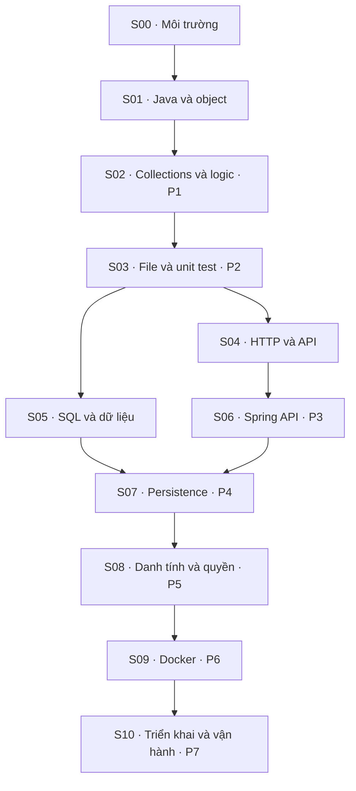

# Java Backend — Đường học cốt lõi v1

Điều chỉnh 26/09/2026: [roadmap DevOps](devops-learning-path.md) là đường học riêng. Docker thuộc DS03; S09/S10 dưới đây là mốc tích hợp vận hành cho project Backend, liên kết nội dung chung và giữ nguyên TOP/CAP/progress. Không coi người học DevOps phải hoàn thành Java/P5/P7 trước khi bắt đầu.

Ngày: 23/09/2026. Trạng thái: thiết kế lộ trình để review; chưa triển khai vào app. Đầu vào là [23 nhóm kiến thức](backend-knowledge-outline.md) và [business design](../business-design.md). Người học biết lập trình cơ bản, mới học Java/backend.

## 1. Đích đến và cách đọc

Đích của đường cốt lõi: tự xây, kiểm thử, đóng gói và triển khai một Task API có dữ liệu bền vững, xác thực, phân quyền theo chủ sở hữu và cách chẩn đoán/phục hồi lỗi. Đây là năng lực ở phạm vi project học tập; không đồng nghĩa đã thành thạo mọi nhóm Backend hay sẵn sàng vận hành hệ thống lớn.

- K01–K23 là nhóm kiến thức, S00–S10 là chặng học, P0–P7 là mốc project. Ba loại ID không thay thế nhau.
- Một nhóm K có thể xuất hiện ở nhiều chặng với độ sâu khác nhau. Đi qua chặng không tự đánh dấu toàn bộ nhóm K đã hoàn thành.
- Thứ tự là hướng dẫn. Người học được xem trước hoặc làm kiểm tra đầu vào để bỏ qua phần đã biết; tự khai đã biết không cấp bằng chứng thành thạo.
- Các điều kiện dưới đây là năng lực đầu vào, không phải khóa cứng giao diện. Chưa đạt thì đề xuất phần bổ sung cụ thể, vẫn cho khám phá.
- Không gán lịch cố định khi chưa biết thời gian học. Chuyển chặng dựa vào đầu ra và bằng chứng, không dựa vào số ngày hay số lần bấm Next.

## 2. Thứ tự và nhánh song song

S04 và S05 độc lập sau S03; có thể học nối tiếp hoặc xen kẽ. S06 không cần chờ S05: API đầu tiên dùng dữ liệu trong bộ nhớ. S07 là điểm hợp nhất cần cả SQL lẫn API. Docker có thể khám phá từ lúc app chạy local; S09 là mốc tích hợp đầy đủ sau P5. Kiểm tra đầu vào có thể đưa người đã biết SQL vào S05 sớm hơn; sơ đồ là đường mặc định cho persona hiện tại.

## 3. Các chặng

Catalog cấp mục S00–S03 đã có tại [core-foundations.md](core-foundations.md): 28 topic, 56 năng lực, prerequisite cụ thể và readiness P1/P2. Đây là bản chi tiết hóa đường học dưới đây; trạng thái nội dung vẫn planned.

Catalog S04–S07 tại [core-api-data.md](core-api-data.md) thêm 26 topic, 52 năng lực và readiness P3/P4; giữ HTTP/SQL độc lập và hợp nhất ở persistence.

S08–S10 đã được chi tiết hóa tại [core-security-operations.md](core-security-operations.md): thêm 24 topic/48 năng lực và readiness P5–P7. [Chỉ mục nhánh mở rộng](extension-index.md) nối các phần M/S của đủ K01–K23; Docker/Delivery/Observability dùng chung topic và progress giữa Java Backend và DevOps. Tổng catalog cấp mục lõi là 78 topic/156 năng lực, đều planned cho tới khi biên soạn và xuất bản thực tế.

### S00 — Chuẩn bị môi trường và cách làm việc

- Đầu vào: biết biến, điều kiện và vòng lặp trong một ngôn ngữ.
- Học: JDK/JVM ở mức chạy chương trình; IDE/terminal, file/path/encoding, process/port/env; Git init/status/diff/commit; build/dependency cơ bản. Chọn một build tool để thực hành, không học đồng thời mọi lựa chọn.
- Nhóm: K01, K03, K06.
- Đầu ra: chạy được chương trình từ IDE và terminal, đọc lỗi build, lưu một thay đổi có thể xem lại bằng Git.
- Bằng chứng: từ thư mục project mẫu có hướng dẫn, build/run lại được; giải thích lỗi cấu hình được đưa vào bài.
- Project: P0 — bài tập nhỏ, chưa bắt đầu project chính.

### S01 — Java cơ bản, object và tư duy kiểm thử

- Đầu vào: S00 chạy được Java.
- Học: type/casting, control flow, method/scope, array/String; primitive/reference, null, pass-by-value; class/object, constructor, access modifier, static/final; encapsulation/interface/composition; equality cơ bản; exception/input; debugger. Assert và unit test một method đơn giản.
- Nhóm: K04, K06 (stack/heap ở mức mô hình), K07, K17.
- Đầu ra: viết logic nhỏ, chia method/class và giải thích thay đổi trạng thái; tái hiện và sửa lỗi thay vì đoán.
- Bằng chứng: xử lý input hợp lệ, rỗng/sai và biên; giải thích kết quả object/reference bằng tình huống mới; chạy test cho một method.
- Project: P0; không đòi học xong toàn bộ OOP, JVM hay design pattern.

### S02 — Collections, thuật toán đủ dùng và project đầu tiên

- Đầu vào: S01 method/class/interface cơ bản, exception và kiểm thử đơn giản.
- Học: generic đủ dùng; List/Set/Map, iterator, mutability, thứ tự, equals/hashCode, Comparator; tìm/lọc/nhóm/đếm; Big O cơ bản và trade-off list/hash lookup; enum; tách nhập liệu khỏi logic nghiệp vụ.
- Nhóm: K04, K05, K07, K17.
- Đầu ra: chọn cấu trúc theo yêu cầu, xử lý trùng/mã không tồn tại và giữ invariant của dữ liệu.
- Bằng chứng: bài lựa chọn cấu trúc với dữ liệu mới; test chức năng thêm/tìm/sửa trạng thái và trường hợp lỗi.
- Project: P1 — CLI quản lý task trong bộ nhớ. Có ID, tiêu đề, trạng thái; CRUD/lọc và validation. Mất dữ liệu khi tắt là giới hạn được công bố ở mốc này.
- Mở rộng sau: tree/graph/DP, Two Sum và top K không chặn P1.

### S03 — Lưu file, tổ chức code và kiểm thử hồi quy

- Đầu vào: S02/P1 hoặc bằng chứng tương đương.
- Học: I/O, resource handling, serialization có kiểm soát, file lỗi; unit test/JUnit, test data và isolation; refactor qua interface lưu trữ; logging cơ bản, date/time và JSON đủ dùng. Lambda/Stream/Optional học qua thao tác dữ liệu, không ép thay mọi vòng lặp.
- Nhóm: K03, K04, K07, K17, K20.
- Đầu ra: dữ liệu đọc lại được; lỗi file có hành vi rõ; sửa cách lưu mà giữ hành vi nghiệp vụ.
- Bằng chứng: lưu → tắt → mở → dữ liệu còn đúng; thử file thiếu/hỏng; test không phụ thuộc thứ tự và không ghi đè dữ liệu cá nhân.
- Project: P2 — CLI có file persistence và bộ unit test; chưa cần database.

### S04 — Internet, HTTP và thiết kế API

- Đầu vào: S03 đọc dữ liệu/JSON, xử lý lỗi; ôn S00 process/port.
- Học: client/server, DNS/IP/TCP/TLS ở mức luồng request; HTTP method/status/header/body, cookie, CORS và browser DevTools; resource/REST, JSON, validation/error contract, phân trang/filter/sort, API docs; phân biệt authentication và authorization.
- Nhóm: K02, K08, K16.
- Đầu ra: thiết kế contract cho Task API và lần theo request/response; phân biệt lỗi input, thiếu tài nguyên, chưa đăng nhập, thiếu quyền và lỗi server.
- Bằng chứng: bộ request mẫu và phản hồi dự kiến cho ca đúng/sai; giải thích contract. Có thể dùng công cụ thử request hoặc mô phỏng, chưa ghi nhận là API tự triển khai.
- Project: chuẩn bị P3; học song song S05 được.

### S05 — Database quan hệ và SQL

- Đầu vào: S03 tư duy dữ liệu và validation; không yêu cầu Spring.
- Học: phân loại database để hiểu lựa chọn; thực hành một RDBMS (PostgreSQL hoặc MySQL, thống nhất một lựa chọn khi viết lab); table/key/constraint/relationship/normalization; type/NULL, DDL/DML, CRUD/JOIN/GROUP/subquery; transaction/ACID/rollback/isolation và index/execution plan cơ bản; quyền DB, backup/restore ở phạm vi lab.
- Nhóm: K10, K16.
- Đầu ra: schema task/user có ràng buộc phù hợp và truy vấn đúng, không chỉ thao tác qua ORM.
- Bằng chứng: truy vấn một bộ dữ liệu mới, thử vi phạm constraint, rollback một thay đổi; giải thích một index và kiểm tra bản backup có phục hồi được.
- Project: chuẩn bị schema/query cho P4; S04/S06 có thể tiếp tục độc lập. Không bắt học cả MySQL và PostgreSQL hoặc NoSQL để chuyển chặng.

### S06 — Xây Spring API đầu tiên

- Đầu vào: S04 contract API; S03 tách logic/test/build, S01 interface và exception.
- Học: servlet/request lifecycle đủ dùng, Spring IoC/DI, Boot/config, MVC/controller/service, DTO/serialization, validation/error handler, test API; shared singleton và race condition ở mức tránh mutable request state; log request không chứa bí mật.
- Nhóm: K03, K06, K07, K08, K09, K16, K17, K20.
- Đầu ra: hiện thực contract API, nghiệp vụ có test; phân biệt lỗi tầng giao tiếp và tầng nghiệp vụ.
- Bằng chứng: create/read/update/delete, invalid input, missing resource và phân trang; test tự động và bộ request có thể chạy lại.
- Project: P3 — Task API dùng repository trong bộ nhớ an toàn cho các thao tác đã thiết kế. Chưa có tài khoản; chỉ thực hành local, chưa là mốc triển khai dùng chung.

### S07 — Persistence và tính đúng của dữ liệu

- Đầu vào: S05 SQL/schema/transaction + S06 API/DI/test.
- Học: JDBC/driver/pool/prepared statement trước ORM; JPA/Hibernate/Spring Data; mapping, lazy/fetch, N+1, migration, transaction boundary/rollback, constraint và optimistic locking cơ bản; integration test với DB riêng và dữ liệu cô lập.
- Nhóm: K06, K09, K10, K11, K16, K17.
- Đầu ra: API lưu dữ liệu bền vững, không ghi nửa chừng khi lỗi, nhận biết cập nhật xung đột và truy vấn dư.
- Bằng chứng: restart vẫn còn dữ liệu, migration từ DB trống, lỗi giữa transaction rollback đúng, test cập nhật xung đột. Integration test không dùng DB cá nhân/production.
- Project: P4 — thay adapter lưu trữ bằng DB, giữ contract API và test nghiệp vụ.
- Testcontainers là cách chạy DB test tùy chọn sau nền Docker; trước S09 có thể dùng DB test riêng. Không tạo vòng prerequisite Docker ↔ persistence.

### S08 — Danh tính, quyền truy cập và bảo vệ dữ liệu

- Đầu vào: S07 dữ liệu bền vững; S04 cookie/TLS và ranh giới auth.
- Học: Spring Security, password hashing, một luồng session đăng nhập/đăng xuất, resource ownership, role đủ dùng, CSRF/CORS theo client, validation/injection, secrets, giới hạn request và log an toàn. Token/JWT/OAuth/OIDC được phân biệt về mục đích; triển khai sâu là nhánh sau.
- Nhóm: K07, K08, K09, K16, K17.
- Đầu ra: người dùng chỉ thao tác tài nguyên được phép; lỗi xác thực/phân quyền rõ và không lộ dữ liệu nhạy cảm.
- Bằng chứng: hai tài khoản A/B, chưa đăng nhập, đăng xuất và truy cập task của người khác; test âm cho quyền và input. Cấu hình CORS không được dùng thay authorization.
- Project: P5 — Task API có tài khoản và ownership; ưu tiên session cho mẫu đầu tiên để giới hạn phạm vi.

### S09 — Docker và môi trường có thể dựng lại

- Đầu vào: P5 app/DB chạy local, biết port/env/process; có thể đọc trước Docker sau S06.
- Học: image/container, Dockerfile/build context/layer, registry, multi-stage/non-root; port/network/service name, volume, Compose, config/secrets, logs, readiness/health, shutdown và tài nguyên.
- Nhóm: K01, K18, K19, K20.
- Đầu ra: dựng app + DB từ hướng dẫn, giải thích đường mạng và dữ liệu còn/mất khi thay container.
- Bằng chứng: fresh start, DB chưa sẵn sàng, port sai, recreate giữ volume, shutdown; không nhầm lệnh xóa volume với restart.
- Project: P6 — Compose app + DB, health check và dữ liệu bền vững. Lúc này có thể bổ sung Testcontainers vào P4.

### S10 — Triển khai, quan sát và phục hồi

- Đầu vào: P6 và bộ test/kiểm tra quyền từ P5.
- Học: build/test/package trong CI, artifact/version, config/secret, một môi trường triển khai, reverse proxy/TLS, migration tương thích và rollback; structured log/correlation ID, metrics/health/alert cơ bản; backup/restore, runbook, timeout/tài nguyên, đo tải nhỏ có môi trường ghi rõ.
- Nhóm: K01, K02, K03, K16, K17, K19, K20, K21.
- Đầu ra: phát hành có thể lặp lại, biết phát hiện lỗi và khôi phục dịch vụ/dữ liệu trong phạm vi bài lab.
- Bằng chứng: pipeline fail ngăn release; smoke sau deploy; diễn tập rollback ứng dụng và restore DB riêng biệt, ghi mất dữ liệu có thể xảy ra. Rollback image không tự đảo migration phá hủy dữ liệu.
- Project: P7 — bản triển khai học tập có test, log/metrics, hướng dẫn chạy và phục hồi. Chọn môi trường/công cụ khi thiết kế lab; không yêu cầu mua cloud để hoàn thành thiết kế này.

## 4. Các luồng học xuyên suốt

| Luồng | Bắt đầu | Tăng dần |
|---|---|---|
| Git/build/debug — K03 | S00 | Test command S01; refactor/review S03; config S06; CI/release S10 |
| Testing — K17 | S01 method test | P1 unit → P3 API → P4 DB integration → P5 security → P7 smoke/recovery/load cơ bản |
| Bảo mật — K16 | S01 input, S00 không commit secrets | S04 trust boundary → S05 quyền DB → S07 prepared statement → S08 auth → S09 image/runtime → S10 TLS/secrets |
| Thiết kế — K07 | S01 class/method | P1 invariant → P2 storage boundary → P3 layers → P5 ownership; tránh áp pattern trước khi có vấn đề |
| Quan sát — K20 | S03 logging | P3 request/error log → P6 health → P7 metrics/alert/runbook |
| Thuật toán/JVM — K05/K06 | S01 reference, S02 collection | S06 request concurrency → S07 update conflict → chuyên sâu khi cần đo và tối ưu |

## 5. Ánh xạ đủ 23 nhóm

“Chặng lõi” chỉ lấy phần cần cho đầu ra chặng; toàn bộ phần còn lại vẫn nằm trong cây kiến thức. Không buộc học hết một nhóm trước nhóm kế tiếp.

| Nhóm | Chặng lõi | Phần mở rộng / điểm mở |
|---|---|---|
| K01 Máy tính/OS | S00, S09, S10 | Linux/network diagnostics sâu sau P7 |
| K02 Internet/network | S04, S10 | Protocol và network nâng cao theo nhu cầu |
| K03 Quy trình | S00–S10 | Build/plugin/tooling sâu sau workflow cơ bản |
| K04 Java | S01–S03 | Reflection/module, thư viện khác sau Java core |
| K05 DSA | S02 | Tree/graph/DP/top K/LRU sau Collections, nhánh riêng |
| K06 JVM/concurrency | S00–S01, S06–S07 | JMM, executor/virtual thread, profiling sau API chạy được |
| K07 Thiết kế/nghiệp vụ | S01–S03, S06, S08 | DDD/order/inventory sau P4–P5 |
| K08 API | S04, S06, S08 | gRPC/GraphQL/realtime sau P3 |
| K09 Spring | S06–S08 | Batch/reactive/Cloud theo nhánh và prerequisite riêng |
| K10 Database | S05, S07 | NoSQL, SQL nâng cao, replication/sharding sau SQL nền |
| K11 Persistence | S07 | Tuning/batching, mapper khác sau P4 |
| K12 Cache | Chưa bắt buộc | Sau P4 và có số đo truy vấn lặp; HTTP cache có thể tìm hiểu từ S04 |
| K13 Messaging | Chưa bắt buộc | Sau P4, transaction và retry/idempotency; queue/broker lab cần Docker đủ dùng |
| K14 Job/batch | Chưa bắt buộc | Scheduler sau P3; batch lưu checkpoint sau P4; distributed workflow sau K13 |
| K15 File/search/tích hợp | Chưa bắt buộc ở phạm vi dịch vụ ngoài | Upload/API client sau P5 và timeout/input safety; search sau P4 |
| K16 Bảo mật | Xuyên suốt, trọng tâm S08 | OAuth/OIDC/MFA/tenant sâu sau P5 |
| K17 Testing | Xuyên suốt từ S01 | Contract/property/mutation/chaos theo nhu cầu |
| K18 Docker | S09 | Networking/image optimization sâu sau P6 |
| K19 Delivery | S09–S10 | Canary/blue-green và delivery nhiều môi trường sau P7 |
| K20 Observability | S03, S06, S09–S10 | Distributed tracing/SLO sâu sau P7 |
| K21 System design | S10 yêu cầu, tải, bottleneck và trade-off đơn giản | Distributed systems sau P7; microservices theo bài toán, không bắt buộc |
| K22 DevOps sâu | Chưa bắt buộc | Sau P7: cloud/IaC/Kubernetes; dùng lại K18–K20 |
| K23 Chuyên biệt | Chưa bắt buộc | AI/data integration theo mục tiêu; có API, persistence, bảo mật trước |

## 6. Project và progress

Một project chính Task Manager phát triển qua P1–P7; không tạo tám project bắt buộc. P0 chỉ là bài tập. Nhánh queue/cache/workflow có thể thêm milestone tự chọn hoặc dùng mini-project để không kéo phình project chính. Các version/milestone phải giữ lại được để so sánh trước/sau và quay lại ôn.

- Mốc “đủ điều kiện bắt đầu” dùng năng lực đầu vào; mốc “đã áp dụng” cần rubric và bằng chứng đầu ra. Hai trạng thái khác nhau.
- Có thể đạt kiểm tra kiến thức mà chưa làm project; ghi riêng tiến độ kiến thức/năng lực/áp dụng. Project không phải cổng khóa mọi bài tiếp theo.
- Một chức năng project tham chiếu nhiều mục học; chỉ ghi nhận năng lực thực sự có bằng chứng, không cấp toàn bộ K01–K23 vì hoàn thành P7.
- Bỏ qua bài qua kiểm tra không tạo lịch sử “đã xem”. Đọc trước bài không giả lập bằng chứng đủ prerequisite.
- Khi chưa đạt: chỉ ra tiêu chí còn thiếu → quay lại mục liên quan → luyện thêm → thử tình huống mới. Cách tính điểm và hỗ trợ thuộc B03.
- Nội dung planned/draft vẫn xem được đề cương; gợi ý “học tiếp” chỉ dẫn vào nội dung published và có đường prerequisite dùng được. Lộ trình là thiết kế, không khẳng định app đã có đủ bài.

## 7. Rà soát thiết kế và bước tiếp theo

- Đủ 23/23 nhóm có vị trí lõi hoặc nhánh mở rộng; không bỏ nhóm khỏi catalog chỉ vì chưa nằm trên đường chính.
- P0–P7 giữ ý nghĩa của bộ khung; P3 không phụ thuộc SQL; P4 hợp nhất S05/S06; không có vòng chặng tiên quyết.
- Test bắt đầu S01; bảo mật input/secrets có trước auth; SQL trước ORM; Docker trước lab Testcontainers bắt buộc; deployment có recovery.
- Không ép multi-cloud, nhiều DB/framework hoặc microservices để hoàn thành lõi.
- Chưa có learner test; khả năng học được và độ dài từng chặng cần kiểm chứng bằng mẫu Collections.

Kiểm tra ngày 23/09/2026: đủ 11 ID chặng và 23 nhóm trong bảng ánh xạ; đồ thị 11 quan hệ tiên quyết không có vòng. Bản xem tương tác đã kiểm tra mở chặng, bàn phím, lưu/phục hồi trạng thái, không lưu ngược khi nhận trạng thái và không tràn ngang ở 800/390/320px; không có lỗi JavaScript trong lượt kiểm tra. Đã xem ảnh bố cục. Đây là xác minh tài liệu/bản xem, không phải test app hay bằng chứng hiệu quả học tập.

Tiếp theo trong B02: phân rã các chặng thành catalog mục học có ID ổn định và năng lực quan sát được, đủ để khai báo prerequisite ở cấp mục (không chỉ cấp chặng). Sau đó B03 chuẩn hóa template/rubric/progress và hoàn thiện mục Collections trong S02; B04 thiết kế trải nghiệm; B05 đối chiếu schema/backlog trước triển khai code. Thứ tự biên soạn mẫu có thể bắt đầu Collections nhưng thứ tự học cho người mới vẫn bắt đầu S00/S01, kèm ôn prerequisite cho người thử mẫu.
