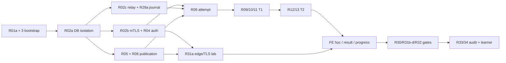

# Implementation plan v3 — microservices R1

BL-MS04 · 30/09–01/10/2026 · Đầu ra MS04 là thiết kế/kế hoạch; thực thi [R01a foundation](../platform/toolchain/verification.md)/[R01b Identity bootstrap](../platform/bootstrap/identity-verification.md)/[R01c Content bootstrap](../platform/bootstrap/content-verification.md)/[R01d Learning bootstrap](../platform/bootstrap/learning-verification.md) sau chỉ dẫn01/10 có evidence riêng. [R02a DB lab](../platform/database/verification.md) và [R02b service trust](../platform/service-trust/verification.md) sau chỉ dẫn02/10 có evidence riêng theo backlog. [Backlog](../delivery-backlog.md) giữ task/status duy nhất; [test/release plan](test-release-plan.md) giữ fixtures/commands/gates; [MS01 catalog](../architecture/service-boundaries.md), [MS02 session](../features/f10-identity-access/sessions/protocol.md) và [MS03 data](../architecture/data-protocols.md) giữ contract hiện hành. Thay stack/build/test/ops/dependency một-app ở D08, giữ ADR-02 cùng repo và FE sau R00.

## 1. Brief và acceptance

- Goal: có task thực thi đủ nhỏ, dependencies không vòng, owner/service/file/REQ/expected rõ; test partial failure và release/recovery có nơi thu bằng chứng. REQ-11/13/14/15/16, toàn REQ R1 theo trace.
- Scope: rebaseline R01–34/task con, stack/versions dự kiến đã đối chiếu, topology/command contract, journal provider qualification, numeric budgets và release DoD. Ngoài phạm vi: source/config runtime, cài dependency/DB, mua cloud, deploy/publish/commit, admin/runner.
- Context/rules: AGENTS, MS03 checkpoint, module map, quality/delivery contract; đọc task/LLD liên quan khi bắt đầu, không lặp toàn repo mỗi session. WIP một task, không tự tạo chat/agent.
- Plan: inventory → stack/ports/secrets → phân task và DAG → fixture/case owners → release/restore gates → trace/review/checkpoint.

| AC | Điều kiện thiết kế | Evidence review |
|---|---|---|
| MS04-AC1 | Service/artifact/DB/credential/listener tách, FE reuse; exact versions có source/pin owner | Mục 2–4, architecture FE/BE |
| MS04-AC2 | Mỗi task leaf có một output, owner/REQ/dependency/AC/test/exclusion; parent không giao nguyên session | Backlog v3 + task brief, DAG check |
| MS04-AC3 | SEC-01–30/DATA-01–30 và business cases có owner/fixture/command/evidence, không mock durability | Test/release plan |
| MS04-AC4 | Release/backup/restore/credential recovery có gates và operator inputs, không fake SLA | Mục 5–6 + REL gates |
| MS04-AC5 | MS-F07/09 có giải pháp kế hoạch, current docs/DoD/trace thống nhất; permission không tự mở | Mục 7, sources/checkpoint |

## 2. Stack và pinning

Giữ frontend React/TypeScript/Vite/router/Playwright hiện có trong `frontend/package-lock.json`, Node24/bundled helper root. Không upgrade FE hoặc thêm monorepo framework. Backend ba Spring MVC apps; JDBC tường minh cho owner/CAS/locks/T1/T2, Flyway migrations per service. Không JPA/Redis/broker/Kubernetes/service mesh/BFF mới cho R1.

| Thành phần | Baseline chọn cho v3 | Owner cần thu evidence khi code |
|---|---|---|
| JDK | Java21; R01a chọn Microsoft21.0.12.1+1-LTS Windows x64 portable, compiler release21 | [R01a evidence](../platform/toolchain/verification.md)/manifest hash; Linux/container runtime R31c |
| Spring Boot | 4.1.1 cho ba app, BOM/parent; MVC/Security/Validation/JDBC/Actuator theo leaf cần; R01a pin Tomcat11.0.26 override BOM11.0.24 | R01b/c/d MVC/bootstrap actual trees/runtime Tomcat đạt; R02a JDBC/Flyway test-scoped; auth/trust dependencies chưa có; SBOM/full scans R31c |
| Maven | Maven3.9.16 qua Wrapper3.3.4 only-script, distribution SHA256 bắt buộc | R01a version/parent validate; bootstrap verify từng artifact R01b–d |
| PostgreSQL | 18.6; lab/dev một instance ba DB, roles/migrations riêng | R02a pin EDB18.6-5 portable Windows ZIP/hash/tools và actual DB isolation tests; image digest/Compose/Linux R31a/c, production phải qualify riêng |
| Session/password | Spring Session JDBC tại Identity; Spring Security Argon2id + BouncyCastle theo resolved BOM/dependency manifest | R03/R04a benchmark/corpus; receiver không dùng Spring Session làm session authority khác |
| Edge/container | Nginx + Docker Compose v2; image/CLI versions/digests chọn/test R31a/c | R31a same-origin/TLS/route tests, R31c images/compatibility/scans |
| Observability | Actuator/Micrometer bounded metrics, structured logs/correlation; optional scrape profile | R31b đo metric/alert, không buộc cloud tracing platform |
| Journal | Local filesystem adapter cho lab; production S3 API adapter với qualification thật | R28a/b, mục 4; không mặc định mọi S3-compatible provider đạt contract |

Đọc nguồn 30/09/2026: [Boot requirements](https://docs.spring.io/spring-boot/system-requirements.html) liệt kê 4.1.1 hỗ trợ Java21/Maven3.6.3+; [Maven history](https://maven.apache.org/docs/history.html) có 3.9.16; [PostgreSQL versioning](https://www.postgresql.org/support/versioning/) có supported18.6. Giữ baseline D08 thay vì tự nâng major; kiểm advisory/resolved transitive versions tại lúc cài và trước release, nguồn này không chứng minh ba app chạy trong repo. [Spring Session JDBC](https://docs.spring.io/spring-session/reference/guides/java-jdbc.html) là backing store, không tự cung cấp distributed logout barrier MS02.

Manifest đích `ops/release/dependencies.json`: component/version/source/hash/advisory checkedAt/resolved tree/JDK/image/toolchain. Không `latest`, floating image tag hoặc placeholder digest trong pilot release. Build conventions dùng Maven parent; mỗi child artifact độc lập, không shared domain/entity/repository JAR hay source import giữa service. `contracts/` schema/fixtures không chứa runtime Java shared domain.

## 3. Runtime topology và config contract

| Vùng | Local/lab dự kiến | Pilot |
|---|---|---|
| Browser/FE | Vite5173 giữ helper; `/api` proxy qua edge localhost8080 | HTTPS edge443 + static `frontend/dist`, SPA fallback chỉ FE routes |
| Edge | Dev HTTP loopback; TLS lab8443 cho __Host-cookie/CSRF tests | Public origin duy nhất; route API-I/C/L đúng owner, deny internal/maintenance/actuator |
| Identity/Content/Learning | DNS compose `identity`, `content`, `learning`; public API listener8080 **HTTPS/mTLS chỉ edge** mỗi container | Edge-only HTTPS upstream, verify CA/SAN và edge client identity; không publish service port ra internet |
| Internal API | TLS listener8443 mỗi service, mTLS private CA/env/service/action | Không qua browser edge; named peer allowlist; cert/clock readiness fail closed |
| PostgreSQL | `postgres:5432` private network; tùy chọn debug loopback port riêng | Ba DB/roles riêng, không public; migration job riêng mỗi service |
| Journal/backup | Thư mục lab riêng ngoài DB dump/restore target | Off-host storage + key quyền riêng, manifest/index verified |

Service public listener không mount internal controllers dưới public security chain;8080 là cổng HTTPS có edge client certificate,8443 chỉ internal service/operator được action allowlist. R02b test receiver chains, R31a test proxy thực. Edge có cert/key riêng chỉ gọi public API, không INT/OPS; upstream phải verify CA/SAN/SNI, không dựa default proxy config. Edge bỏ untrusted identity/forwarded headers, không quyết owner; receiver tự kiểm admission/resource. Nginx giữ prefix `/api/v1` tới public service, không strip prefix hoặc đổi method/body/query; private endpoints không rơi vào SPA fallback. Local HTTP exception chỉ browser→loopback edge với cookie dev tên riêng được whitelist, không hạ trust upstream hoặc giả __Host/Secure test qua HTTP; TLS lab dùng cookie production.

R31a pin route-specific privacy policy: authenticated/credential/learner request và response không spill payload vào proxy temp/cache/store/log hoặc volume backup. Response private tắt cache/store và disk buffering; request dùng streaming đã kiểm với proxy HTTP/1.1+ hoặc buffer RAM hữu hạn theo maxRequestBytes/concurrency từng route. Chunked/slow/near-limit/error/export tests phải dùng sentinel và inspect temp/cache/log thật; không coi Cache-Control:no-store hoặc một flag buffering là proof cho cả hai chiều. Không tee raw body, auto-retry mutation sang upstream khác hoặc đổi payload để hash khác; retry có receipt/key theo endpoint contract. Timeout/413 giữ bản học tốt, không biến API error thành SPA HTML. Limits/memory/load evidence R31a/b, không config runtime từ docs này.

Compose đích `ops/compose/compose.yaml`: profiles `lab`, `pilot`, `observability`; helper phải start đúng DB/apps cần test, không suy profiles tự thỏa dependencies. Service DB role chỉ CONNECT/schema/DML database mình; migration role có DDL database mình, runtime không migrate. Secret mounts per service: own DB, mTLS cert/key/CA; Identity session/KDF config; Identity/Learning own journal namespace credentials; edge riêng client key/CA upstream, không DB/journal key. Không share master DB/password key cho cả ba. Maintenance control ngoài DB snapshots có env/operation/generation; R32a interlock phải ngăn app/writer auto-start trong checkpoint như lifecycle §5.1, không chỉ edge503.

Config contract được tạo R02b/R31a, gồm validated env/serviceId/dbGeneration/realm/peer/listener/clock budget; fail startup khi thiếu/mâu thuẫn, prod không accept dev auth bypass. Liveness local process; readiness có layers DB/schema/local policy/fence/clock/cert/restore state. Identity outage deny protected admission, không làm anonymous outline tự trở thành forbidden. Không đưa external dependency vào liveness để gây restart loop.

## 4. Journal provider và ngân sách ban đầu

Chọn **S3 API adapter** cho off-host production journal/backup, không tạo bucket/tài khoản hoặc buộc mua AWS trong MS04. R28b qualification trên provider/operator supplies thực; AWS S3 là implementation tham chiếu, provider compatible khác phải chứng minh same contract. R28a filesystem adapter chỉ local lab, không thay disaster evidence của R28b/R32.

Protocol adapter: immutable record create-if-absent theo key/digest → immutable index node chứa previous head/digest + record ref → CAS head → verify record/node/head-covered receipt. ACK chỉ sau record đã nằm trong durable indexed prefix; CAS conflict retry đọc head, giữ same record/digest, không skip. Head ETag dùng concurrency token, không thay payload SHA-256 checksum. Record/node chưa indexed là orphan pending, không ACK; recovery checkpoint lấy fixed verified head/prefix, không dựa inventory report trễ hoặc wall time. Compaction có durable floor checkpoint/covered prefix trước GC theo MS03; runtime không có DeleteObject/global purge permission. R28b test concurrent writers/crash từng bước/missing prefix/CAS mismatch/wrong namespace, không suy strong single-object write thành multi-object transaction.

Nguồn: [S3 conditional writes](https://docs.aws.amazon.com/AmazonS3/latest/userguide/conditional-writes.html) mô tả If-None-Match/If-Match; [S3 consistency](https://docs.aws.amazon.com/AmazonS3/latest/userguide/Welcome.html) mô tả read-after-write và versioning. Indexed-prefix/ACK/compaction ở đây là thiết kế app phải test, không bảo đảm mặc định từ nguồn. Encrypt/retention/versioning/IAM/key recovery được qualification; một storage endpoint cùng host DB không là off-host.

| Budget cấu hình ban đầu, không SLA | Giá trị / invariant | Owner đo/test |
|---|---|---|
| Internal HTTP | connect1s, request5s; admission request2s, không retry qua auth/validation deny | R02b/R04d; đảm bảo remaining admission budget trước/final transaction |
| DB mutation | lock timeout5s, bounded transaction; clock skew budget500ms, initial required admission remaining6s | R02b/R04b/c/d; pause/near-cutoff tests, không coi timeout config là proof |
| Relay phase/journal retry | 8 attempts/budget, exponential1s→cap30s + jitter; exhaustion paused/alert, same operation không drop | R02c/R28; auth stream độc lập poison publication |
| Worker | lease60s/heartbeat20s, max3 transient compute retries; fencing kiểm T2, sau đó retryable_error operator | R13a/b; job infra lỗi không learner fail |
| Browser polling | start2s→cap30s, abort/context bound; status không gia hạn idle, user action mới retry mutation cùng key | R20/R24/R29a |
| Data limits | answer64KiB, trace1000, import5MiB/500records/depth20,20draft mở,1preview TTL24h, page20/max100 | Endpoint owners; load boundary/error giữ dữ liệu tốt |
| Backup/retention | Daily checkpoint, encrypted30ngày; live reset/delete cleanup7ngày; journal floor/inventory/replay +7ngày grace | R29c/R32, measured pause/RPO/RTO |

Numeric values là starting config có owner evidence, không tự làm security/performance pass. Admission TTL/deadlines MS02 vẫn authoritative; retry backoff không được cấp quyền hay giữ domain lock trong HTTP/storage/KDF. Publication/reset/delete pending không tự timeout-success.

## 5. Thứ tự thực thi và session

R01/02/04/06/13/16/21/22/23/24/28/29/31/32 là parent rollup có task con trong backlog; giữ ID cũ, không giao parent nguyên một session. Leaf task khác giữ ID nguyên. Parent DONE chỉ khi mọi child AC đạt, không đánh dấu toàn release vì source build. Mỗi session một leaf goal hoặc checkpoint còn lại; dependency quyết thứ tự, không nhất thiết thứ tự số. Không tự tạo session mới.

Đường vào đầu tiên: **R01a toolchain/build contract**, rồi bootstrap Identity/Content/Learning từng task; R02a DB isolation; R02b mTLS/config/wire schemas; R03 credentials; R04a/b/c/d auth; R02c delivery có thể làm trước R04d theo dependencies. R05/schema→R06a/b/c publication; **R31a edge/TLS lab + base CMD-07 trước R14/R24a**, không đợi sát deployment mới có môi trường E2E. **R28a journal sớm trước R08 attempt/R10 support**. Tiếp CAS/T1/grader/R13 worker → FE session/assessment/result → player/practice/history/guidance/áp dụng/transfer/reset → content release/ops/recovery/audit/learner.

Sơ đồ chỉ nhóm, DAG chi tiết là backlog. Local test published fixture riêng không publish draft production; private rubric/case không FE artifact. R28b provider qualification/input và R31d deploy chờ operator/provider/authorization tương ứng, không chặn code toolchain/local lab. R15 có checkpoint demo chọn mục/topic; R20 có checkpoint demo editor→submit→result, review hiểu mục tiêu/feedback/next step và trạng thái lỗi sớm. Đó là slice review, không claim Collections đầy đủ hoặc feedback learner nếu chưa thử thật. R34 vẫn cần feedback learner thật để nghiệm thu cuối, không giả từ automation.

## 6. Operator inputs và release

| Input | Cần trước | Thiếu thì |
|---|---|---|
| Chỉ dẫn chuyển sang code | R01a–d được giao01/10/2026, ghi backlog; leaf sau theo chỉ dẫn tương ứng | MS04 docs DONE không tự là CODE; mỗi leaf goal giữ scope, không nhảy nghiệp vụ auth/DB từ bootstrap |
| JDK/runtime/network checksum source | R01a; không cần cloud | Inventory/chọn pinned distro trong task, không tự đoán đã cài |
| Host/domain/TLS/public origin/resources | R31d deployment | Chuẩn bị bundle/dry-run trước; không mua host/publish không được giao |
| Journal/backup endpoint/bucket namespace/credentials/key custody | R28b/R32b qualification thực | Local adapter có nhãn lab; chưa pilot readiness, không fake durability |
| Verified account recovery/operator channel | R32b before traffic reopen | RECOVERY_REQUIRED chưa login; không tự gửi email/nhắn tin |
| Learner phiên thử | R34 | Giữ nghiệm thu thiếu evidence, không tự DONE |

Gate REL-01–08 trong [test/release plan](test-release-plan.md) là DoD R1 bổ sung: artifacts/compatibility/security/integrity/privacy/UX/recovery/learner. Migration expand/contract, preflight/version inventory và rollback app chỉ schema compatible; destructive migration cần task riêng. Release dùng same artifact digest staging→pilot, không rebuild âm thầm. Rollback không gỡ journal/tombstones/realm để hồi sinh quyền.

## 7. Findings và nguồn hiện hành

MS-F07 có fixture layers, CI service matrix, fault/storage/restore drill và readiness gates; MS-F09 có backlog v3/parent-leaf/REQ-owner-dependency và template đầu tiên. MS-F01–06/08 có giải pháp MS01–03; [review D14](../architecture/readiness-review.md) bổ sung RV-F01–05 về test environment dependency, edge trust/spill, backup interlock, common wire và early UX review. Chúng có owner/solution ở kế hoạch, implementation/race/advisory/provider/performance còn bằng chứng phải thu. Không gọi runtime microservices READY hoặc task code READY khi chưa CODE.

Nguồn phụ trợ đã đọc: [Compose profiles](https://docs.docker.com/compose/how-tos/profiles/), [Compose secrets](https://docs.docker.com/compose/how-tos/use-secrets/), [Nginx proxy](https://nginx.org/en/docs/http/ngx_http_proxy_module.html). Chọn profiles/mount/routing là quyết định app; config/listener/proxy tests chưa chạy. [Architecture BE](../architecture/backend.md), [FE](../architecture/frontend.md), [HLD/LLD index](../design/README.md) phải đọc v3 trước D08 baseline.

### R02b lab implementation

Profile `transport` thực thi receiver HTTPS8080/8443 trên loopback, từng service tuần tự; không thay Compose profiles/DNS/lab/pilot đích. Own JDBC app role dùng clock_timestamp, runtime không migrate. Schema/config marker/cert/clock/bounded peer/wire và packaged tests ở [review R02b](../platform/service-trust/verification.md). Realm/generation chỉ shape/test-bundle, canonical generation/recovery còn owner sau;5s general business call chưa có endpoint, probe2s.

### R03 local credential implementation

Own Identity V2/account guard/token/pending/throttle/audit và CLI đã có [qualification](../features/f10-identity-access/credentials/verification.md). Crypto7.1.1/BouncyCastle1.86 bổ sung Identity, không framework/shared domain JAR. KDF ngoài DB locks, locked reread trước callback effect; Argon2 baseline giữ, corpus hiện fixture lab. Reset/state commit local pending intent, không session/revoke/journal completion. Recovery clear hash và giữ operator disable độc lập. R04a tiếp session/preauth/CSRF; R04 persistent server phải reuse bounded KDF boundary/budget, không instantiate mỗi request. R02c cần cho R04d delivery; enable pending chỉ clear khi đủ MS02/MS03 gates, không auth ACK thay lifecycle journal ACK.
