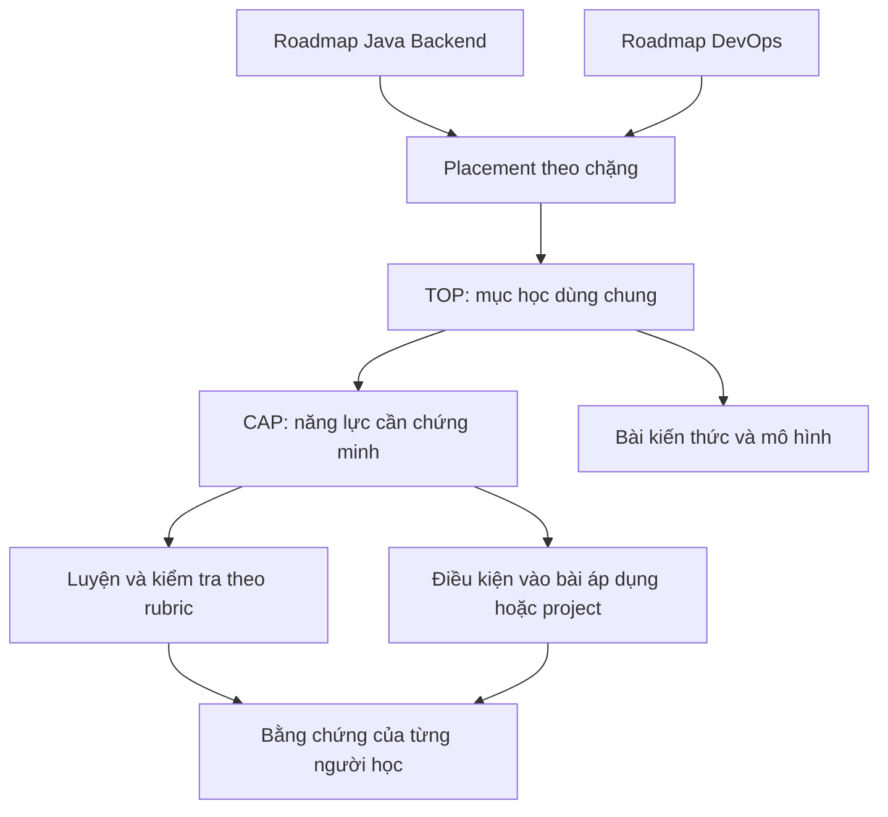
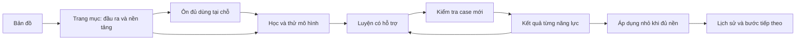
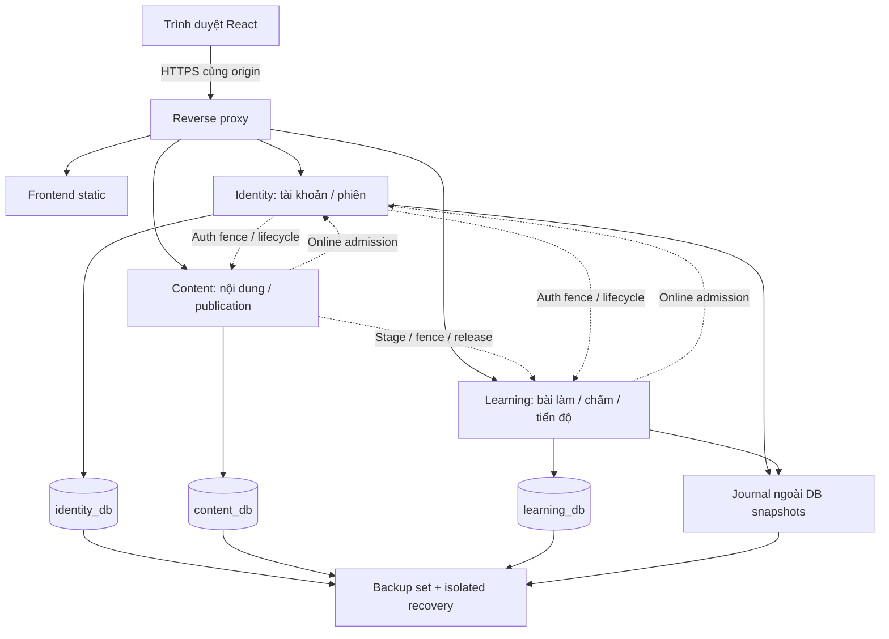

# HLD — Backend Lab

> V3 MS01–04: ba service [catalog](../architecture/service-boundaries.md)/[session](../features/f10-identity-access/sessions/protocol.md)/[data](../architecture/data-protocols.md), [implementation](../delivery/implementation-plan.md)/[test-release](../delivery/test-release-plan.md) chốt stack/tasks/ops/REL gates; [ADR-03](../architecture/microservices-review.md) giữ rationale. D08 một-app lịch sử, chưa runtime/CODE; leaf đầu R01a.

[Mục lục](README.md) · Baseline R1 · 30/09/2026

## 1. Sản phẩm giải quyết vấn đề gì?

Người biết lập trình cơ bản nhưng mới học Java/backend cần nhìn được toàn cảnh, hiểu cơ chế và biết mình thực sự làm được gì. App tổ chức học theo **mục học và năng lực**, kết hợp bản đồ, nội dung ngắn, mô hình tương tác, bài luyện, kiểm tra và áp dụng. Bản đồ giúp chọn đường; bàn học là nơi dành phần lớn thời gian.

Ví dụ: vào Collections → thấy cần List/Set/Map để giải quyết việc gì → thử thay dữ liệu → luyện đếm/nhóm → kiểm tra bằng case mới → xem năng lực còn thiếu → áp dụng vào bài tổng hợp. Xem hết bài không tự thành đạt năng lực.

## 2. Phạm vi và người dùng

| Đối tượng | Làm được trong R1 |
|---|---|
| Khách | Xem outline công khai, biết phần nào đã có nội dung |
| Người học | Kích hoạt lời mời, login/logout, học mẫu Collections, lưu nháp/nộp bài/xem tiến độ của mình |
| Operator | Cấp/khôi phục tài khoản và vận hành qua công cụ bảo trì; không là admin UI |
| Admin | Sau R1: thiết kế chi tiết quyền theo dõi/nhận xét/review học viên riêng |

| R1 phải có | Sau R1 |
|---|---|
| Backend và dữ liệu riêng cho nhiều user | Admin, lớp học, quyền giáo viên |
| Hai roadmap ở mức bộ khung | Nội dung đầy đủ cho mọi mục Backend/DevOps |
| Collections trọn vòng học/luyện/kiểm tra/áp dụng nhỏ | Project Java lớn, runner Java/Docker được xác minh |
| Lưu nháp, lịch sử, tiến độ, export/import và phục hồi | AI tutor, cộng đồng, leaderboard, thanh toán |

R1 có 95 TOP/190 CAP trong catalog thiết kế; chỉ mẫu Collections được triển khai nội dung trước. Tám case kiểm tra chia bốn nhóm, hai case mỗi nhóm; hết case chưa lộ thì tiếp tục luyện và chờ nội dung mới. Không hứa thi độc lập vô hạn.

## 3. Cấu trúc kiến thức

TOP là mục học, CAP là năng lực quan sát được. Chặng/roadmap là cách sắp xếp, không tạo bản sao TOP/CAP. Docker thuộc DevOps; Java Backend liên kết sang đúng phần cần dùng. DevOps bắt đầu từ hệ điều hành/mạng/Git, không đợi người học xong Java.

Collections là gói trải nghiệm gom nhiều TOP. Một bài có thể phục vụ nhiều CAP nhưng mỗi CAP được chấm theo tiêu chí riêng. Không tạo thêm một điểm mastery tổng “Collections” trùng các CAP bên dưới.

## 4. Vòng học và trải nghiệm

Luồng là gợi ý, không khóa cứng: người đã biết có thể kiểm tra trước. Project mở khi đủ prerequisite; chưa phải làm project từ ngày đầu. CL-U-01 trong R1 chỉ chứng minh áp dụng trong mô hình; P1 CLI thật còn điều kiện và rubric riêng.

Giao diện cần có hành động có ý nghĩa: dự đoán, thay input, step, so before/after, thử lại và hiểu lỗi. Animation chỉ dùng khi giải thích cơ chế; có chữ tương đương và giảm chuyển động. Màn học tập trung một hoạt động; tiến độ hiển thị ba chiều, không một phần trăm chung.

## 5. Kiến trúc hệ thống

Repo giữ docs/contracts/ops ở root, FE trong frontend/ và BE trong backend/; BL-R00 đã chuyển source FE; backend runtime theo R01.

Ba service có DB/artifact/credential riêng, không cross-DB joins/FK hay shared runtime. Learning giữ T1/T2 và DB-backed grading worker local để submission/result/evidence/progress atomic. Identity online admission + hai participant fence ACK giữ logout barrier; Content publish chỉ canonical commit sau Learning FENCE, rồi RELEASE policy mới. HTTP outbox/inbox xử lý retry, chưa broker. FE mô phỏng/luyện nhanh, official evidence chỉ từ Learning.

Exposure journal durable trước case/hint/solution; reset giữ exposure/account; delete terminal Identity điều phối. Restore ba DB cô lập/journal/refs/policy/new realm/generations; restored account recovery credential trước login. MS04 chọn S3 API adapter với qualification thật, local journal chỉ lab; controlled backup/drill trước pilot/REL gates có owners và commands dự kiến. Chưa runtime. [Publication](../features/f08-content/publication/protocol.md)/[recovery](../architecture/lifecycle-recovery-protocol.md) giữ protocol.

## 6. Các dữ liệu quan trọng

| Nhóm | Nguồn sở hữu | Quy tắc chính |
|---|---|---|
| TOP/CAP, bài/đề/rubric có version | Catalog đã publish | Giữ ID; đáp án riêng không vào public bundle |
| Tài khoản và phiên | Backend identity | Client không tự khai owner hoặc quyền |
| Nháp | Người học tương ứng | Sửa có revision, conflict không ghi đè im lặng |
| Submission và kết quả | Backend theo owner | Snapshot bất biến, retry không nộp/chấm trùng |
| Evidence và progress | Backend progress | Tách đã xem / chứng minh / áp dụng, giữ nguồn và version |
| File export | Bản dữ liệu người học tải | Import trở lại không tự phục hồi official pass |

## 7. Chất lượng và rủi ro phải chứng minh

R1 phải kiểm quyền A/B, hết phiên/đổi user, hai tab cùng sửa, mất mạng khi nộp, worker restart, publish khi đang chấm và reset/restore. Keyboard, 320px, reduced motion và trạng thái lỗi thuộc từng task UI. Backup chỉ đáng tin sau restore drill; chưa có SLA/RPO/RTO đã đo.

Giới hạn pilot: chỉ lời mời, khôi phục mật khẩu qua operator; nháp chưa lưu chỉ ở RAM nên đóng tab có thể mất; kiểm tra mới hữu hạn; chưa xác minh code Java do learner viết. UI phải nói rõ các giới hạn này đúng lúc.

## 8. Chia việc và điểm review

Thứ tự theo dependency: tách thư mục FE trong cùng repo → nền backend/identity → catalog → nháp/submit/grader → UI học → transfer/recovery → publish/release/audit/learner test. Có 35 task BL-R (R00–R34), mỗi task một đầu ra nghiệm thu. Chi tiết nằm ở [backlog](../delivery-backlog.md); không bắt một session làm hết module.

| ID review | Điều cần xem |
|---|---|
| HLD-01 | R1 tập trung Collections hoàn chỉnh và hai roadmap outline có phù hợp không? |
| HLD-02 | Cấu trúc roadmap → TOP/CAP → hoạt động → project có dễ hiểu không? |
| HLD-03 | Vòng học và ba chiều tiến độ có đúng trải nghiệm mong muốn không? |
| HLD-04 | Pilot dùng lời mời, admin sau R1 và các giới hạn có chấp nhận được không? |

Nguồn: [business](../business-design.md), [requirements](../product-requirements.md), [system](../system-overview.md), [D08](../delivery/history/implementation-v2.md). Đọc tiếp [LLD-01](../features/f10-identity-access/lld.md).
