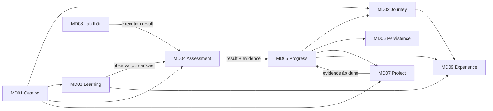

# Feature và module

[Mục lục F01–F12](features/README.md) là điểm vào để làm việc theo feature. Mỗi README nối goal, scope, REQ, MD, nguồn business/LLD, task và DoD. Feature lớn có phần nhỏ khi đã có contract/task riêng; vị trí doc không đổi service/module ownership trong bảng này.

> Mapping module→deployment chốt BL-MS01 ngày 30/09/2026 trong [service catalog](architecture/service-boundaries.md): MD10 authority ở Identity, kiểm quyền tại từng receiver; MD01 và definition MD02/07 ở Content; MD04/05/11 và guidance/readiness cá nhân MD02/07 ở Learning. MD06 persistence theo từng service owner; MD03/09 vẫn FE; MD08/12 sau R1. Module không mặc định bằng microservice. [ADR-03](architecture/microservices-review.md) giữ lý do/findings và nguồn protocol hiện hành.

Ngày 23/09/2026. Feature là giá trị người học nhận được; module là trách nhiệm phần mềm. Danh sách dưới là thiết kế đích, chưa là cấu trúc thư mục phải tạo ngay.

Xem [system](system-overview.md) cho code hiện có/đích. [Data MS03](architecture/data-protocols.md) và [implementation/test MS04](delivery/implementation-plan.md) nối MD owner với gates/journal/ops/task leaves; không module=service. [Test-release](delivery/test-release-plan.md) giữ fixtures/cases/REL evidence; D08 một-app chỉ lịch sử, chưa code/nghiệm thu module từ docs.

## Feature

| ID | Người học làm được gì | Requirements | Module chính | Mốc |
|---|---|---|---|---|
| F01 | Khám phá toàn cảnh và chọn mục phù hợp | REQ-01,02,10,11,19 | MD01,02,09 | R1 |
| F02 | Học một mục qua nội dung và tương tác | REQ-02,03,11,12,19 | MD01,03,09 | R1 |
| F03 | Luyện tập, xem feedback và thử lại | REQ-04,11 | MD03,04,09 | R1 |
| F04 | Kiểm tra và biết năng lực còn thiếu | REQ-05,06,12 | MD04,05,09 | R1 |
| F05 | Tiếp tục học, xem tiến độ và ôn lại | REQ-06,07 | MD02,05,06,09 | R1 |
| F06 | Áp dụng vào project đúng lúc | REQ-08,12 | MD01,05,07,09 | R1 nhỏ; R2 mở rộng |
| F07 | Giữ, sao lưu và phục hồi dữ liệu học | REQ-09 | MD06,09 | R1 |
| F08 | Học nội dung đúng và được cập nhật có kiểm soát | REQ-10,13 | MD01; quy trình review | R1 trở đi |
| F09 | Chạy lab thật và xem output xác minh được | REQ-12,13 | MD08 cùng MD03–06 | R3 |
| F10 | Dùng tài khoản riêng và tiếp tục học trên nhiều thiết bị | REQ-09,14,15 | MD06,09,10 | R1 |
| F11 | Lưu nháp, nộp bài và xem lịch sử của mình | REQ-05,06,15,16 | MD04,05,06,11 | R1 |
| F12 | Admin theo dõi/nhận xét tiến độ học viên | REQ-15,17 | MD10,11,12 | Sau R1 |

Điều chỉnh v2: F01 bao gồm REQ-18 và hai roadmap; F04/F05/F07 phải tuân thủ ownership và kết quả chính thức từ server. Admin đã được người dùng chọn để sau R1.

REQ-11/13 áp dụng xuyên feature dù không lặp ở mọi ô.

## Module và ranh giới

| ID | Trách nhiệm sở hữu | Đầu vào → đầu ra | Không chịu trách nhiệm |
|---|---|---|---|
| MD01 Content catalog | Topic/lesson/competency/activity, version/status, nguồn và validator | Nội dung biên soạn → catalog hợp lệ, lookup | Progress của người học, tự chấm năng lực |
| MD02 Journey & guidance | Cây/đường học, prerequisite readiness, đề xuất next/ôn | Catalog + progress đọc → view model/gợi ý có lý do | Tự cấp evidence hoặc tự publish |
| MD03 Learning runtime | Phiên/bước học, input/action, mô phỏng và state tạm | Activity + action → trạng thái/observation | Kết luận mastery hay ghi storage trực tiếp |
| MD04 Practice & assessment | Feedback/hint, rubric, đánh giá attempt | Đáp án/observation + rubric/version/context hỗ trợ → kết quả và evidence đề xuất | Tự đổi toàn bộ progress hoặc chạy Java tùy ý |
| MD05 Progress & review | Áp dụng evidence, lịch sử/version, ba chiều tiến độ, cần ôn | Kết quả hợp lệ → learner state, phần thiếu | Render UI hoặc sở hữu file import |
| MD06 Persistence | Lưu DB, transaction/version/migration, backup/restore, import/export; cache local phụ trợ theo owner | State hợp lệ → dữ liệu server bền vững hoặc lỗi rõ | Diễn giải điểm thành mastery hoặc tin owner client |
| MD07 Project track | Readiness mốc, deliverable/rubric và evidence áp dụng | Catalog mục + progress + submission → trạng thái mốc | Ép mọi người bắt đầu từ S00 hoặc tự deploy |
| MD08 Lab execution | Hợp đồng thực thi thật, lifecycle/cancel/output, giới hạn an toàn | Task được cho phép → execution result có nguồn | Thực thi lệnh tùy ý từ bài hoặc tự chấm pass qua log giả |
| MD09 App experience | Route/shell, trang mục/player/result/project, accessibility và global locale | View model + callback + locale preference → tương tác người dùng | Sao chép logic rubric/progress vào component hoặc fork progress theo language |
| MD10 Identity & access | Tài khoản, phiên, quyền trên resource | Danh tính đã xác thực + action/resource → cho phép/từ chối | Tự chấm bài hoặc cấp admin từ input client |
| MD11 Learner work | Draft revision, submission bất biến, history và chống nộp trùng theo owner | Câu trả lời + identity + bài/version → attempt được lưu | Nhận pass client làm kết quả chính thức |
| MD12 Administration | View học viên/tiến độ, review/nhận xét và audit theo quyền, sau R1 | Truy vấn/review được cấp quyền → dữ liệu hoặc evidence mới có nguồn | Ghi đè lịch sử hoặc bỏ qua ownership |

Vị trí thực thi v2: MD03/09 chủ yếu frontend; MD01/04/05/06/10/11 có nguồn thẩm quyền ở backend; MD02/07 dùng catalog/progress server; MD12 triển khai sau. Mô phỏng/luyện frontend có phản hồi xem trước nhưng không tự ghi official mastery. MD08 là runner riêng trong tương lai. Catalog từ repo đi qua bước xuất bản vào server, không giữ hai nguồn published độc lập.

## Luồng ranh giới cần bảo vệ

Sơ đồ trên giữ luồng nghiệp vụ học, chưa thể hiện biên xác thực; sơ đồ triển khai v2 nằm trong system-overview. Mọi API dữ liệu cá nhân qua MD10, submission qua MD11 trước MD04/05/06. [Identity](features/f10-identity-access/business.md) và [dữ liệu server](features/f11-learner-work/data-contract.md) chốt hợp đồng BL-S02/S03; application orchestration/schema ở BL-D08, không tạo service riêng cho mỗi module. MD08/12 chưa cần triển khai trong R1.

## Tài sản hiện có

- `frontend/src/content/` là nền MD01 nhưng schema Lesson v1 chưa đáp ứng đầy đủ Topic/Competency/Assessment/Progress business mới.
- `frontend/src/data/journey.ts`, `frontend/src/pages/JourneyPage.tsx` là nền MD02/09, cần nối lại catalog; không nhập lại cây song song lâu dài.
- `frontend/src/components/`, routes và shell là nền MD09; ưu tiên thích nghi thay vì viết lại.
- LearningPage/API 500 mới là đề cương draft, chưa coi MD03–06 đã hoạt động.
- Tests/helpers hiện có được giữ và mở rộng theo hành vi. R01a–d có build/ba bootstrap, R02a DB lab kỹ thuật MD06, R02b trust foundation MD10 và R03 [local credential workflow](features/f10-identity-access/credentials/verification.md). Chưa browser session/admission/owner persistence/nghiệp vụ học; source tree đích hoặc một leaf không là MD10 DONE.

Quyết định thư mục/adapter/microservices hiện hành theo MS01–04 và feature-first D17; D08 một-app là lịch sử. BL-R01–34 giữ backlog; R01/R02a/R02b/R03 có evidence riêng. R04a có [local session/credential binding và opt-in lab auth TLS/browser](features/f10-identity-access/sessions/verification.md). [R04b](features/f10-identity-access/sessions/tasks/BL-R04b.md) triển khai Content receiver MD10/06, Java online-admission port và private INT02, chưa Content learner API. Trạng thái nghiệm thu ở registry; không full reauth/coordinator/FE/production edge từ các leaf này. Task business dẫn chiếu ID module ở mức trách nhiệm.

R02b technical trust foundation và bằng chứng kiểm hiện hành ở [tài liệu review](platform/service-trust/verification.md); trạng thái/evidence cuối ở backlog. Chưa login/session/owner/business/edge deployment.
