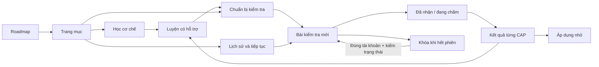

# Collections — luồng trải nghiệm và nghiệm thu UI

BL-D07 · 29/09/2026 · thiết kế v1, chưa triển khai UI sản phẩm. Nguồn: [business](../../../business-design.md), [requirements](../../../product-requirements.md), [module](../../../feature-module-map.md), [D06a](knowledge.md), [bộ bài D06b](../../f04-assessment/collections/cases.md), [identity](../../f10-identity-access/business.md), [dữ liệu server](../../f11-learner-work/data-contract.md). Không thay rubric hoặc quyết định storage trong tài liệu này.

## 1. Hướng trải nghiệm

Một bàn học trung tâm, mỗi lần giải quyết một câu hỏi. Bên cạnh là mục lục ngắn List/Set/Map/chọn cấu trúc; không bắt nhìn toàn roadmap khi đang học. Luân phiên dự đoán → thử thao tác → đối chiếu trước/sau → giải thích ngắn → luyện → kiểm tra. Không thêm streak, tiền ảo, leaderboard hoặc animation liên tục để tạo cảm giác tiến bộ.

Roadmap là nơi khám phá. Trang mục là nơi quyết định học gì; bàn học là nơi tương tác. Năng lực và lịch sử kết quả luôn tách khỏi số bài đã mở. Docker/DevOps vẫn liên kết nội dung chung; thiết kế màn này tập trung mẫu Collections, không thiết kế lại branding hay cả hai roadmap.

Prototype tương tác đi kèm trong hội thoại: `C:/Users/khang.nguyen-huynh/.codex/visualizations/2026/09/19/01a0b7fe-b132-7953-8ba2-dcec97125eaf/collections-experience.html`. Đây là bản xem với dữ liệu giả; chọn màn và trạng thái lỗi để review, không kết nối API, không lưu nháp thật hoặc chấm toàn bộ D06b. Các trạng thái mẫu không là bằng chứng sản phẩm đã hỗ trợ login hoặc persistence.

## 2. Bản đồ luồng

Mũi tên không tự đánh dấu đã xem/đạt. Từ kết quả chỉ mở kiểm tra mới nếu server còn case sạch. History mở submission đã nộp ở chế độ đọc; nháp còn mở mới quay lại editor. Đã nhận pending quay lại trang pending, không quay về form submit mới.

## 3. Màn hình và hợp đồng điều hướng

Tên route dưới là đề xuất để D08 chốt với React Router hiện có; không tạo thêm TOP “Collections”. Gói dùng TOP-COL-002/003/004/006 và bảy CAP đã công bố.

| Màn | Entry / nội dung chính | Hành động chính → exit | Trạng thái riêng |
|---|---|---|---|
| UX-S01 Trang mục | Từ roadmap/deep link; mục tiêu, bảy CAP, prerequisite/thẻ ôn, giới hạn mô hình | Tiếp tục đúng draft; nếu chưa có thì Học cơ chế; kiểm tra đầu vào là lựa chọn phụ | Loading/empty progress/planned; không hiện số liệu mặc định như đã tải thành công |
| UX-S02 Học cơ chế | C1–C6 + R0–R3; mục lục, câu hỏi, sơ đồ/state chữ | Dự đoán → Thử → Vì sao → Luyện liên quan | Pause/replay/reset chỉ thay mô hình; refresh card mở tại chỗ khi lesson nền planned |
| UX-S03 Luyện | CL-P-L/S/M/F/G; input, action, before/after, return | Thử lại, hint tăng dần, xem lời giải; sau đó Chuẩn bị kiểm tra | Practice feedback ngay; đúng không tăng mastery; rỗng/input sai có thông báo tại trường |
| UX-S04 Chuẩn bị kiểm tra | CAP sẽ chấm, loại evidence, số case sạch do server trả | Bắt đầu tạo attempt đúng một lần → UX-S05 | Hết case: Luyện tiếp; không lấy case đã lộ hoặc chỉ đổi mã |
| UX-S05 Kiểm tra | Attempt/case version đã ghim, câu hỏi theo criterion; hỗ trợ đang dùng | Nộp bài → UX-S06; Rời bài giữ draft đã ACK | Không preview đáp án/execute state đúng; hint phải báo chuyển sang có hỗ trợ trước khi mở |
| UX-S06 Đang xử lý | Submission ID, accepted time nếu đã xác nhận, trạng thái chấm | Xem lịch sử hoặc đọc lại trạng thái; khi có kết quả → UX-S07 | Chưa xác nhận khác đã nhận; grader lỗi không ghi fail; không có nút submit lại thành attempt mới |
| UX-S07 Kết quả | Tiêu chí từng CAP, nguồn/hỗ trợ, version; chỗ cần ôn | Ôn đúng lỗi; case mới nếu còn; áp dụng khi đủ nền phù hợp | Partial pass, supported, cần ôn, version cần xác minh; không dùng điểm tổng che CAP thiếu |
| UX-S08 Áp dụng nhỏ | CL-U-01, năm view và U1–U5; phạm vi mô hình | Nộp → pending/result; quay lại bài luyện tương ứng | Applied mô hình độc lập/có hỗ trợ; không P1/verified Java; hết case mới vẫn cho luyện |
| UX-S09 Lịch sử | Nháp đang mở và submission theo owner, thời gian/nhãn rõ | Resume draft, đọc submission/result, về mục | Empty có CTA học; pending giữ identity; không trộn nháp với bài đã nộp |
| UX-S10 Phiên/tài khoản | Bootstrap/login/expired/logout | Đúng user: tra trạng thái rồi tiếp tục; đổi user: xử lý nháp cũ trước | Credential error chung; session store lỗi khác logged-out; admin không có trong R1 |
| UX-S11 Dữ liệu học | Export/import preview/reset riêng khỏi bàn mô phỏng | Preview import → xác nhận; reset reauth/xác nhận | Imported unverified, conflict hoặc version lạ không ghi đè; reset toàn tài khoản nêu phạm vi |

Đề xuất route: `/topics/:topicId`, `/learn/:topicId/:unitId`, `/practice/:exerciseId`, `/attempts/:attemptId`, `/submissions/:submissionId`, `/history`, `/account/learning-data`. Gói nhiều TOP dùng context điều hướng, không dùng context làm khóa progress. URL chỉ chứa ID/vị trí không nhạy cảm, không answer/token/password. Back không replay mutation.

## 4. Bố cục và tương tác học

Desktop: header tên mục + về roadmap + trạng thái tài khoản; mục lục nhỏ bên trái; vùng thao tác chiếm phần lớn màn; giải thích dưới thao tác hoặc cột phụ có thể thu gọn. Một CTA chính cho mục tiêu hiện tại. Không cho card tiến độ chen lên trước câu hỏi ở mọi bước.

Màn học List ví dụ: đề “Xóa theo giá trị sẽ mất ô nào?” → thẻ `[P7,P2,P7]` có index → nút removeValue(P7) → state `[P2,P7]`, return true, chữ “chỉ lần xuất hiện đầu bị xóa”. Xem lại luôn dựng cùng state/action, không tạo bằng chứng. Set không đánh số HashSet như thứ tự Java; Map có key/tồn tại/value; grouping cho thấy mỗi nhóm một List riêng. Những giới hạn này lấy D06a, không thay bằng hiệu ứng trang trí.

Màn kiểm tra dùng cùng cách đọc bảng/state nhưng không có nút chạy thử cho đúng case trước nộp. Chỉ validation định dạng. Câu trả lời rỗng/thiếu cần báo trường nào chưa điền; không công bố đúng/sai từng criterion trước submit. Xin hint mở bước xác nhận nhỏ “Lần này sẽ được ghi có hỗ trợ”; sau khi server ghi exposure mới trả hint. Người học có thể hủy và giữ độc lập nếu chưa nhận hỗ trợ.

Kết quả chia ba phần: CAP nào đạt/chưa đạt; criterion sai + dữ liệu phản chứng; một bước tiếp theo phù hợp. Có hỗ trợ là nhãn nguồn, không lời chê người học. Cờ cần ôn không xóa lịch sử đã đạt. Không ghi “hoàn thành Collections” khi chỉ xem hết hoặc khi COL-006-B vẫn chưa đánh giá; dùng “đã đạt 7 năng lực được kiểm tra trong mẫu”, kèm B ngoài phạm vi nếu đủ bảy thật.

## 5. Lưu nháp, rời màn và phục hồi

| Trạng thái | Copy hiển thị | Hành động / dữ liệu được giữ |
|---|---|---|
| Có chỉnh sửa RAM | Chưa lưu thay đổi mới | Có thể tiếp tục gõ; autosave nối tiếp, không khẳng định đã bền vững |
| Đang gửi | Đang lưu… | Không khóa toàn editor; ACK chỉ xác nhận snapshot đã gửi |
| Đã ACK | Đã lưu lúc … | Resume thiết bị khác chỉ từ revision server |
| Mất mạng trước ACK | Chưa xác nhận lưu. Đừng đóng trang nếu muốn giữ thay đổi này | Giữ RAM đúng owner; reconnect tra trạng thái trước retry |
| Conflict | Có bản mới hơn từ phiên khác | So bản đang gõ và bản server; tải server hoặc hợp nhất chủ động, không auto overwrite |
| Submit timeout | Chưa xác nhận đã nhận bài | Tra receipt cùng owner; không tạo submission mới bằng key khác |
| Pending đã nhận | Đã nhận bài. Đang chấm | Đọc snapshot/lịch sử; không sửa snapshot |
| Grader lỗi | Bài đã được giữ. Chưa có kết quả | Server retry job cũ; không báo fail hoặc yêu cầu nộp lại bài khác |
| Withdraw/version invalid | Đề này không còn dùng để xác minh hiện tại | Lịch sử giữ, mở đề mới nếu có; không tự đổi rubric của bài đang làm |

Rời màn trong app với RAM chưa lưu: Lưu rồi rời / Tiếp tục sửa / Bỏ thay đổi chưa lưu. Lưu lỗi phải ở lại, không âm thầm bỏ RAM. Bỏ RAM không xóa draft server. Khi đã ACK, Back điều hướng bình thường; quay lại đọc đúng revision. Browser close/reload chỉ có thể cảnh báo theo khả năng browser; không hứa giữ RAM sau reload. Server lỗi khi tải draft không tạo bản rỗng ghi đè bản đang tốt.

Conflict view hiện hai bản dạng chữ có nhãn “Đang soạn trên máy này” và “Đã lưu trên server”; không chỉ hiện diff bằng màu. Chọn tải bản server cần xác nhận bỏ thay đổi RAM. Hợp nhất vào editor, lưu với revision mới; nếu lại conflict thì giữ nguyên cả hai bản và yêu cầu xem lại. D08 chốt form/data shape, không tự chọn bản theo timestamp client.

## 6. Login, hết phiên và dữ liệu học

Trước bootstrap xong chỉ hiện shell/loading, không render nháp tài khoản cũ. Anonymous có thể khám phá outline; thao tác ghi/nộp/resume cá nhân yêu cầu login. Login pilot dùng tài khoản được mời theo S02, không thêm signup/social login. Lỗi credentials chung; CSRF/context đổi yêu cầu kiểm lại phiên, không tự replay POST.

Expiry khóa nội dung riêng và hành động ghi, giữ nháp RAM ẩn dưới owner cũ. CTA “Đăng nhập lại để tiếp tục”. Cùng user: tra draft/submission trước, giải quyết conflict/pending, rồi learner tiếp tục trong context mới. User khác: không thấy draft A; muốn chuyển phải chọn bỏ thay đổi RAM A hoặc quay lại đăng nhập A; không có “lưu nháp A vào B”. Response cũ bị bỏ qua kể cả request không abort được.

Logout có RAM mới cho ba lựa chọn như mục 5. Offline logout khóa ngay, chữ “Đã khóa trên máy này; chưa xác nhận đăng xuất server”; không tự login lại hoặc báo đã revoke. Khi reconnect, chỉ tiếp tục revoke đúng context cũ theo S02. Back/focus tab phải xác minh identity trước hiển thị dữ liệu cá nhân.

UX-S11: export là dữ liệu owner hiện tại, import luôn preview mới/trùng/conflict/unverified trước ghi. Reset mô phỏng chỉ ở player; reset dữ liệu học nằm riêng dưới tài khoản, mô tả xóa nháp/bài nộp/kết quả/progress toàn user, giữ account/exposure; reauth và xác nhận rõ theo S03. Trong lúc journal phục hồi chưa ghi xong, hiện “Đang xử lý yêu cầu xóa”, khóa ghi học và cho kiểm tra lại trạng thái; lỗi không báo thành công hoặc yêu cầu tạo một reset mới. Chỉ báo đã xóa sau receipt hoàn tất theo D08/S03. Không làm nút reset roadmap vì shared content. Các màn này được đặc tả trong D07, prototype chỉ minh họa các trạng thái rủi ro chính chứ không dựng toàn workflow tài khoản.

## 7. Responsive, keyboard và accessibility

- Desktop 1440/1024: mục lục và bàn học hai cột; mobile 390/320: mục lục chuyển thành điều hướng gọn, câu hỏi → input → action → feedback theo thứ tự đọc. Dãy thẻ wrap, vẫn có index; bảng dài chỉ cuộn ngang khi thực sự cần và có nhãn, không làm cả trang tràn.
- Mọi kéo/thả có select/nút thay thế; Tab/Shift+Tab theo DOM, Enter/Space dùng native controls. Không có keyboard shortcut ghi đè phím nhập liệu. Radio có fieldset/legend, error liên kết trường; focus lỗi đầu khi submit thiếu, không auto nhảy khi autosave.
- Khi chuyển route, sản phẩm đưa focus về heading màn; modal giữ focus bên trong, Escape hủy nếu chưa mutation, đóng trả focus về trigger. Prototype dùng vùng nội tuyến và nút native, không giả đã kiểm modal focus trap sản phẩm.
- `aria-live=polite` cho feedback/lưu/kết quả, `role=alert` cho lỗi cần hành động; không đọc mọi frame animation. Icon có chữ, status không chỉ màu; không dùng màu xanh thay lời giải.
- Reduced motion: đổi state trực tiếp, giữ before/after và observation; không autoplay, confetti hoặc countdown đánh giá. Pause luôn giữ state. Touch target khoảng 44px, input không bé khó đọc, zoom 200% vẫn dùng được.
- Bản mẫu kiểm light/dark và các kích thước rủi ro; screen reader thực tế và API/browser integration phải kiểm tiếp khi triển khai, không coi thuộc tính ARIA là đã chứng minh trải nghiệm đọc màn hình.

## 8. Ma trận nghiệm thu và phạm vi prototype

P = có màn/tương tác đại diện trong prototype; D = đặc tả, phải kiểm ở UI sản phẩm. Prototype dùng fixture cho partial result/pending/lỗi, không có auth/server/grader thật.

| ID | Requirement | Tình huống / expected | Mức |
|---|---|---|---|
| UX-01 | REQ-02/07 | Trang mục có mục tiêu, ôn, tiếp tục; planned không mở editor trống | P/D |
| UX-02 | REQ-03/12 | Step/reset List đúng mô hình, before/after có chữ, không JVM claim | P |
| UX-03 | REQ-04/06 | Practice feedback và hint không cấp mastery | P |
| UX-04 | REQ-05 | Assessment không lộ kết quả đúng trước nộp; hint ghi có hỗ trợ | P/D |
| UX-05 | REQ-05/06 | Partial result A đạt/B thiếu, chỉ rõ criterion/ôn, không điểm tổng | P |
| UX-06 | REQ-07 | Hết case chỉ luyện, không giả case mới | P |
| UX-07 | REQ-08/12 | Applied mô hình khác P1/Java thật | P |
| UX-08 | REQ-09 | Offline/RAM/chưa xác nhận không báo đã lưu | P/D |
| UX-09 | REQ-09/16 | Conflict giữ hai bản, lựa chọn chủ động | P/D |
| UX-10 | REQ-09/16 | Pending/grade error không fail, không submit mới | P/D |
| UX-11 | REQ-14/15 | Expiry ẩn dữ liệu, đúng owner mới resume | P/D |
| UX-12 | REQ-14/15 | Đổi user/response muộn/Back không lộ hay nộp nhầm | D |
| UX-13 | REQ-07/09 | Back/reload dùng ID/revision, cảnh báo RAM và không replay POST | D |
| UX-14 | REQ-10 | Withdraw/version changed giữ history, không chấm rubric khác | D |
| UX-15 | REQ-11 | Keyboard mọi CTA/input, focus rõ; modal/error focus đúng | P/D |
| UX-16 | REQ-11 | 320/390/1024/1440, light/dark/reduced-motion không mất thông tin | P/D |
| UX-17 | REQ-09/15 | Import preview/owner/unverified và export đúng tài khoản | D |
| UX-18 | REQ-09 | Reset mô hình khác reset dữ liệu có reauth/phạm vi | P/D |
| UX-19 | REQ-07/16 | History phân biệt draft, pending, graded; empty/error có hành động | P/D |
| UX-20 | REQ-14 | Logout online/offline và session-store unavailable có copy riêng | D |

## 9. Bàn giao

D08 chốt routes/schema/view model/API, chọn cách biểu diễn save-state/context/version và chia task R1 v2 theo các UX/IA/LD/AP/CA case. Giữ code frontend hiện có, không lấy prototype làm engine chấm hoặc bypass quyền server. Task code cần kiểm route thật, HTTP race, ownership, keyboard/modal, screen reader và dữ liệu thật; không suy từ mock đã đạt.

Tài liệu này chốt màn/action/state và hướng bố cục. Bằng chứng thử prototype, finding và giới hạn ghi tại [backlog](../../../delivery-backlog.md). Không có feedback learner nếu người dùng chưa thử; D07 không tự cho phép chuyển sang code sản phẩm.
