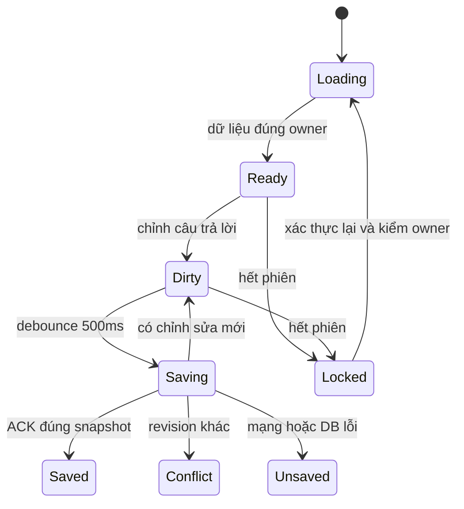

# LLD-05 — Giao diện và phiên học

[Mục lục](../../design/README.md) · MD03/09 · REQ-02/03/07/11 · BL-R14–24

## Bố cục chức năng

Implementation prototype cho nội dung đọc: [BL-P03 block reader](../f08-content/authoring/lesson-blocks.md). [BL-P04](tasks/BL-P04.md) đặt một locale `vi|en` ở root cho shell/pages/lesson; switch không remount route hoặc learner state. Hai route mẫu không là luồng progress R1 trong bảng thiết kế bên dưới.

| Màn/route | Nội dung chính | Hành động và điểm thoát |
|---|---|---|
| `/journey/:roadmapId` | Chặng/mục, prerequisite, nội dung khả dụng | Mở topic; Back giữ ngữ cảnh bản đồ |
| `/topics/:topicId` | Mục tiêu, CAP, ba chiều progress, ôn nền | Ôn tại chỗ, học, luyện hoặc kiểm tra |
| `/learn/:topicId/:unitId` | Câu hỏi, bàn mô hình, input, before/after, giải thích | Step/replay/reset, Next/Back; chỉ viewed |
| `/practice/:exerciseId` | Đề nhỏ, phản hồi, hint tăng dần | Thử lại/ôn; không tự mastery |
| `/attempts/:attemptId` | Form trả lời, save state, hỗ trợ, submit | Lưu nháp, nộp, dừng; không chạy preview đáp án case |
| `/submissions/:submissionId` | Pending/error/result, từng CAP/tiêu chí | Xem thiếu gì, ôn/luyện, case mới nếu còn |
| `/history` | Nháp, submission bất biến, bài áp dụng | Tiếp tục đúng ID, không POST lại khi reload |
| `/account/learning-data` | Export/import/reset riêng | Preview, xác nhận, receipt |
| Login/activate/reset | Danh tính và credential forms | Quay lại tài nguyên chỉ sau kiểm owner |

Desktop: điều hướng bài + vùng hoạt động chính + giải thích/feedback theo ngữ cảnh. Mobile ưu tiên đọc/ôn, các panel xếp theo thứ tự; thao tác phải có alternative bằng nút/form. Trạng thái/rubric không chỉ biểu diễn bằng màu. Chi tiết 11 màn và prototype ở D07; LLD này không thay thành một thiết kế hình ảnh mới.

## State và sở hữu frontend

Session provider giữ identity/context/authGeneration. Fetch wrapper cùng origin mang cookie/CSRF/context. Mô hình dùng reducer thuần; response DTO qua adapter. Cache cá nhân chỉ RAM, xóa khi logout/đổi user. Không dùng component React để chấm official progress.

Locale provider chỉ sở hữu preference hiển thị và chọn Pair EN/VI theo stable key. Prototype lưu key versioned trong localStorage, whitelist `vi|en`, fallback Việt và cập nhật `html lang`; không lưu answer/progress ở đây. Account preference tương lai phải đi qua owner/profile task, không trộn với session/auth state.

Một request save in-flight mỗi draft. Submit chờ save đang gửi, dùng snapshot cuối và revision mới. ACK cũ không xóa dirty mới. Conflict cho xem hai bản, không tự last-write-wins. Rời màn có thay đổi chưa lưu phải thông báo; reload/đóng tab có thể mất RAM, không hứa offline persistence.

## Tính sinh động có mục đích

Người học dự đoán rồi thay input để thấy state thay đổi. List/Set/Map có cùng dữ liệu để so sánh; highlight phần đổi kèm chữ. Step/pause/replay/reset chỉ điều khiển mô hình, không cộng thành tích. Giải thích xuất hiện cạnh kết quả; không biến mọi phần kiến thức thành một bài đọc dài hoặc animation tự chạy không kiểm soát.

### Interactive Learning Workspace

Workbench là một mode tùy chọn trong player cho topic mà visualization giúp giải thích cơ chế. Luồng vẫn là roadmap → topic → workspace; roadmap sở hữu định hướng, topic sở hữu mục tiêu/prerequisite, còn workspace sở hữu scene, inspector và state mô phỏng trong phiên. Topic không có descriptor hợp lệ tiếp tục dùng lesson reader bình thường, không có CTA hoặc khung rỗng giả tương tác.

Scene nhận descriptor nội dung đã validate từ MD01 và dùng reducer/state machine xác định ở MD03; không nhận arbitrary HTML/JavaScript hoặc tự gọi service. Baseline là SVG/HTML/CSS 2D với hotspot, flow và text equivalent. Inspector có thể trình bày Theory, Flow, Example, Check và Apply nhưng `Check` chỉ là formative nếu đáp án nằm trong public bundle; official assessment/project phải đi qua owner MD04/05/07. Run, Next, replay, reset hoặc xem hết animation không tự tạo Proven/Applied.

HTTP Foundations là pilot đầu với Browser → DNS → Server → Controller → Service → Database → HTTP Response. Người học dự đoán trước, thay đổi input có allowlist và xem observation/explanation sau simulation. Mọi trạng thái phải dùng được bằng keyboard, có reduced-motion/static fallback và giữ nghĩa ở English/Tiếng Việt. Không cam kết WebGL/3D; task và dependency chính thức nằm ở [BL-E07](tasks/BL-E07.md).

## Lỗi và khả dụng

Loading khác empty và error. Pending chấm khác fail. Unauthorized khác server unavailable. Hết case hiển thị lý do và đường luyện. Reset dữ liệu có phạm vi/reauth/processing riêng, không đặt cạnh nút reset mô hình.

Test keyboard toàn luồng, focus sau lỗi/modal/đổi route, label/live status phù hợp, reduced-motion, 320px, theme, Back/reload, expired session và response trễ. Prototype D07 đã có bằng chứng riêng; sản phẩm nối API phải test lại R14–24/33, không kế thừa pass từ mock.

- **LLD-05-A:** cách chia bản đồ/trang mục/bàn học có thuận tiện không?
- **LLD-05-B:** vòng dự đoán→thử→giải thích→luyện có đủ sinh động không?
- **LLD-05-C:** lưu nháp/conflict/expiry có dễ hiểu và ít gây mất bài không?

Nguồn: [D07](collections/experience.md), [mô hình Collections](collections/knowledge.md), [D08](../../delivery/history/implementation-v2.md). Tiếp: [dữ liệu](../f07-data-lifecycle/lld.md).
