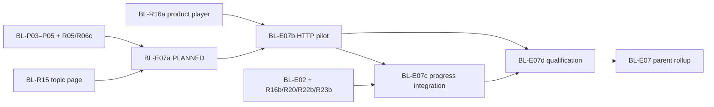

# BL-E07 — Interactive Backend Workbench

[Registry](../../../delivery-backlog.md) · [F02](../README.md) · [F08 authoring](../../f08-content/authoring/lesson-blocks.md) · [Progress](../../f05-progress/business.md) · [DoD](../../../delivery/contract.md)

## Objective, business outcome và trạng thái

**Objective:** thêm `Interactive Learning Workspace` như một mode học có chủ đích cho topic phù hợp, với scene trực quan, theory/flow/code/check/apply theo ngữ cảnh và ranh giới evidence rõ. Roadmap vẫn là màn định hướng; workbench không trở thành một roadmap hoặc một runner thật.

**Business outcome:** người mới có thể nhìn và thao tác với cơ chế backend trước khi đọc sâu hoặc làm bài, nhưng vẫn hiểu phần nào là simulation, phần nào là official assessment và phần nào là applied evidence. Pilot đầu tiên là HTTP Foundations; contract phải tái sử dụng được cho Spring, Database, Microservices và DevOps mà không nhân content/progress ID.

**Trạng thái 29/10/2026: `PLANNED` parent rollup.** Không giao parent vào một session và không tự bắt đầu child. Không child nào là task kế tiếp hiện hành; BL-E07a chỉ được kích hoạt sau khi BL-R15 chốt topic page/CTA/deep-link.

## Ownership và quan hệ với capability hiện có

- Primary owner: F02/MD03/MD09 cho workspace runtime và experience.
- Content owner: F08/MD01 cho descriptor, bilingual content, version và publication.
- Evidence owners: F04/F05/F06, MD04/05/07; workbench không tự ghi mastery/project.
- BL-P01–P05 là prototype/evidence đầu vào, không phải product publication/progress.
- BL-R14/R15 tiếp tục sở hữu roadmap/topic; BL-R16a sở hữu product player; BL-R17 sở hữu Collections reducer. E07 không thay hoặc đóng lại các task đó.

## Phân rã leaf và dependency

| Leaf | Đầu ra chính | Dependency bắt buộc | Quan hệ song song |
|---|---|---|---|
| [BL-E07a](BL-E07a.md) | Product/UX contract và reusable scene/content model | P03/P04/P05, R05/R06c và R15 | Thực hiện sau R15, tốt nhất trước hoặc ở đầu giai đoạn extension planning của R16a; không block R16a |
| [BL-E07b](BL-E07b.md) | HTTP Foundations pilot trong product player | E07a, R16a | Sau R16a có thể triển khai độc lập với Collections content/reducer nếu write scope không giao nhau |
| [BL-E07c](BL-E07c.md) | Viewed/Proven/Applied integration qua owner APIs/routes | E07b, E02 HTTP assessment/apply content, R16b, R20, R22b, R23b | Không song song write với E07b; contract audit có thể chuẩn bị trước |
| [BL-E07d](BL-E07d.md) | A11y/responsive/performance qualification report | E07b, E07c | Preflight có thể chạy sau E07b; final qualification chờ E07c |

## Invariants và ngoài phạm vi chung

- Roadmap không bị thay thế; workbench chỉ xuất hiện khi published descriptor hợp lệ và visualization có giá trị học tập.
- Giữ stable TOP/CAP/unit/block/scene IDs; shared Backend/DevOps dùng một content source và một progress.
- `Viewed`, `Proven`, `Applied` tách riêng. Run/Next/replay/reset không tự cấp Proven/Applied.
- Mọi simulation ghi rõ phạm vi mô hình và không được trình bày như Java, Docker, network hoặc hạ tầng thật đã chạy.
- English/Tiếng Việt dùng cùng ID/state; mode Việt giữ technical terms English khi chính xác hơn.
- Baseline 2D SVG/HTML/CSS, không cam kết WebGL/3D, dependency/framework hoặc asset production mới.
- Không đổi service boundary, không tạo runner, CMS/admin hoặc production deployment trong initiative này.

## Acceptance parent

Parent chỉ `DONE` khi bốn leaf `DONE`, owner docs/registry thống nhất và không còn P0/P1 trong supported scope. Pilot phải đi được từ topic đến workbench, có deterministic simulation + fallback, official progress boundaries đúng, keyboard/reduced-motion/responsive/screen-reader semantics đạt và performance budget được chứng minh. Pilot không được dùng làm bằng chứng cho topic khác hoặc real execution.

## Checkpoint planning ban đầu — 29/10/2026

- Chọn parent + bốn leaf vì contract, pilot, progress integration và qualification có output/validation độc lập.
- Không nhập initiative vào BL-P03 vì P03 chỉ là local FE/content prototype; không mở rộng BL-R16a/R17 vì chúng đang sở hữu product player và Collections reducer R1.
- UX reference Arduino chỉ dùng để quan sát mô hình scene + contextual panel + code/action + lesson navigation; không sao chép source, asset, visual identity và không chọn 3D làm baseline.
- Sau review scheduling, E07a không chen vào task kế tiếp. Activation window là sau
  R15 và trước/đầu extension planning của R16a: topic navigation đã ổn định nhưng
  player chưa bị khóa vào một presentation chỉ dành cho Collections.
- Lượt này chỉ planning/docs. Không có frontend/backend/schema implementation, dependency mới, commit, deploy hoặc child session được mở.
