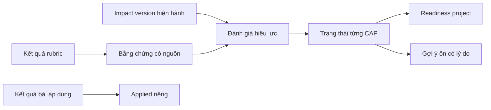

# LLD-04 — Tiến độ, ôn và áp dụng

[Mục lục](../../design/README.md) · MD05/02/07 · REQ-06/07/08/12 · BL-R13/21–23

Hiện hành [MS03 publication](../f08-content/publication/protocol.md): current reads giữ shared Learning publication gate/snapshot, xét eligibility/impact trước trả mastery. Trong fence trả pending; immutable history vẫn có thể đọc. Projection stale phải overlay/reconcile policy hiện hành; không cần quét cập nhật mọi user khi publish. [Recovery](../../architecture/lifecycle-recovery-protocol.md) giữ owner/epoch/exposure floors trước rebuild, chưa có runtime.

## Mô hình đọc tiến độ

| Chiều | Input đáng tin | Điều hiển thị | Không suy ra |
|---|---|---|---|
| Đã xem | viewed-event hợp lệ unit/version | Phần bắt buộc đã xem của TOP | Đã hiểu hoặc pass CAP |
| Năng lực | Evidence server chấm, rubric/support/version hợp lệ | Từng CAP đạt/chưa đủ bằng chứng/cần xác minh | Đã làm project hoặc CAP ngoài rubric |
| Áp dụng | Result bài tổng hợp/milestone theo rubric riêng | Đã áp dụng, loại nguồn, mức hỗ trợ | Hoàn thành mọi prerequisite hoặc Java thật |

Evidence giữ result/target/kind/source/support/policyVersion. Projection rebuild được, không authority để nhập pass; có appliedPublicationRevision. Learner guard tuần tự hóa cập nhật, tránh lost update. User+learningEpoch+CAP dùng chung hai roadmap.

## Tính trạng thái và gợi ý

1. Lấy evidence cùng owner/epoch và versions nguồn.
2. Áp impact publication hiện hành: giữ hiệu lực, cần xem lại, cần xác minh lại. Lịch sử pass vẫn còn.
3. Tách ba chiều; CAP không được assessment bao phủ vẫn hiện chưa đánh giá.
4. Đề xuất phần ôn liên quan tiêu chí thiếu, chỉ dẫn nội dung published hoặc refresh card có thật.
5. Tính readiness mốc từ prerequisite; đủ điều kiện không tự hoàn thành mốc.

`POST /api/v1/viewed-events` nhận unit/version; server lấy TOP mapping từ manifest. `GET /progress`, `/history`, `/recommendations` có owner từ phiên; history cursor timestamp+ID, mặc định20/max100. Publication cũ phải reconcile trước khi trả mastery hiện hành.

## Ví dụ Collections

Người học chưa xem hết C3 nhưng tự làm đúng case Map có thể đạt CAP-COL-004-A/B; viewed vẫn chưa đầy đủ. Dùng lời giải rồi làm đúng hiển thị kết quả có hỗ trợ, không cấp độc lập mới. TOP-COL-006 có A được đánh giá, B chưa; không ghi toàn TOP thành thạo.

CL-U-01 đạt U1–U5 ghi “đã áp dụng trong mô hình”. Dùng hint ghi áp dụng có hỗ trợ. Mẫu chỉ một case áp dụng; làm lại sau biết lời giải là luyện. P1 CLI cần COL-007/validation/unit test và rubric riêng, không tự mở hoàn thành từ CL-U-01.

## Lỗi và nghiệm thu

Import official pass tự khai chỉ unverified; missing/new version không xóa history; không có bài published thì báo đang biên soạn; API lỗi không hiển thị số0 như chưa học. Planned/draft không vào mẫu số tiến độ nội dung khả dụng, độ bao phủ app là số liệu khác tiến độ learner.

Kiểm AP-01–22, publish/T2 race, rebuild, shared progress, supported vs independent, readiness vs applied; UX empty/loading/error/history. Chưa có thuật toán spaced repetition tự đặt hoặc leaderboard trong R1.

- **LLD-04-A:** ba chiều và nhãn “cần xác minh lại” có rõ không?
- **LLD-04-B:** khi nào bắt đầu áp dụng nhỏ/project có đúng mong muốn không?
- **LLD-04-C:** giới hạn mô hình so với code Java thật có được thể hiện đủ rõ không?

Nguồn: [D05](../f04-assessment/evidence-contract.md), [D06](../f04-assessment/collections/cases.md), [D08](../../delivery/history/implementation-v2.md). Tiếp: [trải nghiệm](../f02-learning-experience/lld.md).
