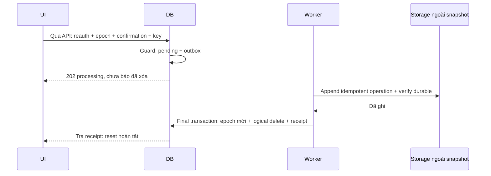

# LLD-06 — Export, import, reset và phục hồi

> Hiện hành MS03: [lifecycle/recovery LLD](../../architecture/lifecycle-recovery-protocol.md) và [data protocols](../../architecture/data-protocols.md) giữ journal/reset/delete/ba-DB restore. Trang này rút gọn để review; không có runtime/backup/drill đã chạy.

[Mục lục](../../design/README.md) · MD06/10/11 · REQ-09/15 · BL-R25–29/32

## Ba thao tác khác nhau

| Thao tác | Mục đích | Thẩm quyền |
|---|---|---|
| Export/import JSON | Người học giữ bản dữ liệu và nhập nháp/lịch sử tự khai | Không tự cấp official evidence |
| Reset dữ liệu học | Xóa toàn dữ liệu học của owner, giữ account/exposure | Reauth và xác nhận rõ phạm vi |
| Backup/restore server | Operator phục hồi dữ liệu tin cậy khi sự cố | Quy trình cô lập, journal và kiểm chứng trước mở traffic |

Reset mô hình chỉ thay state thí nghiệm, không thuộc reset dữ liệu học. Không reset riêng roadmap vì shared content.

## Dữ liệu và API

Learning giữ `import_staging`: previewId/owner/checksum/epoch/dataRevision/expiry24h; `imported_record`: owner+source+sourceId/fingerprint; `mutation_receipt`: operation/key/outcome; pending intent/inbox/outbox/epoch floors. Journal ngoài snapshot có JRN-01 exposure, JRN-02 reset intent; Identity có JRN-03 terminal delete và JRN-04 ordered account state. Chỉ metadata/digest, không answer/password/cookie.

GET `/api/v1/learning-data/export` đọc snapshot nhất quán; không secrets/private expected/user khác. POST `/import-preview`, `/import-apply`, `/reset` nằm dưới `/api/v1/learning-data`. Receipt lookup theo API chung phục vụ timeout/pending.

## Luồng import

1. Giới hạn file 5MiB/500record, depth20; kiểm schema/owner/reference trước ghi dữ liệu học.
2. File owner khác từ chối; legacy ownerless phải nhận rõ vào tài khoản hiện tại dưới nhãn unverified.
3. Preview mới/trùng/conflict/không mapping. Cùng sourceId khác nội dung không tự chọn bên thắng.
4. Apply kiểm lại checksum/epoch/dataRevision/context, merge và receipt một local transaction. Nếu file chứa known exposure, pending/outbox → external exposure journal ACK trước final apply; final vẫn CAS/recheck, stale409 preview lại. Journal lỗi không overwrite dữ liệu tốt, không official evidence.

Không sửa submission/evidence chính thức. File ghi pass vẫn chỉ lịch sử tự khai. Version không dùng được vào archive unverified; legacy API500 không biến thành draft Collections. Unsupported/error giữ file và dữ liệu đang tốt.

## Luồng reset có thể phục hồi

Sơ đồ rút gọn API để thấy boundary transaction. Journal write nằm ngoài DB transaction. Khi pending, khóa ghi học; journal lỗi giữ dữ liệu và pending để retry cùng operation. Final commit chặn autosave/job/import epoch cũ. Retry receipt cũ sau khi đã học lại không xóa bài mới. Cleanup vật lý trong7ngày; không hứa backup được xóa tức thì.

Account deletion là lệnh operator do Identity điều phối: auth fencing cả Content/Learning → terminal delete journal → suppression ACK cả hai → logically deleted → live purge. Participant absent vẫn tombstone; down thì pending, không fake success. UUID không tái sử dụng, cleanup live ≤7 ngày, backup expiry báo riêng. Reset giữ exposure; disclosure case/hint/solution và import known exposure phải journal durable trước final, để restore không làm case quen thành độc lập mới.

## Restore và kiểm tra

Backup policy hằng ngày, encrypted/off-host30 ngày, controlled application checkpoint ba DB + manifest/cursors/bundle digests/journal watermarks; không global DB snapshot. Journal retention toàn backup inventory + replay window +7 ngày grace, backup ngoại lệ kéo dài. Storage provider/schedule/commands và pause duration đo ở MS04/code ops.

Restore môi trường riêng/quarantine → verify manifest + current journal prefix → terminal delete/account state/reset epoch floors/exposure max → new auth realm/participant/job generations → recover publication prefix/refs/receipts → rebuild surviving projections/jobs → readiness/drill evidence trước traffic. Orphan owner/version không map theo loginName/guess rubric. Mọi account restored RECOVERY_REQUIRED, credential/token/session cũ không hoạt động lại; operator verified cấp mới sau đối soát disable/delete. Intent journal durable chưa DB final phải hoàn tất/recovered receipt, không hồi sinh old state. Thiếu journal/checksum/provenance giữ offline, giữ nguồn tốt.

LD-21–28 + DATA-16–30: import/CAS/journal faults, reset/T2/retry after new work, deletion absent/down, restore before exposure/reset/credential change, mixed DB heads/unknown refs/old ACK. MS04 gắn test owners/commands; R32 đo RPO/RTO/data-loss interval, chưa SLA/zero-loss. Learner JSON không thay trusted restore drill.

- **LLD-06-A:** import chỉ nháp/unverified, không khôi phục pass, có rõ không?
- **LLD-06-B:** reset toàn account và trạng thái processing có phù hợp không?
- **LLD-06-C:** dữ liệu giữ đến khi chủ động xóa, cùng giới hạn backup, có phù hợp pilot không?

Nguồn: [S03](../f11-learner-work/data-contract.md), [D08 §8](../../delivery/history/implementation-v2.md). Tiếp: [nền tảng](../../platform/lld.md).
