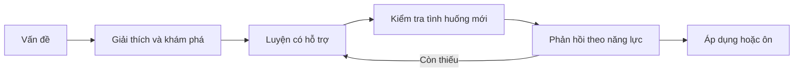

# Mẫu biên soạn một mục học

BL-D04 · template v1 · 23/09/2026. Dùng cho F02/F03/F08, MD01/03/04 và REQ-02/03/04/10/12. [Business design](../../../business-design.md) giữ định nghĩa học/luyện/kiểm tra/progress; tài liệu này chuyển chúng thành các phần cần điền khi biên soạn. Quy tắc chấm/attempt/progress chi tiết thuộc BL-D05, schema và adapter code thuộc BL-D08.

## 1. Đơn vị và nguồn chuẩn

Mẫu triển khai FE: [khối bài học BL-P03](lesson-blocks.md). Đây là renderer prototype; không thay yêu cầu publication của template.

Bài mới/sửa từ14/10/2026 tuân thủ [chuẩn content-first và song ngữ](bilingual-standard.md): điền EN/VI cho các phần bài học, dùng key/rubric chung, review độ đúng và tương đương ngữ nghĩa. Template không tự thay schema runtime.

- Một bản mục học tham chiếu một TOP đã có trong [catalog nền tảng](../../../curriculum/core-foundations.md), [API/data](../../../curriculum/core-api-data.md) [security/operations](../../../curriculum/core-security-operations.md) hoặc [DevOps](../../../curriculum/devops-catalog.md). CAP và prerequisite lấy từ catalog; không tạo ID mới chỉ vì đổi tiêu đề, màn hình hoặc lộ trình.
- Mục có nhiều bài và hoạt động, mỗi bài tập trung một vấn đề vừa đủ để thử và phản hồi. Không áp số bài, số chữ, số câu hỏi hay thời lượng cố định cho mọi topic.
- Collections là gói trải nghiệm ghép List/Set/Map và lựa chọn cấu trúc; từng TOP/CAP vẫn là nguồn progress. D06 có thể đặt một tên hiển thị chung cho gói; không tạo mastery “Collections” trùng với các topic thành phần.
- Một hoạt động có thể dùng lại hoặc cung cấp bằng chứng cho nhiều CAP khi có tiêu chí riêng cho từng CAP. Một CAP được luyện ở nhiều bài vẫn là cùng năng lực.
- CAP quá rộng hoặc prerequisite không phù hợp phải được đề xuất sửa trong catalog với lý do/version; không âm thầm diễn giải lại trong bài. Chỉ bao phủ một phần CAP thì ghi “hỗ trợ”, chưa dùng để cấp đạt cả CAP.
- Thời lượng, công nghệ và phiên bản chỉ ghi khi có cơ sở; để “chưa đo/chưa chọn” ở draft. Template v1 không tự nâng version nội dung hay version schema hiện có.

## 2. Các phần cần điền

**B** = bắt buộc có khi published; **ĐK** = có khi điều kiện áp dụng, nếu không ghi lý do; **TC** = tùy chọn. Draft được ghi pending có owner/task xử lý; published không được để pending ở phần B hoặc ĐK đang áp dụng.

T01–T15 trong tài liệu này là mã phần cục bộ của template, không phải các task T01–T35 lịch sử trong TASKS.md.

| Mã | Phần | Mức | Nội dung tác giả cần điền |
|---|---|---|---|
| T01 | Danh tính/phạm vi | B | TOP, tên, version, trạng thái, K/S/mức, CAP mục tiêu; phần ngoài phạm vi và liên kết catalog |
| T02 | Vấn đề và đầu ra | B | Tình huống cụ thể, ích lợi, người học làm được gì; mỗi lời hứa nối CAP hoặc ghi rõ chỉ giới thiệu |
| T03 | Đường vào và ôn | B | Prerequisite TOP/CAP/selector, cách nhận biết thiếu nền, phần ôn và link quay lại; nêu không có nếu thực sự không cần |
| T04 | Kiến thức và bài nhỏ | B | Khái niệm → cơ chế → ví dụ/đối chứng → giới hạn/lỗi thường gặp; CAP và thứ tự bài, nội dung bắt buộc/mở rộng |
| T05 | Cách giải thích trực quan | B | Sơ đồ/trạng thái/mô phỏng phù hợp, câu hỏi nó giúp giải đáp, bản chữ tương đương; không buộc có animation |
| T06 | Hợp đồng tương tác | ĐK | Khi có mô phỏng: state/input/action/observation, reset/replay, điều kiện lỗi/không hỗ trợ, kết quả kỳ vọng và phạm vi mô hình |
| T07 | Luyện tập và feedback | B | Ít nhất một đường luyện mỗi CAP mục tiêu: yêu cầu, dữ liệu/ràng buộc, tiêu chí, lỗi thường gặp, hint tăng dần, lời giải/lý do và retry |
| T08 | Bài toán kinh điển | ĐK | Khi phù hợp: đề/ràng buộc/ví dụ/biến thể, hint/lời giải, đánh đổi và ứng dụng; ghi lý do bỏ nếu không giúp mục tiêu |
| T09 | Kiểm tra năng lực | B | Tình huống khác luyện tập, CAP/rubric/evidence cần quan sát, cách thu/chấm dự kiến và feedback thiếu tiêu chí; chính sách hỗ trợ nối D05 |
| T10 | Áp dụng | B | Bài tổng hợp nhỏ hoặc liên kết milestone với điều kiện thật sự cần; không bắt tạo project mới cho mỗi topic |
| T11 | Tổng kết, progress và ôn | B | Điều đã học/đạt/áp dụng cần hiện, lỗi cần ôn, bài tiếp theo; dữ liệu cần thu để D05 diễn giải, không tự đặt công thức điểm |
| T12 | Khả dụng và phục hồi | B | Keyboard/text alternative/reduced motion nếu có motion; nơi tiếp tục khi dở, lỗi input/lab/storage có đường xử lý tương ứng |
| T13 | Thực thi thật | ĐK | Nếu có lab: tool/version/env, vùng dữ liệu, setup/reset/cleanup, command được review, kết quả cần kiểm chứng và lỗi môi trường |
| T14 | Nguồn, phiên bản và review | B | Nguồn gắn khẳng định/ví dụ, URL/mục tham chiếu, version tương ứng, ngày kiểm chứng thật, reviewer/findings và trạng thái |
| T15 | Nội dung bổ sung | TC | Mẹo, lịch sử, đọc thêm, thử thách sâu; tách rõ khỏi đường bắt buộc và progress của bài hiện tại |

T05 có thể chỉ là sơ đồ tĩnh có chú thích khi đủ giải thích. T06 chỉ xuất hiện khi hành động của người học có kết quả cần mô hình hóa. Lab T13 có thể dùng terminal do người học tự chạy, không mặc định app đã có runner. Hoạt động không chạy thật luôn hiển thị đúng là mô phỏng hoặc bài phân tích.

## 3. Mẫu để sao chép

Các tên trường là hợp đồng biên soạn bằng tài liệu, chưa là schema runtime. ID bài/hoạt động tạm dùng tên cục bộ duy nhất trong TOP + version; BL-D08 chuẩn hóa ID lưu trữ. Không dùng thứ tự dòng làm ID của CAP.

```text
T01 — TOP / tên / version / status:
Catalog / K / S / mức:
CAP mục tiêu / CAP chỉ hỗ trợ:
Ngoài phạm vi:

T02 — Người học đang gặp vấn đề gì? Học xong làm được gì?
T03 — Prerequisite (all-of, selector nếu có):
Kiểm tra đầu vào / ôn nhanh / quay lại mục nền:

T04 — Danh sách bài nhỏ (ID cục bộ, CAP, mục đích, bắt buộc/tùy chọn):
Khái niệm / cơ chế / ví dụ / phản ví dụ / lỗi thường gặp:
T05 — Trực quan + mô tả chữ tương đương:
T06 — Có tương tác? Nếu có: state/input/action/output/reset/giới hạn:

T07 — Luyện tập (mỗi activity):
ID / CAP / yêu cầu / dữ liệu / ràng buộc:
Tiêu chí / feedback đúng-sai / hint / lời giải / retry:
T08 — Bài kinh điển (hoặc không áp dụng + lý do):

T09 — Assessment:
ID / CAP / tình huống mới / khác gì với luyện tập:
Quan sát cần có / rubric / expected result / cách thu evidence:
Mức hỗ trợ / retry / rule chấm: tham chiếu hợp đồng BL-D05:
T10 — Áp dụng nhỏ hoặc milestone / readiness / sản phẩm cần nộp:

T11 — Tổng kết / dữ liệu progress cần thu / ôn / bài tiếp:
T12 — Keyboard / fallback / pending-error / tiếp tục phiên:
T13 — Lab thật (hoặc không có): env/version/vùng lab/setup/reset/cleanup:
T14 — Nguồn + phần được chứng minh / version / ngày review thực / finding:
T15 — Đọc thêm/thử thách mở rộng (nếu có):

Ma trận CAP → bài → luyện → kiểm tra → áp dụng → loại evidence:
Pending / task xử lý / điều kiện publish:
```

### Ma trận bao phủ bắt buộc

| CAP | Bài/hoạt động dạy | Luyện tập | Kiểm tra và tiêu chí | Áp dụng | Evidence dự kiến |
|---|---|---|---|---|---|
| CAP thật trong catalog | ID cục bộ và phạm vi dạy | ID và feedback | ID, phần rubric chứng minh CAP | ID bài nhỏ/milestone hoặc link dùng lại | Phân tích/mô phỏng/tự khai/thực thi xác minh |

Không để một CAP được hứa là đạt mà chỉ có nội dung đọc. Một hoạt động kiểm tra chung có thể bao phủ nhiều CAP, nhưng từng CAP phải có kết quả đánh giá riêng. Phần giới thiệu/mở rộng không có assessment được ghi chưa đánh giá; không làm người học tưởng đã đạt toàn topic. Published topic phải có đường chứng minh mọi CAP trong phạm vi mục tiêu đã công bố; trạng thái hoàn thành topic dựa trên CAP thật theo D05, không theo số section có mặt.

## 4. Nhịp một phiên học và dữ liệu cần quan sát



- Mỗi bài có một câu hỏi dẫn nhập và một kết quả cụ thể. Người học dự đoán/thao tác/giải thích trước khi xem lời giải khi hoạt động phù hợp; không ép mọi nội dung thành trò chơi.
- Feedback chỉ ra điều quan sát được, vì sao khác dự kiến và nên thử gì tiếp. Hint tăng dần từ định hướng tới gợi ý cơ chế; dùng lời giải phải được ghi nhận để D05 quyết định giá trị evidence.
- Mô phỏng có nhiều bước thì có step/replay/reset; sơ đồ tĩnh không cần các nút này. Khi giảm motion vẫn thấy đủ trạng thái và quan hệ nguyên nhân/kết quả.
- Tác giả chỉ định dữ liệu cần thu: TOP/CAP và content version, activity/case, input/câu trả lời, observation, hint/lời giải đã dùng, kết quả theo tiêu chí, nguồn evidence và nơi tiếp tục. Chỉ thu phần cần đánh giá; không ghi secret/dữ liệu cá nhân trong bài mẫu.
- Reset hoạt động đưa về trạng thái thí nghiệm ban đầu. Xóa lịch sử học là hành động khác. Xem hết, luyện xong và pass assessment phải được mô tả khác nhau; score/threshold/attempt/version migration sẽ được chốt D05.
- Nếu cơ chế không được hỗ trợ hoặc lab không chạy: hiển thị giới hạn/lỗi và đường tiếp tục phù hợp; không trả một kết quả dựng sẵn rồi gắn nhãn thực thi thật.

## 5. Điền thử A — Collections: Map trong gói List/Set/Map

Đây là **bản điền thử cấu trúc**, không phải bài Collections hoàn chỉnh của D06. Chọn một topic nguyên tử để kiểm tra traceability; gói Collections sẽ ghép các TOP còn lại bằng cùng cách này.

| Phần | Nội dung điền thử |
|---|---|
| T01 | TOP-COL-004; Map: khóa, giá trị và tra cứu; contentStatus=planned; version dự kiến 1; K04/S02/C. Mục tiêu CAP-COL-004-A/B. Không bao phủ hashing internals, concurrency, toàn bộ Big O hay CAP-COL-006 |
| T02 | Tra cứu task theo String ID; xử lý ID không tồn tại và cập nhật task đã có. Đầu ra A: tra cứu/cập nhật theo contract; B: giải thích khóa trùng và khóa ổn định |
| T03 | TOP-COL-001 và TOP-JAVA-010. Ôn đọc generic/API và equality; link quay lại catalog nếu chưa phân biệt key với value. Không tự cấp progress prerequisite chỉ từ xem phần ôn |
| T04 | M-C1: key/value và thao tác tra cứu (A). M-C2: cập nhật/khóa trùng (A/B). M-C3: chọn String ID ổn định và giới hạn mô hình (B). Ví dụ/đối chứng và code chính xác do D06 biên soạn |
| T05 | Bảng key → value, đánh dấu hàng bị tác động và log thao tác dạng chữ. Người học quan sát cùng key qua các thao tác; không mô phỏng memory/hash bucket chưa được dạy |
| T06 | State: ánh xạ và action log. Input: key/value + action thêm/cập nhật/tìm; output: bảng/giá trị/kết quả thiếu key theo contract. Reset dữ liệu mẫu; không giả chạy JVM. Null/order/mutable key ngoài phạm vi đầu phải có nhãn, không tự chọn hành vi ngầm |
| T07 | M-P1: tra cứu/cập nhật trên dataset task (A); M-P2: phát hiện ID trùng và chọn khóa ổn định (B). Feedback dự kiến chỉ ra key bị tác động, kết quả theo contract; hint từ tìm key đến lần theo action; lời giải/case biên cần D06 |
| T08 | Không thêm bài kinh điển riêng trong topic Map tối thiểu. Frequency/grouping nằm ở TOP-COL-006, Two Sum là mở rộng; liên kết đúng chỗ thay vì nhân bản nội dung |
| T09 | M-A1: bộ mã sản phẩm và chuỗi thao tác mới, gồm thiếu key/trùng key; A/B có tiêu chí riêng. Yêu cầu giải thích lựa chọn key và trạng thái cuối, không chỉ nhớ lại đáp án task mẫu. Case/expected result do D06, chính sách chấm/hint do D05 |
| T10 | M-U1: chức năng tra cứu/cập nhật theo ID trong bài tổng hợp; nối P1 khi đủ TOP-COL-007 và prerequisite của P1. Hoàn thành Map chưa tự thành hoàn thành P1 |
| T11 | Hiện bài đã xem, A/B đã có/chưa có evidence và phần áp dụng riêng; ôn khi nhầm key/value hoặc khóa trùng; nối TOP-COL-005/006 theo prerequisite |
| T12 | Form thao tác dùng keyboard; state trước/sau có chữ; input chưa được hỗ trợ báo rõ; lưu vị trí dở theo D05/D08. Không có animation bắt buộc |
| T13 | Chưa có lab thật trong bản điền thử. Khi D06 có code Java chạy thật, bổ sung tool/version/test và nguồn kết quả; không lấy thao tác mô phỏng làm bằng chứng chạy Java |
| T14 | Nguồn cần kiểm chứng khi viết bài: Java API Map và tài liệu equality theo JDK được chọn. URL/version/reviewedAt còn pending; chưa ghi đã review kỹ thuật. Owner: D06 |
| T15 | Link chọn cấu trúc/đếm nhóm ở COL-006; không đưa vào tiêu chí pass Map |

| CAP | Dạy | Luyện | Kiểm tra | Áp dụng | Evidence dự kiến |
|---|---|---|---|---|---|
| CAP-COL-004-A | M-C1/M-C2 | M-P1 | M-A1: lookup/update và trường hợp thiếu key | M-U1 | Câu trả lời/observation mô phỏng; code test thật nếu lab được bổ sung |
| CAP-COL-004-B | M-C2/M-C3 | M-P2 | M-A1: giải thích key trùng/ổn định | M-U1 | Giải thích + trạng thái dự đoán; không tự suy JVM đã chạy |

## 6. Điền thử B — Bind mount/Volume và vòng đời dữ liệu

Bản này đối chiếu cả kiến thức cơ chế và thao tác cần môi trường thật. Nó dùng cùng template với Map nhưng khác loại trực quan/evidence.

| Phần | Nội dung điền thử |
|---|---|
| T01 | TOP-CTR-005; Bind mount, volume và dữ liệu bền vững; contentStatus=planned; version dự kiến 1; K18/S09/C. Mục tiêu CAP-CTR-005-A/B; không bao phủ Kubernetes, backup toàn hệ thống hoặc toàn mốc P6 |
| T02 | App/DB container được tạo lại và cần hiểu dữ liệu đang nằm ở đâu. A: chọn cách lưu và chỉ ra dữ liệu còn/mất; B: thử đối chứng có/không volume, phân biệt recreate với xóa volume trong lab |
| T03 | TOP-CTR-003 và TOP-ENV-002.A. Ôn lifecycle, path/vùng lab; không cần đã hoàn thành P5. Nếu chưa có Docker, vẫn học sơ đồ nhưng CAP-B thực thi thật chưa được xác minh |
| T04 | V-C1: vị trí dữ liệu của container, bind mount, volume (A). V-C2: theo lifecycle và cấu hình mount (A). V-C3: thiết kế đối chứng và vùng dữ liệu lab (B). Hành vi/command chính xác cần nguồn và review ở đợt biên soạn |
| T05 | Sơ đồ host–container–mount, đánh dấu nơi ghi dữ liệu; chuỗi trạng thái với bảng chữ tương đương. Có thể dùng thẻ trạng thái tĩnh để giải thích cơ chế, không đòi cùng giao diện key/value như Map |
| T06 | Nếu làm mô phỏng: state là container/mount/data; action theo lifecycle đã định nghĩa; kết quả kỳ vọng có case matrix. Phải công bố phần DB flush/driver/OS không mô phỏng. Reset chỉ reset mô hình, không gọi lệnh xóa dữ liệu máy |
| T07 | V-P1: lần theo vị trí dữ liệu và chọn mount cho tình huống (A). V-P2: sắp kế hoạch đối chứng và tìm thao tác có nguy cơ mất dữ liệu (hỗ trợ B). Hint đi từ vị trí ghi tới lifecycle; mô phỏng V-P2 không tự chứng minh đã chạy lab |
| T08 | Không áp dụng bài thuật toán kinh điển. Tình huống “recreate rồi dữ liệu có còn?” đã thuộc bài cơ chế/lab, không tạo bài toán trùng chỉ để đủ mục |
| T09 | V-A1: sơ đồ/cấu hình mới, dự đoán và giải thích dữ liệu (A). V-A2: lab riêng quan sát có/không volume và dữ liệu sau recreate (B). Tiêu chí thao tác vùng lab/kết quả cuối tách khỏi câu trả lời kiến thức; chấm cụ thể thuộc D05 |
| T10 | V-U1: storage cho app + DB tại P6 khi đủ toàn readiness. Năng lực volume dùng chung Backend/DevOps; không tạo progress thứ hai khi đổi lộ trình |
| T11 | Giữ riêng hiểu cơ chế và bằng chứng thực hành; chưa có môi trường thì V-A2 ở trạng thái chưa được xác minh. Ôn khi nhầm stop/recreate/xóa volume; readiness P6 vẫn xét các TOP khác |
| T12 | Bảng trạng thái đọc được bằng keyboard, không phụ thuộc màu/motion; lab offline/port/path sai có hướng xử lý; không giả pass khi command fail |
| T13 | Bắt buộc cho CAP-B khi xuất bản đường xác minh lab thật: tool/OS/version, DB image chọn, fixture nhỏ và vùng lab riêng, precheck/config, setup/reset/cleanup và expected observation. Lệnh có ảnh hưởng dữ liệu phải ghi đích cụ thể và hậu quả; chưa có các chi tiết này nên chưa publish ví dụ |
| T14 | Nguồn cần kiểm chứng: tài liệu Docker storage/volumes/bind mounts và image DB được chọn. URL/version/reviewedAt còn pending; chưa chạy Docker trong task template. Owner: task biên soạn Volume khi được lập |
| T15 | Liên kết backup/restore OPS-007 và networking CTR-004; không suy ra volume là backup |

| CAP | Dạy | Luyện | Kiểm tra | Áp dụng | Evidence dự kiến |
|---|---|---|---|---|---|
| CAP-CTR-005-A | V-C1/V-C2 | V-P1 | V-A1: vị trí dữ liệu và lý do chọn mount | V-U1 | Phân tích sơ đồ/observation mô phỏng có giới hạn |
| CAP-CTR-005-B | V-C3 | V-P2 hỗ trợ; lab luyện khi sẵn sàng | V-A2: thao tác đối chứng và dữ liệu thực quan sát | V-U1 | Execution/observation được xác minh; ảnh/tự khai ghi đúng loại nếu chưa xác minh được |

## 7. Checklist theo trạng thái nội dung

### Được giữ ở planned/draft

- [ ] TOP/CAP và phạm vi có thật; prerequisite kế thừa đúng; phần cần sửa catalog được ghi rõ.
- [ ] Mỗi T01–T15 được đánh dấu có nội dung, pending có task/owner, hoặc không áp dụng có lý do.
- [ ] Có đường bài → luyện → kiểm tra dự kiến cho CAP mục tiêu; loại evidence thực tế cần có được nêu.
- [ ] Các nguồn/version/case chưa kiểm chứng ghi pending; draft không có lời hứa đã pass/published.
- [ ] Trạng thái đề cương/draft hiện rõ; gợi ý “học tiếp” không dẫn người học vào phần chưa dùng được.

### Đủ điều kiện published

- [ ] Tất cả phần B và ĐK áp dụng đã hoàn thiện; không còn placeholder/case/đáp án/rubric chặn học.
- [ ] Mọi CAP mục tiêu có cơ hội học/luyện và tình huống kiểm tra mới với tiêu chí/expected result đã review. CAP hỗ trợ không bị cấp đạt toàn bộ.
- [ ] Hint/feedback/lời giải đúng, điều kiện retry/support liên kết hợp đồng D05; không đặt ngưỡng điểm tùy tiện cho từng màn.
- [ ] Prerequisite có nội dung published dùng được hoặc đường ôn thay thế được review, nêu giới hạn của phần ôn; không ngõ cụt planned.
- [ ] Nguồn chính thức gắn đúng claim/phiên bản; ngày review là ngày kiểm tra thật, có xử lý finding kỹ thuật.
- [ ] Sơ đồ/mô phỏng đúng phạm vi, các action/case/reset được xác minh; text alternative, keyboard/reduced motion và lỗi hoạt động đã review.
- [ ] Nếu có lab: setup/expected/failure/reset/cleanup đã được thử trên môi trường công bố; bằng chứng thực thi không được thay bằng mô phỏng. Phần chỉ phân tích được ghi đúng phạm vi.
- [ ] Data/reference/version và luồng runtime tương ứng được kiểm tra theo quality-process; progress/resume/failure không cấp bằng chứng sai.
- [ ] Không còn finding chặn học/sai kết quả trong scope; người dùng thử chỉ được ghi đã thử khi có phản hồi thật. Learner test của mốc R1 theo BL-R34, không tự buộc mỗi bài phải có một người duyệt mới.

**DONE của tài liệu template khác published của bài.** Hai bản điền thử ở mục 5–6 hiện đáp ứng mức thiết kế/planned, còn thiếu bài, rubric, nguồn và runtime; không được gắn nhãn published.

## 8. Rà độ phù hợp và bàn giao

| Ca review | Quy tắc/mẫu đã xử lý |
|---|---|
| Chủ đề chỉ cần sơ đồ tĩnh | T05 bắt buộc giải thích, T06 có điều kiện; không ép dựng mô phỏng |
| Không có bài toán kinh điển phù hợp | T08 ghi không áp dụng kèm lý do; ví dụ Map/Volume đều nêu rõ |
| Không có project ở thời điểm học | T10 cho bài nhỏ hoặc link áp dụng về sau với readiness cụ thể |
| Gói Collections có nhiều topic | Ghép theo TOP/CAP hiện có; mỗi topic giữ progress, không nhân đôi mastery |
| Một hoạt động chấm nhiều năng lực | Ma trận CAP ghi tiêu chí từng năng lực, không cấp tất cả từ một điểm tổng |
| Dùng hint hoặc xem lời giải | Lưu hỗ trợ; D05 quyết định evidence/attempt, template không tự đặt pass |
| Không có Docker local | Học cơ chế được; evidence lab CAP-B còn thiếu và hiển thị đúng |
| Mô phỏng không hỗ trợ input | Báo giới hạn, không dựng output rồi gắn nhãn chạy thật |
| Cập nhật nội dung/phiên bản | Giữ ID ổn định và thông tin version/review; thay đổi bằng chứng do D05/D08 xử lý |
| Tác giả chưa kiểm chứng nguồn | Draft có pending, publish checklist ngăn claim reviewedAt giả |

REQ-02 được cụ thể hóa ở T03; REQ-03 ở T05/T06/T12; REQ-04 ở T07/T08; REQ-10 ở T01/T14 và checklist; REQ-12 ở T06/T09/T13. Đây là hướng biên soạn, không thay định nghĩa business hoặc triển khai bộ validator mới. D05 tiếp nhận yêu cầu evidence/attempt/rubric; D06 dùng template để hoàn thiện gói Collections; D08 chọn schema/ID activity/runtime phù hợp.

Kiểm tra 23/09/2026: script đọc tài liệu xác nhận đủ 15 phần định nghĩa và đủ 15 phần ở mỗi bản điền thử, TOP/CAP tham chiếu tồn tại trong catalog, link local hợp lệ, cả hai ví dụ ghi planned và có pending rõ. Đã review mười ca ở bảng trên, ranh giới D05/D06/D08 và tính nhất quán với business. Không chạy test app hoặc lab Java/Docker; nguồn kỹ thuật của ví dụ chưa được kiểm chứng vì đây là mẫu cấu trúc, không là nội dung xuất bản.

Hồ sơ từng mục khi bắt đầu biên soạn dùng [task brief](../../../delivery/task-brief-template.md); phân biệt DoD thiết kế và published theo [delivery contract](../../../delivery/contract.md). Các mục catalog/planned chưa được coi là đủ hồ sơ chi tiết.
