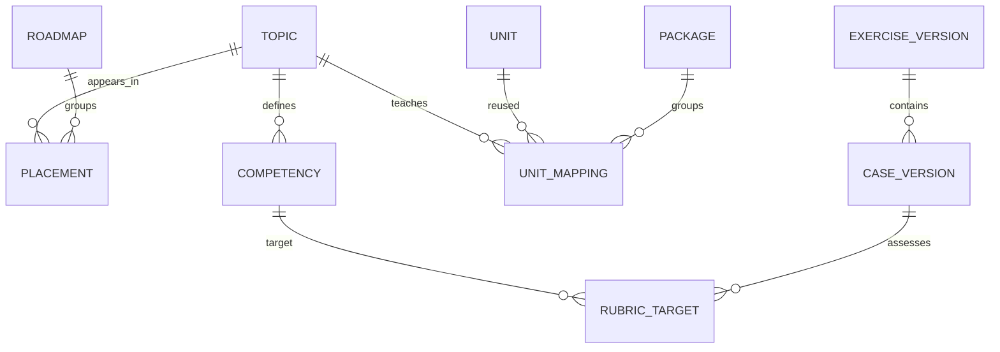

# LLD-02 — Nội dung, roadmap và xuất bản

[Mục lục](../../design/README.md) · MD01/02 · REQ-01/02/10/18 · BL-R05–07/14/15/30

## Trách nhiệm và quan hệ

FE có [block lesson prototype BL-P03](authoring/lesson-blocks.md) để thử chất lượng nội dung song ngữ. Type trong FE chưa thay schema/service contract dưới đây.

Content sở hữu định nghĩa kiến thức/năng lực/version/canonical publication; Journey sắp xếp và hiển thị. Learning sở hữu owner progress và private verified replica phục vụ chấm/history. [MS03 publication LLD](publication/protocol.md) là nguồn hiện hành thay publisher transaction một-DB; [catalog](../../architecture/service-boundaries.md) giữ API/owner.

Đây là quan hệ logic, chưa là DDL. Prerequisite có thể tham chiếu TOP hoặc CAP selector; validator kiểm đủ reference và DAG. Không suy prerequisite từ chặng đứng trước.

| Entity | Khóa/thuộc tính cần review |
|---|---|
| Topic/Competency | TOP/CAP ổn định, không đổi theo tên hay vị trí |
| Placement | roadmap/chặng/TOP; không có progress riêng |
| ContentVersion | entity+version unique, checksum immutable, trạng thái publish |
| Package/Unit mapping | `PKG-COLLECTIONS-CORE`, các TOP/CAP, canonicalTopicId cho route |
| Exercise/Case | ID/version/family/mode, public input, private expected/rubric |
| Publication/impact | revision và tác động từng CAP: giữ/cần ôn/cần xác minh |

## Một mục học cần có gì?

Tổng quan và đầu ra → prerequisite/ôn đủ dùng → kiến thức/ví dụ/lỗi → trực quan → luyện/feedback → bài toán kinh điển nếu phù hợp → kiểm tra/rubric → áp dụng → tổng kết/progress → nguồn/review. Mô hình có input/action/output/giới hạn; mục không cần animation vẫn có thể dùng sơ đồ và bản chữ. Template có 15 phần, không bắt mọi mục cùng số bài.

R1 Collections ghép TOP-COL-002/003/004/006, đánh giá bảy CAP; COL-006-B chưa đánh giá. Manifest unit→TOP quy định viewed; không cộng xem toàn TOP chỉ vì mở package.

## Publish và API

Authoring repo → schema/reference/DAG/coverage/source review → immutable candidate/manifest → Learning STAGE → FENCE ACK → Content canonical COMMIT → Learning RELEASE ACK. R1 serialize một publication operation toàn catalog; canonical commit sau fence là điểm hiệu lực, COMPLETE sau release nói Learning đã sync. Candidate lỗi giữ bản tốt, outage giữ pending; sau canonical commit chỉ forward revision/retry, không abort để phục vụ policy cũ.

`GET /api/v1/catalog`, `/topics/{id}`, `/topics/{id}/units/{unit}` theo API-C01–03: outline anonymous, published body login/no-store. Public DTO không private expected/case/hint/solution; phần đó qua Learning exposure journal trước disclosure. Source authoring không vào Vite bundle/sourcemap. Test fixture published ở DB test riêng không làm production draft thành published.

Response mang canonical/applied revision/as-of và `learning_sync_pending` khi cần. Trong fence, Learning current progress/new attempt/submit/support/T2 pending; readonly history và draft save pinned schema không cấp evidence vẫn có thể dùng. Withdrawal chặn new attempt/submit; valid pending grader có thể finalize history theo manifest, không current mastery từ withdrawn/invalid rubric. Invalid rubric không tạo official fail/pass. History giữ version; current impact theo CAP, một shared CAP không nhân progress hai roadmap.

## Lỗi và kiểm tra

| Lỗi | Hành vi |
|---|---|
| ID/reference trùng hoặc thiếu, graph vòng | Từ chối publish toàn bundle, giữ bản tốt |
| Bài planned được mở từ link | Hiện outline/đang biên soạn; không CTA giả hoạt động |
| Link topic cũ stage-index | Alias rõ; không mapping duy nhất thì giữ outline, không đoán CAP |
| Topic dùng ở hai roadmap | Cùng ID và progress; UI đổi placement thôi |
| Publish giữa lúc chấm | Shared/exclusive Learning gate sắp thứ tự; T2 recheck policy/epoch, release overlay current progress |
| FENCE/RELEASE ACK mất hoặc participant down | Retry same message/digest/sequence lấy durable receipt; pending, không globally-ready giả |

R05/06 kiểm catalog 95 TOP/190 CAP và DS/DP; R07 payload/artifact privacy; R14/15 deep link/Back/ôn; R30 review/publish. MS04 rebaseline task ownership và DB/fault cases DATA-01–09/24/26; chưa test publication runtime.

- **LLD-02-A:** cấu trúc một mục và phân biệt mục/gói/chặng có rõ không?
- **LLD-02-B:** shared Backend/DevOps và nhãn planned/published có đúng kỳ vọng không?
- **LLD-02-C:** cập nhật nội dung có nên giữ lịch sử và chỉ yêu cầu xác minh CAP bị ảnh hưởng như baseline không?

Nguồn: [template](authoring/topic-template.md), [DevOps catalog](../../curriculum/devops-catalog.md), [D08](../../delivery/history/implementation-v2.md). Tiếp: [bài làm](../f11-learner-work/lld.md).
