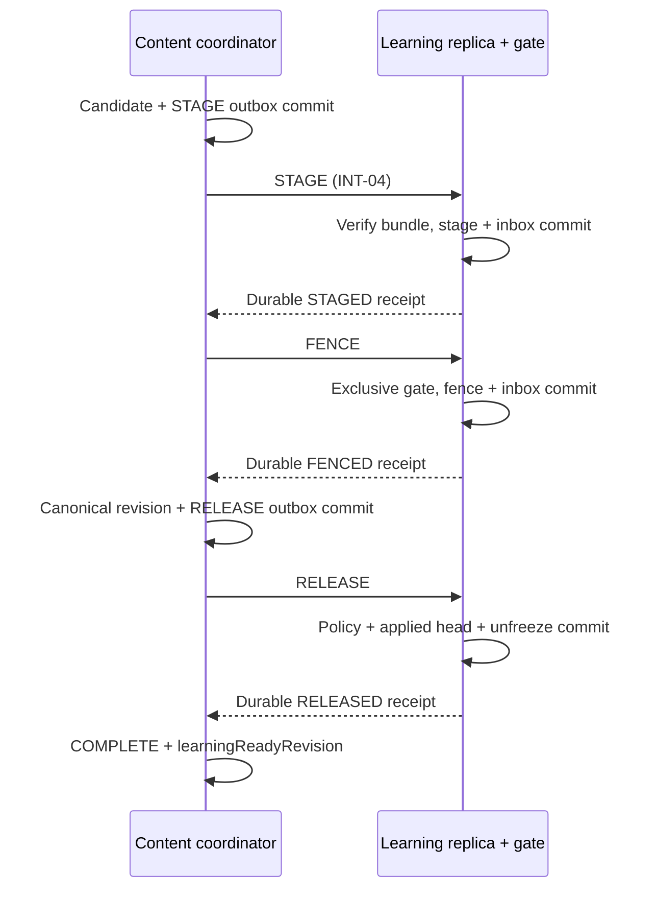

# Publication protocol — Content ↔ Learning

BL-MS03 · 30/09/2026 · LLD thiết kế, chưa runtime. Đọc cùng [data protocols](../../../architecture/data-protocols.md), [service catalog](../../../architecture/service-boundaries.md) và [session protocol](../../f10-identity-access/sessions/protocol.md). Thay publication một transaction/DB ở D08; không thay tiêu chí biên soạn, rubric hay viewed/proven/applied.

## 1. Candidate và nguồn sự thật

Content giữ canonical publication revision và coordinator; Learning giữ private verified replica và policy dùng khi học/chấm. R1 serialize một publication operation toàn catalog, kể cả hai roadmap dùng chung TOP/CAP. Không có publication transaction xuyên DB, không cập nhật từng learner để giả atomic.

Candidate immutable gồm `operationId`, `parentRevision`, `targetRevision`, bundle IDs/digests, schema/content/rubric/case versions, prerequisite DAG, coverage/review report và impact theo CAP. Manifest quy định từng old version: `newAttemptAllowed`, `submitAllowed`, `finalizeAllowed`, `currentEvidencePolicy`, body availability; có lý do retain/review/reverify. Cosmetic change có thể giữ evidence nhưng vẫn đi qua cùng barrier R1. Cùng ID khác bytes/digest bị chặn.

Content validate candidate/reference/DAG/coverage và private payload trước phát STAGE. Learning validate bundle schema/checksum/reference/grading inputs trước ACK. Download INT-03 ngoài transaction; không nhận private expected từ browser, không dùng manifest chưa verify để chấm. Version được history tham chiếu phải được giữ; withdrawal không tự GC version.

## 2. State và điểm hiệu lực

| State | Transaction / điều kiện | Traffic |
|---|---|---|
| PUB-01 CANDIDATE | Content candidate + STAGE outbox; parent là current head, không operation khác active | Canonical P vẫn phục vụ |
| PUB-02 STAGED | Learning staged bundle + inbox/receipt; verified parent P và target P+1 | Learning vẫn dùng P; candidate chưa eligible |
| PUB-03 FENCED | Learning exclusive publication gate ghi operation fence + receipt; chờ shared transactions/snapshots trước đó xong | Content-sensitive action pending; không current mastery từ old policy |
| PUB-04 CANONICAL_COMMITTED | Content kiểm đúng FENCE ACK/digest/generation rồi canonical P+1 + RELEASE outbox cùng commit | Canonical P+1 có hiệu lực; Learning vẫn fenced nếu chưa release |
| PUB-05 RELEASED | Learning exclusive gate kiểm đúng operation/parent/staged digest; atomically policy + applied head P+1 + clear đúng fence + receipt | Learning phục vụ theo P+1; job/current progress kiểm policy mới |
| PUB-06 COMPLETE | Content nhận đúng RELEASE receipt và ghi learningReadyRevision | Catalog/learning readiness đã đối soát |
| PUB-07 ABORTING/ABORTED | Chỉ trước PUB-04: Content quyết định abort + ABORT outbox; Learning bỏ candidate/unfence đúng operation, receipt ACK; Content chốt ABORTED | P giữ nguyên; chưa bắt đầu operation mới trước ABORT ACK |

**Linearization publication là PUB-04 canonical commit.** Sau đó mọi action content-sensitive tại Learning đã bị fence hoặc đã dùng policy P+1. COMPLETE nói thêm rằng Learning đã release; không đồng nhất canonical committed với toàn hệ thống sẵn sàng. Sau PUB-04 không ABORT/rollback P; retry RELEASE hoặc tạo revision tiến tới bằng protocol mới sau khi operation hiện tại hội tụ.

FENCE trước COMMIT là đánh đổi availability có chủ đích: Learning down trước ACK thì Content chưa commit; down sau ACK/commit thì learning pending tới RELEASE. Không cho publisher bỏ qua participant để “publish thành công”. Global gate ngắn khi hệ thống tốt nhưng pending có thể kéo dài khi lỗi; MS04 phải đo và có alert/runbook.

## 3. Local gates và hành vi học

Learning T1, T2 và current progress/readiness snapshot giữ shared publication gate tới commit/snapshot. FENCE/RELEASE giữ exclusive gate; publisher không giữ learner_guard. User mutation theo auth_account_gate → learner_guard → publication gate → resource; T2 theo learner_guard → publication gate → job/result. Không HTTP/journal/KDF trong transaction giữ lock. Worker tính kết quả pure ngoài lock rồi kiểm lại epoch, job fencing token, manifest eligibility trong T2.

Trong PUB-03→05, block new attempt, submit, hint/solution/case disclosure, viewed/evidence mutation, T2 finalization và current progress/readiness. Trả `publication_pending` có operation/revision và retry/status, không pass/fail. Có thể xem readonly immutable history và lưu draft đúng owner trên pinned schema đang giữ, không cấp evidence; export chỉ snapshot Learning với revision/as-of. Auth/logout/reset/delete vẫn hoạt động theo gate riêng, không chờ publication stream để revoke principal.

Content outline công khai vẫn đọc được. Body published yêu cầu login và chỉ public lesson/practice phần được phép; assessment expected/case/hint/solution riêng qua Learning. Sau canonical commit có thể hiện P+1 cùng `learning_sync_pending`; UI không mở CTA đánh giá khi serving/applied heads chưa tương thích. Response từ snapshot trước fence vẫn mang revision/as-of; không thể thu lại bytes đã gửi. FE bỏ/refetch response incompatible khi biết head mới, không tự tính current mastery từ snapshot cũ.

| Thay đổi / race | Result/history | Current evidence / job |
|---|---|---|
| Cosmetic, manifest cho retain | Giữ pinned input và kết quả cũ | Retain đúng CAP/version; không reset toàn topic |
| New rubric/capability impact review/reverify | History giữ nguyên | Current policy overlay yêu cầu ôn/chứng minh lại; stale projection không là authority |
| Withdraw, pending submission đã accepted, grader còn valid | Cho finalize historical result nếu manifest cho phép | Không new attempt/submit; không cấp current mastery từ withdrawn version |
| Rubric/expected invalid | Submission giữ, không ghi official pass/fail bằng rubric lỗi | Job `superseded_content`/replacement required; giải thích, không tính learner fail |
| T2 commit trước FENCE | Kết quả đã commit giữ | RELEASE áp impact hiện hành khi đọc current progress |
| T2 tới trong FENCE hoặc sau RELEASE | Pause rồi retry, hoặc finalize theo policy mới | Epoch/lease/eligibility kiểm trong T2; không stale grant |

Một shared CAP dùng chung Backend/DevOps chỉ có một evidence/progress nguồn. RELEASE cập nhật global eligibility/impact, không sửa hàng loạt historical evidence. Projection có `appliedPublicationRevision`; đọc current/readiness overlay policy mới và reconcile nếu cần, không trả projection cũ như current authority.

## 4. Retry, abort và recovery

INT-04 provider Learning, caller Content; phase/status ở [wire catalog](../../../architecture/data-protocols.md). STAGE/FENCE/RELEASE/ABORT mỗi phase message immutable/digest/sequence riêng, ACK sau inbox+effect commit. Same phase retry trả cùng receipt; wrong parent/digest/realm/generation conflict. Strict stream giữ thứ tự, không để stale ABORT/RELEASE mở fence của operation khác. Lease publisher không tự cho phép operation cạnh tranh; local coordinator serialization là nguồn quyết định.

| Failure | Kết quả và cách hội tụ |
|---|---|
| STAGE validation/download lỗi | Canonical P không đổi, chưa fence; sửa bằng candidate/version mới sau abort đúng state |
| FENCE ACK mất | Learning fenced, Content retry lấy durable receipt; không đoán ACK |
| Content crash trước PUB-04 | Resume coordinator; nếu chưa commit có thể ABORT đúng operation; không tự timeout-unfence tại Learning |
| Content crash sau PUB-04, RELEASE chưa gửi | Canonical P+1 + outbox còn; resend RELEASE, Learning giữ fence tới lúc nhận |
| RELEASE commit rồi ACK mất | Learning đã P+1; duplicate receipt giúp Content COMPLETE, không effect lần hai |
| Old operation tới sau op mới | Dedupe hoặc reject theo cursor/parent/state; không mở gate mới |
| Restore heads/cursors/generations lệch | Offline recovery đối soát canonical operation/bundle/fence prefix, tạo recovery delivery theo generation mới; không dùng ACK trước restore |

ABORT không xóa historical versions; candidate chưa published được GC chỉ khi không active/referenced/retained recovery operation. Khi không tìm được bundle/provenance/coordinator prefix, giữ learning readiness denied và quarantine nguồn; không auto-publish private replica để chữa thiếu source.

Expected review/test: DATA-01–09/12/14/24/26/29/30 và MS-F01/03 trong [data matrix](../../../architecture/data-protocols.md). SQL lock modes, deadlock/fault fixture, response schema và numeric retry budget là đầu ra code/rebaseline sau MS04; chưa có test runtime pass.
