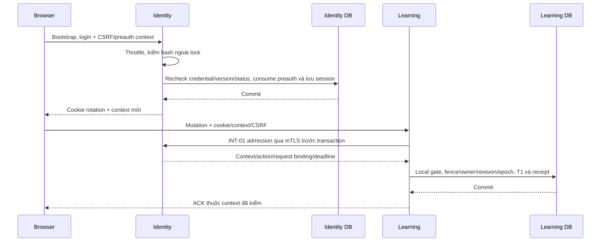

# LLD-01 v3 — Tài khoản, phiên và quyền

> BL-MS02 · 30/09/2026: [security/threat model](../../architecture/security-design.md) và [session LLD v3](sessions/protocol.md) là nguồn chi tiết hiện hành. Trang này trình bày dữ liệu/luồng để review; thay sequence một-backend/shared guard cũ. Chưa có security runtime/test backend.

[Mục lục](../../design/README.md) · MD10/09 + các receiver · REQ-09/13–15 · MS02, R02–04/24 sau MS04 rebaseline

## Trách nhiệm và dữ liệu

Identity xác thực danh tính/session và cấp admission theo action; Learning tự kiểm owner resource, Content tự kiểm quyền body. R1 cấp tài khoản qua lời mời, không signup công khai/admin UI. Service identity mTLS khác quyền learner; edge không quyết owner hoặc cấp principal từ header.

| Dữ liệu | Trường/constraint cốt lõi | Mục đích |
|---|---|---|
| app_user | userId bất biến, loginName unique, passwordHash, status | invited/active/disabled |
| Identity auth_account | userId, credentialEpoch/version, status, authTransitionPending | Serialize credential/login/revoke; không learningEpoch/dataRevision |
| Identity auth_session | cookie digest, sessionRef/context, realm, deadlines/state/epoch | Canonical ACTIVE/REVOKING/EXPIRED/REVOKED, ngoài framework-only record |
| Identity auth_operation/delivery | operation/digest/topology/initiating binding/participant ACK | Resume revoke, completed chỉ sau cả CNT/LRN fence durable |
| CNT/LRN auth gate/fence/receipt | userId, min epoch, context deny, command/generation | Local guard chung với receiver mutation, không copy session table |
| Learning learner_guard | learningEpoch/dataRevision/lifecycle state | Nháp/result/progress local, khác credentialEpoch |
| activation_token | digest unique, user, purpose, expiry, consumed | Invite/reset một lần |
| throttle/audit | bucket hết hạn, metadata sự kiện | Hạn chế thử mật khẩu; không log secret |

LoginName 3–32 ký tự ASCII theo S02, chuẩn hóa trim/lowercase; mật khẩu 15–128 code point, không trim. Argon2id và các tham số giữ ở D08; benchmark/corpus blocklist thuộc R03. Token invite 24 giờ, reset 15 phút; session idle 30 phút, absolute 12 giờ. Background poll không kéo dài idle.

## API và trình tự

Mọi path dưới prefix `/api/v1`. `GET /session` trả ACTIVE/locked-pending/anonymous/unavailable phù hợp và CSRF/context. POST `/auth/login`, `/auth/logout`, `/auth/logout-all`, `/auth/activate`, `/auth/password-reset`, `/auth/password-change` thực thi credentials/phiên. MS02 thêm POST `/auth/reauth` cho proof reset học và GET `/auth/operations/{operationId}` status-only gắn initiating binding; session revoked không có quyền learner vì được poll operation. [Catalog](../../architecture/service-boundaries.md) giữ API ownership, session LLD giữ wire/validation.

Kết quả hash gắn credential version/epoch và kiểm lại trước cấp phiên. Receiver mutation và fence dùng cùng local auth gate; không HTTP trong T1/T2. Identity ngừng admission ở REVOKING, fence luôn tới cả Content/Learning kể cả session absent, chỉ completed sau đủ ACK. Fence chờ transaction đang giữ gate commit/rollback; admission tới trễ không hạ epoch/ghi đè deny. [Session LLD mục 5](sessions/protocol.md) giữ chứng minh thứ tự và failure cases.

Owner luôn từ principal. Resource khác owner trả404; các list/export cũng lọc owner, không chỉ endpoint detail. Private response no-store. Cookie production HttpOnly/Secure/SameSite=Lax, cùng origin, CSRF vẫn bắt buộc.

## Hết phiên, logout và lỗi

| Tình huống | Server | UI |
|---|---|---|
| Logout có nháp chưa lưu | Chỉ revoke khi gửi yêu cầu logout | Cho lưu rồi logout / hủy / bỏ phần chưa lưu |
| Offline logout | Chưa xác nhận revoke server | Khóa UI, nói rõ chưa thu hồi được; không giả logout server |
| Receiver down/ACK chưa đủ | Operation pending, chặn admission mới | Poll status-only, không nói logout hoàn toàn |
| Expired hoặc đổi context | Từ chối write | Giữ RAM dưới owner cũ ở màn khóa; không tự replay |
| B đăng nhập, response A về trễ | Resource vẫn của A | authGeneration bỏ response, xóa cache A |
| Session store lỗi | Fail closed | Báo tạm không xác minh được, không coi như đã lưu |
| Reset/đổi mật khẩu | Consume/update + revoke intent local Identity; pending tới đủ ACK | Yêu cầu login riêng sau completed, không đổi lần hai khi retry |

Logout/status không gửi Set-Cookie xóa auth cookie vì response A trễ có thể xóa cookie B. Cookie cũ đã mất quyền server, được login rotation thay hoặc hết hạn; vẫn cleanup SecurityContext/CSRF và private cache theo S02. authGeneration không chặn browser áp dụng Set-Cookie: preauth một lần, context/server rotation checks và multitab tests phải giữ fail closed. Session TTL không thay revoke barrier; idle/absolute/admission được server kiểm ở biên ghi.

## Kiểm tra và điểm review

IA-01–24 mở rộng bằng [SEC-01–30 và CTL-01–16](../../architecture/security-design.md): DB gate/ACK/install/KDF race, mTLS/caller negative, CSRF/owner/payload, browser cookie/cache/RAM, scan/artifact/rotation. [MS03 recovery](../../architecture/lifecycle-recovery-protocol.md) thêm journal/terminal lifecycle và restored credential RECOVERY_REQUIRED; disable/enable complete cần journal + auth ACK. Tests expected chưa chạy, MS04 phân task/commands/CI trước runtime.

- **LLD-01-A:** cấp và phục hồi qua operator có phù hợp pilot không?
- **LLD-01-B:** lựa chọn xử lý nháp khi logout/đổi user có rõ không?
- **LLD-01-C:** nhiều thiết bị nhưng chưa có offline bền vững có phù hợp R1 không?

Nguồn: [S02](business.md), [security design](../../architecture/security-design.md), [session protocol](sessions/protocol.md). D08 một-DB chỉ giữ baseline lịch sử; không là cổng code. Tiếp: [nội dung](../f08-content/lld.md).
