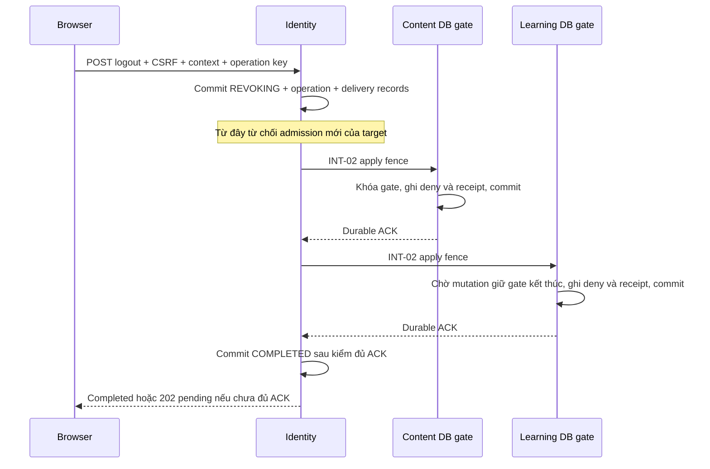

# LLD v3 — Session admission và revocation giữa ba service

BL-MS02 · 30/09/2026 · Thiết kế, chưa có service/DB/API chạy thật. Đây là nguồn giao thức INT-01/02/06; [security design](../../../architecture/security-design.md) giữ threat model/controls/test matrix; [service catalog](../../../architecture/service-boundaries.md) giữ owner. Thay cơ chế account/session guard chung DB của D08; giữ cam kết S02/S03 về owner, context và revoke trước commit.

## 1. Quyết định và invariants

Browser dùng opaque session cookie do Identity quản lý. Content/Learning gọi Identity qua mTLS cho mỗi protected request để lấy admission; không cache ALLOW giữa request, không dùng JWT của browser để tự cho phép ghi. Admission đơn lẻ chưa bảo vệ commit: receiver kiểm durable local fence dưới khóa DB dùng chung với thao tác thu hồi. R1 có **hai participant bắt buộc, Content và Learning**, kể cả chưa từng có user/session trong DB của participant; không dùng danh sách subscriber lazy làm nguồn đủ ACK.

| Invariant | Cam kết |
|---|---|
| AUTH-INV01 | Chỉ Identity sinh principal/context; user/role/pass/header do browser tự khai không là quyền |
| AUTH-INV02 | Receiver kiểm audience/action, owner và expectedContextId; context của request A không dùng cookie mới B |
| AUTH-INV03 | Admission trễ không hạ epoch floor, không ghi đè session fence revoked, không hồi sinh session |
| AUTH-INV04 | Identity chỉ báo revoke COMPLETED sau durable ACK đúng operation/generation của cả Content/Learning |
| AUTH-INV05 | User mutation commit sau revoke COMPLETED bị chặn; commit trước participant fence vẫn thuộc owner cũ |
| AUTH-INV06 | Idle/absolute/admission deadline do server kiểm; request cũ không gia hạn idle hoặc đổi timestamp từ client |
| AUTH-INV07 | Logout không hủy job đã nhận hợp lệ; T2 vẫn kiểm learning epoch/publication/job fence theo MS03 |
| AUTH-INV08 | Restore/clock/trust state chưa đối soát không cho protected traffic; framework flush không tái tạo ALLOW |

Đây là thuật toán riêng, không guarantee mặc định Spring/OWASP. [Test-release MS04](../../../delivery/test-release-plan.md) gắn SEC owners/fixtures/cmd/compatibility/recovery gates; [implementation](../../../delivery/implementation-plan.md) chọn initial budgets/config rồi task code phải đo/test. Ưu tiên revoke/độ đúng, protected action phụ thuộc Identity; chưa runtime proof.

## 2. Dữ liệu, state và khóa

| Owner | Domain state / constraint | Mục đích |
|---|---|---|
| Identity | auth_account: userId, status, credentialEpoch, credentialVersion, authTransitionPending | Serialize login/credential change/logout-all/disable |
| Identity | auth_session: cookieDigest, sessionRef, sessionContextId, userId, epoch, authRealmId, issuedAt, lastInteractiveAt, state | ACTIVE → REVOKING/EXPIRED → REVOKED; không chuyển ngược ACTIVE |
| Identity | auth_operation: operationId, scope, target, commandDigest, topologyVersion, requiredParticipants, ACKs, initiatingBinding, state | PENDING_FENCES → COMPLETED; timeout/error không là COMPLETED |
| Identity | revoke delivery records trong cùng DB transaction với chuyển state | Worker tiếp tục gửi INT-02 sau crash; không phụ thuộc HTTP request browser còn sống |
| Content/Learning | auth_account_gate: userId, authRealmId, minCredentialEpoch | Durable local row để khóa/floor; khác learner_guard/learningEpoch |
| Content/Learning | auth_session_fence: sessionRef/context, state/version, command provenance | Tombstone cho cả session chưa được tạo local; không upsert revoked thành active |
| Content/Learning | auth_command_receipt: operationId, commandDigest, applied floor/fence, DB generation | ACK chỉ sau commit; duplicate cùng command có kết quả tương đương |
| Learning | admission_use + business mutation receipt | Ghi sử dụng admission cùng mutation/receipt; không tái dùng cho action/payload khác |
| Identity | reauth grant: digest, user/context/epoch, purpose/intent, expiry, reservation | Opaque proof có scope; không là session thứ hai |

Các tên là schema concept, chưa DDL. userId/sessionRef không chứa raw cookie. minCredentialEpoch tăng đơn điệu; sessionRef/context UUID không tái sử dụng. Ticket thuộc epoch thấp hơn floor bị từ chối, ticket epoch mới từ Identity có thể nâng floor nhưng không hạ nó. authRealmId là generation của miền auth theo environment, không là version build.

Receiver tạo/khóa auth_account_gate bằng thao tác insert-if-absent rồi `SELECT ... FOR UPDATE`; toàn bộ install/check admission và fence của cùng user dùng khóa này. User mutation ở Learning giữ khóa đến commit: auth_account_gate → learner_guard → content eligibility → resource/receipt theo thứ tự cố định. Fence chỉ cần auth_account_gate; worker T2 không lấy quyền từ browser session. Không KDF/HTTP/object storage khi giữ khóa DB. Lock/transaction timeout ngắn và đo ở implementation; lỗi rollback, không ACK giả.

Không cleanup session tombstone khi còn admission/job/replay/backup tham chiếu. Session deadline đã qua chưa đủ mở restore snapshot. [MS03 lifecycle/recovery](../../../architecture/lifecycle-recovery-protocol.md) chốt retention/journal/floors/realm/generations; mọi restored account RECOVERY_REQUIRED, old password hash cũng không login. Disable/enable lifecycle completion thêm durable ACCOUNT_STATE journal; auth sub-operation ACK không thay journal ACK, enable giữ authTransitionPending tới cả hai đạt. Không đặt tombstone TTL ngắn hơn replay/backup window.

## 3. Wire contracts và caller

Các JSON field là contract cần hiện thực/test sau MS04; chưa là OpenAPI executable. Tất cả service call dùng mTLS với caller identity/action allowlist theo security design. Browser không được gửi AuthzContext/admission trực tiếp vào receiver.

| Contract | Provider / caller | Method / path | Field/hành vi chính |
|---|---|---|---|
| INT-01 | Identity / CNT hoặc LRN | POST /internal/v1/auth-context/admissions | Cookie credential chỉ ở request bảo mật, expectedContextId, requestBinding và CSRF/origin metadata; ALLOW hoặc deny/unavailable |
| INT-02 | CNT/LRN / Identity | PUT /internal/v1/session-fences/{operationId} | scope=session/account, userId, sessionRef/context khi cần, epochFloor, realm/topology, commandDigest; ACK sau durable commit |
| INT-06 | Identity / Learning | POST /internal/v1/reauth-authorizations/reservations | Opaque proof, purpose, operationKey/intent/context; reserve cùng intent idempotent, intent khác conflict |
| API-I08 | Identity / Browser Login | POST /api/v1/auth/reauth | CSRF/context, currentPassword, purpose và intent; trả opaque proof ngắn hạn cho reset học |
| API-I09 | Identity / Browser initiating binding | GET /api/v1/auth/operations/{operationId} | Chỉ trạng thái operation do browser này khởi tạo; cookie/context binding, không list hoặc participant detail |

AuthzContext nội bộ: admissionId, requestNonce, provider=Identity, caller/audience, authRealmId, userId, sessionRef, sessionContextId, credentialEpoch, action, requestBinding, issuedAt/serverTime, validUntil, idleDeadline, absoluteDeadline, csrfVerified và reauthRef khi cần. Nhận qua response trực tiếp của kênh mTLS Identity, giữ trong request scope; không là bearer token truyền tiếp, không expose FE/log, không deserialize từ header browser.

requestBinding do receiver tính từ method, canonical route/resource ID, query được allowlist và hash body đã validate; admission cho GET không dùng cho PUT/POST. Nonce do receiver sinh, đối chiếu response cùng request. Cookie truyền tới Identity chỉ gồm credential của app; không forward toàn Cookie/header/log hay gửi sang Content bundle/publication feed. Password chỉ gửi Identity, không đi qua Learning. Identity dùng policy action allowlist theo caller, không tin caller yêu cầu audience khác.

CSRF synchronizer state ở Identity. API-I01 bootstrap trả token qua JSON/no-store; FE giữ RAM, gửi `X-CSRF-TOKEN`. Identity kiểm token gắn session/preauth context cho các mutation của mình và INT-01 mutation admission. Receiver còn kiểm method/content-type/origin và enforce csrfVerified/action binding trước domain write. Không tắt CSRF toàn app vì có endpoint mTLS; internal listener/filter chain tách và không chấp nhận browser cookie làm service identity.

Bootstrap phân biệt ACTIVE (identity/context), REVOKING (locked + operationId/status, không mở private data), REVOKED/EXPIRED (anonymous/locked theo pending marker) và UNAVAILABLE (503, không giả anonymous). Nếu response bắt đầu operation bị mất, cùng initiating cookie/context có thể lấy pending operationId qua bootstrap để tra API-I09; không phải API list account operations. Chỉ credential flow/explicit preauth bootstrap tạo cookie mới; background status không tạo/rotate cookie hoặc gia hạn idle.

API-I09 là ngoại lệ **status-only**: Identity có thể nhận đúng cookie digest/context đã khởi tạo dù session vừa bị revoke, chỉ để đọc operation đó. Không tạo principal learner, không gia hạn idle hay cho truy cập dữ liệu học. Mismatch/ID khác trả404; không tin contextId đứng một mình. Credential flow anonymous gắn preauth browser binding khi khởi tạo operation. Nếu cookie/binding mất hoặc hết thời hạn lưu, UI không đoán complete; bootstrap/recovery theo trạng thái server. Operator có status qua maintenance độc lập.

## 4. Login, bootstrap và mutation

1. Identity bootstrap cho anonymous tạo preauth/CSRF context. Login cần đúng preauth context/CSRF, rate limit trước KDF; unknown/disabled dùng lỗi chung. Một preauth context chỉ consume một lần để chặn hai login đồng thời phát hai phiên khác owner từ cùng flow.
2. Kiểm password hash ngoài lock; vào transaction Identity khóa auth_account, kiểm lại credentialVersion/epoch/status và authTransitionPending. Nếu đã đổi/reset/disable thì không cấp phiên từ kết quả hash cũ.
3. Lưu canonical session + guard/rotation thành công trước response cookie mới/context mới. Không cần đăng ký login với participant; Identity vẫn luôn thu hồi tới cả hai participant static. Orphan/framework-only session không có canonical ACTIVE guard bị từ chối.
4. Browser protected request gửi cookie/context/CSRF. Receiver validate/bind request, gọi INT-01 **trước** mở business transaction. Identity khóa state cần thiết, kiểm active/account/epoch/context/deadlines/CSRF, rồi trả admission gắn caller/request.
5. Receiver vào transaction, khóa auth_account_gate, kiểm realm/readiness/epoch/session tombstone/admission binding/deadlines và owner. Install positive context chỉ dưới khóa và chỉ khi không có deny mới hơn. Sau đó thực hiện CAS/T1/import/support/viewed theo contract, ghi admission_use+receipt local atomic; check deadline/fence ở biên ghi và giữ khóa đến commit.
6. ACK mutation chỉ sau commit; mất response dùng receipt cùng owner theo S03. Admission đã hết hạn hoặc context đổi không tự refresh/replay request. Retry mutation phải qua admission mới và business idempotency; không thay owner/key/payload từ request cũ.

Ở receiver chưa có user/session: insert auth gate chỉ là metadata security, không tự tạo profile/attempt từ userId client. Nếu revoke đến trước install, fence row được tạo dù session absent; bước 5 phải thấy nó và từ chối. Nếu install thắng trước, cả mutation và revoke vẫn dùng cùng khóa nên có thứ tự commit/ACK.

## 5. Revoke barrier và điểm hoàn tất

Gửi hai participant có thể độc lập; không giữ transaction Identity trong khi chờ network. `requiredParticipants={Content,Learning}` và topologyVersion được snapshot trong operation, không suy từ service nào từng nhìn thấy session. Thêm participant mới phải block traffic/action mới cho đến bootstrap fence và update topology an toàn; không xóa participant chưa ACK vì nó đang down.

INT-02 áp dụng dưới gate: epoch floor lấy max, session deny không chuyển ngược, command receipt ghi cùng transaction. Cùng operationId khác commandDigest →409/security event; cùng command hoặc command bị floor mới hơn bao phủ → trả ACK có provenance trạng thái hiện hành. ACK gồm receiver identity, authRealmId, participant DB generation, operationId/digest và applied floor/fence. Identity đối chiếu caller mTLS, target/topology/generation và effect đáp ứng command trước ghi ACK. Mất ACK sau commit chỉ gây resend, không cấp lại session.

**Điểm hoàn tất revoke** là transaction Identity chuyển operation COMPLETED sau đủ durable ACK. Chứng minh thứ tự: mutation M và fence F tại Learning cùng khóa G. Nếu M giữ G trước F, F chỉ commit/ACK sau M commit hoặc rollback; Identity hoàn tất sau ACK. Nếu F giữ G trước M, M thấy deny và rollback. Do đó không có M hợp lệ commit sau revoke COMPLETED. Admission được phát trước REVOKING nhưng đến trễ vẫn rơi vào một trong hai trường hợp, không tạo ngoại lệ.

Ý nghĩa REVOKING: Identity đã chặn admission mới, nhưng participant chưa fence đủ có thể hoàn tất request đã admitted trước đó. UI nói **đang thu hồi**, không nói đã logout hoàn toàn. Timeout/partial outage trả202 có operationId hoặc503 khi chưa tạo operation; không chuyển timeout thành204. Scope logout hiện tại chỉ session/context đó; logout-all/password change/reset/disable tăng credentialEpoch và chặn login/admission account trong authTransitionPending cho đến đủ fence ACK. Re-enable phải dùng epoch mới, không hồi sinh guard/token cũ.

Idempotency key được bind operation, scope, initiating user/context và payload. Retry logout A với cookie/context B trả mismatch, không revoke B; lookup status chỉ theo initiating binding. Login đổi tài khoản trong cùng flow chờ operation complete; UI nhiều tab đồng bộ khóa nhanh, server vẫn enforce context. Transaction credential update/token consume/revoke intent ở Identity local atomic; việc thu hồi liên service sau đó có trạng thái pending, không hứa một transaction xuyên ba DB.

## 6. Expiry, clock và availability

Giữ S02: idle30 phút, absolute12 giờ. Identity giữ lastInteractiveAt, không nhận timestamp/interactive=true client để kéo dài phiên. Route policy quyết request nào có thể cập nhật idle: thao tác học chủ động hợp lệ; background poll/operation status/bootstrap không gia hạn. Autosave từ tương tác hợp lệ dùng admission hiện tại; app không gửi heartbeat vô hạn để giữ idle.

Mỗi admission có validUntil=min(idleDeadline, absoluteDeadline, issuedAt+15 giây). 15 giây là cấu hình ban đầu giới hạn request bị giữ trễ, không là cửa sổ logout có thể bỏ qua fence hay SLA. Receiver kiểm giờ DB ở authorization/ghi transaction; quá deadline/không còn đủ budget transaction → reject/rollback, không gia hạn từ local activity. Trong implementation phải kiểm deadline ở bước final trước commit, test case gần cutoff; không dựa vào thời điểm filter chạy. Giới hạn transaction và độ lệch đồng hồ cần đo và cấu hình tại MS04, không khẳng định timeout có thể undo commit đã xảy ra.

DB/service clock so với Identity phải nằm trong budget sai lệch được kiểm. Receiver dùng cutoff bảo thủ trừ budget khỏi deadline; clock jump, drift ngoài budget hoặc không xác minh được thì readiness protected=false, reject admission. Nếu không đo được budget thì không bật runtime; không tự cho phép vì UTC string giống nhau. Điểm authorize trong local transaction dùng server time; receipt/commit order quyết trạng thái đã ghi, thời gian response/browser không quyết session validity.

Identity phát hiện expiry khi access/sweeper: ngừng cấp admission, tạo fence operation; receiver vẫn tự từ chối admission quá deadline trước khi fence tới. Không cho ACTIVE lại sau EXPIRED; login sinh session/context khác. Scheduler chậm không kéo dài deadline. Phiên hết hạn/Identity down không xóa draft hay tự nộp bài; UI giữ RAM dưới owner cũ và khóa gửi. Khi Identity down chỉ outline anonymous có boundary độc lập; protected body/history/receipt cũng fail closed, không dùng ALLOW cache.

Restore receiver/Identity dùng realm và participant generation mới/đối soát trước traffic; static registry không nhận ACK snapshot cũ. [MS03 recovery](../../../architecture/lifecycle-recovery-protocol.md) chốt journal/inventory/handshake/credential recovery; MS04 gắn actual failure tests. Restart không xóa fences; replicas chia DB gate, không process allow cache bypass.

## 7. Reauth, cookie và dữ liệu browser

API-I08 cho reset học: password chỉ tới Identity; grant opaque random256bit, chỉ lưu digest, TTL5 phút ban đầu, bind user/context/credentialEpoch/purpose/operationKey/intent hash. INT-06 reserve proof cùng intent idempotent; khác user/context/action/payload/key →deny/conflict. Proof không dùng cho admission khác hoặc login. Learning reserve trước transaction rồi check reference/deadline/admission dưới local gate, ghi dùng proof cùng reset operation/receipt. Reservation không tự là reset đã commit; crash dùng cùng operation/receipt để đối soát, không refund proof sang intent khác.

Logout-all/đổi mật khẩu ở Identity reauth trong flow tương ứng; reset bằng token một lần theo S02, không tự login. Token consume hoặc password update đã commit nhưng fence ACK thiếu →operation pending; retry không consume/đổi lần hai, login account chưa mở đến hoàn tất transition. Số đo KDF/throttle không do receiver tự quyết.

Production cookie `__Host-backend-lab-session`, HttpOnly/Secure/SameSite=Lax, Path=/, không Domain. Max-Age/Expires bám hard absolute deadline của phiên (tối đa12h từ login), không sliding theo hoạt động; cookie hết hạn ở browser không thay server-side revoke. CSRF token có lifetime/context riêng, lấy lại sau auth change; cookie/session credential không nằm trong URL/localStorage/event. Browser HTTPS và upstream bảo mật theo security design; localhost HTTP ngoại lệ dev phải explicit loopback, startup prod từ chối. Tên/policy này là baseline thiết kế, chưa có filter đã cấu hình.

**Cookie response trễ:** authGeneration chỉ chặn render, không ngăn browser áp dụng Set-Cookie. Mutation/Content/Learning/poll/late session flush không phát auth Set-Cookie. Logout/status response không xóa cookie HttpOnly bằng Set-Cookie có thể đến sau login B; Identity revoke canonical session/security context và CSRF, cookie cũ chỉ còn handle vô hiệu tới khi bị login rotation thay hoặc hết hạn. Đây là sửa cơ chế cleanup của baseline D08/S02 để tránh logout A xóa cookie B; logout vẫn thu hồi server theo barrier.

Đây là tradeoff có giới hạn: credential cookie cũ có thể còn được browser gửi trong phần thời gian tới absolute expiry dù server đã revoke; UI private data bị xóa ngay, mọi protected request dùng cookie đó bị từ chối. Không đặt cookie lifetime dài hơn server absolute deadline và không renew Max-Age ở poll/autosave. Security design ghi rõ khác biệt với khuyến nghị invalidation client-cookie khi logout; MS04 phải kiểm replay bị deny, cookie tự hết hạn đúng deadline, và response đảo thứ tự không làm mất cookie phiên mới. Nếu policy pilot yêu cầu xóa cookie tức thì thì cần thiết kế tên cookie/giao thức cleanup có generation riêng, không thêm Set-Cookie xóa vào response có thể đến muộn.

Cookie rotation chỉ ở bootstrap cần tạo preauth và login thành công, với preauth một lần, kiểm expected context và UI serialize credential flows. Response login/bootstrap cũ có thể làm browser mất cookie mới; context/rotation guard phải fail closed và UI khóa/rebootstrap, không hiển thị hay ghi nhầm owner. Session guard đã revoke không được framework save muộn hồi sinh. Không tự gán response/request A sang context B hoặc replay POST sau401/403. Test đa tab/response reorder bắt buộc; không hứa có thể thu hồi byte đã gửi vào mạng trước fence.

FE bỏ private cache/RAM khi đổi owner, giữ nháp chưa lưu theo quy tắc S02 trên màn khóa khi hết phiên; pending-lock marker chỉ context/state không bí mật, tồn tại qua reload. Broadcast/focus/Back chỉ hỗ trợ UI, không là permission. Private/body no-store và export đóng luồng khi biết fence/context hết hiệu lực; byte đã gửi trước đó không thể kéo lại. Không tự coi session bootstrap background là learner tương tác.

## 8. Failure và expected

| Case | Expected và recovery |
|---|---|
| Revoke tới receiver chưa từng tạo session/user | Tạo auth gate/tombstone; ACK durable; admission trễ bị deny, không learner profile giả |
| Install admission tranh fence | Chung gate quyết thứ tự; không positive upsert thắng deny mới hơn |
| Mutation giữ gate khi revoke tới | Fence chờ commit/rollback hoặc lock timeout; không ACK sớm; UI pending |
| Receiver commit fence nhưng ACK mất | Retry same command trả ACK; không xóa fence hoặc complete từ timeout |
| Identity crash sau REVOKING trước gửi/nhận ACK | Delivery records/operation giữ; worker resume; không mở session/login pending |
| Receiver down/partition hoặc cert lỗi | Không đủ ACK, operation pending; không bỏ participant hoặc giả complete |
| Duplicate/old command hoặc same ID khác payload | Monotonic effect + receipt; payload conflict reject/audit |
| Reset/disable đang chạy thì login/KDF cũ hoàn tất | Credential version/epoch/status kiểm lại, không cấp phiên cũ |
| Local time/admission stale/identity unreachable | Reject protected action, giữ dữ liệu tốt; không cached ALLOW |
| T1 đã commit rồi logout; T2 còn chạy | Job vẫn thuộc owner ban đầu; T2 không cần session active, epoch/lifecycle theo MS03 |
| Logout A retry/poll khi cookie đã là B | Không revoke/clear B; mismatch/404 theo action; UI không tự replay |
| Receiver vừa restore fences cũ | Protected readiness bị chặn tới khi realm/generation và suppression đối soát MS03 |

Nối SEC tests trong [security design](../../../architecture/security-design.md) và DATA cases ở [MS03](../../../architecture/data-protocols.md). MS01–03 là nguồn contract/expected, không là runtime proof. Từ04/10, [evidence R04a](verification.md) ghi actual local PostgreSQL race/canonical deny và opt-in lab auth TLS/browser; [task R04b](tasks/BL-R04b.md) ghi Content own gate/fence receipt và actual mTLS controlled provider fixture. Trạng thái nghiệm thu ở registry. Canonical INT01/coordinator/reauth và FE/production edge không được chứng minh từ fixture receiver; không suy toàn bộ protocol đã chạy.
