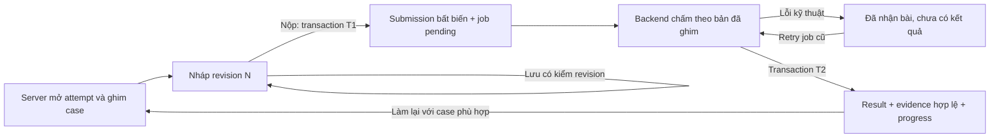

# Hợp đồng bài làm và tiến độ server

> Microservices 30/09/2026: business owner/nháp/evidence giữ. [Catalog MS01](../../architecture/service-boundaries.md) chốt T1/T2 local Learning/private replica; [session MS02](../f10-identity-access/sessions/protocol.md) thay shared auth guard; [data protocols MS03](../../architecture/data-protocols.md) cùng [publication](../f08-content/publication/protocol.md) và [lifecycle/recovery](../../architecture/lifecycle-recovery-protocol.md) thay cơ chế publish/reset/delete/restore một-DB dưới đây. Export chỉ snapshot Learning; các mô tả transaction/restore cũ là baseline, không topology hiện hành.

> Refinement MS03: exposure floor durable ngoài snapshot trước disclosure case/hint/solution và import known exposure, `preparing` không lộ prompt; assignment độc lập đầu tiên không bị self-encounter hủy. Publication FENCE trước canonical commit, RELEASE overlay current policy, history bất biến. Reset intent→journal→epoch/receipt; delete ACK cả Content/Learning; restore current journal/refs/generations và mọi restored account RECOVERY_REQUIRED. Những quyết định này giữ known case không clean lại và credential cũ không sống lại; không fake pass/complete khi dependency lỗi.

BL-S03, 28/09/2026 — thiết kế R1, chưa triển khai DB/API hoặc kiểm thử runtime. Nối [identity/access](../f10-identity-access/business.md), [policy đánh giá](../f04-assessment/evidence-contract.md), [system](../../system-overview.md) và REQ-05–09/12/15/16 trong [requirements](../../product-requirements.md). MD01/04/05/06/10/11 cùng chịu trách nhiệm; không cần tách thành nhiều service.

## 1. Quyết định và ranh giới

Server giữ đề đã xuất bản, nháp đã lưu, bài nộp và kết quả chính thức. Frontend giữ thao tác/nháp chưa gửi trong RAM theo đúng chủ; phản hồi mô phỏng tại máy chỉ là xem trước. R1 nhận dữ liệu có cấu trúc và code dạng text, không chạy Java/Docker, không nhận file thực thi/archive tùy ý, không có admin chấm tay hoặc AI tự chấm giải thích tự do.

Ba mốc hiển thị khác nhau: **chưa lưu/chưa xác nhận**, **đã nhận bài, đang chấm**, **đã có kết quả**. Chỉ phản hồi server hoặc truy vấn lại thành công mới xác nhận mốc lưu. Timeout không chứng minh request thất bại; lỗi bộ chấm không phải kết quả sai. Bài làm của A không thể gắn lại sang B khi đổi phiên.

## 2. Mô hình dữ liệu nghiệp vụ

| Đối tượng | Identity và dữ liệu chính | Bất biến |
|---|---|---|
| Exercise | exerciseId ổn định, TOP/CAP liên quan, loại practice/assessment/project | Đề khác bài người học nộp; không tái dùng ID cho nghĩa khác |
| ExerciseVersion | exerciseId + version; content/rubric/grader version; case/family, input schema, tiêu chí theo CAP, loại evidence, chính sách hỗ trợ | Bản published bất biến; thay đổi tạo version; giữ bản cũ để đọc lịch sử |
| Attempt | server cấp attemptId; owner, learningEpoch, exerciseVersion, caseVersion, mode, thời gian | Server chọn case đủ điều kiện; practice không được client đổi thành assessment |
| Draft | draftId duy nhất cho attempt; answer, resume position, revision | Mutable trước nộp; revision tăng khi server ghi thành công; không dùng timestamp client để chọn bản thắng |
| SupportExposure | owner + case/family và phiên bản tương đương; loại hint/solution, thời điểm server | Chỉ tăng thông tin đã biết; đổi tab, retry hoặc reset tiến độ không làm quên đáp án |
| Submission | submissionId; một submission/attempt; snapshot answer, revision, support, version, acceptedAt | Bất biến sau commit; làm lại tạo attempt khác; không sửa bài cũ bằng autosave |
| GradeJob / AssessmentResult | job gắn submission; pending/retryable_error/completed; kết quả từng tiêu chí/CAP, graderVersion | Một kết quả cuối có hiệu lực/submission trong R1; retry kỹ thuật không tạo lần thi mới |
| Evidence | owner, epoch, submission/result, CAP hoặc milestone, nguồn/loại, mức hỗ trợ | Chỉ backend tạo từ kết quả đủ điều kiện; evidence không đồng nghĩa mọi CAP đã pass |
| Progress | owner + epoch + TOP/CAP/milestone; viewed/proven/applied, lý do cần ôn, revision | Projection từ sự kiện có nguồn; một CAP chung cho hai roadmap; không có API nhận passed=true |
| MutationReceipt | owner + operation + idempotencyKey, fingerprint, resourceId/outcome | Chống lặp request; không dùng key như token quyền |

Ownership được kiểm tra cả ở ID con/quan hệ và truy vấn list/count/export. Quan hệ draft→attempt→version và submission→result→evidence không được vượt owner/epoch. D08 chuyển các bất biến thành schema/constraint và contract API; không chỉ kiểm bằng frontend.

## 3. Vòng đời học và nộp bài

Attempt đang mở có thể abandoned theo yêu cầu; abandoned không phải fail. Bắt đầu lại là attempt mới, giữ lịch sử. Submit đóng draft, không đóng mất lịch sử attempt. Job pending vẫn là bài đã nhận; UI không cho sửa snapshot hoặc khuyên nộp lại thành attempt mới để sửa lỗi chấm.

Server trả đề/case public, không gửi sẵn đáp án/rubric bí mật vào bundle assessment. Xin hint/solution phải ghi exposure thành công trước khi trả nội dung. Nếu ghi lỗi, không trả đáp án; nếu ghi thành công nhưng response mất, exposure vẫn được giữ và giải thích nhãn hỗ trợ. Hint và submit trên hai tab phải được sắp thứ tự tại server trên cùng phạm vi exposure: hint trước T1 khiến submission có hỗ trợ; hint sau T1 không làm bẩn kết quả cũ. Case đã lộ không cấp một lần pass độc lập mới. Không tuyên bố phát hiện được hỗ trợ bên ngoài app.

R1 chấm tự động chỉ những tiêu chí có evaluator xác định được: đáp án có cấu trúc hoặc trace mô phỏng được server kiểm/replay theo mô hình/version. Không tin client gửi observationPassed hoặc ảnh chụp/log tự khai. Giải thích tự do được lưu để người học đối chiếu, chưa có evaluator đáng tin thì không cấp CAP dựa vào nó. D06b phải chọn cách biểu đạt/chấm đủ cho các CAP mục tiêu hoặc ghi CAP chưa được xác minh; không âm thầm hạ rubric.

| Nguồn | Có thể ghi nhận | Không được suy ra |
|---|---|---|
| Dấu xem/vị trí do client báo, server kiểm content/owner | Đã xem trên content version | Năng lực hoặc thực thi thật |
| Structured answer được backend chấm độc lập | CAP đúng phạm vi rubric | CAP khác hoặc toàn TOP tự động |
| Trace mô phỏng được backend kiểm | checkedSimulation, CAP cho phép mô hình | verifiedExecution |
| Text/code/log/project tự khai chưa xác minh | Bài làm lưu được, selfReport/unverified | Official mastery hoặc applied verified |
| Runner có provenance trong tương lai | verifiedExecution khi contract runner nghiệm thu | R1 hiện đã chạy lab thật |

## 4. Revision, mạng và hai tab

Mọi thay đổi nháp gửi expectedRevision và sessionContextId. Server so sánh revision cùng transaction ghi; lệch trả conflict và giữ bản server. Client giữ bản RAM riêng, hiển thị chênh lệch: tải bản server hoặc người học hợp nhất rồi lưu với revision mới. Không có last-write-wins ngầm, không tự merge code/text.

Autosave nối tiếp trên một draft; chỉnh sửa mới trong lúc request chạy chờ lượt kế. ACK revision cũ không được ghi đè text mới hoặc báo mọi thay đổi đã lưu. UI đánh dấu đã lưu chỉ đến snapshot được ACK. Hai tab vẫn có thể đụng nhau và phải qua conflict, broadcast không thay constraint server.

Submit chứa expectedRevision và snapshot câu trả lời hiện tại. T1 vừa lưu snapshot cuối vừa đóng draft, tạo submission/job/receipt trong cùng transaction; không bắt autosave thành công trước rồi để khoảng trống giữa save và submit. Nếu autosave đang chạy, UI đợi kết quả và dùng revision mới; server vẫn chống race. Conflict giữ nháp RAM và bản server, không nộp một bản người học chưa chọn.

Mất kết nối trước ACK: hiển thị “chưa xác nhận”, tra receipt/submission sau reconnect với đúng tài khoản. Nếu chưa commit, retry cùng key và payload; nếu đã commit, đọc kết quả cũ. Khi hết phiên, khóa nháp RAM như S02; login cùng owner cho phép tra trạng thái request cũ rồi người học tiếp tục rõ ràng trong context mới. Không tự sửa owner/context và replay request nền. Reload khi RAM chưa lưu có thể mất phần đó; D07 phải cảnh báo khi có thể, không hứa phục hồi offline bền vững.

## 5. Idempotency và transaction

Operation tạo attempt, lưu draft, submit, xin hỗ trợ, import và reset đều có receipt khi retry có thể gây lặp. Phạm vi key là user + operation; fingerprint chuẩn hóa dữ liệu nghiệp vụ gồm resource/epoch/version/revision/answer, không gồm cookie/CSRF. Trước mọi xử lý vẫn kiểm phiên/context/owner; key đúng không bỏ qua quyền.

- Cùng key/cùng fingerprint: trả resource/outcome đã commit, không chạy mutation lại. Cùng key/khác fingerprint: conflict, không ghi gì.
- Hai key khác nhau cùng attempt: uniqueness một submission/attempt thắng; trả conflict kèm đường đọc submission của chính owner, không coi payload khác là cùng bài.
- Hai request đồng thời cùng key phải hội tụ về một receipt được commit; không có bước “check rồi insert” tách rời không bảo vệ.
- Khi receipt không còn sau purge, resource đã đóng/tombstone vẫn chặn nộp lại. Receipt reset/import giữ suốt thời gian tài khoản tồn tại; không dùng TTL ngắn làm mất chống lặp. D08 chốt cách tối ưu metadata, không bỏ invariant.

**T1 — Nhận bài:** trong một transaction kiểm owner/session guard/epoch, draft revision, exposure và trạng thái version; ghi snapshot đóng draft + submission + job pending + receipt. Lỗi bất kỳ bước nào rollback toàn bộ. Receipt chỉ được xác nhận sau commit. Không chấm dài hoặc gọi dịch vụ ngoài trong transaction này.

**T2 — Chốt kết quả:** worker nội bộ đọc submission đã commit, tính theo grader/rubric ghim; trong một transaction kiểm job chưa finalized, epoch và eligibility version, ghi result + evidence hợp lệ + sự kiện/projection progress + job completed. Lỗi DB rollback toàn bộ T2, giữ T1/job pending để thử lại. Không có cửa sổ kết quả pass đã hiển thị nhưng evidence bị mất. Job lease có hạn và được nhận lại sau crash; uniqueness result/evidence chặn worker chạy trùng. D08 thiết kế DB-backed job, không mặc định thêm message broker.

**Thứ tự với logout/revocation:** mutation người dùng và revoke phải dùng chung cơ chế guard transaction theo session/user. Revoke hoàn tất trước commit T1/save thì mutation bị từ chối; commit trước revoke thì dữ liệu đã nhận thuộc owner cũ và vẫn có hiệu lực. Một lần đọc session trước transaction không đủ. D08 chọn locking/epoch phù hợp session store, chứng minh bằng integration test có điều khiển race; không coi browser abort là rollback.

Job xử lý submission đã nhận là công việc server, được hoàn tất sau logout, hết hạn hoặc disable tài khoản, vẫn thuộc owner cũ và không trả vào UI người khác. Reset dữ liệu/xóa tài khoản khác logout: epoch/deletion guard ngăn job cũ tái tạo progress hoặc dữ liệu đã xóa. T2 và reset/publish có thứ tự xác định qua guard chung tương ứng; việc tính ngoài transaction phải kiểm lại trước commit.

Sự kiện đã xem không cấp mastery. Các ghi progress đồng thời dùng cơ chế cập nhật/rebuild theo revision nguồn, không ghi đè cả snapshot cũ làm mất CAP vừa đạt. Result/evidence là nguồn audit; projection có thể rebuild theo policyVersion và publication hiện tại. Nếu projection không nhất quán, báo đang khôi phục, không đoán pass ở frontend.

## 6. Phiên bản và xuất bản

Repo là nơi biên soạn/review, backend DB là nguồn published runtime. Operator chạy quy trình publish có kiểm soát ở D08, chưa cần CMS/admin UI: validate schema/ID/reference/DAG, khả năng chấm theo CAP, case độc lập, impact map, public/private fields → preview thay đổi → ghi version bundle bất biến → atomically đổi publication pointer. Bundle sai hoặc DB lỗi giữ release tốt. Cùng ID/version khác nội dung bị từ chối; checksum chỉ phát hiện khác dữ liệu, không thay quyền publish.

Attempt ghim version từ khi mở. Phiên bản cũ bị superseded có thể tiếp tục nếu manifest cho phép nhận/chấm; thay đổi thuần chữ không bắt học lại. Bản withdrawn chặn attempt/submit mới và không gợi ý. Với submission pending đã nhận, vẫn lưu kết quả lịch sử nếu grader dùng được nhưng T2 không cấp mastery hiện hành từ bản đã rút hoặc rubric bị đánh dấu invalid; giải thích cần case mới. Rubric lỗi không dùng để chấm sai/pass giả.

Publish phải có tác động từng CAP: giữ hiệu lực, cần xem lại, cần xác minh lại; không reset toàn bộ theo số version. Publication đổi khiến kết quả đọc hiện hành áp dụng impact ngay cả khi projection chưa rebuild xong. Nếu T2 commit trước publish, publish làm evidence đó cần xác minh; nếu publish trước T2, T2 áp dụng policy mới. Chưa có assessment mới thì báo đang biên soạn, không gợi ý bài lỗi thời. Giữ version lịch sử còn được submission tham chiếu; không xóa bằng cleanup catalog.

## 7. Export, import và legacy

Export R1 là JSON dữ liệu học của chính user theo snapshot nhất quán: schemaVersion, userId, exportedAt, publication refs, epoch, nháp, lịch sử bài làm/kết quả và loại nguồn. Không xuất password/session/token, đáp án riêng chưa được phép xem hay bài người khác. Download qua request có quyền, không link public; dữ liệu tải về là trách nhiệm người học giữ riêng. Export không đồng nghĩa backup khôi phục server.

Import R1 là **merge có preview**, không có replace tài khoản: chỉ tạo nháp mới chưa nộp hoặc lịch sử unverified. File khai official result/evidence được giữ trong phần lịch sử tự khai với nhãn rõ, tuyệt đối không chèn vào bảng evidence đáng tin hay projection mastery. Không tin chữ ký/checksum tự khai trong file. Muốn pass chính thức phải nộp một case đủ điều kiện và được backend chấm; không chuyển lại case đã biết đáp án thành assessment độc lập.

1. Parse có giới hạn, kiểm schema/version/owner/reference/kiểu và dung lượng trước ghi. File owner khác bị từ chối; legacy không owner chỉ nhận sau chọn rõ “nhận nháp/lịch sử tự khai cho tài khoản này”.
2. Preview phân loại mới/trùng/conflict/không ánh xạ; sourceId của file là metadata trong vùng import, không dùng để sửa ID tài nguyên server.
3. Dedupe theo owner + nguồn import + sourceId và fingerprint; cùng nội dung bỏ qua, khác nội dung báo conflict, không tự chọn thắng. Người học loại mục lỗi rồi tạo preview mới hoặc hủy.
4. Xác nhận preview bằng token có hạn ghim checksum và revision/epoch đích. Server kiểm lại toàn bộ cùng owner/context; thay đổi kể từ preview buộc preview lại. Apply toàn bộ lựa chọn + receipt trong một transaction; lỗi giữ dữ liệu trước đó, không nhập nửa chừng.

Bài/version không còn dùng được chỉ vào unverified archive, không ép tạo draft nộp được. Version legacy chưa hỗ trợ được báo rõ, giữ file gốc để người học tải/đọc, không sửa snapshot đang tốt. `LessonProgress` v1/API 500 chưa có bằng chứng mapping sang CAP; D08 viết adapter chỉ khi có fixture và semantics kiểm chứng. Không tự chuyển Next/evidence cũ thành pass. Import trùng không nhân đôi lịch sử; import không xóa exposure đã biết đáp án.

## 8. Reset, lưu giữ và phục hồi

Reset mô phỏng chỉ reset trạng thái thí nghiệm. R1 reset dữ liệu học là **xóa dữ liệu học toàn tài khoản**, không phải nút “học lại” giữ lịch sử; học lại bình thường tạo attempt mới. UI nêu rõ xóa nháp/bài nộp/kết quả/progress server, giữ tài khoản và thông tin đã xem đáp án để bảo vệ kiểm tra; xác nhận riêng và reauthenticate trước gửi. Không thêm reset theo roadmap vì nội dung dùng chung sẽ gây hiểu nhầm phạm vi.

D08 làm rõ bước chuẩn bị: ghi suppression pending/outbox dưới account guard, tạm khóa mutation học, rồi ghi journal bền vững ngoài snapshot. API trả202 processing; journal lỗi giữ dữ liệu và trạng thái đang xử lý để retry cùng operation, chưa báo đã xóa. Sau journal thành công, reset atomically tăng learningEpoch, làm dữ liệu học cũ không còn truy cập và ghi receipt/tombstone; cleanup vật lý hoàn tất trong 7 ngày theo chính sách pilot. Giao diện chỉ báo reset đã commit, không tuyên bố tất cả backup đã xóa ngay. Job/autosave/import preview thuộc epoch cũ bị chặn, không hồi sinh dữ liệu; request reset retry cùng key không xóa cả dữ liệu mới vừa học lại. Exposure và metadata tối thiểu chống lặp không chứa câu trả lời. Xóa tài khoản qua operator là quy trình riêng xóa cả exposure và dữ liệu cá nhân; D08 phải có thủ tục xử lý, không cần admin UI.

Chính sách pilot đề xuất làm đầu vào triển khai: nháp/bài làm giữ khi tài khoản còn tồn tại cho đến reset/xóa chủ động; không tự hết hạn bài dở. Backup mã hóa hằng ngày, giữ 30 ngày, kiểm quyền truy cập; staging import hết hạn sau 24 giờ, không log nguyên bài làm/token. Giới hạn kích thước câu trả lời/trace, số mục import và pagination bắt buộc do D08 định cấu hình theo bài, reject trước mutation; không cắt dữ liệu âm thầm.

Backup tin cậy là snapshot server do operator quản lý, gồm catalog version/users/learning data/job/receipt nhất quán; khác hẳn JSON import user. Restore thử trên môi trường cô lập, kiểm counts/ownership/references/rebuild progress và job dedupe. Trước mở lại production phải áp dụng nhật ký reset/xóa lưu riêng khỏi snapshot được rollback để dữ liệu đã xóa không tái xuất hiện; thiếu nhật ký thì giữ hệ thống chưa phục vụ cho đến đối soát. Thu hồi tất cả phiên cũ và vô hiệu token invite/reset đã tồn tại lúc restore. D08 chọn phương án lưu nhật ký, retention và runbook cụ thể, có bằng chứng restore drill trước nghiệm thu R1. Backup hằng ngày không là cam kết RPO/RTO; đo và ghi khoảng dữ liệu có thể mất, thời gian phục hồi thực tế, chưa hứa zero-loss khi mất toàn DB.

## 9. Ma trận nghiệm thu

Các expected dưới đây là review thiết kế, **chưa phải test đã chạy**. D08 ánh xạ thành API/DB integration và E2E trọng điểm theo [quality process](../../quality-process.md).

| ID | Tình huống | Expected |
|---|---|---|
| LD-01 | B đọc/sửa/nộp draft hoặc ID con của A | Không lộ dữ liệu; server từ chối, list/count/export cũng theo owner |
| LD-02 | Client giả passed, owner, mode, case hoặc graderVersion | Reject trường không được phép; không có evidence giả |
| LD-03 | Tab 1 và 2 cùng lưu revision N | Chỉ một bản thành N+1; bản kia conflict, còn RAM để hợp nhất |
| LD-04 | ACK autosave về khi đã gõ thêm | Không mất chữ mới, chỉ snapshot ACK được báo đã lưu |
| LD-05 | Submit khi có autosave/race revision | T1 dùng revision đúng hoặc conflict; không nộp âm thầm bản cũ |
| LD-06 | Timeout T1 trước và sau commit | Lookup/retry cùng key phân biệt; không giả fail/nhân submission |
| LD-07 | Cùng key khác payload; hai key cùng attempt | Conflict; tối đa một submission, không sửa snapshot |
| LD-08 | DB lỗi sau ghi submission trước ghi job/receipt | T1 rollback, draft còn mở, không submission mồ côi |
| LD-09 | Bộ chấm crash/timeout | Bài đã nhận còn nguyên; retry job, không CAP fail/pass giả |
| LD-10 | T2 lỗi giữa result/evidence/progress | Toàn T2 rollback; retry tạo đúng một kết quả cuối |
| LD-11 | Hai worker nhận lại cùng job | Một final result/evidence; projection không cộng đôi |
| LD-12 | Logout commit trước/sau T1 | Trước: chặn mutation; sau: bài thuộc A, job tiếp tục, không lộ sang B |
| LD-13 | Hết phiên/đăng nhập B khi RAM hoặc response A còn | Khóa/bỏ response cũ, không chuyển draft hay replay sang B |
| LD-14 | Tab 2 mở hint trong lúc tab 1 submit | Thứ tự commit exposure/T1 xác định hỗ trợ, không tin flag client |
| LD-15 | Xem solution sau pass, retry cùng case/reset tiến độ | Pass cũ không bị bẩn; case đã biết không cấp độc lập mới |
| LD-16 | Gửi trace/log mô phỏng giả hoặc giải thích chưa có evaluator | Validate server; không suy ra thực thi thật hoặc năng lực chưa chấm được |
| LD-17 | Publish bản cosmetic trong lúc làm | Ghim rubric cũ, giữ hiệu lực theo manifest; không reset CAP vô cớ |
| LD-18 | Withdraw/rubric invalid tranh T2; chưa có case mới | History giữ, không mastery hiện hành sai; nhãn cần xác minh/đang biên soạn |
| LD-19 | Publish sai reference hoặc cùng version khác payload | Không đổi release đang tốt |
| LD-20 | Hai CAP pass đồng thời hoặc chuyển roadmap | Không mất CAP, không nhân progress cùng TOP/CAP |
| LD-21 | File import sai/version lạ/khác owner | Không mutation, còn snapshot tốt và thông báo rõ |
| LD-22 | File giả official evidence hoặc legacy ownerless | Chỉ unverified/draft có xác nhận phù hợp; không official pass |
| LD-23 | Import trùng/sourceId đổi payload/preview stale | Dedupe hoặc conflict/preview lại; không ghi đè/lặp |
| LD-24 | DB lỗi giữa apply import | Rollback toàn bộ lựa chọn, retry cùng receipt an toàn |
| LD-25 | Reset mô phỏng; reset dữ liệu tranh autosave/job/import | Mô phỏng không mất lịch sử; reset học chặn epoch cũ và không hồi sinh |
| LD-26 | Retry reset sau khi đã học lại | Trả receipt cũ, không reset lần nữa |
| LD-27 | Export A trong lúc ghi; B thử tải | Snapshot A nhất quán, B bị từ chối; không secret/đáp án riêng |
| LD-28 | Restore backup trước lần reset/xóa | Áp nhật ký reset/xóa, vô hiệu phiên/token, job không khôi phục dữ liệu bị xóa |
| LD-29 | Projection lỗi/rebuild với version mới | Dựa nguồn trusted/policy hiện tại; không dùng import tự khai để cấp pass |
| LD-30 | Input/import vượt giới hạn hoặc DB/auth không dùng được | Reject/unavailable rõ, không cắt ngầm/partial write hoặc báo đã lưu |

## 10. Bàn giao và giới hạn

- **D06b:** [Collections](../f02-learning-experience/collections/knowledge.md) chọn case/family và grader xác định, rubric từng CAP, public/private fields, hỗ trợ và biến thể. Loại evidence phải phù hợp mô hình, không giả thực thi Java.
- **D07:** thiết kế các màn nháp/conflict/chưa xác nhận/pending/kết quả/expired/import preview/reset, keyboard và thông báo mất RAM; không chỉ happy path.
- **D08:** chốt schema/API/constraint, canonical fingerprint, session/revoke guards, worker lease/retry, publish impact concurrency, migration fixtures, quotas, backup/deletion journal và restore drill; phân rã task R1 v2 có các case LD/AP/IA tương ứng. Chưa chọn isolation/lock SQL hoặc config framework trong S03.
- **S04 tiếp theo:** catalog DevOps dùng chung TOP/CAP, không tạo progress thứ hai. Admin/runner/upload vẫn ngoài R1; S03 DONE chỉ xác nhận hợp đồng thiết kế đã đủ phạm vi, không chứng minh app đã lưu/chấm an toàn.
