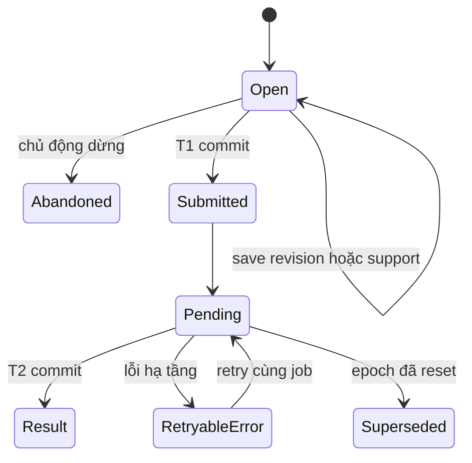
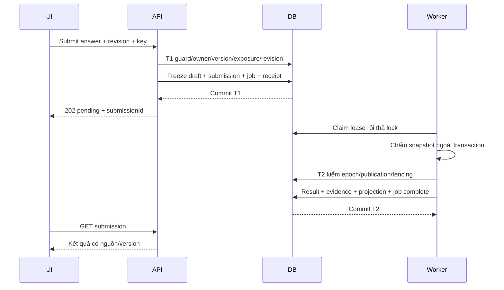

# LLD-03 — Nháp, nộp và chấm bài

> T1/T2 local Learning theo [session MS02](../f10-identity-access/sessions/protocol.md), [publication MS03](../f08-content/publication/protocol.md) và [lifecycle/exposure MS03](../../architecture/lifecycle-recovery-protocol.md). Không shared row xuyên DB. New case/support có `preparing` chờ exposure journal durable, không trả prompt/hint trước ACK; trang này là thiết kế, chưa runtime.

[Mục lục](../../design/README.md) · MD04/11 · REQ-04/05/09/15/16 · BL-R08–13/18–20

## Dữ liệu và trạng thái

| Entity | Quy tắc |
|---|---|
| Attempt | Server chọn case/mode/version/owner; không tin case sạch từ client |
| Draft | Answer/position/revision; sửa bằng compare-and-set |
| SupportExposure | Owner+family xuyên epoch; hint/solution/used không mất khi reset |
| Submission | Một bản mỗi attempt, snapshot answer/version/support bất biến |
| GradeJob | Một job/submission, lease/fencing/retry; lỗi hạ tầng không thành fail learner |
| Result/Evidence | Backend tạo theo rubric; mỗi CAP có tiêu chí riêng |

Đây là state nghiệp vụ để review, enum chính xác thuộc contract task. Abandoned không phải điểm fail; submitted không sửa lại. Learner retry tạo attempt đủ điều kiện mới, khác worker retry cùng job.

## API và hợp đồng lưu

Prefix `/api/v1`: POST `/attempts`; GET `/attempts/{id}`; PUT `/drafts/{id}`; POST `/attempts/{id}/support`, `/abandon`, `/submissions`; GET `/submissions/{id}` và `/receipts/{operation}/{key}`.

Ví dụ payload lưu nháp: `{expectedRevision: 4, answer: <đúng schema bài>, position: <vị trí>}`; idempotency key/context/CSRF ở headers. Owner từ phiên. ACK revision5 chỉ xác nhận snapshot đã gửi, không xác nhận phần người học vừa gõ sau đó. Conflict409 giữ RAM và bản server để learner chọn xử lý.

## Hai transaction của một lần nộp

User lock order auth_account_gate → learner_guard → shared publication gate → resource; T2 learner_guard → publication gate → job/result. Không HTTP/journal trong T1/T2. Lỗi T1 rollback, T2 không partial pass. Lease/retry numeric ở D08 là baseline MS04 phải kiểm; fencing chặn worker cũ. Logout không hủy accepted job; reset/delete epoch/pending chặn resurrection. Publication fence pause finalization, RELEASE áp policy/impact; withdrawn valid grader có thể history-only, invalid rubric không fake pass/fail.

## Quy tắc chấm và lỗi

Mỗi CAP đạt khi mọi tiêu chí cần thiết đúng trong **cùng submission độc lập**. Không cộng mảnh đúng từ hai lần fail. List giữ thứ tự; Map/HashSet không so thứ tự key; list trong grouping vẫn giữ thứ tự. Grader Java xác định, không chạy source learner hoặc AI chấm tự do.

| Tình huống | Kết quả |
|---|---|
| Timeout lúc POST | Tra receipt, retry cùng key/payload nếu cần; không tạo lần nộp khác |
| Same key khác payload | 409 KEY_REUSED |
| Hint chạy đồng thời submit | Learner guard quyết thứ tự; monotonic exposure trước disclose, journal durable trước hint; submit support snapshot đúng |
| Hết hai case chưa biết của nhóm | 409 CASE_EXHAUSTED; luyện tiếp, chưa xác minh mới |
| Worker chết sau tính/trước commit | Lease lại, chỉ một result/evidence nhờ fencing/unique |
| Lỗi input/DB | Không xóa câu trả lời đang tốt hoặc cấp pass tạm |

Kiểm CA-01–14 và LD/AP liên quan bằng fixture expected độc lập; race/fault với PostgreSQL thật; E2E timeout/conflict/hint. Chưa chạy runtime trong thiết kế.

- **LLD-03-A:** phân biệt nháp/bài nộp và conflict có phù hợp không?
- **LLD-03-B:** hai case mỗi nhóm và hành vi hết case có chấp nhận được không?
- **LLD-03-C:** kết quả theo từng CAP, không dùng điểm tổng, có dễ hiểu không?

Nguồn: [S03](data-contract.md), [bộ bài](../f04-assessment/collections/cases.md), [D08](../../delivery/history/implementation-v2.md). Tiếp: [progress](../f05-progress/lld.md).
