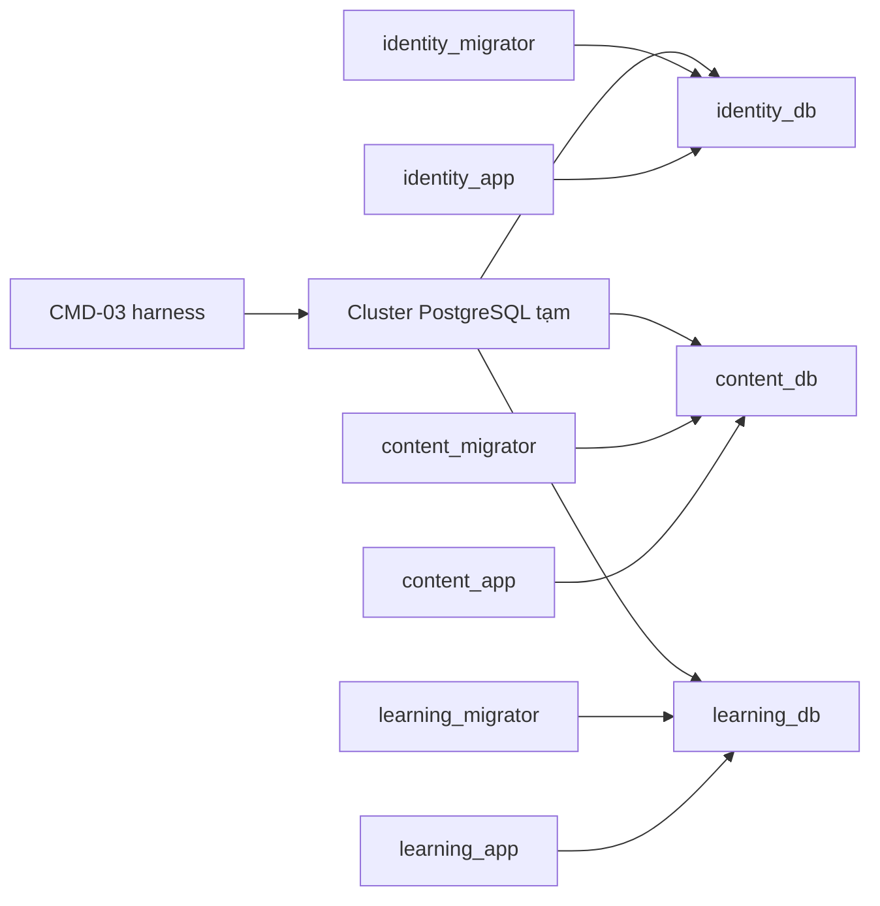

# R02a — Three-DB migration harness

02/10/2026 · MD06 · REQ-09/13/15. [Backlog](../../delivery-backlog.md) giữ brief, AC và trạng thái; [lab README](../../../ops/db-lab/README.md) giữ commands/lifecycle; [backend architecture](../../architecture/backend.md) giữ boundary. Đầu ra là nền DB/migration/test, chưa persistence API, user ownership hoặc security/business release.

## Cấu trúc đã có

Một instance lab có ba database, mỗi database có owner NOLOGIN và hai login roles riêng. Migrator sở hữu schema dịch vụ/migration_metadata; app chỉ đọc marker và DML bảng được cấp. Không role membership, superuser, createDB/createRole/replication/bypassRLS hoặc CONNECT database khác. Canonical data/transaction vẫn thuộc từng service theo MS01; không join/FK/transaction xuyên DB.

Mỗi service có V1 service_descriptor trong main resources và DatabaseIsolationIT riêng. V2 transaction_probe, V3 failed/recovery migration chỉ trong test resources. App bootstrap giữ nguyên Java/config/listener/status, JDBC42.7.13 và Flyway12.4.0 test scope, Failsafe3.5.6 db-it. Không ORM hoặc shared-domain Java.

## Acceptance và bằng chứng

| AC | Expected độc lập | Evidence |
|---|---|---|
| AC01 | Own DB/role, SCRAM, không cross-connect/DDL/escalation | Real server18.6; each app/migrator cross-connect peer DB/postgres/template1 bị42501, role attrs/membership và app DDL/history bị từ chối |
| AC02 | Fresh migrate/rerun/validate/checksum/failure rollback giữ dữ liệu tốt | V1+testV2 thực thi2, rerun0; checksum sai fail; V3 division-by-zero rollback DDL/history, baseline còn; correctedV3 chạy1 rồi0; Flyway clean bị khóa |
| AC03 | Two real connections, kiểm lock/commit/rollback/CAS/timeout; không zero/skip PASS | Latch gửi backendPID, pg_blocking_pids xác nhận row lock trước commit; stale CAS trả0, winner còn; rollback không đọc uncommitted và lock_timeout55P03; strict XML gate từng service |
| AC04 | Own cluster/process/listener dừng, regressions và docs/hash nhất quán | finally success/failure + path/junction/UUID guards, build process-tree timeout, packaged bootstrap regressions, current snapshots/manifest, static review và checkpoint |

CMD-03 all nghiệm thu ngày02/10/2026: runId `74ad6fce-2aa8-4636-8e4f-8b2ba10fc6c9`, command `pwsh -NoProfile -File scripts/services.ps1 -Task db -Service all -Offline`. Exit0, report PASS/clusterStopped=true, port64933 đóng;81 DB IT +96 bootstrap regressions, failures/errors/skips=0. XML đã retain riêng theo run và so với target thực.

| Service | DB IT | Bootstrap Java regression | Packaged JAR smoke |
|---|---:|---:|---:|
| Identity | 27 | 26 | 7 |
| Content | 27 | 28 | 7 |
| Learning | 27 | 42 | 7 |

Required suite phải >0, failures/errors/skips=0. Report XML thật được retain theo run tại ignored artifacts/quality/R02a; không cộng lượt chạy lặp thành coverage mới. Helper tests dùng command/report doubles để kiểm missing/zero/skip/malformed/failure/selector/exit; không thay81 DB IT thật. Helper đạt25 cases; lab guards đạt7 tests kiểm path/marker/link và listener child process timeout, không thay DB transactions. Setup repeat exit0/version18.6; missing-config fixture chạy Failsafe thật từ POM/classes trong ignored thư mục riêng, giữ nguyên actual service reports.

Fixture lỗi trước Maven: runId `7446589c-403e-4fa6-abad-2615505fd09f`, exit1 có chủ ý/report FAIL, clusterStopped=true và port đóng. Không gọi fixture này business CMD-05 PASS. Thiếu lab.config phải làm IT error/nonzero, không tự skip suite. POM/helper giữ selected build riêng; CMD-04–11 chưa có.

Dependency-plugin3.10.0 trees actual offline đều exit0: mỗi service72 artifacts,39compile/33test, computed cache SHA256/source URLs trong own snapshots. Executable JAR vẫn34 runtime libraries; chỉ own V1 SQL vào main resources, không JDBC/Flyway hoặc V2/V3/test classes. Current [manifest](../../../ops/release/dependencies.json) khớp snapshots/JAR smoke hashes. R01 counts/hashes được giữ như checkpoint lịch sử và ignored pre-R02a manifest copies.

## Môi trường và các lỗi đã xử lý

Không Docker/PG tools có sẵn trên runner. Dùng [EDB binaries ZIP](https://www.enterprisedb.com/download-postgresql-binaries), liên kết từ [PostgreSQL Windows](https://www.postgresql.org/download/windows/); exact current build18.6-5, archive384620317bytes, computed SHA256 `e2246ba91d22345bc3d017586c09ede52d9df180b1eeb480f050445f1cad84e2`. [Pin/hashes](../../../ops/release/postgresql.json) ghi nguồn và runtime files; setup repeat kiểm cache/version18.6. Publisher checksum/signature chưa xác minh. Bản18.6-1 từng tải khi tìm URL không được chọn hoặc chạy.

Default sandbox launch báo restricted-token87/start3; không có listener, không PASS. Outside-sandbox launch được phép hoạt động; đây là điều kiện runner, chưa kết luận nguyên nhân Windows cụ thể. Lần đầu pg_ctl stdout PIPE khiến Python chờ EOF do child server kế thừa handle: cluster đó đã được kiểm ownership và stop rõ ràng, report FAIL. Harness hiện ghi trực tiếp ra file và timeout dừng process tree do nó tạo. Path guard từ chối data junction trước stop. Sandbox không cho dừng tree trong một guard fixture; kết quả PASS chỉ ghi cho host environment tương ứng lab, thất bại sandbox không bị coi là PASS.

JDK21 Windows vẫn dùng process-local `jdk.net.unixdomain.tmpdir` dưới .tools/jvm-ipc-sockets theo evidence R01b–d; default selector được giữ. Không thay registry/PATH hệ thống, Windows service, FE package/lock/framework hoặc Java bootstrap. Cluster mới ở workspace, không reset dữ liệu học hoặc recursive delete. Credentials ngẫu nhiên chỉ file ignored/child environment, không argv/report/source. SCRAM authentication trên loopback; JDBC sslmode=disable chỉ lab tạm, không production TLS.

## Giới hạn và handoff

DB lab này kiểm quyền/migrations/transaction fixtures; SEC-26 mới đạt phần DB roles, chưa SQL/sort allowlist business của R09. Các SEC/DATA gate còn lại không được cấp PASS từ fixture kỹ thuật. Chưa account/session/owner, catalog/publication/work/grader/progress, HTTP/mTLS, auth gates/token tables hoặc app persistence connection. MarkerV1 không giả auth schema đã có. V2/V3 hiện là fixture-only versions, không đặt trước sequence nghiệp vụ; task thêm production migrations phải cập nhật namespace/expected fixture để không collision (R03/R04/R06 và owners sau).

[PostgreSQL18.6 release/security notes](https://www.postgresql.org/docs/18/release-18-6.html) và [privileges](https://www.postgresql.org/docs/18/ddl-priv.html), [Flyway transaction handling](https://documentation.red-gate.com/fd/migration-transaction-handling-273973399.html), [PostgreSQL support](https://documentation.red-gate.com/fd/postgresql-database-277579325.html) và [JDBC options](https://jdbc.postgresql.org/documentation/use/) đã đối chiếu nguồn primary. Đây không full SCA/SBOM/signature verification. Linux/Compose/container/image/TLS/load/CI R31, backup/restore/recovery R32 và provider qualification giữ owner riêng.

R02a đạt chỉ khi AC/checkpoint kết thúc; R02 parent chờ R02b/c. Leaf kế tiếp **BL-R02b — trusted listeners/service test harness**. Không tự triển khai leaf kế tiếp trong lượt R02a.

Mốc R02a phía trên giữ lịch sử. R02b chuyển PostgreSQL JDBC sang runtime cho own-DB clock, bổ sung transport/common-wire và chạy lại CMD-03; [R02b review](../service-trust/verification.md) giữ current artifact/dependency/evidence, không rewrite số/hash mốc R02a.
