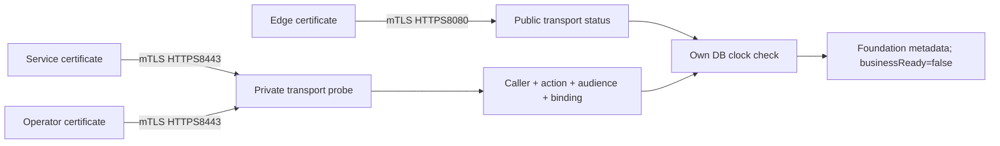

# R02b — Service trust, cấu hình và wire

02/10/2026 · Technical foundation của Identity/Content/Learning. Trạng thái duy nhất ở [backlog](../../delivery-backlog.md). Tài liệu này nối implementation với R02b-AC01–04; không nghiệm thu login, quyền owner, INT-01 admission, edge deployment hoặc R1.

## Hành vi và ranh giới

Mỗi service có profile explicit `transport` cho lab, public HTTPS8080 chỉ nhận edge certificate và private HTTPS8443 chỉ nhận service/operator theo action. `bootstrap` giữ HTTP loopback cũ; `lab`/`pilot` Compose chưa được triển khai. Cả hai transport endpoint luôn báo `businessReady=false`.



Service được test lần lượt trên cùng host để dùng đúng8080/8443; đây chưa là ba container chạy đồng thời. Harness kiểm cổng trống trước start, không dừng process của người dùng. Edge trong sơ đồ là certificate fixture, chưa là proxy Nginx thật.

| Receiver | Caller | Action ở probe |
|---|---|---|
| Identity | Content, Learning | ADMISSION_TRANSPORT |
| Content | Identity | FENCE_TRANSPORT |
| Content | Learning | BUNDLE_TRANSPORT |
| Learning | Identity | FENCE_TRANSPORT |
| Learning | Content | PUBLICATION_TRANSPORT |
| Cả ba | Operator | OPS_TRANSPORT |

Tên action thể hiện kiểm boundary. Chúng không thực hiện admission/fence/bundle/publication/maintenance nghiệp vụ. Certificate chứng minh caller; quyền domain phải được thêm tại task tương ứng.

## Implementation và cấu hình

Own `transport/` package trong từng service có `TransportSettings`, `CertificateIdentity`, `TransportConfiguration`, `TransportBoundaryFilter`, `TransportPeerClient` và `WireCodec`; không import source/domain service khác. JDBC PostgreSQL42.7.13 chuyển từ test sang runtime để lấy clock ở own app role; Flyway12.4.0 vẫn test-scoped, app không migrate DB. Framework/JDK/Maven/Tomcat pins giữ nguyên.

Transport config bắt buộc `--backendlab.trust.config=<owned fixture>`. Marker và real paths phải nằm trong immediate `.tools/trust-lab/run-*` của workspace. Properties đúng schema/service/env/run, realm/generation/DB-run UUID, store/password/DBport và controlled test clock offset; thiếu/sai thì không mở protected listener. Realm/generation mới chỉ kiểm shape và lab bundle; chưa chứng minh restore generation hay canonical realm với Identity. Own DB run marker được đối chiếu qua SQL trên PostgreSQL thật.

PKI generator `scripts/trust_lab.py` dùng keytool của pinned JDK21: unique test CA, EC leaves, URI SAN `spiffe://backend-lab/lab/<identity>`, hostname/IP SAN và EKU. Server leaf phải đúng own service, chain/trust CA/date và cả serverAuth/clientAuth. Client phải qua TLS chain/date/clientAuth và receiver kiểm đúng một URI SAN/env/identity. Outbound thêm expected receiver URI SAN, serverAuth và HTTPS hostname verification. CN không cấp quyền.

Root signing stores được xóa đúng file trong fixture sau khi cấp leaf, trước app start. Public CA và leaf fixtures giữ trong ignored cache để review. Fixture chứa nhiều leaf private keys phục vụ test sai caller; chưa chứng minh per-service secret mount isolation của deployment. Không cài CA vào Windows/browser hoặc đóng gói key/cert/password trong JAR/source.

Public chỉ có GET `/api/v1/transport/status`; private chỉ có POST `/internal/v1/transport/probes`. Internal/business/bootstrap/Actuator route khác bị từ chối. Cookie/Origin không xác thực service, forged identity/owner/context/forwarded headers bị từ chối. Query, escaped/ambiguous path bị chặn. Filter error envelope JSON/no-store/no-cookie/redacted; native TLS/framing errors có thể do container xử lý, chưa là toàn bộ public API error contract.

## Clock, thời hạn và outbound

Clock lấy `clock_timestamp()` cùng database/user/DB-run marker qua own app credential. Connection/socket/query có budget1s; sample SQL round trip≤1s, DB timestamp nằm giữa JVM-before−500ms/JVM-after+500ms. JVM đảo chiều, DB thiếu/unavailable/wrong owner/run hoặc drift vượt budget thì startup fail hoặc response503. JVM class loading/connection setup không được tính thành sample SQL; không nới drift/sample khi cold start chậm.

Probe yêu cầu issuedAt không vượt DB-now+500ms, TTL≤15s và validUntil **lớn hơn** DB-now+6500ms (6s processing reserve+500ms safety). Case6500ms bị từ chối,6501ms được chấp nhận ở pure boundary test. Đây chưa là canonical Identity-issued admission, idle/absolute expiry, distributed logout hoặc multi-replica clock oracle.

Peer client chỉ nhận receiver allowlist và fixed lab URI `https://127.0.0.1:8443/internal/v1/transport/probes`. Connect1s, probe toàn response2s, payload/request/response≤64KiB, không redirect hoặc application retry; timeout/cancel đóng subscription. Chưa có general business call5s vì chưa có endpoint đó. Actual fault server kiểm302,503, quá cỡ và body giữ chậm bằng latch. Rotation với connection đang tồn tại/production DNS/Compose là R31.

## Wire layers đã có

[Common contracts](../../../contracts/http/common/README.md) giữ schemas, registry và independent binding example. Own validators thực thi quy tắc; chưa qualification bằng một JSON Schema engine hoặc OpenAPI đầy đủ.

| Case | R02b thực thi | Owner còn lại |
|---|---|---|
| WIRE-01 | BIGINT decimal string, canonical/nonnegative≤Long.MAX_VALUE, không number coercion | Field semantics tại API business |
| WIRE-02 | Strict UTF8, duplicate decoded keys, surrogate/trailing JSON/depth/size | Endpoint-specific payload/framing |
| WIRE-03 | Error envelope/redaction và trạng thái PENDING/COMPLETED/FAILED | Error/status contract tại API/FE/edge |
| WIRE-04 | Canonical UUID key shape | R09/R11 receipt, retry/concurrency/exactly-once effect |
| WIRE-05 | Bounded printable opaque cursor shape | R21 owner/epoch/filter/signature/rotation/paging |
| WIRE-06 | Unsupported major/state fail closed, additive optional response field; probe version/time/binding | Endpoint operation durability/compatibility registry R31c |

SEC-14/15/20 ở đây chỉ receiver/common transport layer. CSRF/session/admission/fences và actual edge case vẫn pending theo [test-release](../../delivery/test-release-plan.md). Không chuyển trạng thái full SEC/WIRE case sang PASS từ các lớp này.

## Lệnh kiểm và evidence

Chạy từ repo root, Windows x64 đã có portable JDK/PG và Maven cache:

```powershell
pwsh -NoProfile -File scripts/services.ps1 -Task contract -Service all -Offline
pwsh -NoProfile -File scripts/services.ps1 -Task fault -Service identity -Case SEC-15 -Offline
pwsh -NoProfile -File scripts/services.ps1 -Task db -Service all -Offline
pwsh -NoProfile -File scripts/tests/backend-build.Tests.ps1 -EvidenceTask R02b
python -X utf8 scripts/tests/db_lab.Tests.py
```

Bỏ `-Offline` khi cần resolve dependency. CMD-04 chạy toàn bộ owned receiver/common layer của service được chọn; optional supported `-Case` không thay thành full business-case suite. CMD-05 bắt buộc SEC-14/15/20 và lọc JUnit tag thật. Unknown/missing/unimplemented case trả nonzero trước provisioning. Missing config/suite,0 tests, required skip/error/failure không PASS. CMD-06–11 và canonical security/data cases chưa có.

CMD-04/05 build từng own artifact rồi chạy transport suite với **`java -jar` từ empty working directory** trong owned fixture; TLS receiver/caller/peer checks kiểm executable runtime thật. Startup-config negative kiểm own SpringApplication in-process; pure wire validators chạy ở test JVM; client network faults dùng actual JDK HTTPS fixture sau khi đóng receiver. Bootstrap unit regression giữ riêng. Failsafe direct mặc định có thể dùng in-process receiver; evidence managed commands ghi rõ packaged mode. `ARTIFACT_TRANSPORT` log giữ artifact SHA256/cwd/PID, finally đóng process/listeners/PG. Report/XML/input source hashes retain theo run trước build sau ghi đè target. Không cộng nhiều rerun thành coverage mới.

Kết quả thực (Windows x64,02/10/2026):

| Kiểm tra | Kết quả/evidence |
|---|---|
| CMD-04 packaged all | Exit0; run `5f9a3d8f-3045-4803-9ac5-3fc6aec1d483`; Identity46transport+29wire+26bootstrap, Content46+29+28, Learning46+29+42;225IT+96bootstrap,0fail/error/skip |
| CMD-05 SEC-15 Identity | Exit0; run `5f0968d0-6794-415d-b2b9-7d3c99802a01`;18tagged IT+26bootstrap,0fail/error/skip. SEC14/20 ran within CMD04; separate CMD05 selectors chưa chạy |
| CMD-03 regression all | Exit0; run `070dbb08-b070-4d59-b6f1-0921ec7da045` ở artifacts/quality/R02a;81real DB+96bootstrap,0fail/error/skip |
| Packaged bootstrap smoke | Exit0 mỗi service;7checks/service,21 tổng; all owned Java processes/listeners stopped |
| Missing trust config actual Failsafe | Expected exit1, required-reason confirmed; TransportTrustIT errors before DB/TLS, Wire29pass; isolated fixture, không sửa positive reports |
| Helper report/selector gates | Exit0;38isolated command/report cases; không substitute TLS/DB proof |
| DB/PKI path/process guards | Exit0;8cases, includes trust root junction refused before writing và owned child-tree timeout cleanup |
| Trees/artifacts | Actual dependency-plugin3.10.0 exit0 ba service;72artifacts/service (40compile/1runtime/31test),36runtime libs. JDBC42.7.13+checker qualifier vào runtime; Flyway/fixtures/test/PKI không vào JAR |

Logs/XML/reports/input hashes ở `artifacts/quality/R02b/<runId>/`; helper/static/missing-config/smoke ở R02b root. Release snapshots/manifest giữ current artifact/dependency hashes. Các JAR đúng bytes đã qua CMD04 được retain trước clean fault/DB builds, rồi restore byte-for-byte vào target sau khi xác nhận input hashes không đổi; bootstrap smoke kiểm chính bytes đó. Không coi JAR rebuild có hash mới là cùng qualified digest chỉ từ source giống nhau. Retained candidates và proof ở `qualified-artifacts/`/`qualified-artifacts.json`.

Hai failed all-runs giữ report FAIL/cleanup stopped, không cộng thành coverage: `e9cbf78b-98a5-4c17-9825-bddb09fc0e76` có future-time fixture dùng timestamp trước HTTP-call trước đó, sửa capture mới+60s một lần; `30cd5afe-35c0-424c-8931-92c340870e84` Identitypass nhưng Content startup clock budget rejected, phép đo cũ bao cả connection setup. Đã đặt sample quanh SQL round trip với budgets giữ nguyên; current all-run PASS. Initial Identity-only exploratory `d79ae1af-cab8-4b7f-936e-2f8ebc24bfdb` không thay final three-service proof. Không kết luận nguồn clock drift hoặc root cause Windows ngoài quan sát.

Static scope/link/ID/DAG/hash/secret/closed-port review ghi `static-review.log`; checkpoint backlog ghi kết quả cuối và handoff. Source/boundary review không còn finding P0/P1 trong R02b foundation; không full-system security hoặc release approval.

## Nguồn implementation và giới hạn

Đã đọc [Boot web server how-to](https://docs.spring.io/spring-boot/how-to/webserver.html), [Tomcat factory API](https://docs.spring.io/spring-boot/api/java/org/springframework/boot/tomcat/servlet/TomcatServletWebServerFactory.html), [Tomcat11 SSL](https://tomcat.apache.org/tomcat-11.0-doc/ssl-howto.html)/[connector](https://tomcat.apache.org/tomcat-11.0-doc/config/http.html), [JDK21 extended trust manager](https://docs.oracle.com/en/java/javase/21/docs/api/java.base/javax/net/ssl/X509ExtendedTrustManager.html) và [X509 certificate](https://docs.oracle.com/en/java/javase/21/docs/api/java.base/java/security/cert/X509Certificate.html). Local compile/runtime proof áp dụng các API thực của versions đã pin; nguồn không thay executable qualification.

Windows runner dùng process-local `jdk.net.unixdomain.tmpdir` như R01; không đổi selector/JDK/system PATH/trust. Default-temp/Linux/container chưa qualified. DB loopback lab dùng SCRAM, chưa production DB TLS. Không auth credentials/session/user/owner/store/API học, outbox/journal/backup/recovery, Compose, full SCA/SBOM/scan/release/learner test. FE và main migration/IDs không thay.
