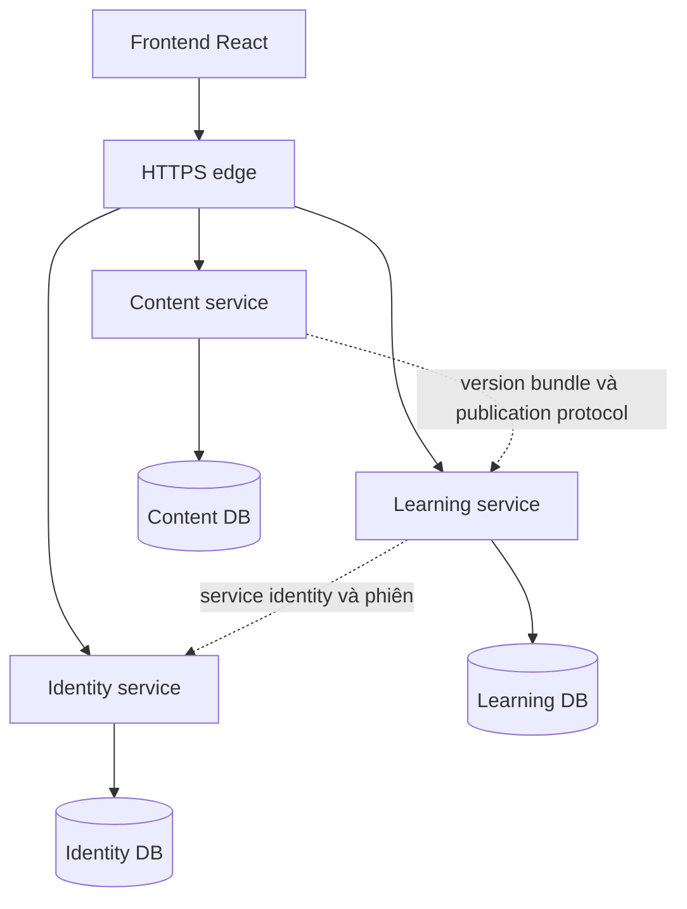

# System overview v2 — nền tảng học nhiều người dùng

26/09/2026. Thay thế thiết kế R1 chỉ lưu local theo yêu cầu mới: backend, login/logout, lưu bài tập và tiến độ theo tài khoản; hai roadmap Java Backend và DevOps. Người dùng đã chọn **admin ở giai đoạn sau**. Đây là thiết kế, chưa triển khai code. Nguồn phạm vi: [requirements](product-requirements.md), [business](business-design.md), [backlog](delivery-backlog.md).

## 1. Kiến trúc đích sau yêu cầu microservices

Ngày 30/09/2026 người dùng chọn backend microservices. [ADR-03/review](architecture/microservices-review.md) thay ADR-01 một-app/shared-DB; [service catalog MS01](architecture/service-boundaries.md) chốt ownership/API và [architecture BE](architecture/backend.md) giữ cây source đích. R00 đã chuyển FE vào frontend/, backend có README, chưa có service Java.

Thiết kế chốt ba service nghiệp vụ: Identity (user/session), Content (catalog/version/publish), Learning (nháp/chấm/evidence/progress). Mỗi service có database/role/build artifact riêng; cùng một repo, có thể dùng chung PostgreSQL instance local nhưng không truy cập chéo DB. Edge reverse proxy cung cấp HTTPS/cùng origin, không chứa nghiệp vụ. Worker chấm ở Learning để T1/T2 vẫn local atomic.

MS01–04 thiết kế: [catalog](architecture/service-boundaries.md), [session](features/f10-identity-access/sessions/protocol.md)/[security](architecture/security-design.md), [data](architecture/data-protocols.md), [implementation plan](delivery/implementation-plan.md)/[test-release](delivery/test-release-plan.md). Ba artifacts/DB/mTLS, parent-leaf tasks/SEC-DATA/REL gates và ops/qualification/recovery có owner. Outline anonymous/body login/private disclosure journal; runtime/CODE chưa có.

## 2. Phạm vi từng mốc

| Mốc | Đầu ra |
|---|---|
| R0 điều chỉnh | Hợp đồng tài khoản/quyền, bài nộp/progress server, roadmap DevOps, mẫu Collections, UX và thiết kế kỹ thuật |
| R1 | Nhiều tài khoản login/logout; hai roadmap ở mức đề cương; mẫu Collections trọn luồng; lưu nháp/nộp bài/lịch sử/progress server; tiếp tục thiết bị khác sau khi đã lưu |
| R2 theo nhánh | Mở rộng nội dung hai roadmap; admin quản lý tiến độ/bài nộp theo phạm vi được duyệt, không cần đợi viết xong toàn khóa |
| R3 theo nhu cầu | Lab thật và runner cô lập, có hợp đồng thực thi riêng |

R1 không hứa mọi bài đã có nội dung. Community, leaderboard, thanh toán, AI tutor, CMS giao diện đầy đủ và file upload tùy ý chưa thuộc bản đầu.

## 3. Tài khoản và quyền

- Learner chỉ đọc/sửa nháp, nộp bài, xem lịch sử và export dữ liệu của mình. Backend lấy danh tính từ phiên xác thực, không tin `userId`, role hoặc `passed=true` của client.
- Login tạo phiên; logout ngừng admission, fence Content/Learning, completed sau đủ ACK rồi loại dữ liệu tài khoản khỏi cache hiển thị. Pending/partition khóa UI nhưng không báo complete. Request cũ không được gắn sang user mới; logout/status không late-clear cookie phiên mới theo MS02.
- [Identity/access v1](features/f10-identity-access/business.md) chốt pilot cấp tài khoản bằng lời mời, loginName/mật khẩu, reset qua kênh operator gốc, logout hiện tại/logout-all; admin UI vẫn sau R1. Chưa mở signup công khai.
- Web cùng origin opaque cookie/CSRF/online admission/local fences theo [MS02](features/f10-identity-access/sessions/protocol.md); [MS04 plan](delivery/implementation-plan.md) giữ stack/listener/cert/key/task/test contract. [R04a](features/f10-identity-access/sessions/verification.md) có local Identity authority/opt-in lab TLS/browser harness; nghiệm thu từng candidate theo registry/evidence. Receiver/coordinator R04b–d, FE R24a–c và production edge còn phía sau; không suy end-to-end auth đã đạt.
- Admin chưa bật trong R1. Phạm vi đề xuất sau: xem học viên, lọc tiến độ, xem bài nộp, ghi nhận xét. Sửa kết quả nếu được cho phép phải tạo review/evidence mới có actor/lý do/thời gian và giữ bản cũ; không sửa mất lịch sử.

Nguồn kỹ thuật đọc 26/09/2026: [Spring Security session management](https://docs.spring.io/spring-security/reference/servlet/authentication/session-management.html), [logout](https://docs.spring.io/spring-security/reference/servlet/authentication/logout.html). Chưa là cấu hình đã kiểm chứng trong app.

## 4. Lưu trữ bài tập

| Dữ liệu | Nội dung | Quy tắc |
|---|---|---|
| Exercise/ExerciseVersion | Đề, case, rubric, hint/lời giải theo version | Published bất biến; sửa tạo version mới; API kiểm soát khi nào trả đáp án |
| Draft | Câu trả lời/code text, vị trí đang làm, revision | Theo user + bài/version; autosave chỉ báo đã lưu khi server xác nhận |
| Submission/Attempt | Snapshot câu trả lời, mức hỗ trợ, đề/rubric version, thời gian | Giữ lịch sử; lần làm lại mới có attempt mới; retry cùng request không nhân bản |
| AssessmentResult/Evidence | Kết quả từng CAP, tiêu chí, nguồn bằng chứng | Backend đánh giá/xác minh; client không tự cấp mastery |
| Progress | Đã xem, đã chứng minh, đã áp dụng, cần ôn | Theo user + TOP/CAP; cùng nội dung giữa roadmap chỉ tính một lần |
| Review/Audit tương lai | Nhận xét/đánh giá lại/thao tác admin | Actor và lý do; bảo toàn submission/evidence cũ |

R1 nhận câu trả lời có cấu trúc và text/code, chưa nhận archive/file thực thi. Attachment/object storage sẽ thiết kế khi cần upload thật. Đề bài và bài người học nộp là hai đối tượng khác nhau.

Nội dung ban đầu có thể biên soạn/review trong repo rồi nhập thành version vào backend qua quy trình xuất bản kiểm soát. DB/API là nguồn published khi chạy; không giữ hai catalog runtime độc lập. Admin CMS không phải dependency R1.

[S03](features/f11-learner-work/data-contract.md) business owner/evidence; [publication](features/f08-content/publication/protocol.md) STAGE/FENCE/COMMIT/RELEASE; [recovery](architecture/lifecycle-recovery-protocol.md) exposure/intent journals/three-DB restore. MS04 chọn verified baseline Java21/Boot4.1.1/Maven3.9.16/PG18.6, actual digest/advisory theo leaf; S3 API adapter production phải qualified, local journal lab không proof off-host. T1/T2 local Learning/pinned replica/no cross-DB FK; D08 một-app chỉ lịch sử. Chưa DB/service runtime.

## 5. Nộp bài và bảo toàn dữ liệu

1. Backend xác thực phiên, quyền đối với draft và bài/version.
2. Nhận đáp án cùng mã chống nộp trùng; kiểm tra contract và mức hỗ trợ đã ghi nhận, không lấy trạng thái pass của client làm kết quả.
3. Ghi submission bất biến, chấm theo rubric được ghim, cập nhật evidence/progress nhất quán. Chấm lỗi giữ pending/error, không ghi fail giả.
4. Trả kết quả từng CAP và trạng thái lưu; UI cập nhật progress chính thức từ server.
5. Thiết bị khác đọc dữ liệu đã lưu. Hai tab sửa nháp dùng revision/conflict, không để bản cũ âm thầm ghi đè.

Mất mạng: có thể tiếp tục mô phỏng và giữ nháp RAM đúng user; chưa gửi server phải hiện chưa lưu/chưa xác nhận. R1 chưa lưu nháp cá nhân xuống localStorage/IndexedDB. Sau login lại kiểm đúng chủ nháp/context trước retry. Logout không gửi được tới server khóa UI và báo chưa xác nhận thu hồi phiên; không chỉ xóa UI rồi tuyên bố logout server thành công.

Import validate quyền/nguồn/version, preview rồi merge atomic thành nháp mới/lịch sử unverified; không replace hoặc nhập official pass từ file. Reset dữ liệu học là xóa toàn dữ liệu học của tài khoản sau xác nhận/reauth, giữ tài khoản và exposure đáp án; ghi journal phục hồi ngoài snapshot trước khi tăng epoch chặn tác vụ cũ; trong lúc chờ chỉ báo processing, chưa báo đã xóa. Học lại thường chỉ tạo attempt mới. Chính sách cleanup/backup và nguồn dữ liệu legacy theo BL-S03.

## 6. Hai roadmap

Java Backend và DevOps là hai đường học riêng. Docker thuộc DevOps. Java Backend dẫn sang Docker/CI/CD/vận hành thiết yếu đúng mốc project, dùng lại TOP/CAP; không xóa mục tiêu deploy/vận hành khỏi Backend và không bắt người học DevOps học hết Java.

Xem [devops-learning-path.md](curriculum/devops-learning-path.md) và [catalog BL-S04](curriculum/devops-catalog.md). DS là ID chặng DevOps, không thay TOP/CAP/K/S/P đã có. Catalog đã nối 12 chặng và DP0–DP5, bổ sung 17 TOP/34 CAP, tháo prerequisite Java khỏi vận hành dùng chung; R1 vẫn chỉ đưa DevOps lên mức outline, chưa biên soạn toàn khóa.

## 7. Kiểm tra bắt buộc khi triển khai

- Hai user A/B: GET/list/save/submit/export/history của A không cho B truy cập bằng đổi ID hoặc đường gián tiếp.
- Login/logout/expired session; cache và request cũ không lộ dữ liệu sau đổi tài khoản; kiểm quyền server.
- Retry/nộp trùng, hai tab sửa, lỗi DB giữa submission/evidence/progress, mất mạng và khôi phục.
- Đổi version giữa lúc làm: giữ version của attempt hoặc yêu cầu chuyển có giải thích; không âm thầm chấm rubric khác.
- Import sai/khác owner/giả evidence; backup/restore DB trên môi trường riêng, không chỉ export frontend.
- Quy tắc D05 về ba chiều và nội dung dùng chung vẫn áp dụng, bổ sung owner/server authority/pending.

Đây là tiêu chí thiết kế, chưa là test backend đã chạy.

## 8. Bàn giao

Giữ frontend/schema/draft hiện có làm tài sản. D05 giữ business năng lực nhưng cập nhật local theo server authority; D06a giữ kiến thức Collections. D06b/D07 nhận contract identity/submission mới; D08 lập lại task triển khai backend/DB/auth/frontend. Backlog local-only BL-I01–14 là lịch sử để đối chiếu, không tự thực thi. Chưa sửa source hoặc cài dependency trong đợt đổi thiết kế này.
